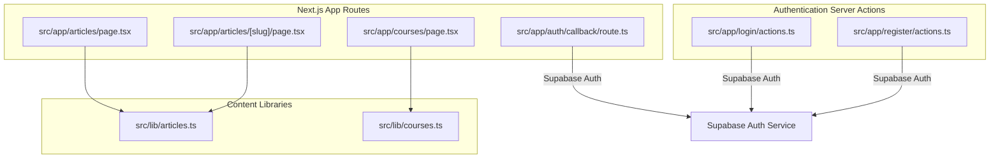
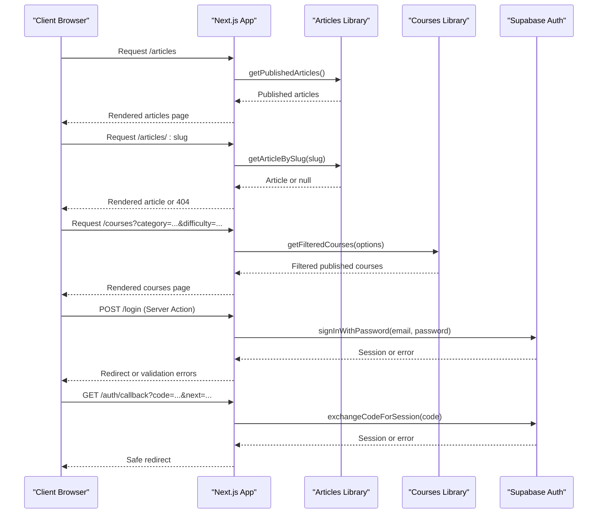
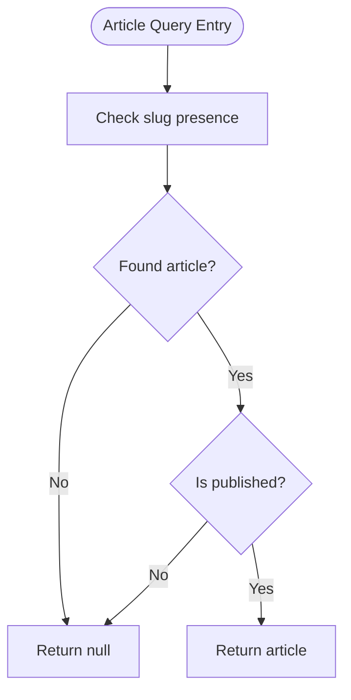
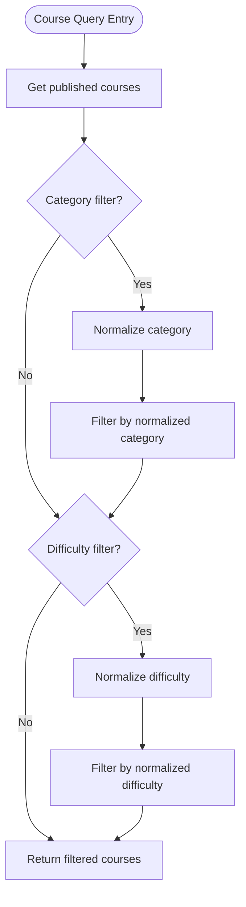
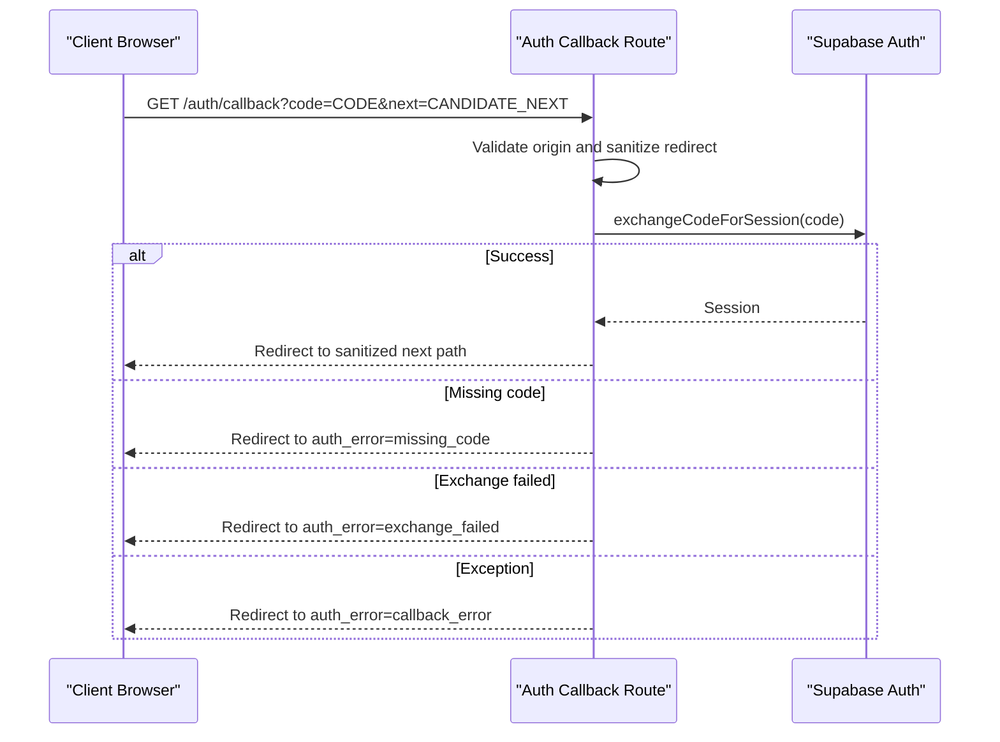
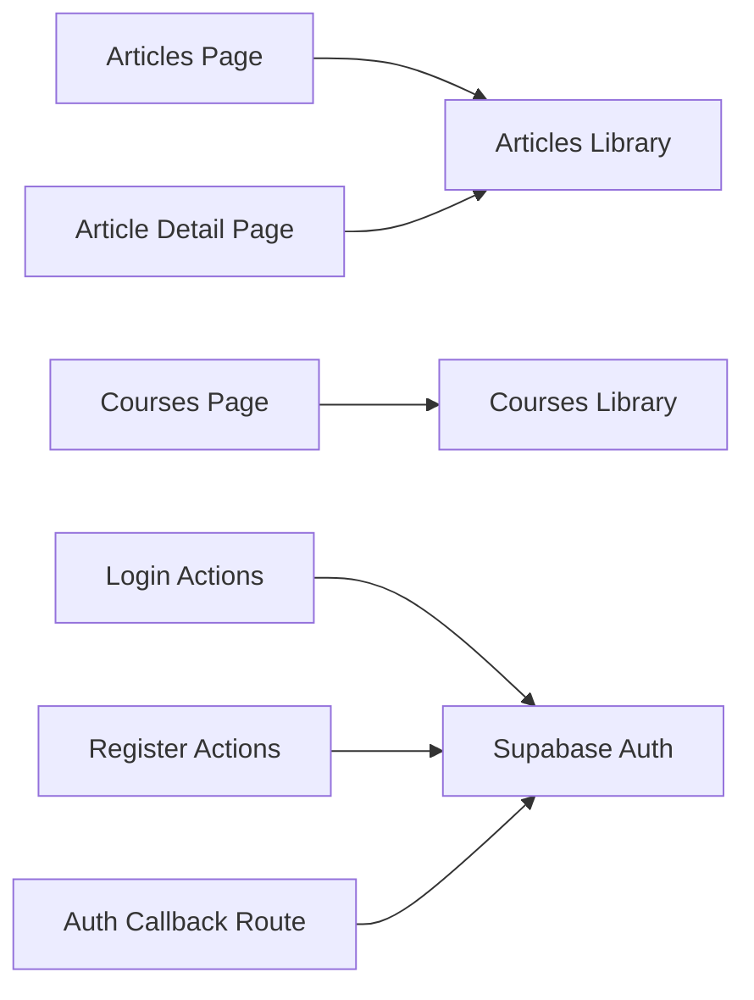

# API Reference

<cite>
**Referenced Files in This Document**   
- [articles.ts](file://src/lib/articles.ts)
- [courses.ts](file://src/lib/courses.ts)
- [Articles Page](file://src/app/articles/page.tsx)
- [Article Detail Page](file://src/app/articles/[slug]/page.tsx)
- [Courses Page](file://src/app/courses/page.tsx)
- [Auth Callback Route](file://src/app/auth/callback/route.ts)
- [Login Actions](file://src/app/login/actions.ts)
- [Register Actions](file://src/app/register/actions.ts)
</cite>

## Table of Contents
1. [Introduction](#introduction)
2. [Project Structure](#project-structure)
3. [Core Components](#core-components)
4. [Architecture Overview](#architecture-overview)
5. [Detailed Component Analysis](#detailed-component-analysis)
6. [Dependency Analysis](#dependency-analysis)
7. [Performance Considerations](#performance-considerations)
8. [Troubleshooting Guide](#troubleshooting-guide)
9. [Conclusion](#conclusion)
10. [Appendices](#appendices)

## Introduction
This document describes SwimNigeria’s public-facing data access patterns and server-side interfaces. The application is a Next.js project that currently exposes content through server components and React Server Actions rather than a traditional REST API layer. Data for articles and courses is stored as strongly typed local registries, while authentication integrates with Supabase Auth using PKCE-style email flows.

The primary integration points are:
- Article data access functions used by article pages.
- Course registry functions used by the course catalogue page.
- Authentication server actions for login and registration.
- An authentication callback route that exchanges authorization codes for sessions.

Clients should treat these files as the authoritative implementation surface when integrating with SwimNigeria’s current architecture.

## Project Structure
At a high level, the relevant parts of the repository are organized into:
- Content libraries under `src/lib` for articles and courses.
- Next.js app routes under `src/app` for pages, authentication callbacks, and server actions.
- UI components under `src/components`.
- Tests under `src/__tests__`.

**Diagram sources**
- [articles.ts:181-242](file://src/lib/articles.ts#L181-L242)
- [courses.ts:1033-1247](file://src/lib/courses.ts#L1033-L1247)
- [Articles Page:25-29](file://src/app/articles/page.tsx#L25-L29)
- [Article Detail Page:13-46](file://src/app/articles/[slug]/page.tsx#L13-L46)
- [Courses Page:32-44](file://src/app/courses/page.tsx#L32-L44)
- [Auth Callback Route:24-55](file://src/app/auth/callback/route.ts#L24-L55)
- [Login Actions:45-193](file://src/app/login/actions.ts#L45-L193)
- [Register Actions:45-204](file://src/app/register/actions.ts#L45-L204)

**Section sources**
- [articles.ts:1-242](file://src/lib/articles.ts#L1-L242)
- [courses.ts:1-1346](file://src/lib/courses.ts#L1-L1346)
- [Articles Page:1-168](file://src/app/articles/page.tsx#L1-L168)
- [Article Detail Page:1-206](file://src/app/articles/[slug]/page.tsx#L1-L206)
- [Courses Page:1-367](file://src/app/courses/page.tsx#L1-L367)
- [Auth Callback Route:1-61](file://src/app/auth/callback/route.ts#L1-L61)
- [Login Actions:1-252](file://src/app/login/actions.ts#L1-L252)
- [Register Actions:1-224](file://src/app/register/actions.ts#L1-L224)

## Core Components
SwimNigeria’s current public interface surface consists of:
- Article query helpers that return published articles, category-filtered lists, related articles, and categories.
- Course registry helpers that return published courses, filtered courses, syllabi, preview lessons, and lesson resolution utilities.
- Authentication server actions for learner login, logout, and registration.
- A PKCE-style authentication callback route that exchanges authorization codes for sessions and performs safe redirects.

These components are not HTTP endpoints in the traditional sense; they are server-side functions invoked by Next.js server components or form actions.

**Section sources**
- [articles.ts:181-242](file://src/lib/articles.ts#L181-L242)
- [courses.ts:1033-1345](file://src/lib/courses.ts#L1033-L1345)
- [Login Actions:45-251](file://src/app/login/actions.ts#L45-L251)
- [Register Actions:45-223](file://src/app/register/actions.ts#L45-L223)
- [Auth Callback Route:24-55](file://src/app/auth/callback/route.ts#L24-L55)

## Architecture Overview
The system follows a layered pattern:
- Pages read data from content libraries.
- Content libraries filter and sanitize draft content before returning it to pages.
- Authentication flows use Supabase Auth via a server client.
- Redirects are sanitized against a trusted application origin to prevent open-redirect vulnerabilities.

**Diagram sources**
- [Articles Page:25-29](file://src/app/articles/page.tsx#L25-L29)
- [Article Detail Page:13-46](file://src/app/articles/[slug]/page.tsx#L13-L46)
- [Courses Page:32-44](file://src/app/courses/page.tsx#L32-L44)
- [Login Actions:104-193](file://src/app/login/actions.ts#L104-L193)
- [Auth Callback Route:24-55](file://src/app/auth/callback/route.ts#L24-L55)

## Detailed Component Analysis

### Article Data Access Pattern
The article subsystem provides:
- A typed article model with slug, title, summary, category, read time, publication status, publication date, and structured sections.
- A published-only list sorted by publication date descending.
- Slug-based lookup that returns null for missing or unpublished articles.
- Category filtering with normalized comparison.
- Related article selection that prefers same-category items but falls back to other categories.
- Distinct category enumeration.

#### Public Functions
| Function | Parameters | Return Type | Behavior |
|---|---|---|---|
| `getPublishedArticles` | None | `Article[]` | Returns published articles sorted newest first. |
| `getArticleBySlug` | `slug: string` | `Article \| null` | Returns a published article by slug, or null if missing or unpublished. |
| `getArticlesByCategory` | `category: string` | `Article[]` | Returns published articles matching the normalized category; `"all"` or empty returns all published. |
| `getRelatedArticles` | `currentSlug: string`, `category: string`, `limit?: number` | `Article[]` | Returns related published articles excluding the current article, preferring same category. |
| `getCategories` | None | `ArticleCategory[]` | Returns distinct categories from published articles. |

#### Validation Rules
- Slugs are expected to be URL-safe identifiers.
- Categories are normalized by lowercasing and removing non-alphanumeric characters before comparison.
- Draft articles (`published: false`) are excluded from public queries.
- Unknown categories return an empty array rather than throwing.

#### Error Handling
- Missing slugs return `null`.
- Unpublished slugs return `null`.
- The article detail page converts missing or unpublished results into a Next.js 404 response.

#### Request/Response Examples
Because this is not an HTTP endpoint, request/response examples describe function calls and returned structures:
- Call `getPublishedArticles()` → returns an array of published articles.
- Call `getArticleBySlug("overcoming-fear-of-water-adult-beginners")` → returns the corresponding published article object.
- Call `getArticlesByCategory("water-safety")` → returns published water safety articles.
- Call `getArticleBySlug("non-existent-article")` → returns `null`.

#### Caching Strategy
- The library reads from a local readonly data array.
- There is no built-in in-memory cache or external cache layer.
- Performance depends on the size of the local dataset and the cost of filtering/sorting operations.

**Diagram sources**
- [articles.ts:190-199](file://src/lib/articles.ts#L190-L199)

**Section sources**
- [articles.ts:1-242](file://src/lib/articles.ts#L1-L242)
- [Article Detail Page:13-46](file://src/app/articles/[slug]/page.tsx#L13-L46)

### Course Management Data Access Pattern
The course subsystem provides a strongly typed curriculum registry with:
- Course, module, and lesson models.
- Preview lesson support.
- Syllabus transformation that strips internal fields.
- Strict draft isolation at course, module, and lesson levels.
- Filtering by category and difficulty.
- Safe video embed construction for YouTube and Vimeo.

#### Public Functions
| Function | Parameters | Return Type | Behavior |
|---|---|---|---|
| `getPublishedCourses` | None | `Course[]` | Returns published courses sorted by display order, stripping unpublished modules and lessons. |
| `getCourseBySlug` | `slug: string` | `Course \| null` | Returns a published course by slug, or null if missing or unpublished. |
| `getPreviewLessons` | None | `PreviewLessonItem[]` | Returns preview lessons across published courses where parent course and module are published and lesson is marked as preview. |
| `getCourseSyllabus` | `courseSlug: string` | `CourseSyllabus \| null` | Returns a sanitized syllabus structure for a published course. |
| `getLessonBySlug` | `courseSlug: string`, `lessonSlug: string` | Lesson resolver object or `null` | Resolves a published lesson within a published course. |
| `isLessonPreviewEligible` | `courseSlug: string`, `lessonSlug: string` | `boolean` | Checks whether a lesson is eligible for public preview. |
| `getCoursesByCategory` | `category: string` | `Course[]` | Returns published courses matching the normalized category. |
| `getCourseCategories` | None | `CourseCategory[]` | Returns unique categories from published courses. |
| `getCourseDifficulties` | None | `DifficultyLevel[]` | Returns unique difficulty levels from published courses. |
| `getFilteredCourses` | `options: { category?, difficulty? }` | `Course[]` | Filters published courses by category and/or difficulty. |
| `getSafeVideoEmbed` | `video?: LessonVideoReference` | `SafeVideoEmbed \| null` | Validates provider and ID, then returns safe embed/watch URLs. |
| `getPreviewLesson` | `courseSlug: string`, `lessonSlug: string` | Lesson resolver object or `null` | Resolves a specific preview lesson with strict access checks. |
| `getAdjacentPreviewLessons` | `courseSlug: string`, `lessonSlug: string` | `{ prev?, next? }` | Returns adjacent preview lessons for navigation. |

#### Query Parameters and Response Schemas
The course catalogue page uses search parameters:
- `category`: Normalized category value. `"all"` means no category filter.
- `difficulty`: One of `foundational`, `beginner`, or `intermediate`. `"all"` means no difficulty filter.

Example usage:
- `/courses?category=water-safety-acclimatization&difficulty=all`
- `/courses?category=all&difficulty=beginner`

Response schemas:
- `Course` includes slug, title, summary, description, category, difficulty, intended audience, prerequisites, learning outcomes, estimated duration, display order, publication flags, free flag, and modules.
- `CourseModule` includes slug, title, description, order index, publication flag, and lessons.
- `Lesson` includes slug, title, summary, order index, duration, preview flag, publication flag, sections, and optional video reference.
- `CourseSyllabus` is a sanitized view containing course metadata and module/lesson outlines without full content.

#### Validation Rules
- Slugs must match expected URL-safe patterns.
- Categories are normalized by removing non-alphanumeric characters before comparison.
- Difficulty values are compared case-insensitively after trimming.
- Unknown filter values return an empty result set rather than throwing.
- Video embeds require supported providers and validated IDs.

#### Error Handling
- Missing or unpublished courses return `null`.
- Missing or unpublished lessons return `null`.
- Invalid video references return `null`.
- Unknown filters return empty arrays.

#### Caching Strategy
- The course registry is a local readonly array.
- No explicit caching layer exists.
- Draft isolation is enforced during query execution.

**Diagram sources**
- [courses.ts:1220-1247](file://src/lib/courses.ts#L1220-L1247)

**Section sources**
- [courses.ts:16-127](file://src/lib/courses.ts#L16-L127)
- [courses.ts:1033-1345](file://src/lib/courses.ts#L1033-L1345)
- [Courses Page:28-68](file://src/app/courses/page.tsx#L28-L68)

### Authentication Endpoints and Server Actions
Authentication is implemented through:
- A Next.js server action for login.
- A Next.js server action for registration.
- A server action for logout.
- An authentication callback route for exchanging authorization codes.

#### Login Flow
The login flow validates input, authenticates via Supabase, handles unverified email states, detects rate limits, sanitizes redirects, and returns a structured result.

| Field | Type | Description |
|---|---|---|
| `success` | `boolean` | Whether login succeeded. |
| `redirectTo` | `string?` | Safe post-login redirect target. |
| `isUnverified` | `boolean?` | Indicates email verification is required. |
| `email` | `string?` | Email associated with the login attempt. |
| `errors` | `LoginFieldErrors?` | Field-level or form-level validation errors. |

Error handling covers:
- Missing or invalid credentials.
- Unverified email addresses.
- Rate limiting responses.
- Supabase configuration errors.
- Unexpected exceptions.

#### Registration Flow
The registration flow validates input, constructs a safe PKCE callback URL, calls Supabase signup, preserves account-enumeration resistance, and returns a structured result.

| Field | Type | Description |
|---|---|---|
| `success` | `boolean` | Whether registration succeeded or should prompt inbox check. |
| `email` | `string?` | Submitted email address. |
| `fullName` | `string?` | Non-authoritative profile metadata. |
| `errors` | `RegisterFieldErrors?` | Field-level or form-level validation errors. |

Error handling covers:
- Duplicate registration attempts.
- Email send rate limits.
- Supabase configuration errors.
- Unexpected exceptions.

#### Callback Route
The callback route:
- Extracts the authorization code and candidate redirect target.
- Sanitizes the redirect target against the trusted application origin.
- Exchanges the code for a session via Supabase.
- Handles recovery flows by redirecting to password reset when appropriate.
- Returns safe generic error redirects for missing codes, exchange failures, or malformed requests.

**Diagram sources**
- [Auth Callback Route:24-55](file://src/app/auth/callback/route.ts#L24-L55)

**Section sources**
- [Login Actions:29-193](file://src/app/login/actions.ts#L29-L193)
- [Login Actions:199-251](file://src/app/login/actions.ts#L199-L251)
- [Register Actions:30-204](file://src/app/register/actions.ts#L30-L204)
- [Register Actions:209-223](file://src/app/register/actions.ts#L209-L223)
- [Auth Callback Route:1-61](file://src/app/auth/callback/route.ts#L1-L61)

## Dependency Analysis
The main dependencies are:
- Next.js routing and server components.
- Supabase Auth for authentication.
- Local TypeScript data models for articles and courses.
- Validation schemas referenced by login and registration actions.

**Diagram sources**
- [Articles Page:13-29](file://src/app/articles/page.tsx#L13-L29)
- [Article Detail Page:7-46](file://src/app/articles/[slug]/page.tsx#L7-L46)
- [Courses Page:14-44](file://src/app/courses/page.tsx#L14-L44)
- [Login Actions:23-27](file://src/app/login/actions.ts#L23-L27)
- [Register Actions:25-28](file://src/app/register/actions.ts#L25-L28)
- [Auth Callback Route:19-22](file://src/app/auth/callback/route.ts#L19-L22)

**Section sources**
- [Articles Page:1-168](file://src/app/articles/page.tsx#L1-L168)
- [Article Detail Page:1-206](file://src/app/articles/[slug]/page.tsx#L1-L206)
- [Courses Page:1-367](file://src/app/courses/page.tsx#L1-L367)
- [Login Actions:1-252](file://src/app/login/actions.ts#L1-L252)
- [Register Actions:1-224](file://src/app/register/actions.ts#L1-L224)
- [Auth Callback Route:1-61](file://src/app/auth/callback/route.ts#L1-L61)

## Performance Considerations
- Article and course data is loaded from local readonly arrays, avoiding database round trips for content listing.
- Sorting and filtering occur at runtime; performance scales with dataset size.
- Draft isolation adds filtering overhead but prevents accidental exposure of unpublished content.
- Preview lesson queries traverse courses, modules, and lessons with multiple filters.
- Video embed construction performs regex validation and URL encoding.
- Authentication actions call Supabase over the network; latency depends on Supabase availability and rate limits.

Recommendations:
- Cache expensive computed lists if datasets grow significantly.
- Use server-side memoization or build-time generation where possible.
- Avoid repeated parsing of dates or repeated normalization of user inputs.
- Monitor Supabase rate-limit responses and implement client-side retry/backoff.

[No sources needed since this section provides general guidance]

## Troubleshooting Guide
Common issues and their likely causes:

| Symptom | Likely Cause | Resolution |
|---|---|---|
| Article page shows 404 | Article slug is missing or unpublished | Verify the slug exists and has `published: true`. |
| Category filter returns no articles | Category query does not match normalized category | Use valid category names or `"all"`. |
| Course filter returns no courses | Category or difficulty filter is unknown or mismatched | Use values from `getCourseCategories()` and `getCourseDifficulties()`. |
| Preview lesson not accessible | Parent course/module unpublished or lesson not marked as preview | Ensure course, module, and lesson are published and `isPreview` is true. |
| Login fails with unverified email message | User account requires email confirmation | Direct user to verify email before logging in. |
| Login fails with rate limit message | Too many login attempts | Wait before retrying. |
| Registration fails with duplicate account message | Email already registered | Treat as success and ask user to check inbox. |
| Callback redirect goes to unexpected location | Unsafe or external `next` parameter | Trust only sanitized internal paths. |

**Section sources**
- [Article Detail Page:37-46](file://src/app/articles/[slug]/page.tsx#L37-L46)
- [articles.ts:201-216](file://src/lib/articles.ts#L201-L216)
- [courses.ts:1220-1247](file://src/lib/courses.ts#L1220-L1247)
- [Login Actions:111-165](file://src/app/login/actions.ts#L111-L165)
- [Register Actions:130-171](file://src/app/register/actions.ts#L130-L171)
- [Auth Callback Route:32-58](file://src/app/auth/callback/route.ts#L32-L58)

## Conclusion
SwimNigeria’s current public interface is centered around server-side data access functions and authentication server actions rather than a conventional REST API. Articles and courses are exposed through typed local registries with strict draft isolation. Authentication integrates with Supabase Auth and emphasizes safe redirects, enumeration resistance, and clear error feedback. Clients should integrate by calling the documented server actions and consuming the returned data structures, while respecting validation rules, error conditions, and security constraints.

[No sources needed since this section summarizes without analyzing specific files]

## Appendices

### Article Model Summary
| Field | Type | Notes |
|---|---|---|
| `slug` | `string` | URL-safe identifier. |
| `title` | `string` | Display title. |
| `summary` | `string` | Short description. |
| `category` | `ArticleCategory` | One of the defined article categories. |
| `readTimeMinutes` | `number` | Estimated reading time. |
| `published` | `boolean` | Controls public visibility. |
| `publishedAt` | `string` | ISO 8601 publication date. |
| `sections` | `ArticleSection[]` | Structured content blocks. |

**Section sources**
- [articles.ts:1-24](file://src/lib/articles.ts#L1-L24)

### Course Model Summary
| Field | Type | Notes |
|---|---|---|
| `slug` | `string` | URL-safe identifier. |
| `title` | `string` | Display title. |
| `summary` | `string` | Short description. |
| `description` | `string` | Full course description. |
| `category` | `CourseCategory` | Curriculum category. |
| `difficulty` | `DifficultyLevel` | Foundational, beginner, or intermediate. |
| `intendedAudience` | `string` | Target learner group. |
| `prerequisites` | `string[]` | Required background knowledge. |
| `learningOutcomes` | `string[]` | Expected competencies. |
| `estimatedDurationMinutes` | `number` | Self-paced duration estimate. |
| `displayOrder` | `number` | Deterministic ordering. |
| `published` | `boolean` | Controls public visibility. |
| `publishedAt` | `string` | ISO 8601 publication date. |
| `isFree` | `boolean` | Free digital access flag. |
| `modules` | `CourseModule[]` | Nested curriculum modules. |

**Section sources**
- [courses.ts:62-78](file://src/lib/courses.ts#L62-L78)