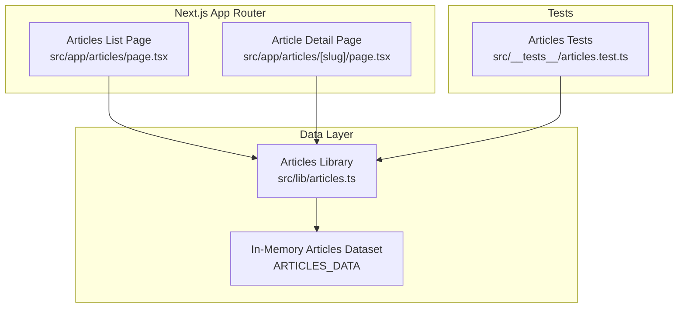
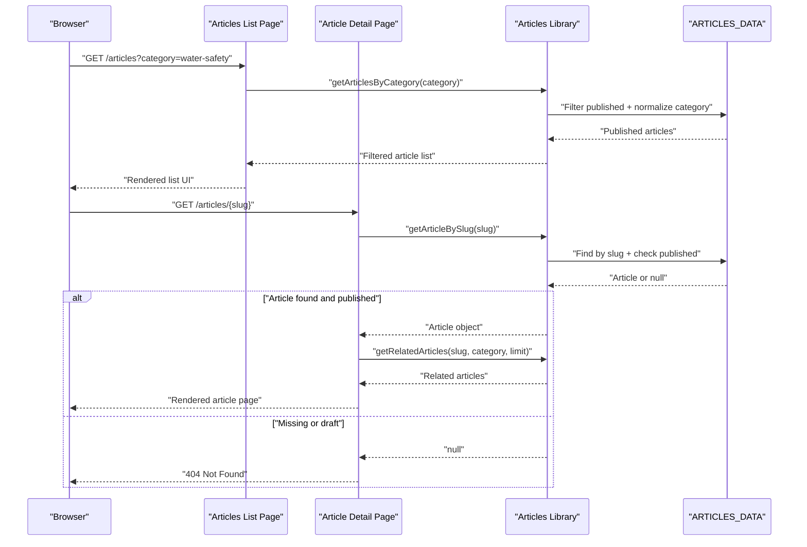
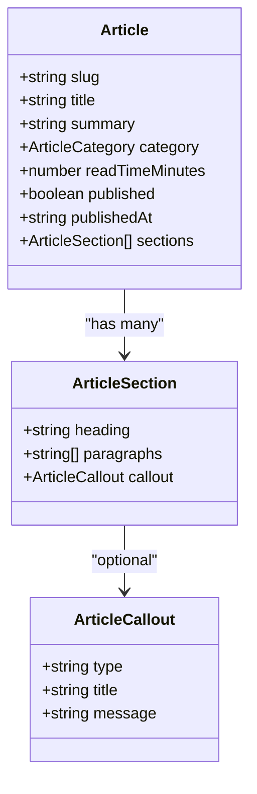
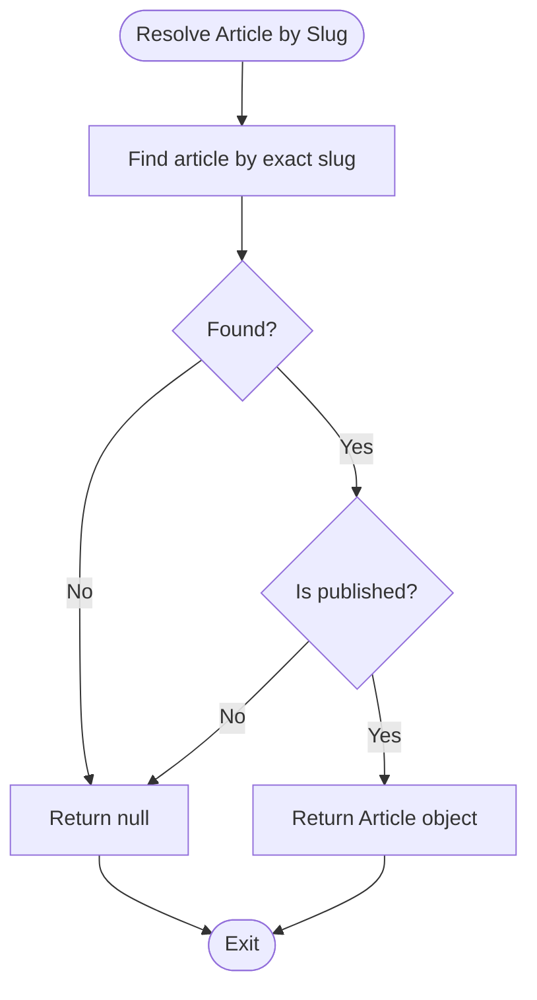
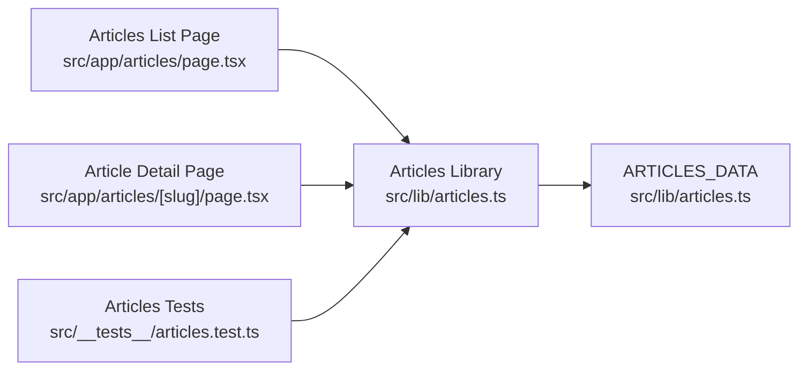

# Article API

<cite>
**Referenced Files in This Document**
- [articles.ts](file://src/lib/articles.ts)
- [articles page](file://src/app/articles/page.tsx)
- [article detail page](file://src/app/articles/[slug]/page.tsx)
- [articles tests](file://src/__tests__/articles.test.ts)
- [database design](file://docs/DATABASE_DESIGN.md)
</cite>

## Table of Contents
1. [Introduction](#introduction)
2. [Project Structure](#project-structure)
3. [Core Components](#core-components)
4. [Architecture Overview](#architecture-overview)
5. [Detailed Component Analysis](#detailed-component-analysis)
6. [Dependency Analysis](#dependency-analysis)
7. [Performance Considerations](#performance-considerations)
8. [Troubleshooting Guide](#troubleshooting-guide)
9. [Conclusion](#conclusion)

## Introduction
This document provides comprehensive API documentation for SwimNigeria’s article management system. It focuses on the server-side data layer and Next.js App Router integration that expose published articles, category filtering, slug-based article resolution, related article suggestions, and draft isolation. The current implementation uses an in-memory TypeScript dataset rather than a live database endpoint, so this guide documents the effective API surface as implemented by the library functions and pages.

The documented API includes:
- Listing published articles with category filtering.
- Resolving a single article by slug with strict draft isolation.
- Fetching related articles within or outside the current category.
- Enumerating distinct categories from published content.

It also explains the article data model, validation rules enforced by tests, error handling patterns, and performance characteristics derived from the current static-data architecture.

## Project Structure
The article feature is organized around a small, focused data layer and two Next.js App Router pages:

- Data and query helpers: `src/lib/articles.ts`
- Articles listing page: `src/app/articles/page.tsx`
- Dynamic article detail page: `src/app/articles/[slug]/page.tsx`
- Unit tests validating behavior: `src/__tests__/articles.test.ts`
- Future database schema reference: `docs/DATABASE_DESIGN.md`

**Diagram sources**
- [articles page:1-168](file://src/app/articles/page.tsx#L1-L168)
- [article detail page:1-206](file://src/app/articles/[slug]/page.tsx#L1-L206)
- [articles.ts:1-243](file://src/lib/articles.ts#L1-L243)
- [articles tests:1-92](file://src/__tests__/articles.test.ts#L1-L92)

**Section sources**
- [articles.ts:1-243](file://src/lib/articles.ts#L1-L243)
- [articles page:1-168](file://src/app/articles/page.tsx#L1-L168)
- [article detail page:1-206](file://src/app/articles/[slug]/page.tsx#L1-L206)
- [articles tests:1-92](file://src/__tests__/articles.test.ts#L1-L92)

## Core Components
The core API surface is implemented in the articles library. It defines the article data model and exposes query functions used by both the list and detail pages.

Key responsibilities:
- Define the article type, section structure, callout structure, and category enum.
- Provide a readonly dataset of articles.
- Return only published articles.
- Resolve a single article by slug while enforcing draft isolation.
- Filter articles by normalized category input.
- Generate related article suggestions.
- Enumerate distinct published categories.

Important notes about the current API:
- There is no explicit pagination parameter in `getPublishedArticles`. Pagination would need to be added at the function level if required.
- Sorting is currently fixed to publication date descending.
- Category filtering supports exact matches after normalization; it does not implement free-text search.
- Draft articles are excluded from all public-facing queries and return null when resolved by slug.

**Section sources**
- [articles.ts:1-243](file://src/lib/articles.ts#L1-L243)

## Architecture Overview
The article system follows a simple server-side data access pattern integrated into Next.js Server Components:

1. The articles list page reads URL search parameters and calls the category filter helper.
2. The article detail page resolves the dynamic slug and returns a real 404 for missing or unpublished articles.
3. Related articles are computed using the current article’s slug and category.
4. Static parameters are generated from published articles for pre-rendered routes.

**Diagram sources**
- [articles page:21-29](file://src/app/articles/page.tsx#L21-L29)
- [article detail page:13-46](file://src/app/articles/[slug]/page.tsx#L13-L46)
- [articles.ts:181-231](file://src/lib/articles.ts#L181-L231)

## Detailed Component Analysis

### Article Data Model
The article model represents structured educational content with metadata, sections, and optional callouts.

| Field | Type | Description | Validation / Constraints |
|---|---|---|---|
| `slug` | string | URL-safe identifier for the article | Must match lowercase alphanumeric hyphens; must be unique per article |
| `title` | string | Display title | Minimum length greater than five characters |
| `summary` | string | Short excerpt shown in listings | Minimum length greater than fifteen characters |
| `category` | `"Water Safety" \| "Beginner Technique" \| "Community & Family"` | Content category | Exact enum value; normalized during category filtering |
| `readTimeMinutes` | number | Estimated reading time | Positive integer |
| `published` | boolean | Public visibility flag | Drafts (`false`) are excluded from public APIs |
| `publishedAt` | string (ISO 8601) | Publication date | Used for sorting by newest first |
| `sections` | `ArticleSection[]` | Ordered content blocks | At least one section per article |
| `ArticleSection.heading` | string | Section heading | Rendered as a secondary heading |
| `ArticleSection.paragraphs` | string[] | Body paragraphs | Supports multi-paragraph content |
| `ArticleSection.callout` | Optional `ArticleCallout` | Highlighted safety, technique, or info box | Optional; typed by `type` |
| `ArticleCallout.type` | `"safety" \| "technique" \| "info"` | Callout classification | Controls visual emphasis and accessibility role |
| `ArticleCallout.title` | string | Callout label | Required when callout exists |
| `ArticleCallout.message` | string | Callout body text | Required when callout exists |

**Diagram sources**
- [articles.ts:1-24](file://src/lib/articles.ts#L1-L24)

**Section sources**
- [articles.ts:1-24](file://src/lib/articles.ts#L1-L24)
- [articles tests:12-22](file://src/__tests__/articles.test.ts#L12-L22)

### getPublishedArticles
Purpose:
- Returns all published articles.
- Sorts results by publication date in descending order.

Query parameters:
- None.

Response:
- Array of `Article` objects.

Behavior:
- Filters out draft articles where `published` is false.
- Uses ISO 8601 `publishedAt` values for sorting.

Complexity:
- Filtering is O(n).
- Sorting is O(n log n).

Error handling:
- No HTTP errors are thrown directly by this function.
- Consumers should handle empty lists gracefully.

TypeScript interface example:
- Return type: `Article[]`

Usage example path:
- Articles list page calls this indirectly through category filtering.
- Detail page uses it for static parameter generation.

**Section sources**
- [articles.ts:181-188](file://src/lib/articles.ts#L181-L188)
- [article detail page:13-18](file://src/app/articles/[slug]/page.tsx#L13-L18)

### getArticleBySlug
Purpose:
- Resolves a single article by its slug.
- Enforces draft isolation by returning null for unpublished articles.

Parameters:
- `slug`: string representing the article’s URL-safe identifier.

Validation rules:
- Slug comparison is exact.
- Slugs are expected to follow the validated pattern enforced by tests.

Response:
- `Article` object if found and published.
- `null` if not found or if the article is a draft.

Error handling:
- The function itself returns `null` instead of throwing.
- The detail page converts missing or draft results into a Next.js 404 response.

TypeScript interface example:
- Parameter: `slug: string`
- Return type: `Article | null`

Request/response examples:
- Successful request:
  - Request: GET `/articles/overcoming-fear-of-water-adult-beginners`
  - Response: Full article object including metadata, sections, and optional callouts.
- Missing slug:
  - Request: GET `/articles/non-existent-article-slug`
  - Response: 404 Not Found via Next.js routing.
- Draft slug:
  - Request: GET `/articles/advanced-freestyle-bilateral-breathing`
  - Response: 404 Not Found because the article is unpublished.

**Diagram sources**
- [articles.ts:190-199](file://src/lib/articles.ts#L190-L199)
- [article detail page:37-44](file://src/app/articles/[slug]/page.tsx#L37-L44)

**Section sources**
- [articles.ts:190-199](file://src/lib/articles.ts#L190-L199)
- [articles tests:38-58](file://src/__tests__/articles.test.ts#L38-L58)
- [article detail page:37-44](file://src/app/articles/[slug]/page.tsx#L37-L44)

### getArticlesByCategory
Purpose:
- Returns published articles filtered by category.
- Normalizes user input to support slugified query strings such as `water-safety`.

Parameters:
- `category`: string.
  - `"all"` or empty input returns all published articles.
  - Any other value is normalized and matched against the article’s category.

Normalization logic:
- Converts input to lowercase.
- Removes non-alphanumeric characters except hyphens are removed during normalization for matching.
- Compares normalized query with normalized article category.

Response:
- Array of `Article` objects.

Edge cases:
- Unknown category returns an empty array.
- Case-insensitive and slug-friendly matching improves usability.

Complexity:
- O(n) filtering over published articles.

TypeScript interface example:
- Parameter: `category: string`
- Return type: `Article[]`

Usage example path:
- Articles list page passes the resolved `searchParams.category` to this function.

**Section sources**
- [articles.ts:201-216](file://src/lib/articles.ts#L201-L216)
- [articles page:21-29](file://src/app/articles/page.tsx#L21-L29)
- [articles tests:60-74](file://src/__tests__/articles.test.ts#L60-L74)

### getRelatedArticles
Purpose:
- Suggests additional articles related to the current article.
- Prefers articles in the same category.
- Falls back to other published articles if fewer than the requested limit exist in the same category.

Parameters:
- `currentSlug`: string.
- `category`: string.
- `limit`: number, default `2`.

Behavior:
- Excludes the current article from results.
- Returns up to `limit` related articles.
- Prioritizes same-category articles, then fills remaining slots with unrelated published articles.

Response:
- Array of `Article` objects.

TypeScript interface example:
- Parameters: `currentSlug: string`, `category: string`, `limit?: number`
- Return type: `Article[]`

Usage example path:
- Article detail page requests related articles after resolving the main article.

**Section sources**
- [articles.ts:218-231](file://src/lib/articles.ts#L218-L231)
- [article detail page:46-46](file://src/app/articles/[slug]/page.tsx#L46-L46)
- [articles tests:76-84](file://src/__tests__/articles.test.ts#L76-L84)

### getCategories
Purpose:
- Returns distinct category names from published articles.

Response:
- Array of `ArticleCategory` values without duplicates.

Use case:
- Rendering category navigation links on the articles list page.

**Section sources**
- [articles.ts:233-242](file://src/lib/articles.ts#L233-L242)
- [articles page:25-29](file://src/app/articles/page.tsx#L25-L29)

### Articles List Page
Responsibilities:
- Read `searchParams.category`.
- Default to `"all"` when no category is provided.
- Call `getArticlesByCategory`.
- Render category navigation.
- Render article cards with title, summary, category badge, reading time, and publication date.
- Handle empty category results with a friendly empty state.

Routing integration:
- Category links use query strings like `/articles?category=water-safety`.
- Active category highlighting compares normalized inputs.

**Section sources**
- [articles page:1-168](file://src/app/articles/page.tsx#L1-L168)

### Article Detail Page
Responsibilities:
- Extract dynamic `slug` from route params.
- Resolve the article using `getArticleBySlug`.
- Return a real 404 for missing or unpublished articles.
- Generate page metadata based on the resolved article.
- Render article header, sections, callouts, safety disclaimer, and related articles.
- Pre-generate static paths from published articles.

Draft isolation:
- Draft slugs are intentionally hidden from public routing and return 404.

**Section sources**
- [article detail page:1-206](file://src/app/articles/[slug]/page.tsx#L1-L206)

## Dependency Analysis
The following diagram shows how the pages depend on the articles library and how the library depends on the in-memory dataset.

**Diagram sources**
- [articles page:13-13](file://src/app/articles/page.tsx#L13-L13)
- [article detail page:7-7](file://src/app/articles/[slug]/page.tsx#L7-L7)
- [articles.ts:26-26](file://src/lib/articles.ts#L26-L26)
- [articles tests:1-9](file://src/__tests__/articles.test.ts#L1-L9)

**Section sources**
- [articles page:1-168](file://src/app/articles/page.tsx#L1-L168)
- [article detail page:1-206](file://src/app/articles/[slug]/page.tsx#L1-L206)
- [articles.ts:1-243](file://src/lib/articles.ts#L1-L243)
- [articles tests:1-92](file://src/__tests__/articles.test.ts#L1-L92)

## Performance Considerations
Current performance characteristics:
- All article data is loaded once as a readonly in-memory dataset.
- Query functions perform simple array operations: filtering, sorting, and slicing.
- No external database calls are made at runtime.

Optimization opportunities:
- Add pagination parameters to `getPublishedArticles` and `getArticlesByCategory` to reduce payload size for large catalogs.
- Introduce memoization or module-level caching if the dataset grows or becomes dynamic.
- Use stable sort keys and avoid repeated date parsing by normalizing dates once.
- Cache computed category lists if they are accessed frequently.
- When migrating to a database, add indexes on `is_published`, `published_at`, and `slug`.

Caching strategy guidance:
- For static datasets, module-level loading already avoids repeated I/O.
- For future database-backed implementations, consider request-scoped deduplication and short-lived server-side caches for expensive queries.
- Avoid caching mutable state across requests unless explicitly invalidated.

[No sources needed since this section provides general guidance]

## Troubleshooting Guide

Common issues and resolutions:

| Symptom | Likely Cause | Resolution |
|---|---|---|
| Article page returns 404 | Slug does not exist or article is unpublished | Verify the slug exists in published articles and that `published` is true |
| Category filter returns empty list | Category name mismatch or unsupported value | Use supported categories or slugified forms like `water-safety`; verify normalization behavior |
| Related articles missing | Fewer than requested limit in same category | Related articles fall back to other categories; adjust expectations or increase available articles |
| Draft article accessible publicly | Incorrect routing or bypassed draft checks | Ensure draft articles remain unpublished and rely on `getArticleBySlug` returning null |
| Sorting appears incorrect | Invalid or inconsistent `publishedAt` format | Use valid ISO 8601 date strings |

Error handling patterns:
- `getArticleBySlug` returns `null` for missing or draft articles.
- The detail page converts null results into a Next.js 404 response.
- Category filtering returns an empty array for unknown categories rather than throwing.

**Section sources**
- [articles.ts:190-199](file://src/lib/articles.ts#L190-L199)
- [article detail page:37-44](file://src/app/articles/[slug]/page.tsx#L37-L44)
- [articles tests:47-58](file://src/__tests__/articles.test.ts#L47-L58)

## Conclusion
SwimNigeria’s article API is a compact, type-safe server-side data layer integrated into Next.js App Router pages. It provides robust draft isolation, predictable sorting, normalized category filtering, and related article suggestions. While the current implementation uses an in-memory dataset, it establishes a clear contract for future migration to a database-backed system. The documented interfaces, validation rules, and error handling patterns provide a solid foundation for client integration, testing, and extension.

[No sources needed since this section summarizes without analyzing specific files]