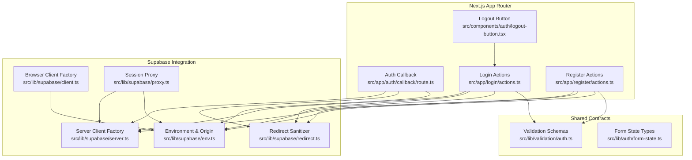
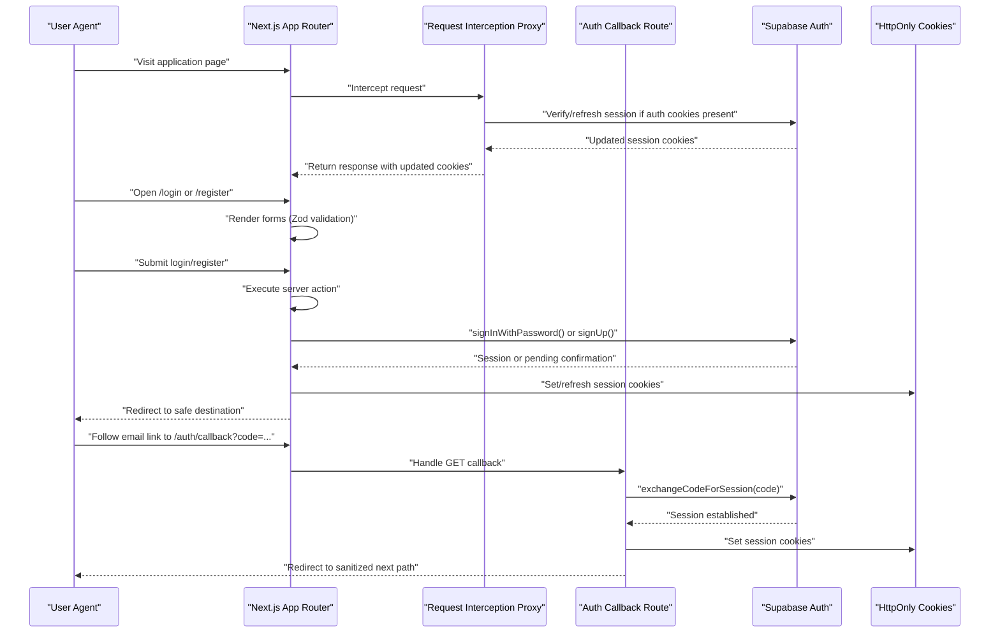
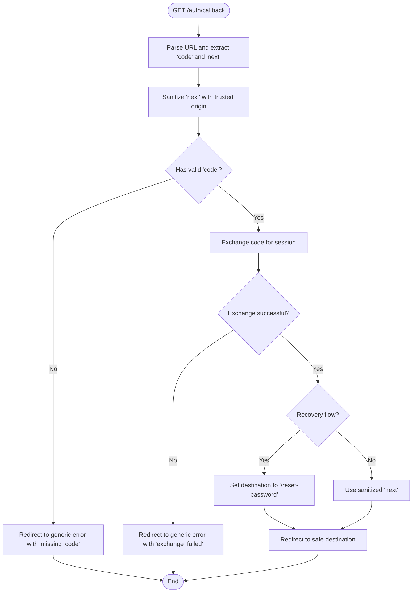
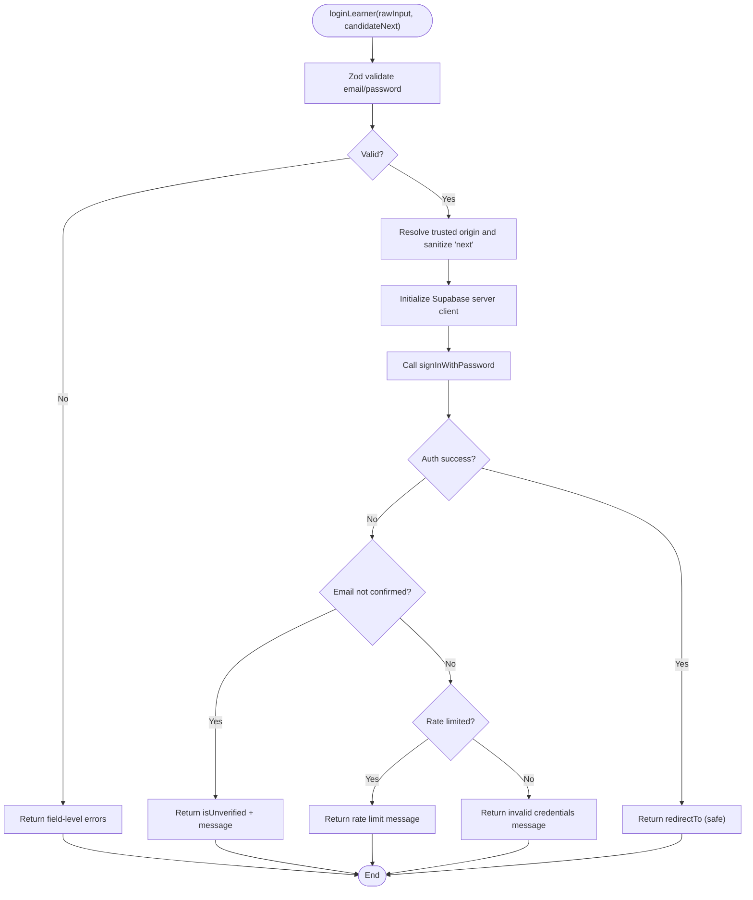
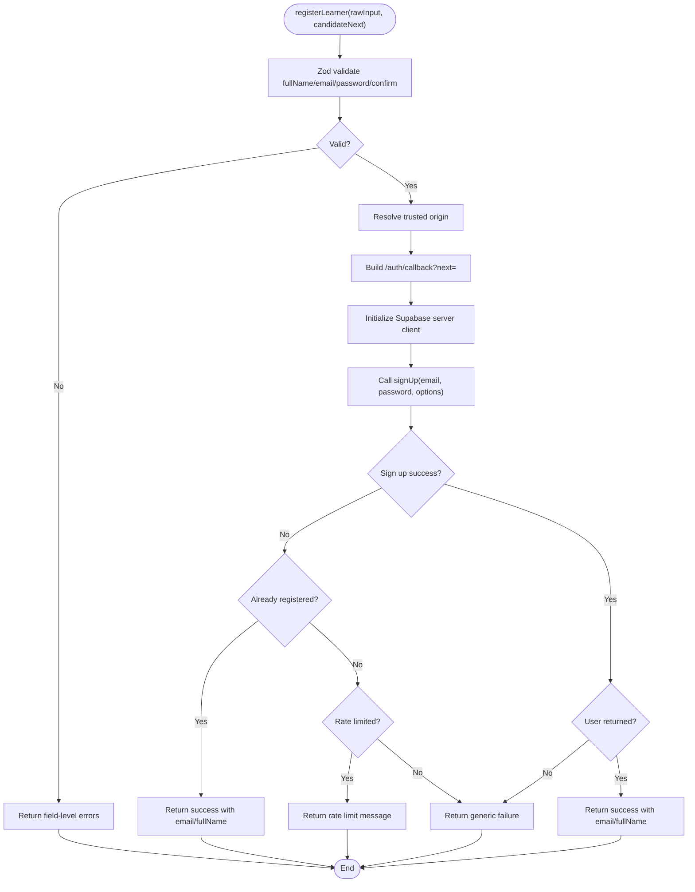
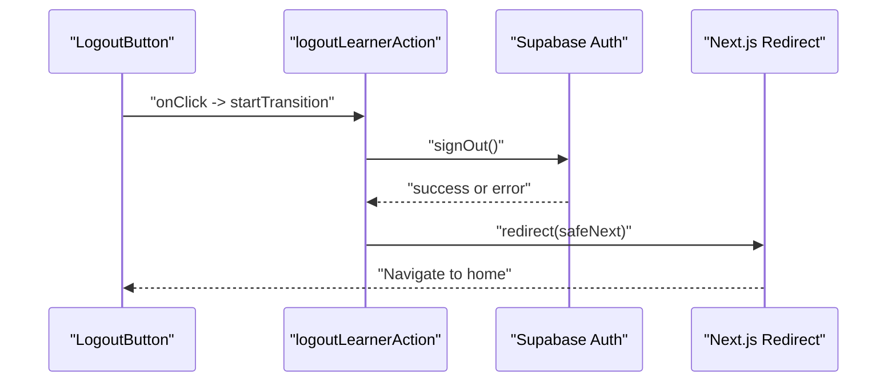
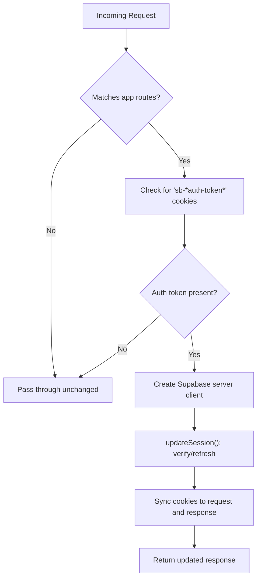
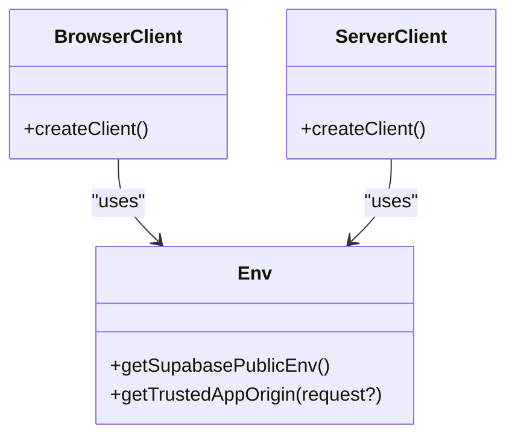
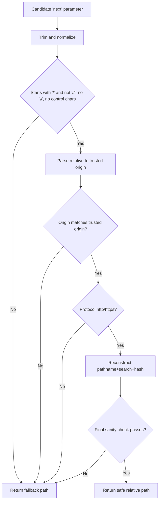
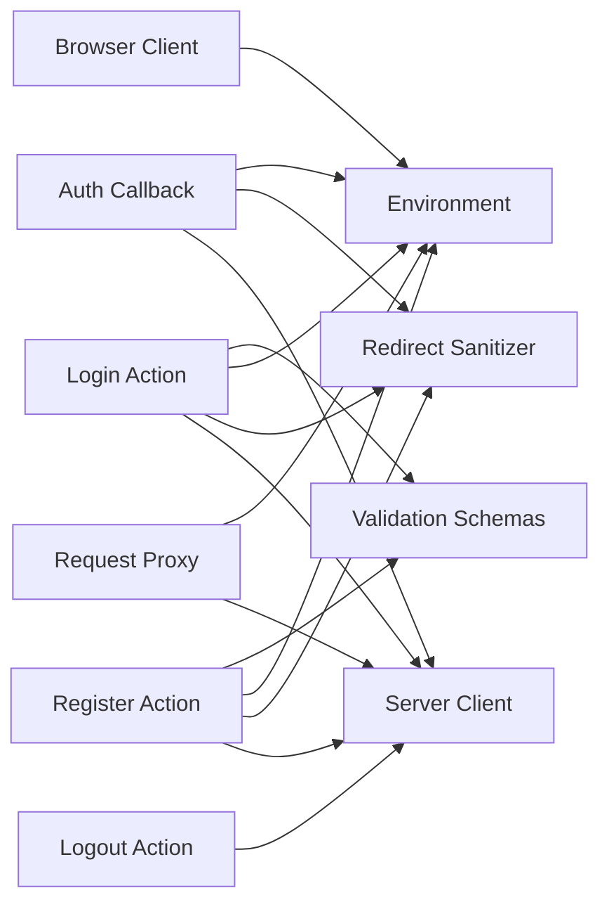

# Authentication & Session Management

<cite>
**Referenced Files in This Document**
- [route.ts](file://src/app/auth/callback/route.ts)
- [actions.ts](file://src/app/login/actions.ts)
- [actions.ts](file://src/app/register/actions.ts)
- [logout-button.tsx](file://src/components/auth/logout-button.tsx)
- [proxy.ts](file://src/proxy.ts)
- [proxy.ts](file://src/lib/supabase/proxy.ts)
- [server.ts](file://src/lib/supabase/server.ts)
- [client.ts](file://src/lib/supabase/client.ts)
- [env.ts](file://src/lib/supabase/env.ts)
- [redirect.ts](file://src/lib/supabase/redirect.ts)
- [auth.ts](file://src/lib/validation/auth.ts)
- [form-state.ts](file://src/lib/auth/form-state.ts)
</cite>

## Table of Contents
1. [Introduction](#introduction)
2. [Project Structure](#project-structure)
3. [Core Components](#core-components)
4. [Architecture Overview](#architecture-overview)
5. [Detailed Component Analysis](#detailed-component-analysis)
6. [Dependency Analysis](#dependency-analysis)
7. [Performance Considerations](#performance-considerations)
8. [Troubleshooting Guide](#troubleshooting-guide)
9. [Conclusion](#conclusion)
10. [Appendices](#appendices)

## Introduction
This document explains SwimNigeria’s authentication and session management system built on Next.js App Router and Supabase Auth. It covers the PKCE-based callback route, login and registration server actions, logout flow, session synchronization via a request interception proxy, environment validation, redirect sanitization, and shared form state contracts. The goal is to provide clear guidance for developers implementing protected routes, user context providers, token refresh strategies, and secure error handling.

## Project Structure
Authentication-related code is organized into:
- Route handlers for authentication callbacks
- Server Actions for login, registration, and logout
- Shared Supabase client factories for browser and server contexts
- Request interception proxy for session refresh
- Environment configuration and redirect sanitizer
- Validation schemas and shared action result types

**Diagram sources**
- [route.ts:1-61](file://src/app/auth/callback/route.ts#L1-L61)
- [actions.ts:1-236](file://src/app/login/actions.ts#L1-L236)
- [actions.ts:1-214](file://src/app/register/actions.ts#L1-L214)
- [logout-button.tsx:1-48](file://src/components/auth/logout-button.tsx#L1-L48)
- [server.ts:1-61](file://src/lib/supabase/server.ts#L1-L61)
- [client.ts:1-23](file://src/lib/supabase/client.ts#L1-L23)
- [proxy.ts:1-34](file://src/lib/supabase/proxy.ts#L1-L34)
- [env.ts:1-143](file://src/lib/supabase/env.ts#L1-L143)
- [redirect.ts:1-94](file://src/lib/supabase/redirect.ts#L1-L94)
- [auth.ts:1-140](file://src/lib/validation/auth.ts#L1-L140)
- [form-state.ts:1-70](file://src/lib/auth/form-state.ts#L1-L70)

**Section sources**
- [route.ts:1-61](file://src/app/auth/callback/route.ts#L1-L61)
- [actions.ts:1-236](file://src/app/login/actions.ts#L1-L236)
- [actions.ts:1-214](file://src/app/register/actions.ts#L1-L214)
- [logout-button.tsx:1-48](file://src/components/auth/logout-button.tsx#L1-L48)
- [proxy.ts:1-34](file://src/proxy.ts#L1-L34)
- [proxy.ts:31-68](file://src/lib/supabase/proxy.ts#L31-L68)
- [server.ts:1-61](file://src/lib/supabase/server.ts#L1-L61)
- [client.ts:1-23](file://src/lib/supabase/client.ts#L1-L23)
- [env.ts:1-143](file://src/lib/supabase/env.ts#L1-L143)
- [redirect.ts:1-94](file://src/lib/supabase/redirect.ts#L1-L94)
- [auth.ts:1-140](file://src/lib/validation/auth.ts#L1-L140)
- [form-state.ts:1-70](file://src/lib/auth/form-state.ts#L1-L70)

## Core Components
- Authentication callback route: Handles Supabase PKCE authorization codes, exchanges them for sessions, sets cookies securely, and redirects safely.
- Login server action: Validates input with Zod, authenticates via Supabase, handles unverified email and rate limits, and returns safe redirect targets.
- Registration server action: Validates input, creates users with email verification enabled, stores non-authoritative full name metadata, and prevents account enumeration.
- Logout mechanism: Signs out via Supabase, cleans session cookies, and redirects to a sanitized target.
- Session synchronization proxy: Intercepts requests, detects auth cookies, refreshes tokens, and updates cookies for downstream components.
- Supabase clients: Browser and server client factories using public credentials and cookie adapters.
- Environment and redirect utilities: Validate Supabase environment variables, resolve trusted origins, and sanitize redirect URLs against open-redirect attacks.
- Validation and form state: Shared Zod schemas and typed action results for consistent UX and type safety.

**Section sources**
- [route.ts:1-61](file://src/app/auth/callback/route.ts#L1-L61)
- [actions.ts:1-236](file://src/app/login/actions.ts#L1-L236)
- [actions.ts:1-214](file://src/app/register/actions.ts#L1-L214)
- [logout-button.tsx:1-48](file://src/components/auth/logout-button.tsx#L1-L48)
- [proxy.ts:1-34](file://src/proxy.ts#L1-L34)
- [proxy.ts:31-68](file://src/lib/supabase/proxy.ts#L31-L68)
- [server.ts:1-61](file://src/lib/supabase/server.ts#L1-L61)
- [client.ts:1-23](file://src/lib/supabase/client.ts#L1-L23)
- [env.ts:1-143](file://src/lib/supabase/env.ts#L1-L143)
- [redirect.ts:1-94](file://src/lib/supabase/redirect.ts#L1-L94)
- [auth.ts:1-140](file://src/lib/validation/auth.ts#L1-L140)
- [form-state.ts:1-70](file://src/lib/auth/form-state.ts#L1-L70)

## Architecture Overview
The authentication architecture combines Next.js App Router handlers and server actions with Supabase Auth. A request interception proxy ensures session tokens are refreshed transparently. All redirects are sanitized to prevent open-redirect vulnerabilities. Environment configuration is validated at startup and runtime.

**Diagram sources**
- [proxy.ts:1-34](file://src/proxy.ts#L1-L34)
- [proxy.ts:31-68](file://src/lib/supabase/proxy.ts#L31-L68)
- [actions.ts:1-236](file://src/app/login/actions.ts#L1-L236)
- [actions.ts:1-214](file://src/app/register/actions.ts#L1-L214)
- [route.ts:1-61](file://src/app/auth/callback/route.ts#L1-L61)

## Detailed Component Analysis

### Authentication Callback Route
Responsibilities:
- Receives one-time authorization code from Supabase Auth.
- Exchanges code for a session.
- Sets session cookies securely.
- Sanitizes redirect destinations to same-origin internal paths.
- Handles missing or invalid codes gracefully.

Security constraints:
- Uses trusted origin resolution.
- Rejects external, protocol-relative, backslash-trick, and unsafe scheme redirects.
- Never includes secrets in redirect destinations.

**Diagram sources**
- [route.ts:24-59](file://src/app/auth/callback/route.ts#L24-L59)
- [env.ts:116-142](file://src/lib/supabase/env.ts#L116-L142)
- [redirect.ts:21-93](file://src/lib/supabase/redirect.ts#L21-L93)

**Section sources**
- [route.ts:1-61](file://src/app/auth/callback/route.ts#L1-L61)
- [env.ts:116-142](file://src/lib/supabase/env.ts#L116-L142)
- [redirect.ts:1-94](file://src/lib/supabase/redirect.ts#L1-L94)

### Login Action Handler
Responsibilities:
- Validates login payload with Zod.
- Authenticates via Supabase `signInWithPassword`.
- Detects unverified email and rate limiting.
- Returns structured results for UI state.
- Redirects to sanitized destination after success.

Error handling:
- Unverified email: prompts user to verify inbox.
- Rate limit: instructs user to wait before retrying.
- Invalid credentials: generic message without revealing existence.
- Configuration errors: friendly unavailable message.

**Diagram sources**
- [actions.ts:34-183](file://src/app/login/actions.ts#L34-L183)
- [auth.ts:68-79](file://src/lib/validation/auth.ts#L68-L79)
- [env.ts:116-142](file://src/lib/supabase/env.ts#L116-L142)
- [redirect.ts:21-93](file://src/lib/supabase/redirect.ts#L21-L93)

**Section sources**
- [actions.ts:1-236](file://src/app/login/actions.ts#L1-L236)
- [auth.ts:68-79](file://src/lib/validation/auth.ts#L68-L79)
- [env.ts:116-142](file://src/lib/supabase/env.ts#L116-L142)
- [redirect.ts:1-94](file://src/lib/supabase/redirect.ts#L1-L94)

### Registration Process
Responsibilities:
- Validates registration payload with Zod (full name, email, password strength).
- Creates user via Supabase `signUp` with email verification enabled.
- Stores non-authoritative full name in user metadata.
- Constructs safe email confirmation redirect through `/auth/callback`.
- Prevents account enumeration by returning consistent responses for existing emails.

Security notes:
- No service-role key usage.
- Metadata is non-authoritative and must not be used for authorization.
- Email verification is mandatory before access to authenticated features.

**Diagram sources**
- [actions.ts:35-194](file://src/app/register/actions.ts#L35-L194)
- [auth.ts:22-49](file://src/lib/validation/auth.ts#L22-L49)
- [env.ts:116-142](file://src/lib/supabase/env.ts#L116-L142)
- [redirect.ts:21-93](file://src/lib/supabase/redirect.ts#L21-L93)

**Section sources**
- [actions.ts:1-214](file://src/app/register/actions.ts#L1-L214)
- [auth.ts:22-49](file://src/lib/validation/auth.ts#L22-L49)
- [env.ts:116-142](file://src/lib/supabase/env.ts#L116-L142)
- [redirect.ts:1-94](file://src/lib/supabase/redirect.ts#L1-L94)

### Logout Mechanism and Session Cleanup
Responsibilities:
- Invokes Supabase `signOut()` to invalidate session.
- Cleans session cookies via Supabase SSR cookie adapter.
- Redirects to a sanitized destination (default home).

UI integration:
- Logout button component triggers server action with transition state.

**Diagram sources**
- [logout-button.tsx:20-46](file://src/components/auth/logout-button.tsx#L20-L46)
- [actions.ts:205-235](file://src/app/login/actions.ts#L205-L235)

**Section sources**
- [logout-button.tsx:1-48](file://src/components/auth/logout-button.tsx#L1-L48)
- [actions.ts:205-235](file://src/app/login/actions.ts#L205-L235)

### Session Synchronization and Token Refresh
Responsibilities:
- Intercepts all application requests except static assets.
- Fast-path skips anonymous visitors without auth cookies.
- For requests carrying Supabase auth cookies, verifies and refreshes session.
- Updates cookies for both downstream Server Components and browser response.

**Diagram sources**
- [proxy.ts:16-33](file://src/proxy.ts#L16-L33)
- [proxy.ts:31-68](file://src/lib/supabase/proxy.ts#L31-L68)

**Section sources**
- [proxy.ts:1-34](file://src/proxy.ts#L1-L34)
- [proxy.ts:31-68](file://src/lib/supabase/proxy.ts#L31-L68)

### Supabase Client Factories and Environment
- Browser client factory initializes @supabase/ssr browser client with public environment values and manages cookies in the browser.
- Server client factory initializes @supabase/ssr server client with Next.js cookie store, handling read-only cookie store constraints in Server Components.
- Environment module validates Supabase URL and anon key, rejects placeholders, and resolves trusted application origin for safe redirects.

**Diagram sources**
- [client.ts:19-22](file://src/lib/supabase/client.ts#L19-L22)
- [server.ts:26-60](file://src/lib/supabase/server.ts#L26-L60)
- [env.ts:49-107](file://src/lib/supabase/env.ts#L49-L107)
- [env.ts:116-142](file://src/lib/supabase/env.ts#L116-L142)

**Section sources**
- [client.ts:1-23](file://src/lib/supabase/client.ts#L1-L23)
- [server.ts:1-61](file://src/lib/supabase/server.ts#L1-L61)
- [env.ts:1-143](file://src/lib/supabase/env.ts#L1-L143)

### Redirect Sanitization and CSRF Protection
- Redirect sanitizer enforces strict same-origin boundaries, rejecting protocol-relative paths, backslash tricks, control characters, and unsafe schemes.
- CSRF protection relies on SameSite cookies managed by @supabase/ssr; no custom CSRF tokens are required for this cookie-based flow.
- All redirect parameters are sanitized before use in callbacks and server actions.

**Diagram sources**
- [redirect.ts:21-93](file://src/lib/supabase/redirect.ts#L21-L93)

**Section sources**
- [redirect.ts:1-94](file://src/lib/supabase/redirect.ts#L1-L94)

### Form State Contracts and Validation
- Shared Zod schemas define strict validation rules for login, registration, forgot password, and reset password flows.
- Shared form state interfaces define consistent return shapes for server actions, enabling predictable UI state management.

Key patterns:
- Field-level error mapping for immediate feedback.
- Initial state snapshots for `useActionState`.
- Type-safe action results across login, register, and logout flows.

**Section sources**
- [auth.ts:1-140](file://src/lib/validation/auth.ts#L1-L140)
- [form-state.ts:1-70](file://src/lib/auth/form-state.ts#L1-L70)

## Dependency Analysis
High-level dependencies among authentication modules:

**Diagram sources**
- [route.ts:1-61](file://src/app/auth/callback/route.ts#L1-L61)
- [actions.ts:1-236](file://src/app/login/actions.ts#L1-L236)
- [actions.ts:1-214](file://src/app/register/actions.ts#L1-L214)
- [proxy.ts:1-34](file://src/proxy.ts#L1-L34)
- [proxy.ts:31-68](file://src/lib/supabase/proxy.ts#L31-L68)
- [server.ts:1-61](file://src/lib/supabase/server.ts#L1-L61)
- [client.ts:1-23](file://src/lib/supabase/client.ts#L1-L23)
- [env.ts:1-143](file://src/lib/supabase/env.ts#L1-L143)
- [redirect.ts:1-94](file://src/lib/supabase/redirect.ts#L1-L94)
- [auth.ts:1-140](file://src/lib/validation/auth.ts#L1-L140)

**Section sources**
- [route.ts:1-61](file://src/app/auth/callback/route.ts#L1-L61)
- [actions.ts:1-236](file://src/app/login/actions.ts#L1-L236)
- [actions.ts:1-214](file://src/app/register/actions.ts#L1-L214)
- [proxy.ts:1-34](file://src/proxy.ts#L1-L34)
- [proxy.ts:31-68](file://src/lib/supabase/proxy.ts#L31-L68)
- [server.ts:1-61](file://src/lib/supabase/server.ts#L1-L61)
- [client.ts:1-23](file://src/lib/supabase/client.ts#L1-L23)
- [env.ts:1-143](file://src/lib/supabase/env.ts#L1-L143)
- [redirect.ts:1-94](file://src/lib/supabase/redirect.ts#L1-L94)
- [auth.ts:1-140](file://src/lib/validation/auth.ts#L1-L140)

## Performance Considerations
- Anonymous fast-path: The request proxy skips session checks when no Supabase auth cookies are present, minimizing latency for public pages.
- Cookie mutation safety: Server client catches read-only cookie store errors during Server Component rendering, relying on upstream proxy for refresh.
- Avoid unnecessary re-renders: Defer reading dynamic state until needed in client components to reduce subscription overhead.

[No sources needed since this section provides general guidance]

## Troubleshooting Guide
Common issues and resolutions:
- Missing or placeholder Supabase environment variables:
  - Symptom: Configuration errors during initialization.
  - Resolution: Ensure NEXT_PUBLIC_SUPABASE_URL and NEXT_PUBLIC_SUPABASE_ANON_KEY are set and not placeholders.
- Open redirect blocked:
  - Symptom: Redirects to external or malformed paths are rejected.
  - Resolution: Use only same-origin relative paths; rely on sanitizeRedirectUrl.
- Email not confirmed:
  - Symptom: Login fails with unverified email message.
  - Resolution: Prompt user to verify email via inbox link; do not grant access until callback exchange succeeds.
- Rate limiting:
  - Symptom: Too many attempts during login or registration.
  - Resolution: Instruct user to wait before retrying; avoid exposing detailed error messages.
- Logout failures:
  - Symptom: Sign-out returns an error or does not clear session.
  - Resolution: Verify Supabase signOut call and ensure cookies are cleared; fall back to safe redirect.

**Section sources**
- [env.ts:49-107](file://src/lib/supabase/env.ts#L49-L107)
- [redirect.ts:21-93](file://src/lib/supabase/redirect.ts#L21-L93)
- [actions.ts:100-154](file://src/app/login/actions.ts#L100-L154)
- [actions.ts:137-161](file://src/app/register/actions.ts#L137-L161)
- [actions.ts:211-235](file://src/app/login/actions.ts#L211-L235)

## Conclusion
SwimNigeria’s authentication system leverages Next.js App Router and Supabase Auth with strong security practices: PKCE-based callbacks, server-side Zod validation, safe redirect sanitization, and transparent session refresh via a request interception proxy. The design avoids service-role keys in client code, protects against open-redirect attacks, and provides robust error handling for unverified emails, rate limits, and configuration issues. Future phases should introduce protected routes, user context providers, and role-based access control while maintaining these security foundations.

[No sources needed since this section summarizes without analyzing specific files]

## Appendices

### Security Headers and CSRF Notes
- CSRF protection is handled by HttpOnly, Secure, SameSite cookies managed by @supabase/ssr.
- Application-level CSRF tokens are not required for this cookie-based flow.
- Ensure deployment uses HTTPS to enforce Secure cookies.

[No sources needed since this section provides general guidance]

### Protected Routes and User Context Providers
- Protected routes should be implemented in later phases using middleware or server-side guards that verify active sessions and roles.
- User context providers should derive state from Supabase Auth listeners and keep UI in sync with server-managed sessions.

[No sources needed since this section provides general guidance]