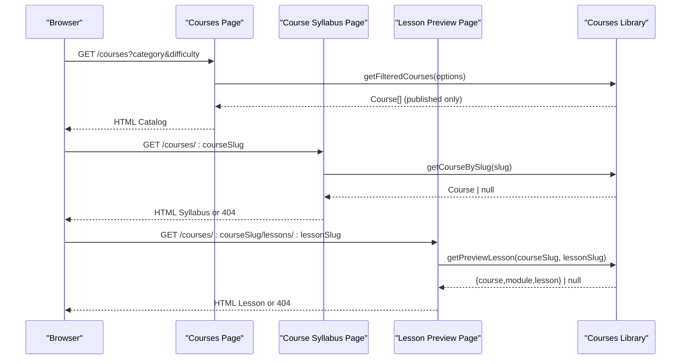
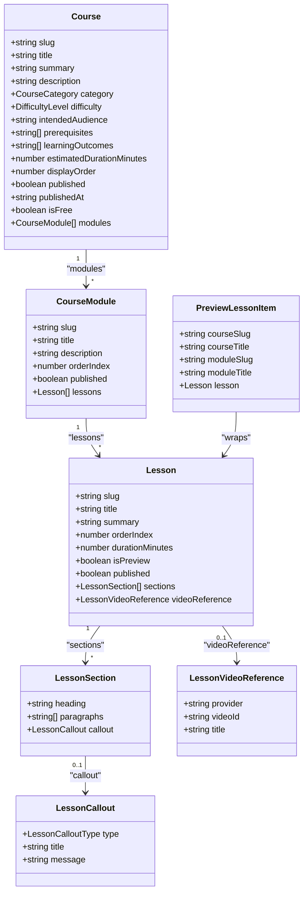
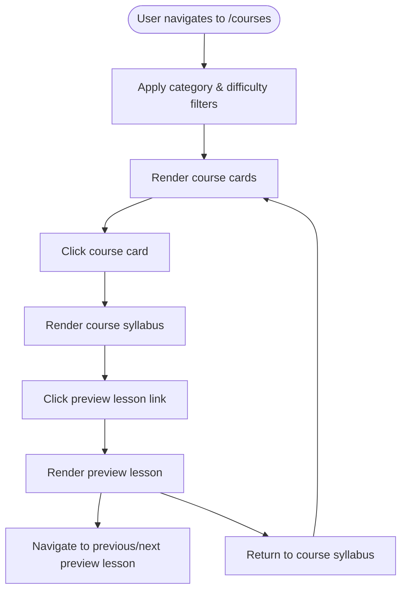
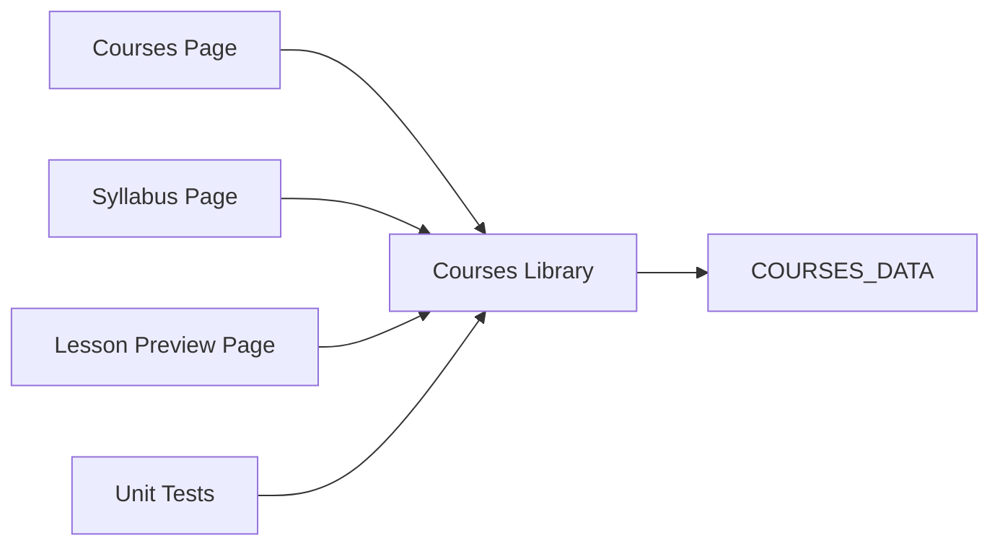

# Course Management API

<cite>
**Referenced Files in This Document**
- [courses.ts](file://src/lib/courses.ts)
- [courses-page.tsx](file://src/app/courses/page.tsx)
- [course-syllabus-page.tsx](file://src/app/courses/[courseSlug]/page.tsx)
- [lesson-preview-page.tsx](file://src/app/courses/[courseSlug]/lessons/[lessonSlug]/page.tsx)
- [courses.test.ts](file://src/__tests__/courses.test.ts)
</cite>

## Table of Contents
1. [Introduction](#introduction)
2. [Project Structure](#project-structure)
3. [Core Components](#core-components)
4. [Architecture Overview](#architecture-overview)
5. [Detailed Component Analysis](#detailed-component-analysis)
6. [Dependency Analysis](#dependency-analysis)
7. [Performance Considerations](#performance-considerations)
8. [Troubleshooting Guide](#troubleshooting-guide)
9. [Conclusion](#conclusion)

## Introduction
This document provides detailed API documentation for SwimNigeria’s course management system. It focuses on:
- Filtering and retrieving courses by difficulty, category, and deterministic ordering.
- Resolving a course by slug with full module and lesson hierarchy.
- Retrieving lessons through nested curriculum organization with strict draft isolation.
- Preview lesson access, adjacent navigation, and safe video embedding.
- TypeScript interfaces for Course, Module, Lesson, and related entities.
- Navigation patterns between course catalog, syllabus pages, and preview lessons.
- Performance considerations, caching strategies, and error handling for missing or unpublished content.

The system currently uses an in-memory course registry to power public routes while enforcing strict draft-content isolation.

## Project Structure
The course management functionality is implemented as:
- A strongly typed data model and query layer under the library file.
- Next.js App Router pages that consume the library functions.
- Tests validating data integrity, filtering behavior, and draft isolation.

```mermaid
graph TB
subgraph "Library Layer"
Lib["src/lib/courses.ts"]
end
subgraph "Next.js Pages"
CatalogPage["src/app/courses/page.tsx"]
SyllabusPage["src/app/courses/[courseSlug]/page.tsx"]
LessonPage["src/app/courses/[courseSlug]/lessons/[lessonSlug]/page.tsx"]
end
subgraph "Tests"
Tests["src/__tests__/courses.test.ts"]
end
CatalogPage --> Lib
SyllabusPage --> Lib
LessonPage --> Lib
Tests --> Lib
```

**Diagram sources**
- [courses.ts:1037-1346](file://src/lib/courses.ts#L1037-L1346)
- [courses-page.tsx:1-367](file://src/app/courses/page.tsx#L1-L367)
- [course-syllabus-page.tsx:1-347](file://src/app/courses/[courseSlug]/page.tsx#L1-L347)
- [lesson-preview-page.tsx:1-354](file://src/app/courses/[courseSlug]/lessons/[lessonSlug]/page.tsx#L1-L354)
- [courses.test.ts:1-447](file://src/__tests__/courses.test.ts#L1-L447)

**Section sources**
- [courses.ts:1-1346](file://src/lib/courses.ts#L1-L1346)
- [courses-page.tsx:1-367](file://src/app/courses/page.tsx#L1-L367)
- [course-syllabus-page.tsx:1-347](file://src/app/courses/[courseSlug]/page.tsx#L1-L347)
- [lesson-preview-page.tsx:1-354](file://src/app/courses/[courseSlug]/lessons/[lessonSlug]/page.tsx#L1-L354)
- [courses.test.ts:1-447](file://src/__tests__/courses.test.ts#L1-L447)

## Core Components
The core components are:
- Data model and constants defining Course, Module, Lesson, and supporting types.
- Query helpers for published courses, filtered catalogs, syllabi, lessons, previews, and adjacent navigation.
- Safe video embed validation utilities.
- Page components that render the course catalog, syllabus, and preview lesson views.

Key responsibilities:
- Enforce draft isolation at every level (course, module, lesson).
- Provide deterministic ordering via displayOrder and orderIndex fields.
- Normalize filter inputs for robust category matching.
- Validate external video providers and IDs before rendering.

**Section sources**
- [courses.ts:16-135](file://src/lib/courses.ts#L16-L135)
- [courses.ts:1037-1346](file://src/lib/courses.ts#L1037-L1346)
- [courses-page.tsx:14-44](file://src/app/courses/page.tsx#L14-L44)
- [course-syllabus-page.tsx:1-47](file://src/app/courses/[courseSlug]/page.tsx#L1-L47)
- [lesson-preview-page.tsx:1-58](file://src/app/courses/[courseSlug]/lessons/[lessonSlug]/page.tsx#L1-L58)

## Architecture Overview
The architecture follows a layered approach:
- Library layer exposes pure functions over a static dataset.
- Pages consume these functions during server-side rendering.
- Draft isolation is enforced centrally so UIs never receive unpublished content.



**Diagram sources**
- [courses-page.tsx:32-44](file://src/app/courses/page.tsx#L32-L44)
- [course-syllabus-page.tsx:16-47](file://src/app/courses/[courseSlug]/page.tsx#L16-L47)
- [lesson-preview-page.tsx:21-58](file://src/app/courses/[courseSlug]/lessons/[lessonSlug]/page.tsx#L21-L58)
- [courses.ts:1037-1346](file://src/lib/courses.ts#L1037-L1346)

## Detailed Component Analysis

### API Surface: Courses Catalog Filtering
The catalog page consumes a filtering function that supports:
- Category filtering by normalized string comparison.
- Difficulty filtering by exact case-insensitive match.
- Deterministic ordering preserved from published courses.

Function signature and behavior:
- Function: getFilteredCourses
- Input: CourseFilterOptions with optional category and difficulty
- Output: Course[] containing only published courses, sorted by displayOrder
- Unknown filters return empty arrays; “all” resets that filter

Query parameters used by the page:
- category: URL-encoded category name; normalized internally
- difficulty: lowercase difficulty value; normalized internally

Example queries:
- All courses: /courses
- Filter by category: /courses?category=water-safety-acclimatization
- Filter by difficulty: /courses?difficulty=beginner
- Combined filters: /courses?category=water-safety-acclimatization&difficulty=foundational

Error handling:
- No courses match: page renders an empty state with a reset link.
- Invalid or unknown filters: returns empty array without errors.

**Section sources**
- [courses.ts:1220-1247](file://src/lib/courses.ts#L1220-L1247)
- [courses-page.tsx:28-44](file://src/app/courses/page.tsx#L28-L44)
- [courses-page.tsx:346-362](file://src/app/courses/page.tsx#L346-L362)

### API Surface: Get Course By Slug
Resolves a single course by its slug. Returns null if not found or unpublished. The returned course has all unpublished modules and lessons stripped.

Function signature and behavior:
- Function: getCourseBySlug
- Input: string slug
- Output: Course | null
- Behavior:
  - Validates slug presence
  - Finds course by slug
  - Ensures course.published is true
  - Sanitizes modules and lessons to published-only

Usage in syllabus page:
- generateStaticParams enumerates published courses for pre-rendering.
- generateMetadata builds SEO metadata using resolved course.
- Default export calls notFound() when course is null or unpublished.

Navigation pattern:
- Back to catalogue link always present.
- Displays category badge, difficulty label, estimated duration, module count, total lessons.
- Renders mandatory disclaimer and structured syllabus breakdown.

**Section sources**
- [courses.ts:1044-1059](file://src/lib/courses.ts#L1044-L1059)
- [course-syllabus-page.tsx:16-47](file://src/app/courses/[courseSlug]/page.tsx#L16-L47)
- [course-syllabus-page.tsx:40-110](file://src/app/courses/[courseSlug]/page.tsx#L40-L110)

### API Surface: Lesson Retrieval System
The lesson retrieval system supports:
- Resolving a specific lesson within a published course and module.
- Checking preview eligibility.
- Fetching a single preview lesson with strict four-point access control.
- Adjacent preview lesson navigation.

Functions:
- getLessonBySlug(courseSlug, lessonSlug): returns { course, module, lesson } or null
- isLessonPreviewEligible(courseSlug, lessonSlug): boolean
- getPreviewLesson(courseSlug, lessonSlug): returns { course, module, lesson } or null
- getAdjacentPreviewLessons(courseSlug, lessonSlug): returns { prev, next }

Access control rules:
- Parent course must be published.
- Parent module must be published.
- Lesson must be published.
- For preview access, lesson.isPreview must be true.

Usage in lesson preview page:
- generateStaticParams enumerates all preview lessons.
- generateMetadata builds SEO metadata for preview lessons.
- Default export calls notFound() when preview lesson is unavailable.
- Renders breadcrumb, header, optional safe video embed, ordered sections, callouts, and adjacent navigation.

Progress tracking fields:
- Current implementation does not include per-user progress tracking fields in the data model.
- Placeholder text indicates future phases will introduce enrollment, progress tracking, and assessments.

**Section sources**
- [courses.ts:1140-1179](file://src/lib/courses.ts#L1140-L1179)
- [courses.ts:1300-1345](file://src/lib/courses.ts#L1300-L1345)
- [lesson-preview-page.tsx:21-58](file://src/app/courses/[courseSlug]/lessons/[lessonSlug]/page.tsx#L21-L58)
- [lesson-preview-page.tsx:47-154](file://src/app/courses/[courseSlug]/lessons/[lessonSlug]/page.tsx#L47-L154)
- [lesson-preview-page.tsx:267-319](file://src/app/courses/[courseSlug]/lessons/[lessonSlug]/page.tsx#L267-L319)

### API Surface: Safe Video Embedding
Validates and constructs safe embed URLs for YouTube and Vimeo:
- Function: getSafeVideoEmbed(video?: LessonVideoReference)
- Input: provider ("youtube" | "vimeo"), videoId, title
- Output: SafeVideoEmbed | null
- Validation:
  - YouTube ID must be exactly 11 characters alphanumeric plus hyphen and underscore.
  - Vimeo ID must be numeric with length 6–12.
- Privacy-respecting embed URLs:
  - YouTube uses youtube-nocookie.com.
  - Vimeo uses player.vimeo.com with dnt=1.

Usage:
- Lesson preview page conditionally renders an iframe when safe video is available.
- Provides fallback watch link to the original platform.

**Section sources**
- [courses.ts:1249-1298](file://src/lib/courses.ts#L1249-L1298)
- [lesson-preview-page.tsx:56-58](file://src/app/courses/[courseSlug]/lessons/[lessonSlug]/page.tsx#L56-L58)
- [lesson-preview-page.tsx:156-188](file://src/app/courses/[courseSlug]/lessons/[lessonSlug]/page.tsx#L156-L188)

### TypeScript Interfaces and Relationships
Core entities and relationships:
- Course contains multiple CourseModule entries.
- Each CourseModule contains multiple Lesson entries.
- Lesson contains LessonSection entries and optional LessonVideoReference.
- Public preview items wrap a Lesson with parent context.



**Diagram sources**
- [courses.ts:16-127](file://src/lib/courses.ts#L16-L127)
- [courses.ts:1252-1257](file://src/lib/courses.ts#L1252-L1257)

**Section sources**
- [courses.ts:16-127](file://src/lib/courses.ts#L16-L127)
- [courses.ts:1252-1257](file://src/lib/courses.ts#L1252-L1257)

### Hierarchical Data Structure and Navigation Patterns
Hierarchy:
- Course → Modules → Lessons → Sections
- Optional video reference attached to lessons
- Preview lessons expose a curated subset across published parents

Navigation patterns:
- Catalog page lists courses with category and difficulty filters.
- Syllabus page shows full course structure with module and lesson listings.
- Preview lesson page provides breadcrumbs, previous/next navigation among preview lessons, and links back to the course syllabus.



[No sources needed since this diagram shows conceptual workflow, not actual code structure]

### Examples: Course Catalog Queries and Curriculum Navigation
Examples:
- Retrieve all published courses: getPublishedCourses()
- Filter by category: getCoursesByCategory("Water Safety & Acclimatization")
- Filter by difficulty: getFilteredCourses({ difficulty: "beginner" })
- Resolve course by slug: getCourseBySlug("water-safety-overcoming-fear")
- Get syllabus: getCourseSyllabus("buoyancy-breathing-mechanics")
- Resolve lesson: getLessonBySlug("water-safety-overcoming-fear", "fear-as-a-survival-instinct")
- Check preview eligibility: isLessonPreviewEligible("water-safety-overcoming-fear", "fear-as-a-survival-instinct")
- Get preview lesson: getPreviewLesson("water-safety-overcoming-fear", "fear-as-a-survival-instinct")
- Adjacent navigation: getAdjacentPreviewLessons("buoyancy-breathing-mechanics", "archimedes-principle-and-lung-volume")

These examples reflect behaviors validated by tests.

**Section sources**
- [courses.test.ts:109-447](file://src/__tests__/courses.test.ts#L109-L447)

## Dependency Analysis
Component dependencies:
- Pages depend exclusively on the library functions for data resolution.
- Library functions operate over a static COURSES_DATA array.
- Tests assert correctness of filtering, draft isolation, and preview logic.



**Diagram sources**
- [courses-page.tsx:14-44](file://src/app/courses/page.tsx#L14-L44)
- [course-syllabus-page.tsx:1-47](file://src/app/courses/[courseSlug]/page.tsx#L1-L47)
- [lesson-preview-page.tsx:1-58](file://src/app/courses/[courseSlug]/lessons/[lessonSlug]/page.tsx#L1-L58)
- [courses.ts:139-992](file://src/lib/courses.ts#L139-L992)

**Section sources**
- [courses.ts:139-992](file://src/lib/courses.ts#L139-L992)
- [courses.test.ts:1-447](file://src/__tests__/courses.test.ts#L1-L447)

## Performance Considerations
Current implementation characteristics:
- In-memory dataset with linear scans for slug lookups and filtering.
- Sorting applied deterministically by displayOrder and orderIndex.
- Draft isolation performed via sanitization and explicit filters.

Recommendations for large course structures:
- Indexing strategy:
  - Maintain lookup maps keyed by slug for O(1) course and lesson resolution.
  - Precompute published-only indices for categories and difficulties.
- Caching strategies:
  - Cache published courses and sanitized syllabi at build time for static generation.
  - Cache preview lesson lists and adjacent navigation results per course.
  - Use Next.js revalidation or edge caching for frequently accessed catalog and syllabus pages.
- Rendering optimization:
  - Paginate or lazy-load modules and lessons for very large courses.
  - Defer non-critical content such as videos until user interaction.
- External resources:
  - Lazy-load iframe embeds and use privacy-respecting domains.
  - Avoid unnecessary network requests by resolving safe embed URLs server-side.

[No sources needed since this section provides general guidance]

## Troubleshooting Guide
Common issues and resolutions:
- Missing or unpublished course:
  - getCourseBySlug returns null; syllabus page triggers notFound().
  - Ensure course.published is true and slug matches exactly.
- Missing or unpublished lesson:
  - getLessonBySlug returns null; ensure lesson.published is true and belongs to a published module.
- Preview lesson not accessible:
  - getPreviewLesson returns null if any of the four conditions fail: course published, module published, lesson published, lesson.isPreview true.
- Invalid video reference:
  - getSafeVideoEmbed returns null for unsupported providers or invalid IDs; verify provider and ID format.
- Empty catalog results:
  - Check filter normalization; ensure category and difficulty values match expected enums.

Validation references:
- Draft isolation guarantees verified by tests for courses, modules, lessons, and previews.
- Video safety validations cover malformed IDs and unsupported providers.

**Section sources**
- [courses.ts:1002-1027](file://src/lib/courses.ts#L1002-L1027)
- [courses.ts:1044-1059](file://src/lib/courses.ts#L1044-L1059)
- [courses.ts:1140-1179](file://src/lib/courses.ts#L1140-L1179)
- [courses.ts:1300-1345](file://src/lib/courses.ts#L1300-L1345)
- [courses.ts:1263-1298](file://src/lib/courses.ts#L1263-L1298)
- [courses.test.ts:109-447](file://src/__tests__/courses.test.ts#L109-L447)

## Conclusion
SwimNigeria’s course management API provides a robust, type-safe foundation for delivering educational content with strict draft isolation. The current surface includes:
- Filtering and sorting of published courses.
- Resolving courses and lessons with hierarchical integrity.
- Secure preview lesson access and adjacent navigation.
- Safe video embedding with provider-specific validation.

Future enhancements should focus on:
- Introducing per-user progress tracking fields and enrollment workflows.
- Scaling the data layer with indexed lookups and caching.
- Extending filtering options and pagination for large curricula.
- Integrating authentication and assessment pipelines in upcoming phases.

[No sources needed since this section summarizes without analyzing specific files]