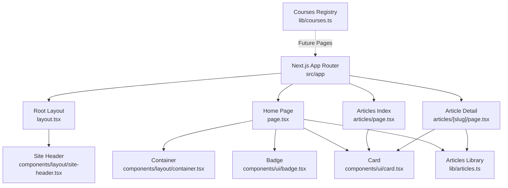
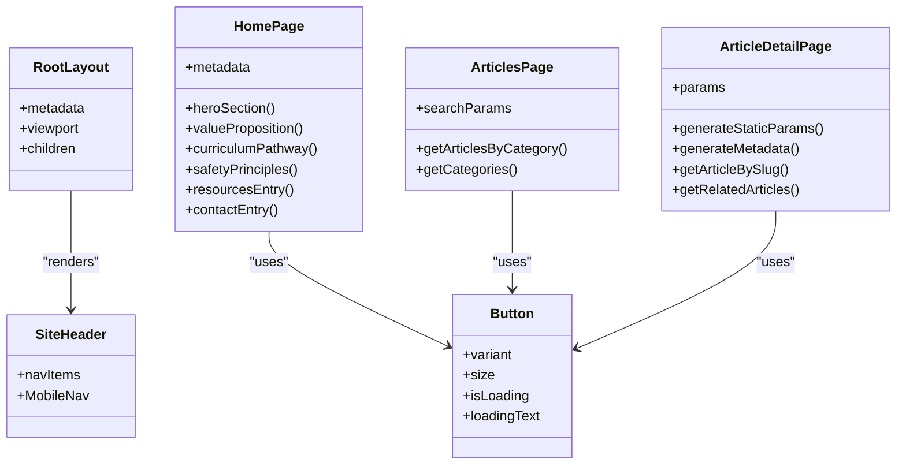
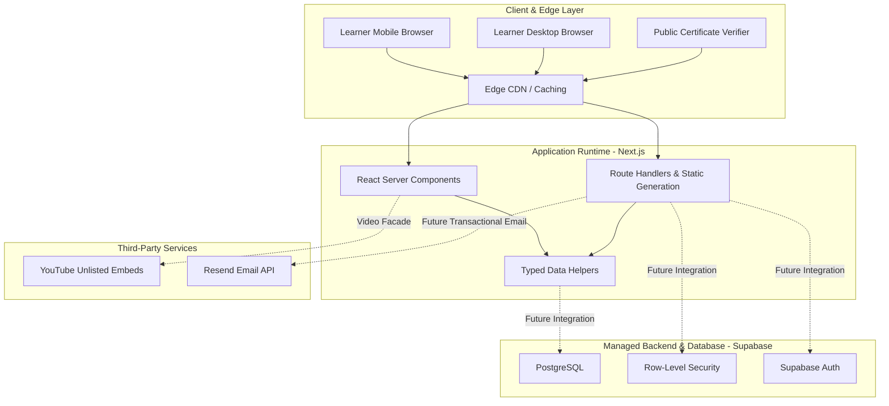
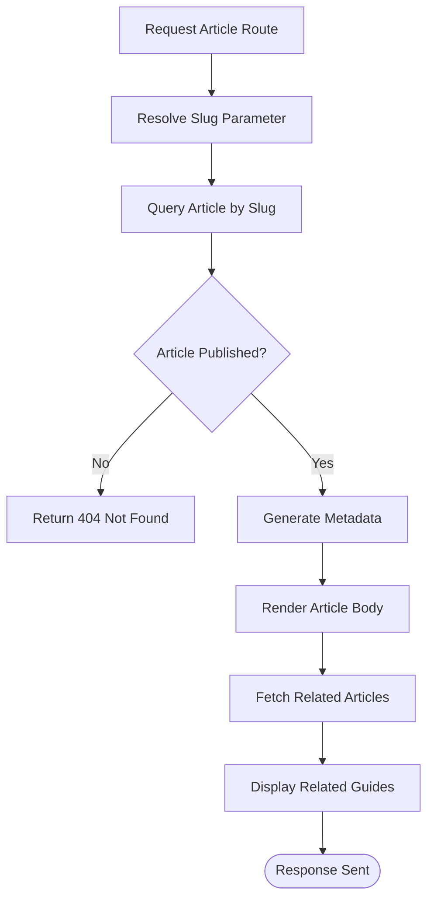
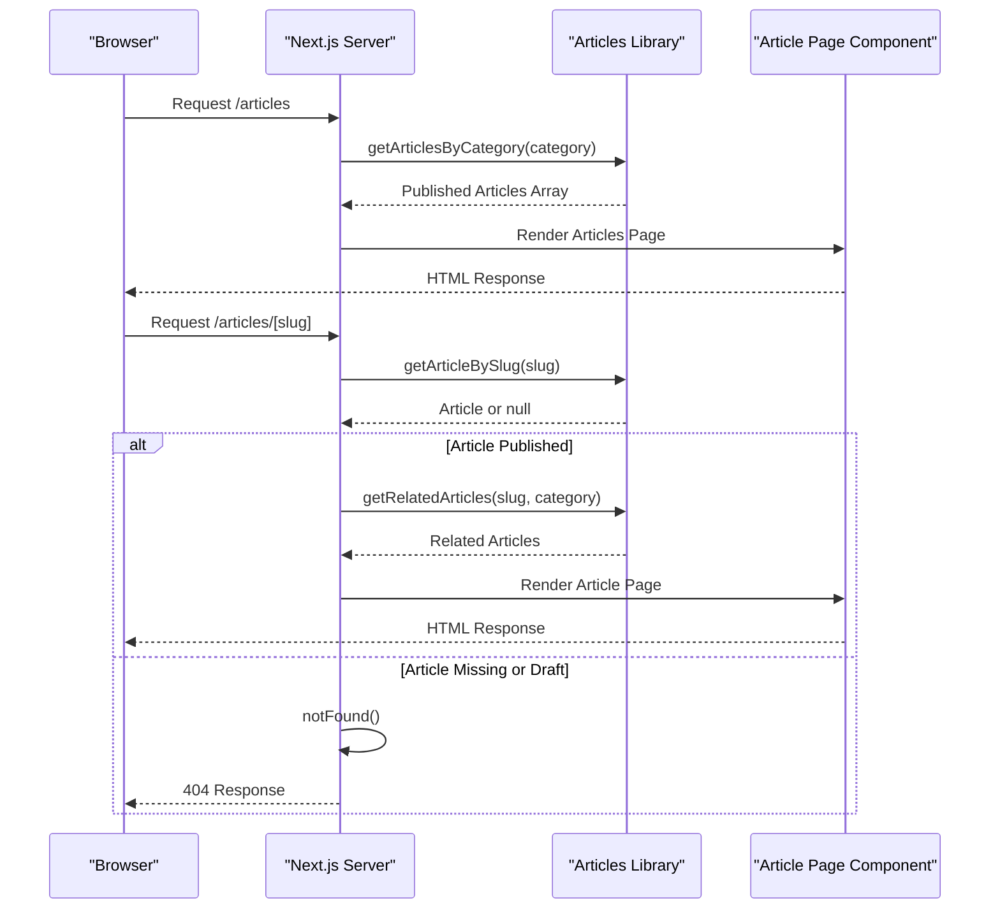
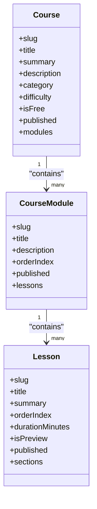
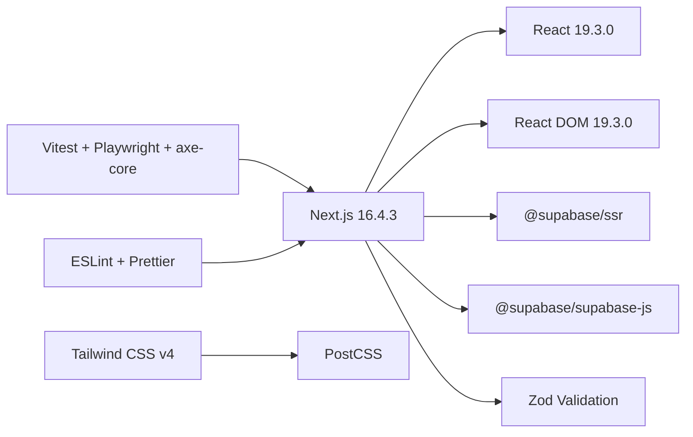

# Architecture & Design

<cite>
**Referenced Files in This Document**   
- [README.md](file://README.md)
- [package.json](file://package.json)
- [tsconfig.json](file://tsconfig.json)
- [vitest.config.ts](file://vitest.config.ts)
- [next.config.ts](file://next.config.ts)
- [postcss.config.mjs](file://postcss.config.mjs)
- [src/app/layout.tsx](file://src/app/layout.tsx)
- [src/app/page.tsx](file://src/app/page.tsx)
- [src/app/articles/page.tsx](file://src/app/articles/page.tsx)
- [src/app/articles/[slug]/page.tsx](file://src/app/articles/[slug]/page.tsx)
- [src/components/layout/site-header.tsx](file://src/components/layout/site-header.tsx)
- [src/components/ui/button.tsx](file://src/components/ui/button.tsx)
- [src/lib/articles.ts](file://src/lib/articles.ts)
- [src/lib/courses.ts](file://src/lib/courses.ts)
- [docs/PROJECT_BRIEF.md](file://docs/PROJECT_BRIEF.md)
- [docs/SYSTEM_ARCHITECTURE.md](file://docs/SYSTEM_ARCHITECTURE.md)
- [docs/TECHNOLOGY_EVALUATION.md](file://docs/TECHNOLOGY_EVALUATION.md)
- [docs/DESIGN_SYSTEM.md](file://docs/DESIGN_SYSTEM.md)
- [docs/DEPLOYMENT_AND_OPERATIONS.md](file://docs/DEPLOYMENT_AND_OPERATIONS.md)
- [docs/DECISION_LOG.md](file://docs/DECISION_LOG.md)
</cite>

## Table of Contents
1. [Introduction](#introduction)
2. [Project Structure](#project-structure)
3. [Core Components](#core-components)
4. [Architecture Overview](#architecture-overview)
5. [Detailed Component Analysis](#detailed-component-analysis)
6. [Dependency Analysis](#dependency-analysis)
7. [Performance Considerations](#performance-considerations)
8. [Troubleshooting Guide](#troubleshooting-guide)
9. [Conclusion](#conclusion)
10. [Appendices](#appendices)

## Introduction
SwimNigeria is a digital aquatic education platform designed to make structured swimming instruction and water safety knowledge accessible across Nigeria. The system emphasizes low-bandwidth performance, strict accessibility, server-side security, and a clean separation between static educational content and future interactive learner features.

At this stage, the project has completed Phase 1 scaffolding: Next.js App Router with TypeScript strict mode, Tailwind CSS v4 design tokens, code quality tooling, testing infrastructure, and foundational layout and UI primitives. No business features, course data, or database migrations have been introduced yet; the current runtime focuses on public marketing pages, article browsing, and a typed local curriculum registry.

Key architectural priorities include fast initial page loads for Nigerian mobile networks, zero-trust server-side validation, draft-content isolation, WCAG 2.1 AA accessibility, and a scalable foundation that can later integrate Supabase authentication, enrollment, assessments, certificates, and email delivery.

**Section sources**
- [README.md:1-16](file://README.md#L1-L16)
- [README.md:93-101](file://README.md#L93-L101)
- [docs/PROJECT_BRIEF.md:1-25](file://docs/PROJECT_BRIEF.md#L1-L25)
- [docs/PROJECT_BRIEF.md:53-59](file://docs/PROJECT_BRIEF.md#L53-L59)

## Project Structure
The repository follows a modern Next.js App Router structure with clear separation between application routes, shared layout components, reusable UI primitives, and typed data libraries.

**Diagram sources**
- [src/app/layout.tsx:1-42](file://src/app/layout.tsx#L1-L42)
- [src/app/page.tsx:1-30](file://src/app/page.tsx#L1-L30)
- [src/app/articles/page.tsx:1-30](file://src/app/articles/page.tsx#L1-L30)
- [src/app/articles/[slug]/page.tsx:1-20](file://src/app/articles/[slug]/page.tsx#L1-L20)
- [src/components/layout/site-header.tsx:1-15](file://src/components/layout/site-header.tsx#L1-L15)
- [src/lib/articles.ts:1-25](file://src/lib/articles.ts#L1-L25)
- [src/lib/courses.ts:1-15](file://src/lib/courses.ts#L1-L15)

The directory organization reflects a component-driven architecture:
- `src/app` contains route-based pages and layouts.
- `src/components/layout` holds site-wide structural components such as header, footer, and container.
- `src/components/ui` contains framework-free UI primitives like Button, Input, Card, Badge, Skeleton, and Dialog.
- `src/lib` contains typed data models, query helpers, constants, and utilities.
- `docs` contains engineering documentation, design system rules, deployment operations, and architecture decision records.

**Section sources**
- [src/app/layout.tsx:1-42](file://src/app/layout.tsx#L1-L42)
- [src/app/page.tsx:1-30](file://src/app/page.tsx#L1-L30)
- [src/components/layout/site-header.tsx:1-15](file://src/components/layout/site-header.tsx#L1-L15)
- [src/components/ui/button.tsx:1-15](file://src/components/ui/button.tsx#L1-L15)
- [src/lib/articles.ts:1-25](file://src/lib/articles.ts#L1-L25)
- [src/lib/courses.ts:1-15](file://src/lib/courses.ts#L1-L15)

## Core Components
The core runtime currently consists of:
- A root layout that defines global metadata, viewport configuration, skip-to-content accessibility support, and consistent body styling.
- A home page that composes brand messaging, curriculum pathway cards, safety principles, resource entry points, and community contact sections.
- An articles index page that filters published articles by category and renders card-based listings.
- An article detail route that generates static parameters, dynamic metadata, draft protection via `notFound`, and related article suggestions.
- A site header with desktop navigation, brand identity, and a mobile navigation trigger.
- UI primitives such as Button, which enforce accessible touch targets, focus rings, loading states, and reduced-motion behavior.

**Diagram sources**
- [src/app/layout.tsx:19-42](file://src/app/layout.tsx#L19-L42)
- [src/app/page.tsx:28-96](file://src/app/page.tsx#L28-L96)
- [src/app/articles/page.tsx:21-30](file://src/app/articles/page.tsx#L21-L30)
- [src/app/articles/[slug]/page.tsx:9-46](file://src/app/articles/[slug]/page.tsx#L9-L46)
- [src/components/layout/site-header.tsx:6-15](file://src/components/layout/site-header.tsx#L6-L15)
- [src/components/ui/button.tsx:8-15](file://src/components/ui/button.tsx#L8-L15)

**Section sources**
- [src/app/layout.tsx:1-42](file://src/app/layout.tsx#L1-L42)
- [src/app/page.tsx:1-96](file://src/app/page.tsx#L1-L96)
- [src/app/articles/page.tsx:1-86](file://src/app/articles/page.tsx#L1-L86)
- [src/app/articles/[slug]/page.tsx:1-46](file://src/app/articles/[slug]/page.tsx#L1-L46)
- [src/components/layout/site-header.tsx:1-84](file://src/components/layout/site-header.tsx#L1-L84)
- [src/components/ui/button.tsx:1-103](file://src/components/ui/button.tsx#L1-L103)

## Architecture Overview
SwimNigeria’s architecture is optimized for low-latency public content, strong type safety, and future extensibility toward authenticated learning flows.

**Diagram sources**
- [docs/SYSTEM_ARCHITECTURE.md:12-59](file://docs/SYSTEM_ARCHITECTURE.md#L12-L59)
- [docs/SYSTEM_ARCHITECTURE.md:65-83](file://docs/SYSTEM_ARCHITECTURE.md#L65-L83)
- [docs/SYSTEM_ARCHITECTURE.md:96-112](file://docs/SYSTEM_ARCHITECTURE.md#L96-L112)
- [docs/SYSTEM_ARCHITECTURE.md:122-139](file://docs/SYSTEM_ARCHITECTURE.md#L122-L139)

### Technology Stack Decisions
- **Framework:** Next.js 16 App Router with React Server Components and TypeScript strict mode.
- **Styling:** Tailwind CSS v4 with SwimNigeria Red-and-White brand tokens.
- **Testing:** Vitest for unit/component tests, Playwright for E2E smoke tests, axe-core for automated accessibility audits.
- **Database & Auth (Target):** PostgreSQL and Supabase Auth with SSR HttpOnly cookies.
- **Video Delivery:** Unlisted YouTube embeds with privacy facades to avoid bandwidth costs.
- **Email Delivery:** Resend API for transactional emails.
- **Hosting:** Vercel Hobby tier for launch, with Cloudflare Pages considered for commercial compliance.

**Section sources**
- [README.md:93-101](file://README.md#L93-L101)
- [package.json:18-45](file://package.json#L18-L45)
- [docs/TECHNOLOGY_EVALUATION.md:9-19](file://docs/TECHNOLOGY_EVALUATION.md#L9-L19)
- [docs/TECHNOLOGY_EVALUATION.md:24-43](file://docs/TECHNOLOGY_EVALUATION.md#L24-L43)
- [docs/TECHNOLOGY_EVALUATION.md:47-66](file://docs/TECHNOLOGY_EVALUATION.md#L47-L66)
- [docs/TECHNOLOGY_EVALUATION.md:70-95](file://docs/TECHNOLOGY_EVALUATION.md#L70-L95)
- [docs/TECHNOLOGY_EVALUATION.md:103-133](file://docs/TECHNOLOGY_EVALUATION.md#L103-L133)

## Detailed Component Analysis

### Root Layout and Global Accessibility
The root layout establishes:
- Global metadata including title and description.
- Viewport configuration with device-width scaling and brand theme color.
- A skip-to-main-content link for keyboard accessibility.
- Consistent body background, text color, and flex column layout.
- Integration of `SiteHeader` and `SiteFooter`.

This layout enforces a mobile-first baseline while allowing responsive expansion through Tailwind utility classes.

**Section sources**
- [src/app/layout.tsx:1-42](file://src/app/layout.tsx#L1-L42)

### Home Page Composition
The home page composes multiple semantic sections:
- Hero section with brand badge, headline, description, and call-to-action links.
- Educational value proposition explaining why structured aquatic education matters.
- Structured learning pathway showing planned beginner stages.
- Critical water safety principles emphasizing silent drowning, supervision, bystander rescue, and float-to-live survival tactics.
- Educational resources entry point linking to published articles.
- Community and contact entry points for educators, instructors, and learners.

The page uses `Container`, `Badge`, and `Card` primitives to maintain visual consistency and accessibility.

**Section sources**
- [src/app/page.tsx:16-96](file://src/app/page.tsx#L16-L96)
- [src/app/page.tsx:98-222](file://src/app/page.tsx#L98-L222)
- [src/app/page.tsx:224-402](file://src/app/page.tsx#L224-L402)
- [src/app/page.tsx:404-488](file://src/app/page.tsx#L404-L488)
- [src/app/page.tsx:490-645](file://src/app/page.tsx#L490-L645)

### Articles Index Page
The articles index page:
- Accepts a `category` search parameter.
- Filters published articles using `getArticlesByCategory`.
- Renders category navigation with active state and accessibility attributes.
- Displays article cards with category badges, summaries, read time, and publication dates.
- Provides an empty state when no articles match the selected category.

This page demonstrates server-side rendering of static content with typed filtering logic.

**Section sources**
- [src/app/articles/page.tsx:15-30](file://src/app/articles/page.tsx#L15-L30)
- [src/app/articles/page.tsx:48-86](file://src/app/articles/page.tsx#L48-L86)
- [src/app/articles/page.tsx:88-154](file://src/app/articles/page.tsx#L88-L154)
- [src/app/articles/page.tsx:156-168](file://src/app/articles/page.tsx#L156-L168)

### Article Detail Page and Draft Protection
The article detail route implements:
- Static parameter generation from published articles.
- Dynamic metadata generation based on resolved article data.
- Draft protection: unpublished or missing articles trigger `notFound`.
- Related article suggestions within the same category or general pool.
- Responsible educational scope disclaimer.

**Diagram sources**
- [src/app/articles/[slug]/page.tsx:13-18](file://src/app/articles/[slug]/page.tsx#L13-L18)
- [src/app/articles/[slug]/page.tsx:20-35](file://src/app/articles/[slug]/page.tsx#L20-L35)
- [src/app/articles/[slug]/page.tsx:37-46](file://src/app/articles/[slug]/page.tsx#L37-L46)
- [src/lib/articles.ts:193-199](file://src/lib/articles.ts#L193-L199)

**Section sources**
- [src/app/articles/[slug]/page.tsx:1-46](file://src/app/articles/[slug]/page.tsx#L1-L46)
- [src/app/articles/[slug]/page.tsx:48-206](file://src/app/articles/[slug]/page.tsx#L48-L206)
- [src/lib/articles.ts:181-243](file://src/lib/articles.ts#L181-L243)

### Site Header and Navigation
The site header provides:
- Brand logo and name with accessible focus styles.
- Desktop navigation links for Home, Courses, Safety Articles, About, and Contact.
- A primary call-to-action linking to the courses section.
- A mobile navigation trigger component.

This component separates navigation data from presentation and supports responsive breakpoints.

**Section sources**
- [src/components/layout/site-header.tsx:6-15](file://src/components/layout/site-header.tsx#L6-L15)
- [src/components/layout/site-header.tsx:14-84](file://src/components/layout/site-header.tsx#L14-L84)

### UI Primitive: Button
The Button primitive enforces:
- Typed variants (`primary`, `secondary`, `outline`, `ghost`, `aquatic`, `danger`).
- Typed sizes (`sm`, `md`, `lg`, `icon`).
- Accessible defaults including `type="button"`, minimum touch target sizing, focus rings, and disabled states.
- Loading state with `aria-busy` and optional spinner.
- Reduced motion compatibility.

This component exemplifies the design system’s commitment to accessibility and consistent interaction patterns.

**Section sources**
- [src/components/ui/button.tsx:1-15](file://src/components/ui/button.tsx#L1-L15)
- [src/components/ui/button.tsx:15-35](file://src/components/ui/button.tsx#L15-L35)
- [src/components/ui/button.tsx:37-103](file://src/components/ui/button.tsx#L37-L103)

### Data Flow: Static Content Through Query Functions to Pages
The current data flow for articles is fully static and server-rendered:
1. `src/lib/articles.ts` defines typed article models and publishes only articles where `published` is true.
2. `getPublishedArticles` returns sorted published articles.
3. `getArticleBySlug` resolves a single article and returns `null` for unpublished entries.
4. `getArticlesByCategory` filters published articles by normalized category.
5. `getRelatedArticles` suggests related guides excluding the current article.
6. Page components consume these functions during server rendering.

**Diagram sources**
- [src/lib/articles.ts:181-243](file://src/lib/articles.ts#L181-L243)
- [src/app/articles/page.tsx:25-30](file://src/app/articles/page.tsx#L25-L30)
- [src/app/articles/[slug]/page.tsx:13-46](file://src/app/articles/[slug]/page.tsx#L13-L46)

**Section sources**
- [src/lib/articles.ts:1-25](file://src/lib/articles.ts#L1-L25)
- [src/lib/articles.ts:181-243](file://src/lib/articles.ts#L181-L243)
- [src/app/articles/page.tsx:25-30](file://src/app/articles/page.tsx#L25-L30)
- [src/app/articles/[slug]/page.tsx:13-46](file://src/app/articles/[slug]/page.tsx#L13-L46)

### Curriculum Registry and Draft Isolation
The curriculum registry defines a strongly typed hierarchy:
- `Course` contains `modules`.
- `CourseModule` contains ordered `lessons`.
- Each entity has a `published` flag.
- Preview lessons are marked separately but still subject to draft isolation at module and course levels.

This model prepares the system for future database integration while enforcing editorial safety boundaries.

**Diagram sources**
- [src/lib/courses.ts:41-78](file://src/lib/courses.ts#L41-L78)
- [src/lib/courses.ts:139-171](file://src/lib/courses.ts#L139-L171)

**Section sources**
- [src/lib/courses.ts:1-15](file://src/lib/courses.ts#L1-L15)
- [src/lib/courses.ts:41-78](file://src/lib/courses.ts#L41-L78)
- [src/lib/courses.ts:139-171](file://src/lib/courses.ts#L139-L171)

### Design System: SwimNigeria Red-and-White Tokens and WCAG 2.1 AA
The design system specifies:
- Primary brand colors: Red and Crisp White.
- Deep slate neutrals for typography and surfaces.
- Aquatic context accents for progress and information states.
- Semantic feedback tones for success, error, and warning.
- Typography scale, spacing grid, and responsive breakpoints.
- WCAG 2.1 AA requirements including contrast ratios, visible focus, and reduced motion support.
- Implemented UI primitives inventory with accessibility and polish features.

**Section sources**
- [docs/DESIGN_SYSTEM.md:1-18](file://docs/DESIGN_SYSTEM.md#L1-L18)
- [docs/DESIGN_SYSTEM.md:15-58](file://docs/DESIGN_SYSTEM.md#L15-L58)
- [docs/DESIGN_SYSTEM.md:61-95](file://docs/DESIGN_SYSTEM.md#L61-L95)
- [docs/DESIGN_SYSTEM.md:98-149](file://docs/DESIGN_SYSTEM.md#L98-L149)
- [docs/DESIGN_SYSTEM.md:152-182](file://docs/DESIGN_SYSTEM.md#L152-L182)

## Dependency Analysis
The project’s dependencies reflect a focused, production-grade frontend stack with strict type safety and comprehensive testing.

**Diagram sources**
- [package.json:18-45](file://package.json#L18-L45)
- [postcss.config.mjs](file://postcss.config.mjs)

**Section sources**
- [package.json:1-48](file://package.json#L1-L48)
- [README.md:48-62](file://README.md#L48-L62)

## Performance Considerations
SwimNigeria prioritizes performance for Nigerian connectivity patterns:
- Server Components render lightweight static HTML for public content.
- Interactive elements are isolated as client components only when necessary.
- Video assets are offloaded to YouTube unlisted embeds with privacy-enhanced facades.
- Aggressive asset caching and lazy media loading reduce initial payload size.
- Client JavaScript budget targets under 120KB gzipped for public routes.
- Fonts and assets use optimized strategies suitable for mobile devices.

These decisions align with the project’s goal of sub-2-second initial load times on 3G/4G connections.

**Section sources**
- [docs/SYSTEM_ARCHITECTURE.md:65-73](file://docs/SYSTEM_ARCHITECTURE.md#L65-L73)
- [docs/SYSTEM_ARCHITECTURE.md:122-130](file://docs/SYSTEM_ARCHITECTURE.md#L122-L130)
- [docs/SYSTEM_ARCHITECTURE.md:219-225](file://docs/SYSTEM_ARCHITECTURE.md#L219-L225)
- [docs/PROJECT_BRIEF.md:53-59](file://docs/PROJECT_BRIEF.md#L53-L59)

## Troubleshooting Guide
Common operational and development issues include:

### TypeScript Strict Mode Failures
- The project enforces `"strict": true`, `"noImplicitAny": true`, and `"strictNullChecks": true`.
- Type errors must be resolved before build or test execution.
- Use `npm run typecheck` to validate types without emitting output.

**Section sources**
- [tsconfig.json:1-36](file://tsconfig.json#L1-L36)
- [README.md:56-57](file://README.md#L56-L57)

### Test Environment Configuration
- Vitest runs in a jsdom environment with global test helpers.
- Tests are scoped to `src/**/*.{test,spec}.{ts,tsx}` and exclude E2E and generated files.
- Path aliases resolve `@/*` to `./src/*`.

**Section sources**
- [vitest.config.ts:1-18](file://vitest.config.ts#L1-L18)
- [README.md:58-59](file://README.md#L58-L59)

### Draft Content Returning 404
- Unpublished articles return `notFound()` instead of leaking draft content.
- Ensure `published` flags are correctly set in data libraries before exposing routes.

**Section sources**
- [src/app/articles/[slug]/page.tsx:37-46](file://src/app/articles/[slug]/page.tsx#L37-L46)
- [src/lib/articles.ts:193-199](file://src/lib/articles.ts#L193-L199)

### Deployment Pipeline Failures
- Every deployment pipeline should execute format checks, type checks, linting, unit tests, E2E tests, and production build steps.
- If any check fails, the build aborts and existing production traffic remains unaffected.

**Section sources**
- [docs/DEPLOYMENT_AND_OPERATIONS.md:34-48](file://docs/DEPLOYMENT_AND_OPERATIONS.md#L34-L48)

## Conclusion
SwimNigeria’s architecture balances immediate usability with long-term scalability. The Next.js App Router with TypeScript strict mode provides a strong foundation for SEO-friendly public content, server-side rendering, and future interactive learner experiences. Tailwind CSS v4 and the Red-and-White design system ensure consistent, accessible branding. Draft-content isolation, WCAG 2.1 AA standards, and mobile-first optimization reflect the platform’s commitment to Nigerian learners and public safety.

As the project progresses, the current static content layer will evolve into a full-stack educational platform with Supabase-backed authentication, enrollment, assessments, certificates, and transactional email delivery—while preserving the zero-cost sustainability and enterprise-grade security posture established in Phase 1.

## Appendices

### Architectural Decision Records Summary
Key decisions include:
- Separation of foundation phase from application implementation.
- Selection of Next.js App Router, TypeScript, and Tailwind CSS.
- Managed PostgreSQL via Supabase Free Tier.
- Privacy-enhanced YouTube unlisted video embeds.
- Tamper-evident certificate verification via NanoID.
- AI development workflow integration.
- Red-and-white brand strategy.
- Pedagogical module hierarchy.
- Learner registration, server-side validation, and email verification.

**Section sources**
- [docs/DECISION_LOG.md:1-18](file://docs/DECISION_LOG.md#L1-L18)
- [docs/DECISION_LOG.md:21-45](file://docs/DECISION_LOG.md#L21-L45)
- [docs/DECISION_LOG.md:48-59](file://docs/DECISION_LOG.md#L48-L59)
- [docs/DECISION_LOG.md:62-73](file://docs/DECISION_LOG.md#L62-L73)
- [docs/DECISION_LOG.md:76-87](file://docs/DECISION_LOG.md#L76-L87)
- [docs/DECISION_LOG.md:90-100](file://docs/DECISION_LOG.md#L90-L100)
- [docs/DECISION_LOG.md:103-114](file://docs/DECISION_LOG.md#L103-L114)
- [docs/DECISION_LOG.md:117-128](file://docs/DECISION_LOG.md#L117-L128)
- [docs/DECISION_LOG.md:131-143](file://docs/DECISION_LOG.md#L131-L143)