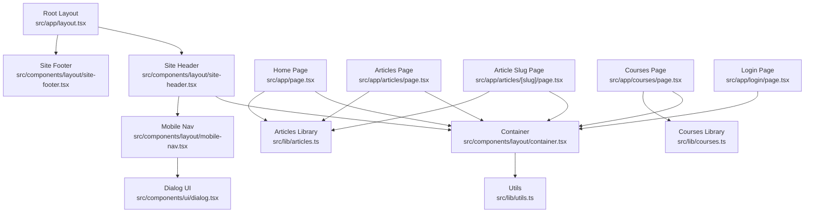
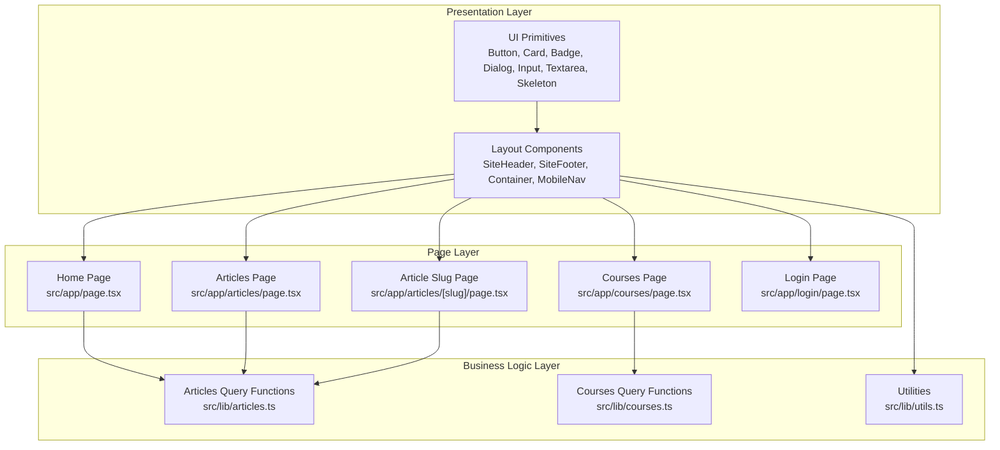
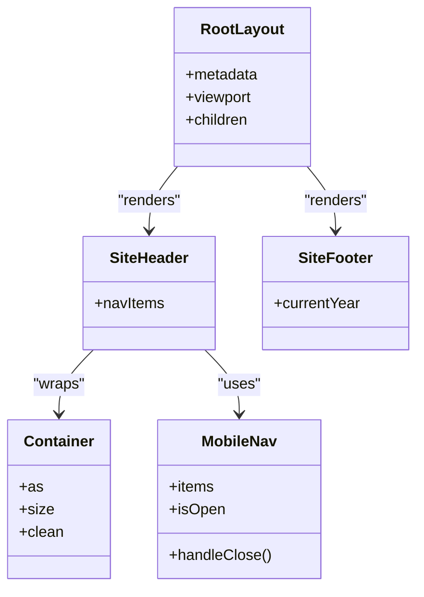
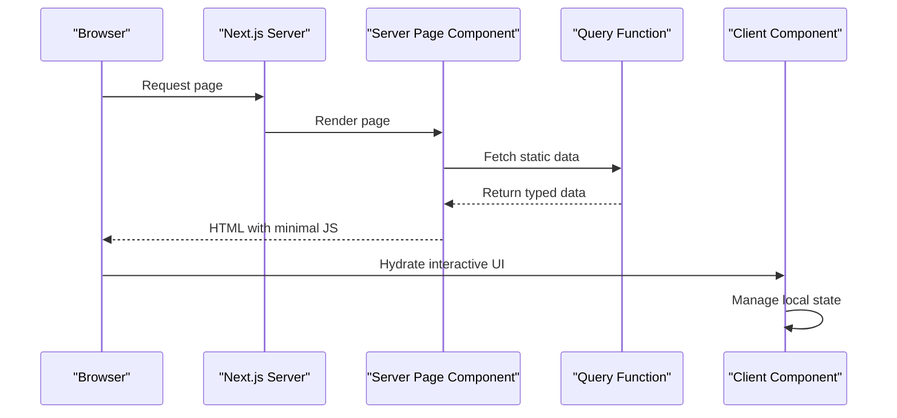
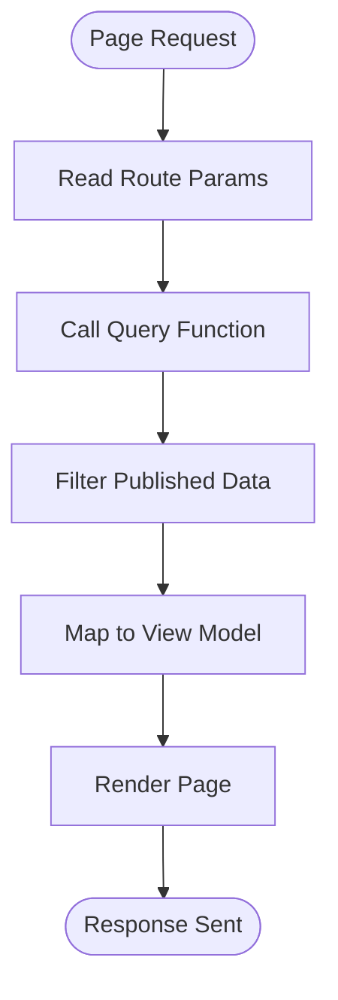
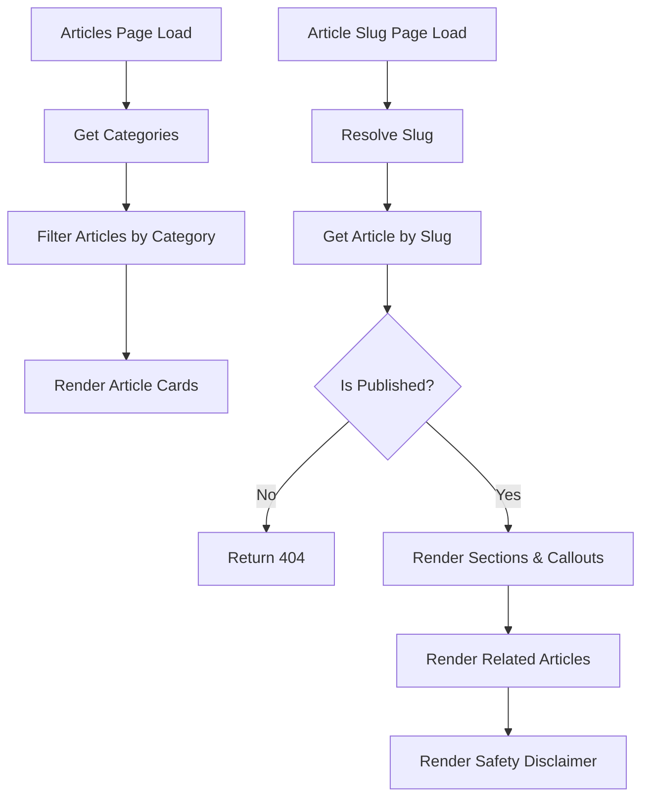
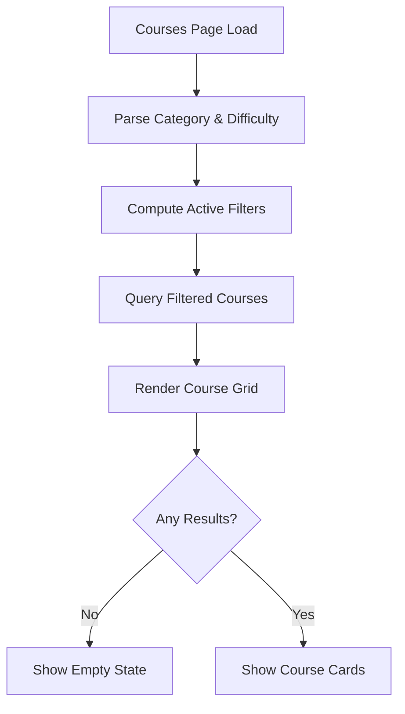
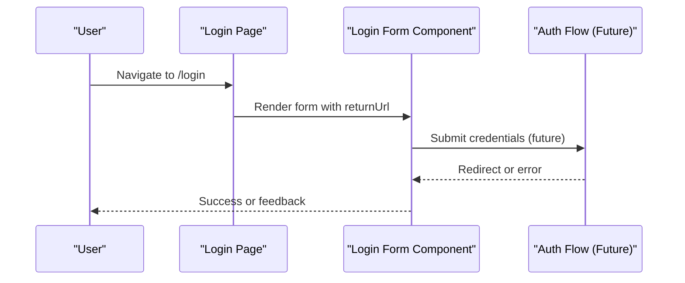
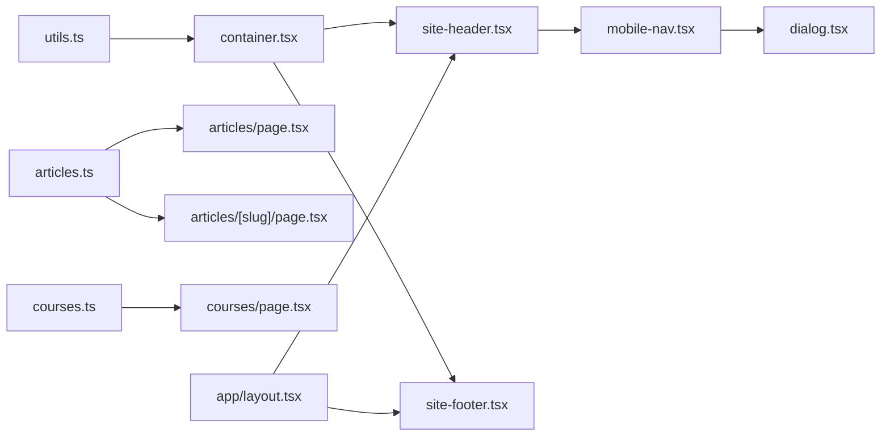

# Component Patterns & Architecture

<cite>
**Referenced Files in This Document**
- [README.md](file://README.md)
- [layout.tsx](file://src/app/layout.tsx)
- [site-header.tsx](file://src/components/layout/site-header.tsx)
- [site-footer.tsx](file://src/components/layout/site-footer.tsx)
- [container.tsx](file://src/components/layout/container.tsx)
- [mobile-nav.tsx](file://src/components/layout/mobile-nav.tsx)
- [page.tsx](file://src/app/page.tsx)
- [articles-page.tsx](file://src/app/articles/page.tsx)
- [article-slug-page.tsx](file://src/app/articles/[slug]/page.tsx)
- [courses-page.tsx](file://src/app/courses/page.tsx)
- [login-page.tsx](file://src/app/login/page.tsx)
- [articles-data.ts](file://src/lib/articles.ts)
- [courses-data.ts](file://src/lib/courses.ts)
- [utils.ts](file://src/lib/utils.ts)
- [dialog.tsx](file://src/components/ui/dialog.tsx)
</cite>

## Table of Contents
1. [Introduction](#introduction)
2. [Project Structure](#project-structure)
3. [Core Components](#core-components)
4. [Architecture Overview](#architecture-overview)
5. [Detailed Component Analysis](#detailed-component-analysis)
6. [Dependency Analysis](#dependency-analysis)
7. [Performance Considerations](#performance-considerations)
8. [Troubleshooting Guide](#troubleshooting-guide)
9. [Conclusion](#conclusion)

## Introduction
This document explains SwimNigeria’s component architecture and design patterns with a focus on:
- The hierarchy from layout components to page components and UI primitives.
- Separation of concerns between presentation, layout, and business logic.
- Server component versus client component boundaries using `use client`.
- Data flow from static content through query functions to pages.
- Composition patterns, prop drilling avoidance, and state management approaches.
- Reusable patterns such as the article rendering system, course curriculum display, and authentication flows.
- Performance techniques including code splitting, lazy loading, and memoization strategies.

The project is a Next.js App Router application focused on structured swimming education and water safety for Nigerian learners. It currently emphasizes scaffolding, design tokens, accessibility, and reusable UI foundations.

**Section sources**
- [README.md:1-111](file://README.md#L1-L111)

## Project Structure
SwimNigeria follows a layered structure:
- `src/app`: Route-based pages and layouts.
- `src/components/layout`: Shared layout shell components.
- `src/components/ui`: Reusable UI primitives.
- `src/lib`: Business logic, data models, and query helpers.

**Diagram sources**
- [layout.tsx:1-42](file://src/app/layout.tsx#L1-L42)
- [site-header.tsx:1-84](file://src/components/layout/site-header.tsx#L1-L84)
- [site-footer.tsx:1-141](file://src/components/layout/site-footer.tsx#L1-L141)
- [container.tsx:1-40](file://src/components/layout/container.tsx#L1-L40)
- [mobile-nav.tsx:1-97](file://src/components/layout/mobile-nav.tsx#L1-L97)
- [dialog.tsx:1-251](file://src/components/ui/dialog.tsx#L1-L251)
- [page.tsx:1-645](file://src/app/page.tsx#L1-L645)
- [articles-page.tsx:1-168](file://src/app/articles/page.tsx#L1-L168)
- [article-slug-page.tsx:1-206](file://src/app/articles/[slug]/page.tsx#L1-L206)
- [courses-page.tsx:1-367](file://src/app/courses/page.tsx#L1-L367)
- [login-page.tsx:1-102](file://src/app/login/page.tsx#L1-L102)
- [articles-data.ts:1-243](file://src/lib/articles.ts#L1-L243)
- [courses-data.ts:1-800](file://src/lib/courses.ts#L1-L800)
- [utils.ts:1-27](file://src/lib/utils.ts#L1-L27)

**Section sources**
- [layout.tsx:1-42](file://src/app/layout.tsx#L1-L42)
- [site-header.tsx:1-84](file://src/components/layout/site-header.tsx#L1-L84)
- [site-footer.tsx:1-141](file://src/components/layout/site-footer.tsx#L1-L141)
- [container.tsx:1-40](file://src/components/layout/container.tsx#L1-L40)
- [mobile-nav.tsx:1-97](file://src/components/layout/mobile-nav.tsx#L1-L97)
- [dialog.tsx:1-251](file://src/components/ui/dialog.tsx#L1-L251)
- [page.tsx:1-645](file://src/app/page.tsx#L1-L645)
- [articles-page.tsx:1-168](file://src/app/articles/page.tsx#L1-L168)
- [article-slug-page.tsx:1-206](file://src/app/articles/[slug]/page.tsx#L1-L206)
- [courses-page.tsx:1-367](file://src/app/courses/page.tsx#L1-L367)
- [login-page.tsx:1-102](file://src/app/login/page.tsx#L1-L102)
- [articles-data.ts:1-243](file://src/lib/articles.ts#L1-L243)
- [courses-data.ts:1-800](file://src/lib/courses.ts#L1-L800)
- [utils.ts:1-27](file://src/lib/utils.ts#L1-L27)

## Core Components
This section documents the foundational building blocks and their responsibilities.

### Layout Shell
- Root layout defines global metadata, viewport settings, skip-to-content link, header, main content area, and footer.
- It composes `SiteHeader` and `SiteFooter`, ensuring consistent site-wide chrome.

**Section sources**
- [layout.tsx:1-42](file://src/app/layout.tsx#L1-L42)

### Site Header
- Renders brand logo, desktop navigation links, call-to-action, and mobile menu trigger.
- Uses `Container` for horizontal alignment and `MobileNav` for responsive drawer behavior.
- Navigation items are defined locally and passed into the mobile drawer.

**Section sources**
- [site-header.tsx:1-84](file://src/components/layout/site-header.tsx#L1-L84)

### Site Footer
- Provides brand information, educational links, platform links, standards statements, mandatory safety disclaimer, and copyright.
- Uses `Container` for consistent width and spacing.

**Section sources**
- [site-footer.tsx:1-141](file://src/components/layout/site-footer.tsx#L1-L141)

### Container
- A flexible layout wrapper supporting semantic element override, size variants, and clean mode.
- Composes Tailwind classes via `cn` utility for conditional styling.

**Section sources**
- [container.tsx:1-40](file://src/components/layout/container.tsx#L1-L40)
- [utils.ts:1-27](file://src/lib/utils.ts#L1-L27)

### Mobile Navigation Drawer
- Client component that manages open/close state and renders an accessible drawer dialog.
- Integrates with the shared `Dialog` UI primitive.

**Section sources**
- [mobile-nav.tsx:1-97](file://src/components/layout/mobile-nav.tsx#L1-L97)
- [dialog.tsx:1-251](file://src/components/ui/dialog.tsx#L1-L251)

### UI Primitives
- Dialog primitive provides modal/drawer semantics, focus management, backdrop handling, and accessible labeling.
- Other UI primitives (Button, Card, Badge, Input, Textarea, Skeleton) are used by pages and layout components for consistent presentation.

**Section sources**
- [dialog.tsx:1-251](file://src/components/ui/dialog.tsx#L1-L251)

## Architecture Overview
SwimNigeria uses a clear separation between:
- Presentation components: UI primitives and small presentational pieces.
- Layout components: Site-wide structural elements like header, footer, container.
- Page components: Route-level components that compose layout and UI components and fetch data.
- Business logic library: Typed data models and query functions under `src/lib`.

**Diagram sources**
- [page.tsx:1-645](file://src/app/page.tsx#L1-L645)
- [articles-page.tsx:1-168](file://src/app/articles/page.tsx#L1-L168)
- [article-slug-page.tsx:1-206](file://src/app/articles/[slug]/page.tsx#L1-L206)
- [courses-page.tsx:1-367](file://src/app/courses/page.tsx#L1-L367)
- [login-page.tsx:1-102](file://src/app/login/page.tsx#L1-L102)
- [articles-data.ts:1-243](file://src/lib/articles.ts#L1-L243)
- [courses-data.ts:1-800](file://src/lib/courses.ts#L1-L800)
- [utils.ts:1-27](file://src/lib/utils.ts#L1-L27)

**Section sources**
- [page.tsx:1-645](file://src/app/page.tsx#L1-L645)
- [articles-page.tsx:1-168](file://src/app/articles/page.tsx#L1-L168)
- [article-slug-page.tsx:1-206](file://src/app/articles/[slug]/page.tsx#L1-L206)
- [courses-page.tsx:1-367](file://src/app/courses/page.tsx#L1-L367)
- [login-page.tsx:1-102](file://src/app/login/page.tsx#L1-L102)
- [articles-data.ts:1-243](file://src/lib/articles.ts#L1-L243)
- [courses-data.ts:1-800](file://src/lib/courses.ts#L1-L800)
- [utils.ts:1-27](file://src/lib/utils.ts#L1-L27)

## Detailed Component Analysis

### Layout Components Hierarchy
- Root layout composes `SiteHeader` and `SiteFooter`.
- `SiteHeader` uses `Container` and delegates mobile navigation to `MobileNav`.
- `SiteFooter` uses `Container` for consistent width and spacing.
- `Container` centralizes responsive width and padding, with optional semantic overrides.

**Diagram sources**
- [layout.tsx:1-42](file://src/app/layout.tsx#L1-L42)
- [site-header.tsx:1-84](file://src/components/layout/site-header.tsx#L1-L84)
- [site-footer.tsx:1-141](file://src/components/layout/site-footer.tsx#L1-L141)
- [container.tsx:1-40](file://src/components/layout/container.tsx#L1-L40)
- [mobile-nav.tsx:1-97](file://src/components/layout/mobile-nav.tsx#L1-L97)

**Section sources**
- [layout.tsx:1-42](file://src/app/layout.tsx#L1-L42)
- [site-header.tsx:1-84](file://src/components/layout/site-header.tsx#L1-L84)
- [site-footer.tsx:1-141](file://src/components/layout/site-footer.tsx#L1-L141)
- [container.tsx:1-40](file://src/components/layout/container.tsx#L1-L40)
- [mobile-nav.tsx:1-97](file://src/components/layout/mobile-nav.tsx#L1-L97)

### Server vs Client Component Boundaries
- Most pages are server components: they render HTML directly, read route parameters, and call query functions.
- Interactive UI requires `use client`:
  - `MobileNav` uses local state to open/close the drawer.
  - `Dialog` primitive manages native `<dialog>` lifecycle, focus, backdrop clicks, and accessibility attributes.

**Diagram sources**
- [articles-page.tsx:1-168](file://src/app/articles/page.tsx#L1-L168)
- [article-slug-page.tsx:1-206](file://src/app/articles/[slug]/page.tsx#L1-L206)
- [courses-page.tsx:1-367](file://src/app/courses/page.tsx#L1-L367)
- [mobile-nav.tsx:1-97](file://src/components/layout/mobile-nav.tsx#L1-L97)
- [dialog.tsx:1-251](file://src/components/ui/dialog.tsx#L1-L251)

**Section sources**
- [mobile-nav.tsx:1-97](file://src/components/layout/mobile-nav.tsx#L1-L97)
- [dialog.tsx:1-251](file://src/components/ui/dialog.tsx#L1-L251)

### Data Flow: Static Content Through Query Functions to Pages
- Articles:
  - `getPublishedArticles`, `getArticlesByCategory`, `getArticleBySlug`, `getRelatedArticles`, and `getCategories` provide typed access to static article data.
  - Pages filter, sort, and render articles without exposing draft content.
- Courses:
  - `COURSES_DATA` defines courses, modules, lessons, and preview flags.
  - Query helpers expose filtered and sanitized views for public routes.

**Diagram sources**
- [articles-data.ts:1-243](file://src/lib/articles.ts#L1-L243)
- [articles-page.tsx:1-168](file://src/app/articles/page.tsx#L1-L168)
- [article-slug-page.tsx:1-206](file://src/app/articles/[slug]/page.tsx#L1-L206)
- [courses-data.ts:1-800](file://src/lib/courses.ts#L1-L800)
- [courses-page.tsx:1-367](file://src/app/courses/page.tsx#L1-L367)

**Section sources**
- [articles-data.ts:1-243](file://src/lib/articles.ts#L1-L243)
- [articles-page.tsx:1-168](file://src/app/articles/page.tsx#L1-L168)
- [article-slug-page.tsx:1-206](file://src/app/articles/[slug]/page.tsx#L1-L206)
- [courses-data.ts:1-800](file://src/lib/courses.ts#L1-L800)
- [courses-page.tsx:1-367](file://src/app/courses/page.tsx#L1-L367)

### Article Rendering System
- The article list page supports category filtering and displays cards with badges, summaries, and read time.
- The article detail page:
  - Generates static params for published articles.
  - Produces dynamic metadata per article.
  - Renders sections, paragraphs, and callouts with appropriate visual emphasis.
  - Shows related articles and responsible safety disclaimers.

**Diagram sources**
- [articles-page.tsx:1-168](file://src/app/articles/page.tsx#L1-L168)
- [article-slug-page.tsx:1-206](file://src/app/articles/[slug]/page.tsx#L1-L206)
- [articles-data.ts:1-243](file://src/lib/articles.ts#L1-L243)

**Section sources**
- [articles-page.tsx:1-168](file://src/app/articles/page.tsx#L1-L168)
- [article-slug-page.tsx:1-206](file://src/app/articles/[slug]/page.tsx#L1-L206)
- [articles-data.ts:1-243](file://src/lib/articles.ts#L1-L243)

### Course Curriculum Display
- The courses page reads search parameters for category and difficulty filters.
- It computes active filters, generates preserved filter URLs, and renders course cards with outcomes, duration, module counts, and placeholder actions.
- The underlying library defines rich course structures with modules, lessons, previews, and safety notices.

**Diagram sources**
- [courses-page.tsx:1-367](file://src/app/courses/page.tsx#L1-L367)
- [courses-data.ts:1-800](file://src/lib/courses.ts#L1-L800)

**Section sources**
- [courses-page.tsx:1-367](file://src/app/courses/page.tsx#L1-L367)
- [courses-data.ts:1-800](file://src/lib/courses.ts#L1-L800)

### Authentication Flow Pattern
- The login page composes a form component and communicates a return URL parameter.
- Security messaging highlights encrypted auth, SSR cookie guard, and verifiable identity.
- Future phases plan Supabase Auth with SSR HttpOnly cookies; current implementation focuses on layout and UX.

**Diagram sources**
- [login-page.tsx:1-102](file://src/app/login/page.tsx#L1-L102)

**Section sources**
- [login-page.tsx:1-102](file://src/app/login/page.tsx#L1-L102)

### Prop Drilling Avoidance Strategies
- Use `Container` to avoid passing width/padding props down multiple levels.
- Keep navigation configuration centralized in `SiteHeader` and pass only necessary data to `MobileNav`.
- Prefer composition over deep prop chains: pages compose layout and UI primitives rather than passing large prop objects.

**Section sources**
- [container.tsx:1-40](file://src/components/layout/container.tsx#L1-L40)
- [site-header.tsx:1-84](file://src/components/layout/site-header.tsx#L1-L84)
- [mobile-nav.tsx:1-97](file://src/components/layout/mobile-nav.tsx#L1-L97)

### State Management Approaches
- Local UI state is kept close to the component that needs it:
  - `MobileNav` manages drawer open/close state.
  - `Dialog` manages modal state, focus restoration, and backdrop interactions.
- No global state libraries are introduced at this stage; server components handle data fetching and rendering.

**Section sources**
- [mobile-nav.tsx:1-97](file://src/components/layout/mobile-nav.tsx#L1-L97)
- [dialog.tsx:1-251](file://src/components/ui/dialog.tsx#L1-L251)

## Dependency Analysis
Key dependencies and relationships:
- Pages depend on layout components and UI primitives.
- Layout components depend on utilities for class composition.
- Pages depend on library query functions for typed data access.
- Client components depend on React hooks and context for interactivity.

**Diagram sources**
- [utils.ts:1-27](file://src/lib/utils.ts#L1-L27)
- [container.tsx:1-40](file://src/components/layout/container.tsx#L1-L40)
- [site-header.tsx:1-84](file://src/components/layout/site-header.tsx#L1-L84)
- [site-footer.tsx:1-141](file://src/components/layout/site-footer.tsx#L1-L141)
- [mobile-nav.tsx:1-97](file://src/components/layout/mobile-nav.tsx#L1-L97)
- [dialog.tsx:1-251](file://src/components/ui/dialog.tsx#L1-L251)
- [articles-data.ts:1-243](file://src/lib/articles.ts#L1-L243)
- [articles-page.tsx:1-168](file://src/app/articles/page.tsx#L1-L168)
- [article-slug-page.tsx:1-206](file://src/app/articles/[slug]/page.tsx#L1-L206)
- [courses-data.ts:1-800](file://src/lib/courses.ts#L1-L800)
- [courses-page.tsx:1-367](file://src/app/courses/page.tsx#L1-L367)
- [layout.tsx:1-42](file://src/app/layout.tsx#L1-L42)

**Section sources**
- [utils.ts:1-27](file://src/lib/utils.ts#L1-L27)
- [container.tsx:1-40](file://src/components/layout/container.tsx#L1-L40)
- [site-header.tsx:1-84](file://src/components/layout/site-header.tsx#L1-L84)
- [site-footer.tsx:1-141](file://src/components/layout/site-footer.tsx#L1-L141)
- [mobile-nav.tsx:1-97](file://src/components/layout/mobile-nav.tsx#L1-L97)
- [dialog.tsx:1-251](file://src/components/ui/dialog.tsx#L1-L251)
- [articles-data.ts:1-243](file://src/lib/articles.ts#L1-L243)
- [articles-page.tsx:1-168](file://src/app/articles/page.tsx#L1-L168)
- [article-slug-page.tsx:1-206](file://src/app/articles/[slug]/page.tsx#L1-L206)
- [courses-data.ts:1-800](file://src/lib/courses.ts#L1-L800)
- [courses-page.tsx:1-367](file://src/app/courses/page.tsx#L1-L367)
- [layout.tsx:1-42](file://src/app/layout.tsx#L1-L42)

## Performance Considerations
Recommended optimization techniques aligned with the current architecture:
- Code splitting:
  - Keep heavy interactive components (e.g., dialogs, drawers) as client components and import them lazily where possible.
  - Split large page bundles by route using Next.js App Router conventions.
- Lazy loading:
  - Defer non-critical UI such as secondary navigation drawers until user interaction.
  - Use suspense boundaries around expensive client-side features when adding them.
- Memoization:
  - Apply `React.memo` to pure presentational components receiving stable props.
  - Use `useMemo` for derived lists or computed values inside client components.
- Static generation:
  - Pre-generate article slugs and metadata to reduce runtime work.
  - Keep query functions deterministic and lightweight.
- Accessibility and performance:
  - Maintain skip-to-content links and keyboard navigation to improve perceived performance and usability.

[No sources needed since this section provides general guidance]

## Troubleshooting Guide
Common issues and resolutions:
- Draft content exposure:
  - Ensure query functions filter unpublished articles and courses before rendering.
  - Verify that slug pages return 404 for missing or unpublished entries.
- Client vs server mismatch:
  - Confirm that components using hooks or DOM APIs include `"use client"`.
  - Avoid calling browser-only APIs in server components.
- Accessibility problems:
  - Validate dialog focus trapping, backdrop click behavior, and aria attributes.
  - Ensure all interactive elements have proper labels and roles.
- Styling inconsistencies:
  - Centralize class composition through `Container` and `cn` utility.
  - Avoid inline style duplication across components.

**Section sources**
- [article-slug-page.tsx:1-206](file://src/app/articles/[slug]/page.tsx#L1-L206)
- [articles-data.ts:1-243](file://src/lib/articles.ts#L1-L243)
- [mobile-nav.tsx:1-97](file://src/components/layout/mobile-nav.tsx#L1-L97)
- [dialog.tsx:1-251](file://src/components/ui/dialog.tsx#L1-L251)
- [container.tsx:1-40](file://src/components/layout/container.tsx#L1-L40)
- [utils.ts:1-27](file://src/lib/utils.ts#L1-L27)

## Conclusion
SwimNigeria’s architecture separates concerns cleanly:
- Layout components provide consistent site structure.
- UI primitives deliver reusable, accessible presentation.
- Page components orchestrate layout, UI, and data queries.
- Business logic lives in typed libraries that enforce draft isolation and safety-first messaging.
- Client components are used strategically for interactivity, while server components handle data fetching and rendering.

This pattern supports scalability, maintainability, and performance, and it aligns with the project’s mission to deliver accessible aquatic education and water safety knowledge.

[No sources needed since this section summarizes without analyzing specific files]