# Design System

<cite>
**Referenced Files in This Document**   
- [DESIGN_SYSTEM.md](file://docs/DESIGN_SYSTEM.md)
- [globals.css](file://src/app/globals.css)
- [button.tsx](file://src/components/ui/button.tsx)
- [card.tsx](file://src/components/ui/card.tsx)
- [input.tsx](file://src/components/ui/input.tsx)
- [dialog.tsx](file://src/components/ui/dialog.tsx)
- [badge.tsx](file://src/components/ui/badge.tsx)
- [skeleton.tsx](file://src/components/ui/skeleton.tsx)
- [textarea.tsx](file://src/components/ui/textarea.tsx)
- [utils.ts](file://src/lib/utils.ts)
- [package.json](file://package.json)
- [about/page.tsx](file://src/app/about/page.tsx)
- [about-contact.spec.ts](file://e2e/about-contact.spec.ts)
</cite>

## Table of Contents
1. [Introduction](#introduction)
2. [Project Structure](#project-structure)
3. [Core Components](#core-components)
4. [Architecture Overview](#architecture-overview)
5. [Detailed Component Analysis](#detailed-component-analysis)
6. [Dependency Analysis](#dependency-analysis)
7. [Performance Considerations](#performance-considerations)
8. [Troubleshooting Guide](#troubleshooting-guide)
9. [Conclusion](#conclusion)

## Introduction
This document describes SwimNigeria’s design system and UI component library. It covers the Red-and-White brand color tokens, typography guidance, spacing scale, accessibility compliance, responsive patterns, and the reusable components implemented under `src/components/ui`. The system is built with React, Next.js, Tailwind CSS v4, and a zero-dependency class-name utility for consistent styling.

The design system balances urgent public-safety messaging with encouraging, educational hospitality. Brand colors are Red and White, supported by deep neutrals and aquatic context accents. Accessibility targets WCAG 2.1 AA, with visible focus states, semantic HTML, ARIA attributes, keyboard navigation, and screen-reader-friendly behavior. Responsive layouts follow a mobile-first approach using Tailwind utilities.

## Project Structure
The design system lives primarily in:
- `docs/DESIGN_SYSTEM.md`: Design principles, color strategy, typography, spacing, breakpoints, and component inventory.
- `src/app/globals.css`: Tailwind theme tokens, global styles, reduced-motion handling, and native dialog backdrop.
- `src/components/ui/*`: Reusable UI primitives such as Button, Card, Input, Dialog, Badge, Skeleton, and Textarea.
- `src/lib/utils.ts`: Zero-dependency `cn` helper for conditional class composition.
- `package.json`: Tailwind CSS v4 dependency and project scripts.

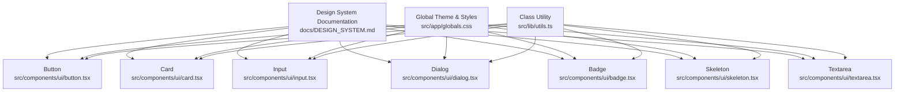

**Diagram sources**
- [DESIGN_SYSTEM.md:1-182](file://docs/DESIGN_SYSTEM.md#L1-L182)
- [globals.css:1-83](file://src/app/globals.css#L1-L83)
- [utils.ts:1-27](file://src/lib/utils.ts#L1-L27)
- [button.tsx:1-103](file://src/components/ui/button.tsx#L1-L103)
- [card.tsx:1-96](file://src/components/ui/card.tsx#L1-L96)
- [input.tsx:1-120](file://src/components/ui/input.tsx#L1-L120)
- [dialog.tsx:1-251](file://src/components/ui/dialog.tsx#L1-L251)
- [badge.tsx:1-45](file://src/components/ui/badge.tsx#L1-L45)
- [skeleton.tsx:1-23](file://src/components/ui/skeleton.tsx#L1-L23)
- [textarea.tsx:1-110](file://src/components/ui/textarea.tsx#L1-L110)

**Section sources**
- [DESIGN_SYSTEM.md:1-182](file://docs/DESIGN_SYSTEM.md#L1-L182)
- [globals.css:1-83](file://src/app/globals.css#L1-L83)
- [utils.ts:1-27](file://src/lib/utils.ts#L1-L27)
- [package.json:1-48](file://package.json#L1-L48)

## Core Components
SwimNigeria implements seven core UI primitives under `src/components/ui`. They share common design rules from the design system documentation and rely on Tailwind CSS v4 theme tokens defined in `globals.css`.

Key shared characteristics:
- All interactive elements expose accessible names, roles, and states where appropriate.
- Focus rings use high-contrast colors and respect `prefers-reduced-motion`.
- Inputs and textareas bind labels, error messages, and helper text via ARIA attributes.
- Dialog uses the native `<dialog>` element for modal semantics and browser-level behaviors.
- Skeleton placeholders are hidden from assistive technologies to avoid noise.

**Section sources**
- [DESIGN_SYSTEM.md:168-181](file://docs/DESIGN_SYSTEM.md#L168-L181)
- [button.tsx:1-103](file://src/components/ui/button.tsx#L1-L103)
- [card.tsx:1-96](file://src/components/ui/card.tsx#L1-L96)
- [input.tsx:1-120](file://src/components/ui/input.tsx#L1-L120)
- [dialog.tsx:1-251](file://src/components/ui/dialog.tsx#L1-L251)
- [badge.tsx:1-45](file://src/components/ui/badge.tsx#L1-L45)
- [skeleton.tsx:1-23](file://src/components/ui/skeleton.tsx#L1-L23)
- [textarea.tsx:1-110](file://src/components/ui/textarea.tsx#L1-L110)

## Architecture Overview
The design system architecture separates concerns between documentation, global theme tokens, and component implementations.

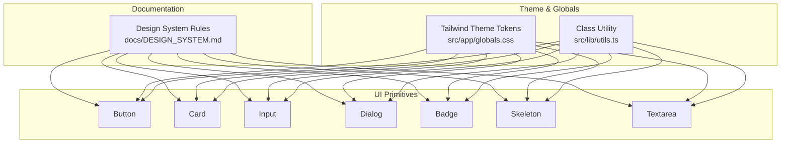

**Diagram sources**
- [DESIGN_SYSTEM.md:1-182](file://docs/DESIGN_SYSTEM.md#L1-L182)
- [globals.css:1-83](file://src/app/globals.css#L1-L83)
- [utils.ts:1-27](file://src/lib/utils.ts#L1-L27)
- [button.tsx:1-103](file://src/components/ui/button.tsx#L1-L103)
- [card.tsx:1-96](file://src/components/ui/card.tsx#L1-L96)
- [input.tsx:1-120](file://src/components/ui/input.tsx#L1-L120)
- [dialog.tsx:1-251](file://src/components/ui/dialog.tsx#L1-L251)
- [badge.tsx:1-45](file://src/components/ui/badge.tsx#L1-L45)
- [skeleton.tsx:1-23](file://src/components/ui/skeleton.tsx#L1-L23)
- [textarea.tsx:1-110](file://src/components/ui/textarea.tsx#L1-L110)

## Detailed Component Analysis

### Color Tokens and Brand Palette
SwimNigeria’s palette centers on Red and White, with deep neutrals and aquatic context accents.

- Primary brand red tokens:
  - `brand-red-50`, `brand-red-600`, `brand-red-700`, `brand-red-800`
- Deep neutral tokens:
  - `neutral-white`, `neutral-50`, `neutral-100`, `neutral-200`, `neutral-300`, `neutral-600`, `neutral-700`, `neutral-800`, `neutral-900`
- Aquatic secondary tokens:
  - `water-blue-50`, `water-blue-100`, `water-blue-600`, `water-blue-700`
- Semantic feedback tokens:
  - `feedback-success`, `feedback-warning`, `feedback-error`

These tokens are declared in the Tailwind theme configuration and used across components for backgrounds, borders, text, and focus rings.

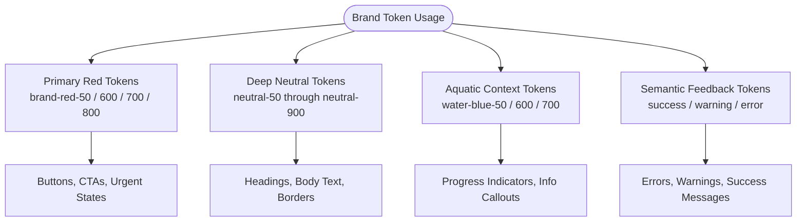

**Diagram sources**
- [globals.css:3-36](file://src/app/globals.css#L3-L36)
- [DESIGN_SYSTEM.md:15-58](file://docs/DESIGN_SYSTEM.md#L15-L58)

**Section sources**
- [globals.css:3-36](file://src/app/globals.css#L3-L36)
- [DESIGN_SYSTEM.md:15-58](file://docs/DESIGN_SYSTEM.md#L15-L58)

### Typography Hierarchy
Typography guidance emphasizes legibility across devices and lighting conditions. The design system recommends Inter or Plus Jakarta Sans for body and headings, with monospace fonts reserved for verification codes.

- Recommended families:
  - Inter or Plus Jakarta Sans for general content
  - JetBrains Mono or Roboto Mono for certificate codes
- Scale guidance includes hero/display, section headings, card headings, body large, body regular, caption/metadata, and micro labels.
- The application’s global font stack falls back to system sans-serif fonts while keeping antialiasing enabled.

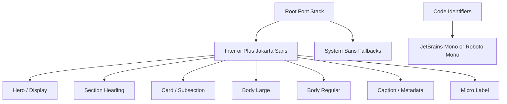

**Diagram sources**
- [DESIGN_SYSTEM.md:61-75](file://docs/DESIGN_SYSTEM.md#L61-L75)
- [globals.css:43-55](file://src/app/globals.css#L43-L55)

**Section sources**
- [DESIGN_SYSTEM.md:61-75](file://docs/DESIGN_SYSTEM.md#L61-L75)
- [globals.css:43-55](file://src/app/globals.css#L43-L55)

### Spacing Scale and Breakpoints
Spacing follows an 8pt grid system, ensuring consistent rhythm and touch-friendly layouts.

- Spacing scale:
  - 4px, 8px, 12px, 16px, 24px, 32px, 48px, 64px
- Breakpoints:
  - Mobile landscape/phablet around 640px
  - Tablet portrait around 768px
  - Laptop/tablet landscape around 1024px
  - Desktop around 1280px

Components implement these scales through Tailwind spacing utilities and responsive prefixes.

**Section sources**
- [DESIGN_SYSTEM.md:78-95](file://docs/DESIGN_SYSTEM.md#L78-L95)

### Accessibility Compliance (WCAG 2.1 AA)
Accessibility is embedded into both design rules and component implementations.

Key practices:
- Color contrast meets WCAG ratios for normal and large text.
- Focus indicators are visible and high-contrast.
- Motion respects user preferences through `prefers-reduced-motion`.
- Forms include explicit labels, required indicators, inline errors, and ARIA attributes.
- Dialogs provide modal semantics, Escape cancellation, and backdrop dismissal.
- E2E tests run automated accessibility scans against WCAG 2.1 AA criteria.

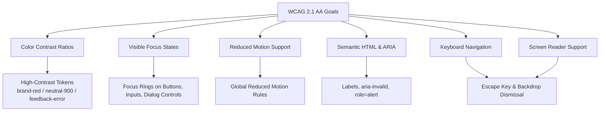

**Diagram sources**
- [DESIGN_SYSTEM.md:159-165](file://docs/DESIGN_SYSTEM.md#L159-L165)
- [globals.css:72-82](file://src/app/globals.css#L72-L82)
- [input.tsx:52-114](file://src/components/ui/input.tsx#L52-L114)
- [textarea.tsx:50-104](file://src/components/ui/textarea.tsx#L50-L104)
- [dialog.tsx:54-141](file://src/components/ui/dialog.tsx#L54-L141)
- [about-contact.spec.ts:37-42](file://e2e/about-contact.spec.ts#L37-L42)

**Section sources**
- [DESIGN_SYSTEM.md:159-165](file://docs/DESIGN_SYSTEM.md#L159-L165)
- [globals.css:72-82](file://src/app/globals.css#L72-L82)
- [input.tsx:52-114](file://src/components/ui/input.tsx#L52-L114)
- [textarea.tsx:50-104](file://src/components/ui/textarea.tsx#L50-L104)
- [dialog.tsx:54-141](file://src/components/ui/dialog.tsx#L54-L141)
- [about-contact.spec.ts:37-42](file://e2e/about-contact.spec.ts#L37-L42)

### Responsive Design Patterns
The system follows a mobile-first approach using Tailwind utilities. Components apply base styles for small screens and enhance layout at larger breakpoints.

Patterns observed:
- Inputs and textareas set minimum heights for touch targets and adjust text sizes responsively.
- Cards adapt padding and typography across breakpoints.
- Dialog supports default modal and drawer variants, with responsive width and height constraints.
- Global styles optimize touch interactions and reduce motion for sensitive users.

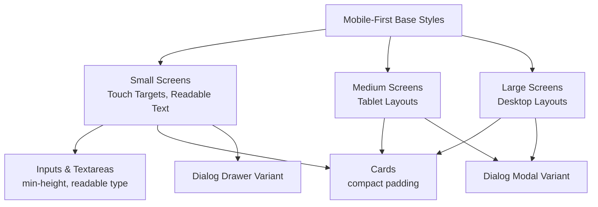

**Diagram sources**
- [input.tsx:79-90](file://src/components/ui/input.tsx#L79-L90)
- [textarea.tsx:76-86](file://src/components/ui/textarea.tsx#L76-L86)
- [card.tsx:13-22](file://src/components/ui/card.tsx#L13-L22)
- [dialog.tsx:120-139](file://src/components/ui/dialog.tsx#L120-L139)

**Section sources**
- [input.tsx:79-90](file://src/components/ui/input.tsx#L79-L90)
- [textarea.tsx:76-86](file://src/components/ui/textarea.tsx#L76-L86)
- [card.tsx:13-22](file://src/components/ui/card.tsx#L13-L22)
- [dialog.tsx:120-139](file://src/components/ui/dialog.tsx#L120-L139)

### Button Component
The Button component provides multiple visual variants and sizes while maintaining accessibility and interaction polish.

Props:
- `variant`: primary, secondary, outline, ghost, aquatic, danger
- `size`: sm, md, lg, icon
- `isLoading`: boolean
- `loadingText`: string
- Standard button attributes via `React.ButtonHTMLAttributes<HTMLButtonElement>`

Behavior:
- Default `type="button"` prevents accidental form submission.
- Loading state sets `aria-busy` and disables interaction.
- Focus ring and active press scale improve perceived interactivity.
- Respects reduced motion settings.

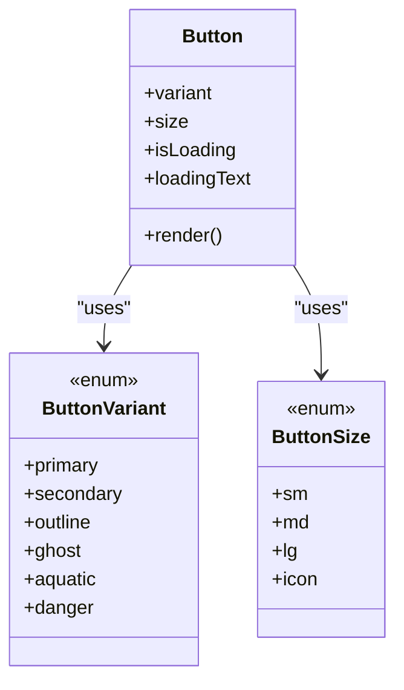

**Diagram sources**
- [button.tsx:4-13](file://src/components/ui/button.tsx#L4-L13)
- [button.tsx:15-35](file://src/components/ui/button.tsx#L15-L35)
- [button.tsx:37-99](file://src/components/ui/button.tsx#L37-L99)

**Section sources**
- [button.tsx:1-103](file://src/components/ui/button.tsx#L1-L103)

### Card Component
The Card component offers a flexible container with header, title, description, content, and footer sections.

Props:
- `variant`: default, muted, interactive
- Section props accept standard HTML attributes; `CardTitle` accepts an `as` prop for polymorphic heading levels.

Behavior:
- Interactive variant adds hover border and shadow transitions.
- Content truncation-safe classes prevent overflow issues.
- Typography adapts across breakpoints.

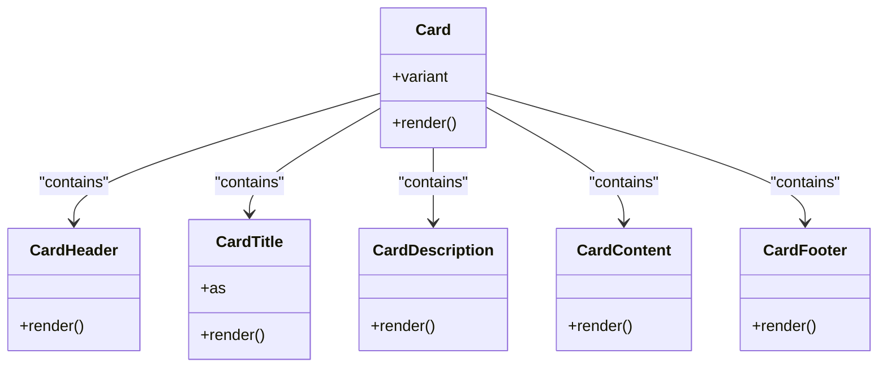

**Diagram sources**
- [card.tsx:4-25](file://src/components/ui/card.tsx#L4-L25)
- [card.tsx:28-53](file://src/components/ui/card.tsx#L28-L53)
- [card.tsx:56-95](file://src/components/ui/card.tsx#L56-L95)

**Section sources**
- [card.tsx:1-96](file://src/components/ui/card.tsx#L1-L96)

### Input Component
The Input component wraps native input fields with accessible labels, error messaging, helper text, and optional right-side elements.

Props:
- `label`: string
- `error`: string
- `helperText`: string
- `containerClassName`: string
- `rightElement`: React.ReactNode
- Native input attributes

Behavior:
- Generates stable IDs and binds label `htmlFor`.
- Computes `aria-invalid` based on error state or explicit prop.
- Associates error and helper text via `aria-describedby`.
- Error message uses `role="alert"` for screen readers.
- Minimum height ensures accessible touch target size.

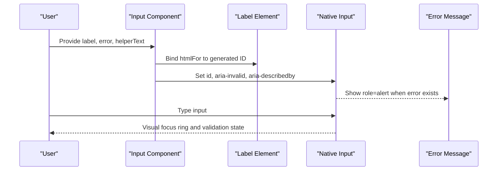

**Diagram sources**
- [input.tsx:31-50](file://src/components/ui/input.tsx#L31-L50)
- [input.tsx:52-114](file://src/components/ui/input.tsx#L52-L114)

**Section sources**
- [input.tsx:1-120](file://src/components/ui/input.tsx#L1-L120)

### Textarea Component
The Textarea component mirrors Input’s accessibility model for multi-line text.

Props:
- `label`: string
- `error`: string
- `helperText`: string
- `containerClassName`: string
- `rows`: number
- Native textarea attributes

Behavior:
- Generates stable IDs and binds label `htmlFor`.
- Computes `aria-invalid` based on error state or explicit prop.
- Associates error and helper text via `aria-describedby`.
- Error message uses `role="alert"`.
- Vertical resize allowed for usability.

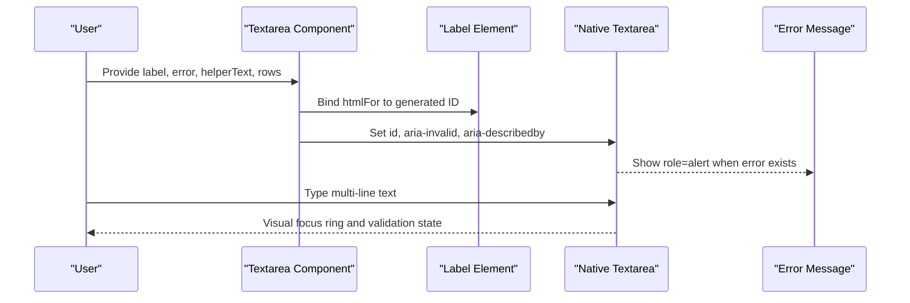

**Diagram sources**
- [textarea.tsx:29-48](file://src/components/ui/textarea.tsx#L29-L48)
- [textarea.tsx:50-104](file://src/components/ui/textarea.tsx#L50-L104)

**Section sources**
- [textarea.tsx:1-110](file://src/components/ui/textarea.tsx#L1-L110)

### Dialog Component
The Dialog component uses the native HTML5 `<dialog>` element to provide modal semantics, focus management, Escape key cancellation, and backdrop dismissal.

Props:
- `id`: string
- `isOpen`: boolean
- `onClose`: function
- `children`: React.ReactNode
- `className`: string
- `closeOnBackdropClick`: boolean
- `titleId`: string
- `descriptionId`: string
- `variant`: default, drawer

Behavior:
- Synchronizes React state with native dialog open/close.
- Stores previously focused element and restores focus on close.
- Provides `aria-modal`, `aria-labelledby`, and `aria-describedby`.
- Drawer variant slides from the right on mobile-friendly widths.
- Header includes an accessible close button with proper labeling.

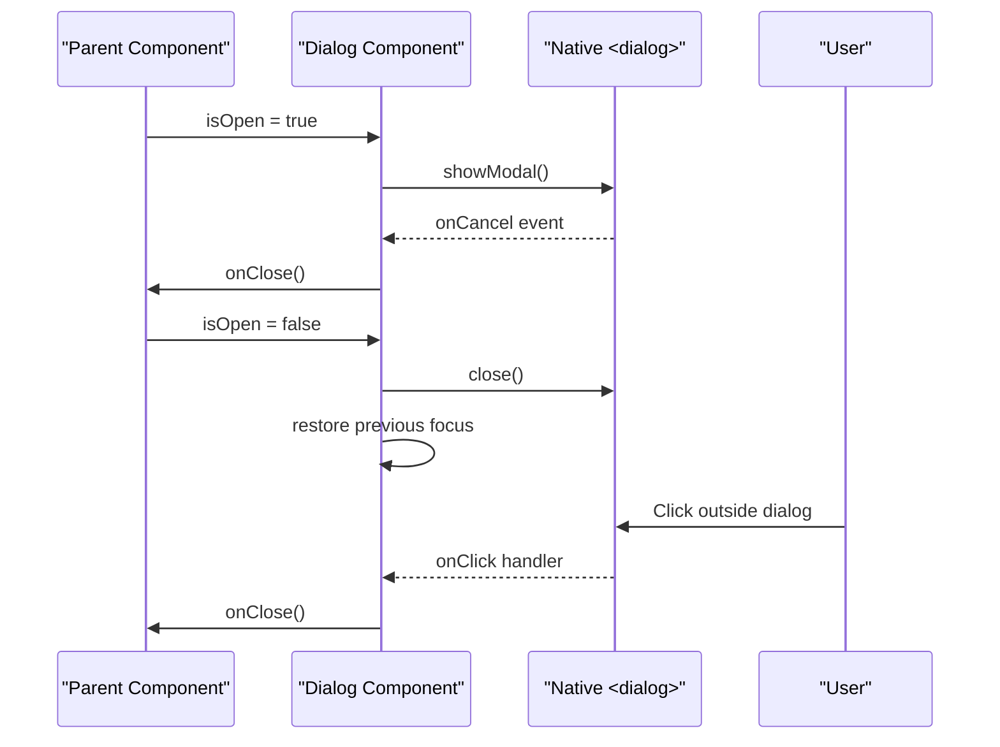

**Diagram sources**
- [dialog.tsx:54-78](file://src/components/ui/dialog.tsx#L54-L78)
- [dialog.tsx:80-108](file://src/components/ui/dialog.tsx#L80-L108)
- [dialog.tsx:110-141](file://src/components/ui/dialog.tsx#L110-L141)

**Section sources**
- [dialog.tsx:1-251](file://src/components/ui/dialog.tsx#L1-L251)

### Badge Component
The Badge component renders compact status tags with multiple semantic variants and sizes.

Props:
- `variant`: default, brand, aquatic, success, warning, outline
- `size`: sm, md

Behavior:
- Uses rounded-full pill shape.
- Applies semantic color combinations for brand, aquatic, success, warning, and outline contexts.
- Maintains high-contrast labels for readability.

**Section sources**
- [badge.tsx:1-45](file://src/components/ui/badge.tsx#L1-L45)

### Skeleton Component
The Skeleton component provides loading placeholders that match final layout proportions without introducing screen reader noise.

Props:
- `className`: string

Behavior:
- Uses `aria-hidden="true"` to hide decorative placeholders.
- Applies pulse animation with reduced-motion support.

**Section sources**
- [skeleton.tsx:1-23](file://src/components/ui/skeleton.tsx#L1-L23)

## Dependency Analysis
The UI components depend on:
- Tailwind CSS v4 theme tokens defined in `globals.css`.
- The zero-dependency `cn` utility for class composition.
- React APIs including `forwardRef`, `useId`, `useEffect`, `useRef`, `useCallback`, `createContext`, and `useContext`.

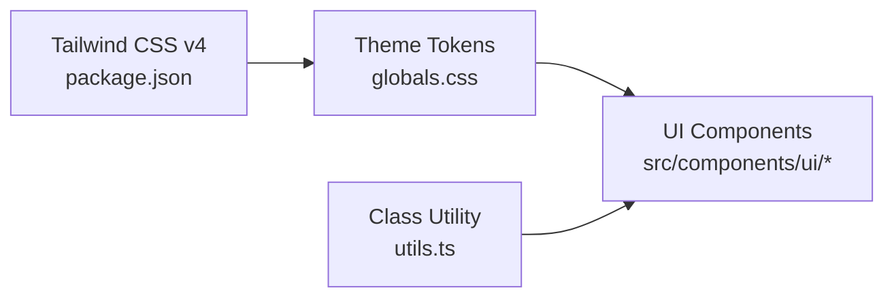

**Diagram sources**
- [package.json:26-45](file://package.json#L26-L45)
- [globals.css:1-36](file://src/app/globals.css#L1-L36)
- [utils.ts:1-27](file://src/lib/utils.ts#L1-L27)
- [button.tsx:1-3](file://src/components/ui/button.tsx#L1-L3)
- [card.tsx:1-3](file://src/components/ui/card.tsx#L1-L3)
- [input.tsx:1-3](file://src/components/ui/input.tsx#L1-L3)
- [dialog.tsx:1-12](file://src/components/ui/dialog.tsx#L1-L12)
- [badge.tsx:1-3](file://src/components/ui/badge.tsx#L1-L3)
- [skeleton.tsx:1-3](file://src/components/ui/skeleton.tsx#L1-L3)
- [textarea.tsx:1-3](file://src/components/ui/textarea.tsx#L1-L3)

**Section sources**
- [package.json:26-45](file://package.json#L26-L45)
- [globals.css:1-36](file://src/app/globals.css#L1-L36)
- [utils.ts:1-27](file://src/lib/utils.ts#L1-L27)

## Performance Considerations
- Animations and transitions are short and respect `prefers-reduced-motion`.
- Skeleton placeholders avoid layout shifts and are hidden from assistive technologies.
- Touch optimization utilities prevent double-tap zoom delays on interactive elements.
- Components use minimal re-render logic and rely on native browser behaviors where possible, especially for dialogs.

[No sources needed since this section provides general guidance]

## Troubleshooting Guide
Common accessibility and UX checks:
- Verify all inputs have visible labels and error messages associated via `aria-describedby`.
- Ensure buttons and interactive controls have sufficient touch target sizes and visible focus rings.
- Confirm dialogs can be closed with Escape and do not trap focus unexpectedly.
- Run automated accessibility scans to detect WCAG violations.

Relevant implementation references:
- Form inputs compute and propagate `aria-invalid` and associate error/helper text.
- Dialog manages focus restoration and Escape cancellation.
- Global styles enforce reduced motion and touch optimization.
- E2E tests validate WCAG 2.1 AA compliance using Axe.

**Section sources**
- [input.tsx:31-50](file://src/components/ui/input.tsx#L31-L50)
- [textarea.tsx:29-48](file://src/components/ui/textarea.tsx#L29-L48)
- [dialog.tsx:54-87](file://src/components/ui/dialog.tsx#L54-L87)
- [globals.css:72-82](file://src/app/globals.css#L72-L82)
- [about-contact.spec.ts:37-42](file://e2e/about-contact.spec.ts#L37-L42)

## Conclusion
SwimNigeria’s design system combines clear brand tokens, accessible component patterns, and responsive Tailwind-based styling. The documented color palette, typography guidance, spacing scale, and accessibility requirements are consistently applied across Button, Card, Input, Dialog, Badge, Skeleton, and Textarea. Automated testing and global style rules reinforce WCAG 2.1 AA compliance, making the system suitable for Nigerian users across diverse devices and capabilities.

[No sources needed since this section summarizes without analyzing specific files]