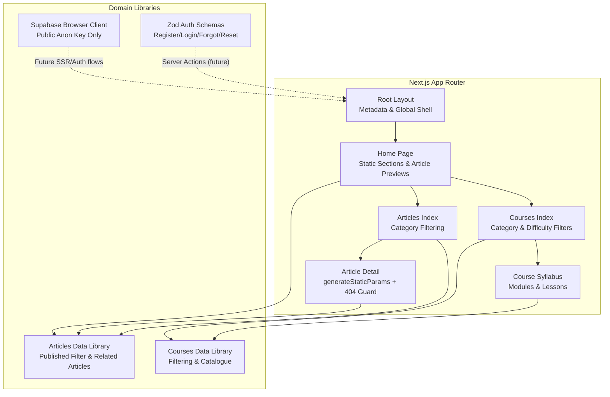
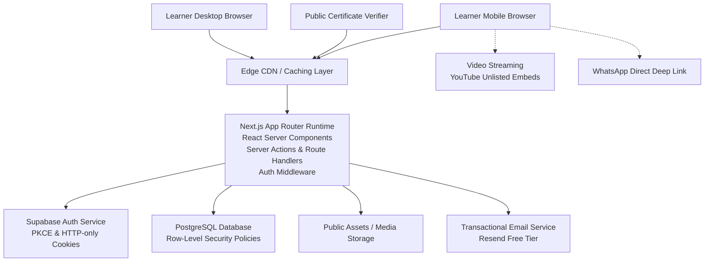
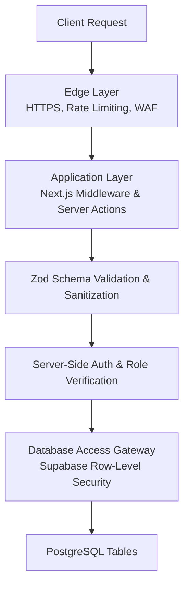
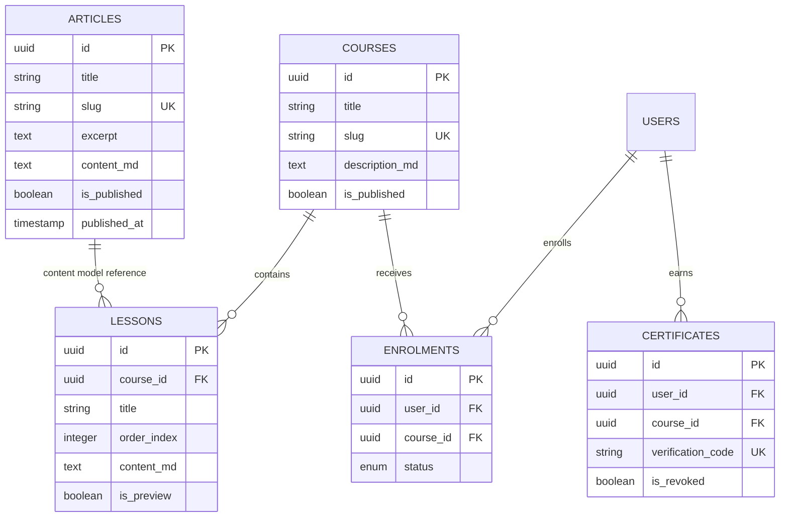
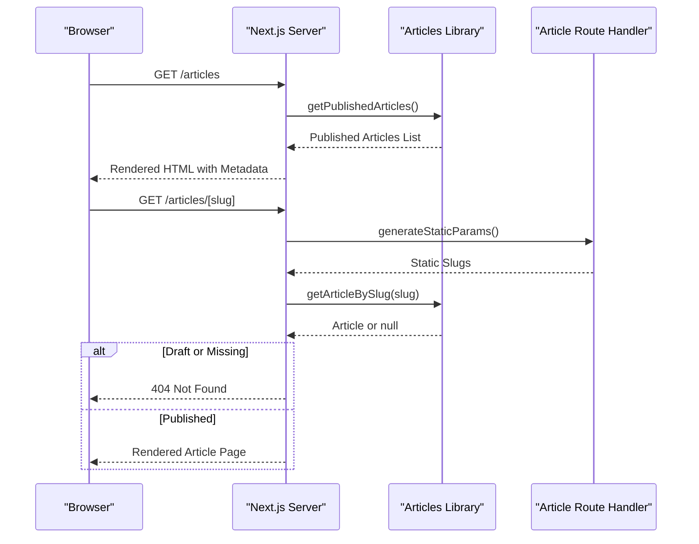
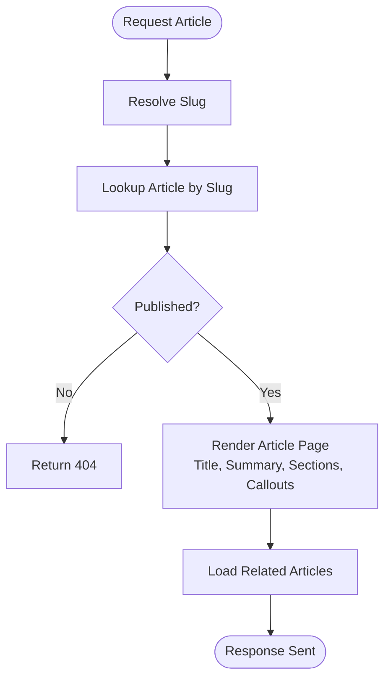
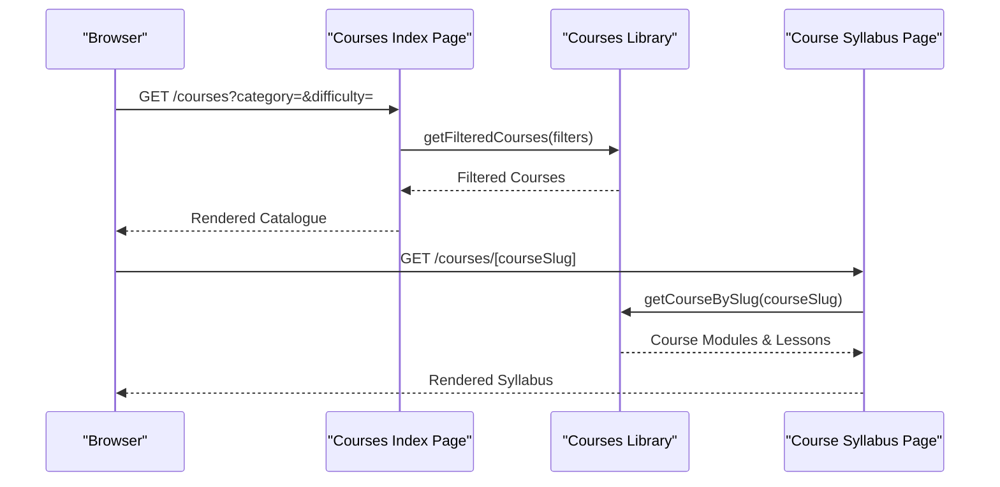
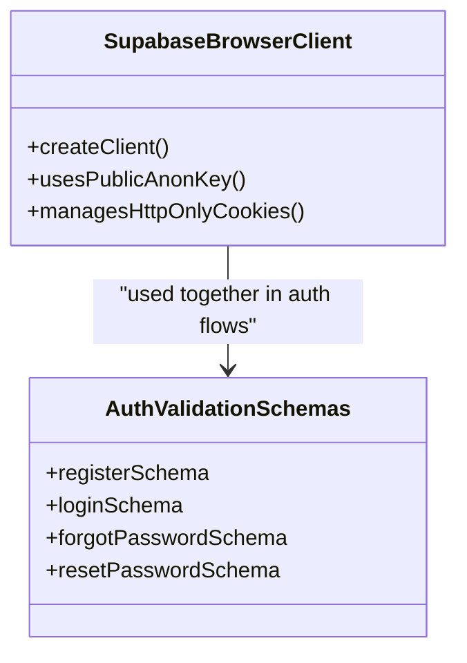
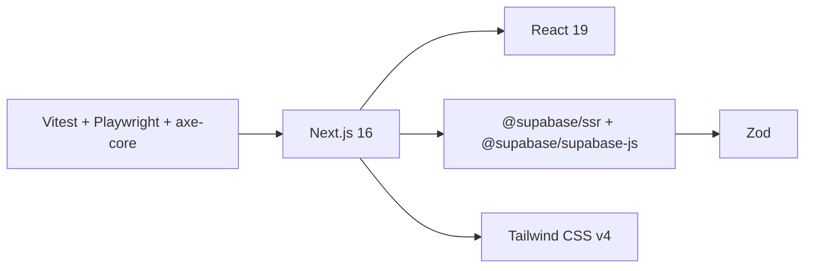

# System Architecture

<cite>
**Referenced Files in This Document**
- [README.md](file://README.md)
- [package.json](file://package.json)
- [next.config.ts](file://next.config.ts)
- [docs/SYSTEM_ARCHITECTURE.md](file://docs/SYSTEM_ARCHITECTURE.md)
- [docs/TECHNOLOGY_EVALUATION.md](file://docs/TECHNOLOGY_EVALUATION.md)
- [docs/SECURITY.md](file://docs/SECURITY.md)
- [docs/DATABASE_DESIGN.md](file://docs/DATABASE_DESIGN.md)
- [docs/DEPLOYMENT_AND_OPERATIONS.md](file://docs/DEPLOYMENT_AND_OPERATIONS.md)
- [src/app/layout.tsx](file://src/app/layout.tsx)
- [src/app/page.tsx](file://src/app/page.tsx)
- [src/lib/articles.ts](file://src/lib/articles.ts)
- [src/app/articles/page.tsx](file://src/app/articles/page.tsx)
- [src/app/articles/[slug]/page.tsx](file://src/app/articles/[slug]/page.tsx)
- [src/app/courses/page.tsx](file://src/app/courses/page.tsx)
- [src/app/courses/[courseSlug]/page.tsx](file://src/app/courses/[courseSlug]/page.tsx)
- [src/lib/supabase/client.ts](file://src/lib/supabase/client.ts)
- [src/lib/validation/auth.ts](file://src/lib/validation/auth.ts)
</cite>

## Table of Contents
1. [Introduction](#introduction)
2. [Project Structure](#project-structure)
3. [Core Components](#core-components)
4. [Architecture Overview](#architecture-overview)
5. [Detailed Component Analysis](#detailed-component-analysis)
6. [Dependency Analysis](#dependency-analysis)
7. [Performance Considerations](#performance-considerations)
8. [Troubleshooting Guide](#troubleshooting-guide)
9. [Conclusion](#conclusion)

## Introduction
SwimNigeria is a zero-cost, mobile-first digital education platform focused on structured swimming instruction and water safety for Nigerian learners. The system uses Next.js App Router with React Server Components to deliver fast server-rendered HTML for public content, while interactive features are isolated as client components. It combines static educational articles with relational course data, enforces defense-in-depth security through edge middleware, application-layer validation, and database row-level security, and relies on Vercel hosting, Supabase backend, and unlisted YouTube video delivery to keep infrastructure costs at ₦0 during launch.

Key design goals:
- Fast initial load on metered 3G/4G networks across Nigeria.
- Strict server-side authorization and input validation.
- Separation between static articles and relational course curriculum.
- Zero-cost hosting and media delivery with clear commercial-use migration paths.

**Section sources**
- [README.md:1-101](file://README.md#L1-L101)
- [docs/SYSTEM_ARCHITECTURE.md:1-11](file://docs/SYSTEM_ARCHITECTURE.md#L1-L11)

## Project Structure
The repository follows the Next.js App Router layout:
- `src/app` contains route-based pages, layouts, metadata, and feature entry points.
- `src/components` provides reusable UI primitives and layout shells.
- `src/lib` holds domain libraries such as article data, course data, Supabase browser client setup, and Zod validation schemas.
- `docs` contains architectural, security, database, deployment, and product documentation.
- Root configuration files include `package.json`, `next.config.ts`, TypeScript, ESLint, Prettier, Vitest, and Playwright settings.

**Diagram sources**
- [src/app/layout.tsx:1-42](file://src/app/layout.tsx#L1-L42)
- [src/app/page.tsx:1-645](file://src/app/page.tsx#L1-L645)
- [src/app/articles/page.tsx:1-168](file://src/app/articles/page.tsx#L1-L168)
- [src/app/articles/[slug]/page.tsx:1-206](file://src/app/articles/[slug]/page.tsx#L1-L206)
- [src/app/courses/page.tsx:1-367](file://src/app/courses/page.tsx#L1-L367)
- [src/app/courses/[courseSlug]/page.tsx:1-347](file://src/app/courses/[courseSlug]/page.tsx#L1-L347)
- [src/lib/articles.ts:1-243](file://src/lib/articles.ts#L1-L243)
- [src/lib/supabase/client.ts:1-23](file://src/lib/supabase/client.ts#L1-L23)
- [src/lib/validation/auth.ts:1-140](file://src/lib/validation/auth.ts#L1-L140)

**Section sources**
- [package.json:1-48](file://package.json#L1-L48)
- [next.config.ts:1-9](file://next.config.ts#L1-L9)
- [src/app/layout.tsx:1-42](file://src/app/layout.tsx#L1-L42)

## Core Components
This section maps the current runtime surface to the broader architecture:

- **Next.js App Router Pages:**
  - Root layout defines global metadata, viewport, theme color, skip-to-content link, header/footer shell, and main content region.
  - Home page composes hero, value proposition, curriculum roadmap, safety principles, article previews, and contact entry points.
  - Articles index supports category filtering and renders published articles.
  - Article detail uses `generateStaticParams`, dynamic metadata, and returns a real 404 for missing or unpublished drafts.
  - Courses index supports category and difficulty filters and shows catalogue cards with planned enrollment routes.
  - Course syllabus page renders modules, lessons, learning outcomes, prerequisites, and launch status notices.

- **Data Libraries:**
  - Articles library exposes typed article structures, published filtering, slug resolution, related articles, and category enumeration.
  - Courses library (referenced by pages) provides filtered courses, categories, difficulties, and syllabus rendering contracts.
  - Supabase browser client factory initializes the public anonymous client without exposing service role secrets.
  - Authentication validation schemas define strict Zod rules for registration, login, forgot password, and reset password inputs.

- **Configuration & Tooling:**
  - Next.js enables strict mode and allows local development origins.
  - Package scripts provide dev, build, start, lint, typecheck, test, E2E, and formatting commands.

**Section sources**
- [src/app/layout.tsx:1-42](file://src/app/layout.tsx#L1-L42)
- [src/app/page.tsx:1-645](file://src/app/page.tsx#L1-L645)
- [src/app/articles/page.tsx:1-168](file://src/app/articles/page.tsx#L1-L168)
- [src/app/articles/[slug]/page.tsx:1-206](file://src/app/articles/[slug]/page.tsx#L1-L206)
- [src/app/courses/page.tsx:1-367](file://src/app/courses/page.tsx#L1-L367)
- [src/app/courses/[courseSlug]/page.tsx:1-347](file://src/app/courses/[courseSlug]/page.tsx#L1-L347)
- [src/lib/articles.ts:1-243](file://src/lib/articles.ts#L1-L243)
- [src/lib/supabase/client.ts:1-23](file://src/lib/supabase/client.ts#L1-L23)
- [src/lib/validation/auth.ts:1-140](file://src/lib/validation/auth.ts#L1-L140)
- [package.json:1-48](file://package.json#L1-L48)
- [next.config.ts:1-9](file://next.config.ts#L1-L9)

## Architecture Overview
SwimNigeria’s system architecture separates clients, edge caching, the Next.js application runtime, managed PostgreSQL via Supabase, and zero-cost third-party services. Public content is rendered server-side; interactive state is minimized until needed. Security is enforced at multiple layers, and heavy media is offloaded to YouTube to avoid bandwidth costs.

**Diagram sources**
- [docs/SYSTEM_ARCHITECTURE.md:12-59](file://docs/SYSTEM_ARCHITECTURE.md#L12-L59)
- [docs/TECHNOLOGY_EVALUATION.md:103-134](file://docs/TECHNOLOGY_EVALUATION.md#L103-L134)
- [docs/SECURITY.md:9-25](file://docs/SECURITY.md#L9-L25)

### Server-Side Rendering Strategy
- Public marketing pages, course syllabi, and educational articles are rendered on the server as lightweight cached HTML.
- Interactive elements such as lesson toggles, quiz engines, and video controls are isolated as granular client components.
- Static generation is used where possible, including article slugs and course slugs, to reduce runtime work.

**Section sources**
- [docs/SYSTEM_ARCHITECTURE.md:65-83](file://docs/SYSTEM_ARCHITECTURE.md#L65-L83)
- [src/app/articles/[slug]/page.tsx:13-18](file://src/app/articles/[slug]/page.tsx#L13-L18)
- [src/app/courses/[courseSlug]/page.tsx:16-21](file://src/app/courses/[courseSlug]/page.tsx#L16-L21)

### Multi-Tier Defense-in-Depth Security Model
Security is layered across:
1. Edge layer: HTTPS, rate limiting, and web application firewall behavior provided by the hosting platform.
2. Application layer: Next.js middleware guards protected routes; server actions re-validate roles and inputs.
3. Validation layer: Zod schemas enforce strict input contracts before any mutation.
4. Authorization layer: Supabase Auth validates sessions; RBAC checks occur server-side.
5. Database layer: Row-Level Security restricts access per user role and ownership.

**Diagram sources**
- [docs/SECURITY.md:9-25](file://docs/SECURITY.md#L9-L25)

**Section sources**
- [docs/SECURITY.md:29-79](file://docs/SECURITY.md#L29-L79)
- [docs/SECURITY.md:82-96](file://docs/SECURITY.md#L82-L96)
- [docs/SECURITY.md:136-147](file://docs/SECURITY.md#L136-L147)

### Hybrid Headless Content Management
- Static articles and guides are represented as typed data with publication flags, enabling version-controlled editorial workflows and safe 404 handling for drafts.
- Relational course data models support structured curricula, ordered lessons, progress tracking, assessments, enrollments, and certificates.

**Diagram sources**
- [docs/DATABASE_DESIGN.md:12-38](file://docs/DATABASE_DESIGN.md#L12-L38)
- [docs/DATABASE_DESIGN.md:106-125](file://docs/DATABASE_DESIGN.md#L106-L125)
- [src/lib/articles.ts:15-24](file://src/lib/articles.ts#L15-L24)

**Section sources**
- [docs/SYSTEM_ARCHITECTURE.md:115-119](file://docs/SYSTEM_ARCHITECTURE.md#L115-L119)
- [docs/DATABASE_DESIGN.md:42-132](file://docs/DATABASE_DESIGN.md#L42-L132)
- [src/lib/articles.ts:181-243](file://src/lib/articles.ts#L181-L243)

### Zero-Cost Infrastructure Decisions
- Hosting: Vercel Hobby tier for non-commercial launch, with Cloudflare Pages as a commercially compliant free-tier alternative.
- Backend: Supabase PostgreSQL with native Row-Level Security, authentication, and storage.
- Video Delivery: Unlisted YouTube embeds with privacy-enhanced facades to avoid bandwidth egress costs.
- Email: Resend free tier for transactional emails.

**Section sources**
- [docs/TECHNOLOGY_EVALUATION.md:70-95](file://docs/TECHNOLOGY_EVALUATION.md#L70-L95)
- [docs/TECHNOLOGY_EVALUATION.md:103-134](file://docs/TECHNOLOGY_EVALUATION.md#L103-L134)
- [README.md:93-101](file://README.md#L93-L101)

## Detailed Component Analysis

### Next.js App Router and React Server Components
The root layout establishes global metadata, viewport, accessibility skip link, site header, main content area, and footer. Pages under `src/app` use server components by default, enabling server-side rendering and static generation where appropriate.

**Diagram sources**
- [src/app/layout.tsx:1-42](file://src/app/layout.tsx#L1-L42)
- [src/app/articles/page.tsx:25-30](file://src/app/articles/page.tsx#L25-L30)
- [src/app/articles/[slug]/page.tsx:13-44](file://src/app/articles/[slug]/page.tsx#L13-L44)
- [src/lib/articles.ts:181-199](file://src/lib/articles.ts#L181-L199)

**Section sources**
- [src/app/layout.tsx:1-42](file://src/app/layout.tsx#L1-L42)
- [src/app/page.tsx:16-26](file://src/app/page.tsx#L16-L26)
- [src/app/articles/[slug]/page.tsx:20-44](file://src/app/articles/[slug]/page.tsx#L20-L44)

### Articles Module
The articles module treats educational content as typed, publishable records. The home page previews recent articles, the articles index supports category filtering, and individual article pages generate static parameters and return proper 404 responses for unpublished or missing content.

**Diagram sources**
- [src/app/articles/[slug]/page.tsx:37-46](file://src/app/articles/[slug]/page.tsx#L37-L46)
- [src/lib/articles.ts:193-199](file://src/lib/articles.ts#L193-L199)

**Section sources**
- [src/app/page.tsx:490-568](file://src/app/page.tsx#L490-L568)
- [src/app/articles/page.tsx:25-30](file://src/app/articles/page.tsx#L25-L30)
- [src/app/articles/[slug]/page.tsx:1-206](file://src/app/articles/[slug]/page.tsx#L1-L206)
- [src/lib/articles.ts:1-243](file://src/lib/articles.ts#L1-L243)

### Courses Module
The courses module currently exposes a public catalogue and syllabus view. Filtering is implemented through search parameters, and each course page renders modules, lessons, learning outcomes, and launch status. Enrollment and interactive lesson readers are marked as future phases.

**Diagram sources**
- [src/app/courses/page.tsx:32-44](file://src/app/courses/page.tsx#L32-L44)
- [src/app/courses/[courseSlug]/page.tsx:40-52](file://src/app/courses/[courseSlug]/page.tsx#L40-L52)

**Section sources**
- [src/app/courses/page.tsx:22-81](file://src/app/courses/page.tsx#L22-L81)
- [src/app/courses/page.tsx:246-367](file://src/app/courses/page.tsx#L246-L367)
- [src/app/courses/[courseSlug]/page.tsx:40-130](file://src/app/courses/[courseSlug]/page.tsx#L40-L130)
- [src/app/courses/[courseSlug]/page.tsx:214-308](file://src/app/courses/[courseSlug]/page.tsx#L214-L308)

### Authentication and Validation Integration Points
Although Phase 1 scaffolding does not yet implement full authentication flows, the codebase prepares integration points:
- A Supabase browser client factory that uses only public environment variables and avoids storing tokens in local storage.
- Zod schemas for registration, login, forgot password, and reset password that enforce length, format, and password matching constraints.

**Diagram sources**
- [src/lib/supabase/client.ts:1-23](file://src/lib/supabase/client.ts#L1-L23)
- [src/lib/validation/auth.ts:22-49](file://src/lib/validation/auth.ts#L22-L49)
- [src/lib/validation/auth.ts:68-79](file://src/lib/validation/auth.ts#L68-L79)
- [src/lib/validation/auth.ts:96-103](file://src/lib/validation/auth.ts#L96-L103)
- [src/lib/validation/auth.ts:120-131](file://src/lib/validation/auth.ts#L120-L131)

**Section sources**
- [src/lib/supabase/client.ts:1-23](file://src/lib/supabase/client.ts#L1-L23)
- [src/lib/validation/auth.ts:1-140](file://src/lib/validation/auth.ts#L1-L140)

## Dependency Analysis
At the package level, SwimNigeria depends on Next.js 16, React 19, Supabase SDKs, Zod, Tailwind CSS v4, and testing tooling. The application structure couples routing pages with domain libraries and future authentication flows.

**Diagram sources**
- [package.json:18-45](file://package.json#L18-L45)

**Section sources**
- [package.json:1-48](file://package.json#L1-L48)

## Performance Considerations
SwimNigeria targets Nigerian connectivity constraints through:
- Aggressive asset caching via CDN edge headers.
- Lazy media loading using lightweight image facades before embedding heavy video players.
- Optimized font strategy with self-hosted variable fonts and latin subsetting.
- A strict client payload budget targeting less than 120KB gzipped JavaScript for public routes.
- Server-side rendering of static content to minimize client-side JavaScript execution.
- Offloading video streaming to YouTube to avoid expensive egress bandwidth.

Operational notes:
- Supabase free tier auto-pauses after seven days of inactivity; an informal health-check ping may be used to mitigate pauses, but this is not a guaranteed SLA.
- Serverless function durations are limited; critical operations should complete quickly.
- Email delivery is capped by the Resend free tier quotas.

**Section sources**
- [docs/SYSTEM_ARCHITECTURE.md:219-225](file://docs/SYSTEM_ARCHITECTURE.md#L219-L225)
- [docs/DEPLOYMENT_AND_OPERATIONS.md:52-71](file://docs/DEPLOYMENT_AND_OPERATIONS.md#L52-L71)
- [docs/TECHNOLOGY_EVALUATION.md:103-134](file://docs/TECHNOLOGY_EVALUATION.md#L103-L134)

## Troubleshooting Guide
Common operational issues and mitigations:

- **Missing or unpublished article returns unexpected content:**
  - Ensure article lookup functions filter by `published` and that route handlers call `notFound()` when the article is missing or draft.
  - Verify `generateStaticParams` only includes published slugs.

- **Authentication token exposure risk:**
  - Confirm the Supabase browser client uses only public environment variables and does not store tokens in `localStorage`.
  - Use `@supabase/ssr` cookie-based session management.

- **Input validation bypass attempts:**
  - Enforce Zod schemas on all server actions and form submissions.
  - Normalize email fields and reject malformed inputs early.

- **Supabase project pause or connection failure:**
  - Monitor uptime and scheduled pings.
  - Manually unpause the project if required and verify environment variables.

- **Email quota exhaustion:**
  - Reserve Resend strictly for transactional emails.
  - Implement rate limits for contact forms and defer bulk communications.

**Section sources**
- [src/app/articles/[slug]/page.tsx:37-44](file://src/app/articles/[slug]/page.tsx#L37-L44)
- [src/lib/supabase/client.ts:1-23](file://src/lib/supabase/client.ts#L1-L23)
- [src/lib/validation/auth.ts:22-49](file://src/lib/validation/auth.ts#L22-L49)
- [docs/DEPLOYMENT_AND_OPERATIONS.md:55-71](file://docs/DEPLOYMENT_AND_OPERATIONS.md#L55-L71)

## Conclusion
SwimNigeria’s architecture balances performance, security, and zero-cost sustainability. Next.js App Router with React Server Components delivers fast, SEO-friendly public content. A multi-tier security model protects sensitive operations from edge to database. The hybrid headless approach cleanly separates static articles from relational course data. Hosting on Vercel or Cloudflare Pages, using Supabase for PostgreSQL and authentication, and delivering videos through unlisted YouTube embeds keeps launch costs at ₦0 while remaining scalable. Network optimizations target Nigerian mobile connectivity, and the codebase is prepared for future authentication, assessments, and certificate issuance within the same secure, component-driven foundation.