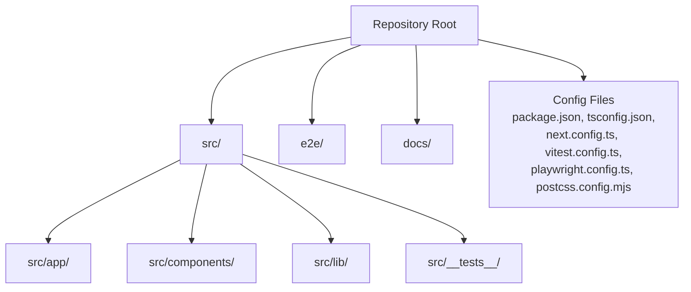
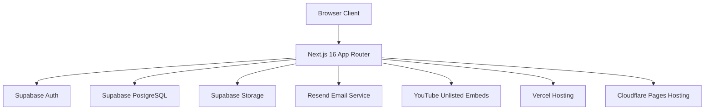
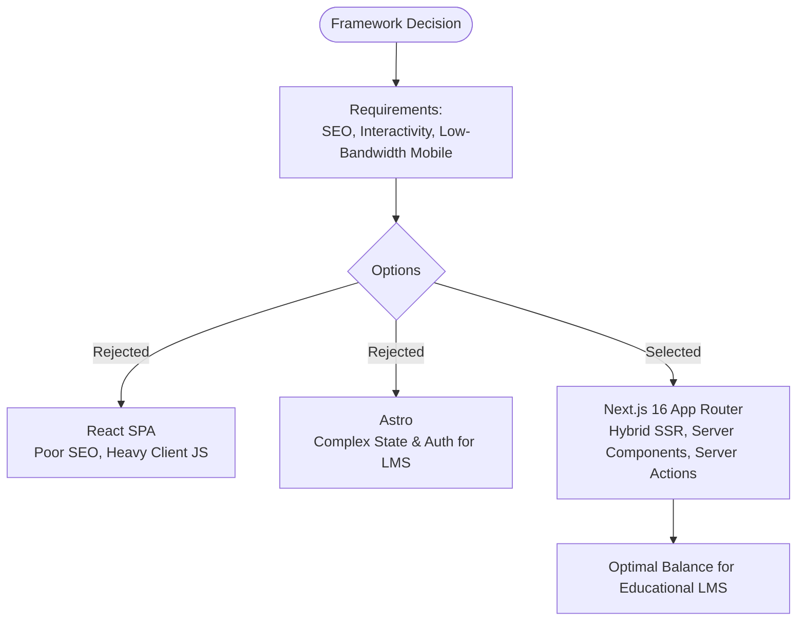
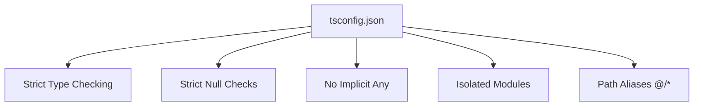
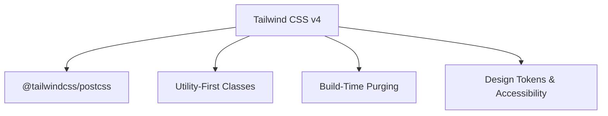
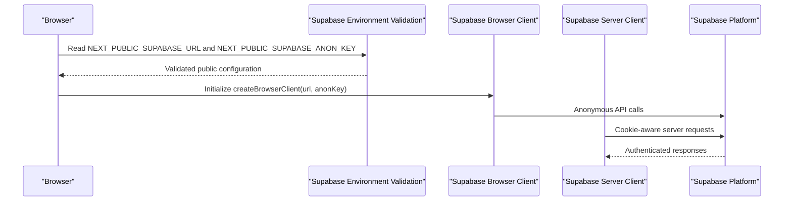
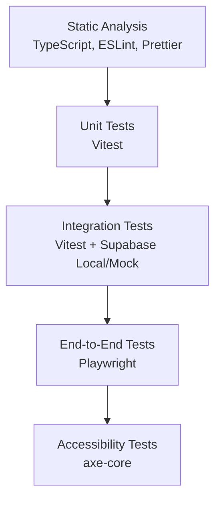
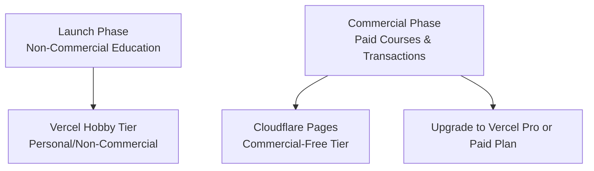
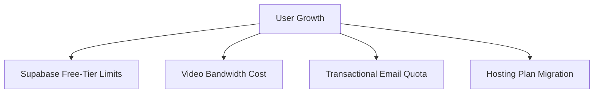
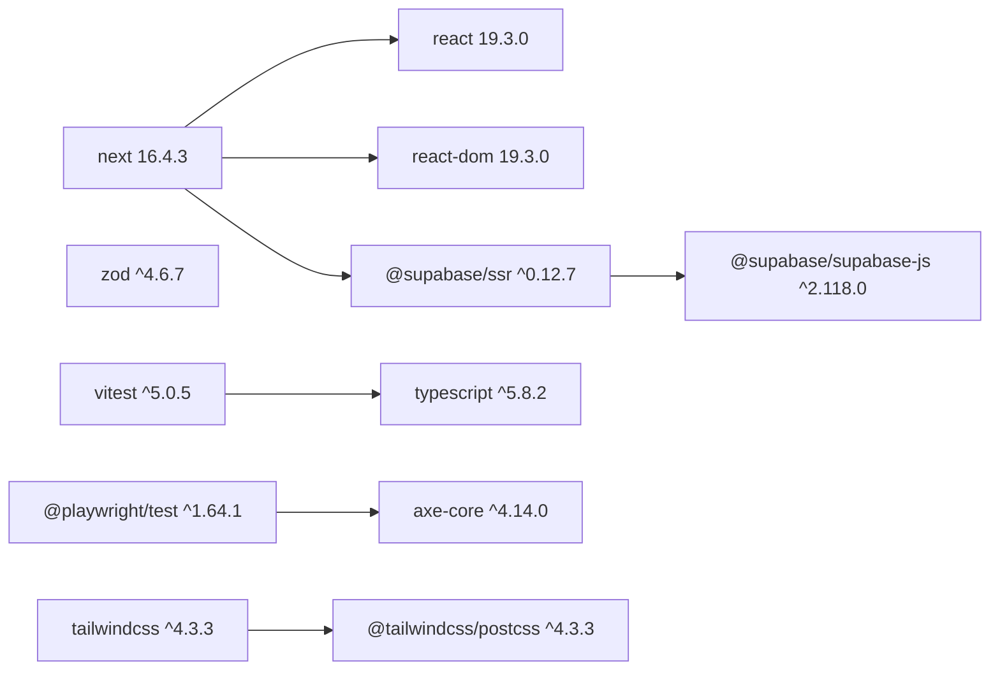

# Technology Evaluation

<cite>
**Referenced Files in This Document**
- [package.json](file://package.json)
- [tsconfig.json](file://tsconfig.json)
- [next.config.ts](file://next.config.ts)
- [vitest.config.ts](file://vitest.config.ts)
- [playwright.config.ts](file://playwright.config.ts)
- [TECHNOLOGY_EVALUATION.md](file://docs/TECHNOLOGY_EVALUATION.md)
- [DECISION_LOG.md](file://docs/DECISION_LOG.md)
- [DEPLOYMENT_AND_OPERATIONS.md](file://docs/DEPLOYMENT_AND_OPERATIONS.md)
- [TESTING_STRATEGY.md](file://docs/TESTING_STRATEGY.md)
- [env.ts](file://src/lib/supabase/env.ts)
- [client.ts](file://src/lib/supabase/client.ts)
- [server.ts](file://src/lib/supabase/server.ts)
</cite>

## Table of Contents
1. [Introduction](#introduction)
2. [Project Structure](#project-structure)
3. [Core Components](#core-components)
4. [Architecture Overview](#architecture-overview)
5. [Detailed Component Analysis](#detailed-component-analysis)
6. [Dependency Analysis](#dependency-analysis)
7. [Performance Considerations](#performance-considerations)
8. [Troubleshooting Guide](#troubleshooting-guide)
9. [Conclusion](#conclusion)
10. [Appendices](#appendices)

## Introduction
This document evaluates SwimNigeria’s technology stack decisions and explains the rationale, trade-offs, and operational implications behind each choice. It focuses on:

- Choosing Next.js 16 over Astro or a React SPA for hybrid server-side rendering, SEO, and low-bandwidth mobile performance.
- Adopting TypeScript strict mode for type safety and developer experience.
- Selecting Tailwind CSS v4 for utility-first styling and build-time CSS optimization.
- Integrating Supabase for authentication, database, and storage with secure environment configuration.
- Establishing testing with Vitest, Playwright, and axe-core.
- Planning deployment to Vercel versus Cloudflare Pages, including commercial-use constraints.
- Outlining version compatibility and migration considerations for future updates.

The evaluation is grounded in the project’s documented decision records, configuration files, and operational guides.

**Section sources**
- [TECHNOLOGY_EVALUATION.md:1-134](file://docs/TECHNOLOGY_EVALUATION.md#L1-L134)
- [DECISION_LOG.md:34-44](file://docs/DECISION_LOG.md#L34-L44)

## Project Structure
SwimNigeria follows a modern Next.js App Router layout with clear separation between application code, tests, end-to-end tests, and documentation:

- `src/app`: Route-based pages and layouts using Next.js App Router conventions.
- `src/components`: Reusable UI components grouped by domain (auth, layout, shared UI primitives).
- `src/lib`: Shared libraries, including Supabase client setup, validation utilities, and data helpers.
- `src/__tests__`: Unit and integration tests executed by Vitest.
- `e2e`: End-to-end test suites executed by Playwright.
- `docs`: Architecture, security, deployment, design system, and technology evaluation documentation.
- Configuration files at the repository root define tooling behavior for Next.js, TypeScript, PostCSS/Tailwind, ESLint, Prettier, Vitest, and Playwright.

**Diagram sources**
- [package.json:6-16](file://package.json#L6-L16)
- [next.config.ts:1-9](file://next.config.ts#L1-L9)
- [vitest.config.ts:1-18](file://vitest.config.ts#L1-L18)
- [playwright.config.ts:1-33](file://playwright.config.ts#L1-L33)

**Section sources**
- [package.json:1-48](file://package.json#L1-L48)
- [next.config.ts:1-9](file://next.config.ts#L1-L9)
- [vitest.config.ts:1-18](file://vitest.config.ts#L1-L18)
- [playwright.config.ts:1-33](file://playwright.config.ts#L1-L33)

## Core Components
The core technology choices are:

| Category | Selected Technology | Rationale |
|---|---|---|
| Frontend Framework | Next.js 16 with App Router | Hybrid SSR/SSG, Server Components, built-in image optimization, and Server Actions reduce client JavaScript while improving SEO and performance on slow networks. |
| Language | TypeScript with strict mode | Full-stack type safety prevents runtime errors in enrollment, grading, and certificate verification flows. |
| Styling | Tailwind CSS v4 | Utility-first CSS with zero runtime overhead and build-time purging supports rapid iteration and consistent design tokens. |
| Database & Storage | PostgreSQL via Supabase Free Tier | Relational modeling, Row-Level Security, Auth, and Storage under one managed service with generous free-tier limits. |
| Authentication | Supabase Auth with SSR cookies | Secure HTTP-only cookie handling, PKCE flow, and tight integration with database authorization. |
| Testing | Vitest + Playwright + axe-core | Fast unit/integration tests, browser-based E2E journeys, and accessibility compliance checks. |
| Deployment | Vercel (launch) / Cloudflare Pages (commercial) | Edge hosting, preview deployments, and clear commercial-use policy differences. |

**Section sources**
- [TECHNOLOGY_EVALUATION.md:9-18](file://docs/TECHNOLOGY_EVALUATION.md#L9-L18)
- [package.json:18-45](file://package.json#L18-L45)

## Architecture Overview
At a high level, SwimNigeria uses Next.js as the application framework, Supabase as the backend platform, and a layered testing strategy to ensure correctness and accessibility.

**Diagram sources**
- [TECHNOLOGY_EVALUATION.md:70-95](file://docs/TECHNOLOGY_EVALUATION.md#L70-L95)
- [DEPLOYMENT_AND_OPERATIONS.md:10-30](file://docs/DEPLOYMENT_AND_OPERATIONS.md#L10-L30)

## Detailed Component Analysis

### Next.js 16 vs Astro vs React SPA
The project selected Next.js 16 with the App Router rather than Astro or a Vite-based React SPA. The decision balances SEO, interactivity, and mobile performance:

- **Next.js 16**: Provides hybrid server-side rendering and static generation, Server Components that render content without client JavaScript, and Server Actions for backend logic co-located with routes. This is important for public articles, course listings, and authenticated dashboards.
- **Astro**: Excellent for static content but less cohesive for an LMS with deep interactivity, authentication, and assessments.
- **React SPA**: Fast local development but poor SEO for content-heavy pages and heavier client bundles, which is problematic for Nigerian learners on metered 3G/4G connections.

**Diagram sources**
- [TECHNOLOGY_EVALUATION.md:24-32](file://docs/TECHNOLOGY_EVALUATION.md#L24-L32)
- [DECISION_LOG.md:34-44](file://docs/DECISION_LOG.md#L34-L44)

**Section sources**
- [TECHNOLOGY_EVALUATION.md:24-32](file://docs/TECHNOLOGY_EVALUATION.md#L24-L32)
- [DECISION_LOG.md:34-44](file://docs/DECISION_LOG.md#L34-L44)

### TypeScript Strict Mode Adoption
TypeScript is configured with strict compiler options to enforce strong typing across the codebase:

- `strict: true` enables comprehensive type checking.
- `noImplicitAny: true` prevents implicit any types.
- `strictNullChecks: true` ensures null and undefined are handled explicitly.
- `isolatedModules: true` improves bundler compatibility and incremental builds.
- Path aliases (`@/*`) simplify imports and improve maintainability.

These settings support safer server actions, validation schemas, and component interfaces, reducing runtime failures in critical flows like enrollment, grading, and certificate verification.

**Diagram sources**
- [tsconfig.json:1-36](file://tsconfig.json#L1-L36)

**Section sources**
- [tsconfig.json:1-36](file://tsconfig.json#L1-L36)
- [TESTING_STRATEGY.md:26-33](file://docs/TESTING_STRATEGY.md#L26-L33)

### Tailwind CSS v4 Selection
Tailwind CSS v4 was selected for utility-first styling with zero runtime CSS overhead and build-time class purging. The project includes:

- `tailwindcss` v4.3.3.
- `@tailwindcss/postcss` v4.3.3 for PostCSS integration.
- A design system approach that favors semantic tokens and accessible headless patterns.

Tailwind v4 reduces bundle size compared to CSS-in-JS solutions and avoids the maintenance burden of vanilla CSS drift. It also pairs well with accessible UI primitives and WCAG-focused testing.

**Diagram sources**
- [package.json:29-43](file://package.json#L29-L43)
- [TECHNOLOGY_EVALUATION.md:36-43](file://docs/TECHNOLOGY_EVALUATION.md#L36-L43)

**Section sources**
- [package.json:29-43](file://package.json#L29-L43)
- [TECHNOLOGY_EVALUATION.md:36-43](file://docs/TECHNOLOGY_EVALUATION.md#L36-L43)

### Supabase Integration Decisions
Supabase provides PostgreSQL, Auth, Storage, and Row-Level Security under a single managed service. SwimNigeria integrates Supabase through:

- Public environment validation for URL and anonymous key.
- Browser client factory for client-side interactions.
- Server client factory for server-side operations with cookie-aware session handling.

**Diagram sources**
- [env.ts:16-96](file://src/lib/supabase/env.ts#L16-L96)
- [client.ts:16-22](file://src/lib/supabase/client.ts#L16-L22)
- [server.ts:26-60](file://src/lib/supabase/server.ts#L26-L60)

Key responsibilities:

- **Environment validation**: Ensures required public variables are present, not placeholders, and structurally valid.
- **Browser client**: Uses only public credentials and relies on `@supabase/ssr` for cookie-based sessions.
- **Server client**: Wraps cookie store access and handles Next.js App Router read-only cookie constraints safely.

**Section sources**
- [env.ts:1-117](file://src/lib/supabase/env.ts#L1-L117)
- [client.ts:1-22](file://src/lib/supabase/client.ts#L1-L22)
- [server.ts:26-60](file://src/lib/supabase/server.ts#L26-L60)
- [DEPLOYMENT_AND_OPERATIONS.md:10-30](file://docs/DEPLOYMENT_AND_OPERATIONS.md#L10-L30)

### Testing Technology Choices
The testing strategy combines fast unit tests, integration tests, E2E tests, and accessibility checks:

- **Vitest**: Runs unit and integration tests in a jsdom environment with global test APIs and path aliases.
- **Playwright**: Executes browser-based E2E tests against a running Next.js server, with parallel execution and retry strategies.
- **axe-core**: Integrated into the testing pipeline to enforce WCAG 2.1 Level AA accessibility standards.

**Diagram sources**
- [TESTING_STRATEGY.md:10-20](file://docs/TESTING_STRATEGY.md#L10-L20)
- [vitest.config.ts:1-18](file://vitest.config.ts#L1-L18)
- [playwright.config.ts:1-33](file://playwright.config.ts#L1-L33)

**Section sources**
- [TESTING_STRATEGY.md:1-128](file://docs/TESTING_STRATEGY.md#L1-L128)
- [vitest.config.ts:1-18](file://vitest.config.ts#L1-L18)
- [playwright.config.ts:1-33](file://playwright.config.ts#L1-L33)

### Deployment Considerations: Vercel vs Cloudflare Pages
Deployment planning distinguishes between non-commercial launch and commercial monetization:

- **Vercel Hobby Tier**: Suitable for personal/non-commercial use during early educational phases; commercial use may violate fair-use terms once paid courses or transactions begin.
- **Cloudflare Pages**: Explicitly permits commercial use on its free tier, with unlimited bandwidth and request quotas, though edge runtime limitations affect certain Node.js-dependent libraries.

**Diagram sources**
- [TECHNOLOGY_EVALUATION.md:70-95](file://docs/TECHNOLOGY_EVALUATION.md#L70-L95)
- [DEPLOYMENT_AND_OPERATIONS.md:52-66](file://docs/DEPLOYMENT_AND_OPERATIONS.md#L52-L66)

**Section sources**
- [TECHNOLOGY_EVALUATION.md:70-95](file://docs/TECHNOLOGY_EVALUATION.md#L70-L95)
- [DEPLOYMENT_AND_OPERATIONS.md:52-66](file://docs/DEPLOYMENT_AND_OPERATIONS.md#L52-L66)

### Scaling Strategies
Scaling considerations include:

- **Database scaling**: Supabase free-tier limits (database size, MAU, bandwidth) require monitoring and potential migration to paid plans as learner volume grows.
- **Video delivery**: Offloading video to YouTube unlisted embeds avoids expensive egress costs and leverages adaptive streaming for varying network conditions.
- **Email delivery**: Resend free tier supports transactional email with rate limiting and deferral of marketing newsletters.
- **Hosting scaling**: Transition from Vercel Hobby to Vercel Pro or Cloudflare Pages when commercial activity begins.

**Diagram sources**
- [TECHNOLOGY_EVALUATION.md:103-118](file://docs/TECHNOLOGY_EVALUATION.md#L103-L118)
- [DEPLOYMENT_AND_OPERATIONS.md:55-70](file://docs/DEPLOYMENT_AND_OPERATIONS.md#L55-L70)

**Section sources**
- [TECHNOLOGY_EVALUATION.md:103-118](file://docs/TECHNOLOGY_EVALUATION.md#L103-L118)
- [DEPLOYMENT_AND_OPERATIONS.md:55-70](file://docs/DEPLOYMENT_AND_OPERATIONS.md#L55-L70)

## Dependency Analysis
The project’s dependencies reflect the chosen stack:

- **Runtime dependencies**: Next.js 16.4.3, React 19.3.0, Supabase client packages, and Zod for validation.
- **Development dependencies**: TypeScript 5.8.2, Vitest 5.0.5, Playwright 1.64.1, axe-core 4.14.0, Tailwind CSS 4.3.3, PostCSS, ESLint, Prettier.

**Diagram sources**
- [package.json:18-45](file://package.json#L18-L45)

**Section sources**
- [package.json:18-45](file://package.json#L18-L45)

## Performance Considerations
Performance priorities include:

- **Low-bandwidth mobile optimization**: Server Components reduce client JavaScript; videos are streamed via YouTube adaptive bitrate.
- **Zero-runtime CSS**: Tailwind v4 generates minimal CSS at build time.
- **Edge hosting**: Vercel and Cloudflare Pages provide CDN-backed deployments with instant previews.
- **Serverless function duration**: Keep server actions under short execution windows; optimize queries and avoid heavy processing.

[No sources needed since this section provides general guidance]

## Troubleshooting Guide
Common operational issues and mitigations:

- **Missing or placeholder Supabase environment variables**: Use the centralized validation helper to surface actionable errors before runtime.
- **Read-only cookie constraints in Server Components**: The server client gracefully ignores expected cookie write errors in Server Components while allowing writes in Server Actions and Route Handlers.
- **Free-tier auto-pause**: Monitor Supabase project activity and implement scheduled health pings where appropriate, understanding this is an operational workaround rather than a guaranteed SLA.
- **Commercial-use restrictions**: If launching paid courses, evaluate Cloudflare Pages or upgrade Vercel to a commercial-compliant plan.

**Section sources**
- [env.ts:16-96](file://src/lib/supabase/env.ts#L16-L96)
- [server.ts:36-56](file://src/lib/supabase/server.ts#L36-L56)
- [DEPLOYMENT_AND_OPERATIONS.md:55-66](file://docs/DEPLOYMENT_AND_OPERATIONS.md#L55-L66)
- [TECHNOLOGY_EVALUATION.md:70-95](file://docs/TECHNOLOGY_EVALUATION.md#L70-L95)

## Conclusion
SwimNigeria’s technology stack is intentionally designed for a zero-cost launch phase while remaining scalable and compliant for future commercial growth. Next.js 16 provides the optimal balance of SEO, interactivity, and mobile performance; TypeScript strict mode strengthens reliability; Tailwind v4 delivers efficient styling; Supabase consolidates database, auth, and storage; and the testing strategy ensures quality and accessibility. Deployment planning accounts for legal and operational constraints, and scaling strategies protect against quota limits and bandwidth costs.

[No sources needed since this section summarizes without analyzing specific files]

## Appendices

### Version Compatibility Matrix
| Component | Current Version | Notes |
|---|---:|---|
| Next.js | 16.4.3 | App Router, Server Components, Server Actions |
| React | 19.3.0 | Compatible with Next.js 16 |
| Supabase Client | ^2.118.0 | Browser and server integrations |
| Supabase SSR | ^0.12.7 | Cookie-aware client setup |
| TypeScript | ^5.8.2 | Strict mode enabled |
| Vitest | ^5.0.5 | Unit and integration testing |
| Playwright | ^1.64.1 | E2E testing |
| axe-core | ^4.14.0 | Accessibility testing |
| Tailwind CSS | ^4.3.3 | Utility-first styling |
| PostCSS | ^8.5.3 | Tailwind v4 integration |

**Section sources**
- [package.json:18-45](file://package.json#L18-L45)

### Migration Paths for Future Updates
- **Next.js upgrades**: Align React and Next.js versions; review Server Components boundaries and Server Action signatures.
- **Tailwind migrations**: Follow Tailwind v4 migration guidance; remove obsolete configuration such as legacy JIT mode flags.
- **Supabase client upgrades**: Review breaking changes in `@supabase/ssr` and `@supabase/supabase-js`; validate environment variable names and cookie handling.
- **Testing upgrades**: Update Vitest and Playwright configurations as APIs evolve; ensure axe-core rules remain aligned with WCAG 2.1 AA.

**Section sources**
- [TECHNOLOGY_EVALUATION.md:24-43](file://docs/TECHNOLOGY_EVALUATION.md#L24-L43)
- [TESTING_STRATEGY.md:95-119](file://docs/TESTING_STRATEGY.md#L95-L119)