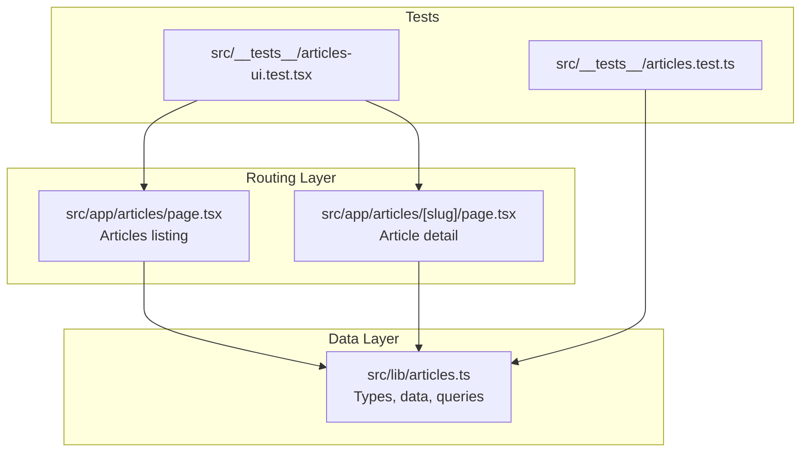
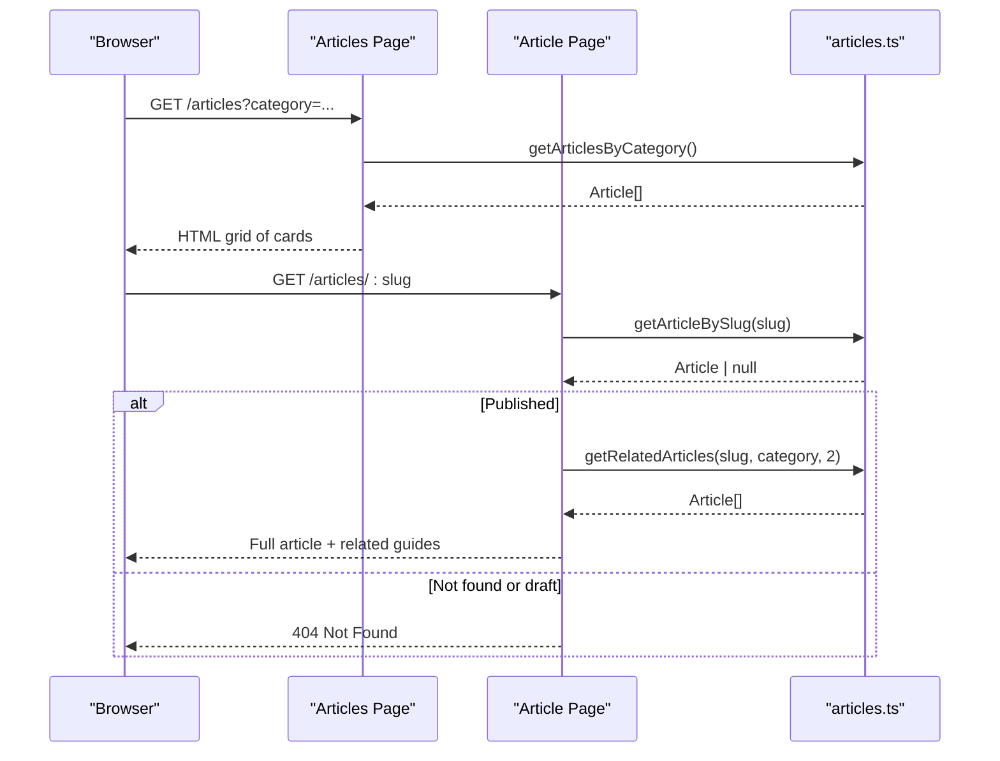
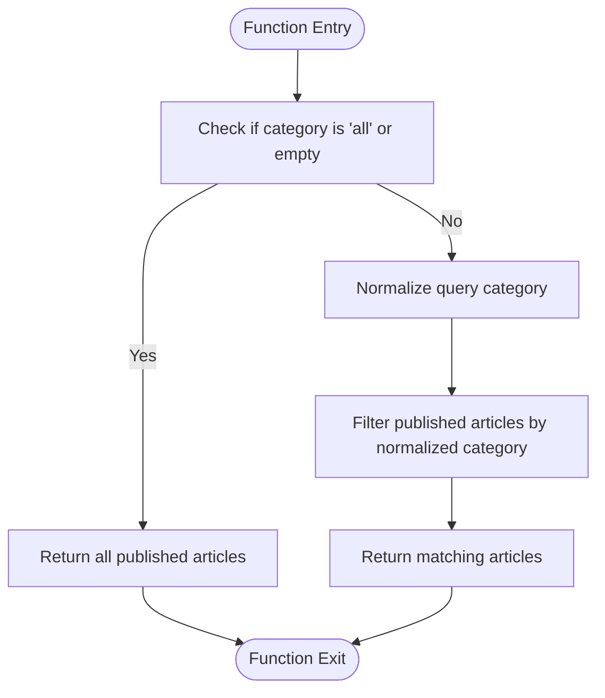
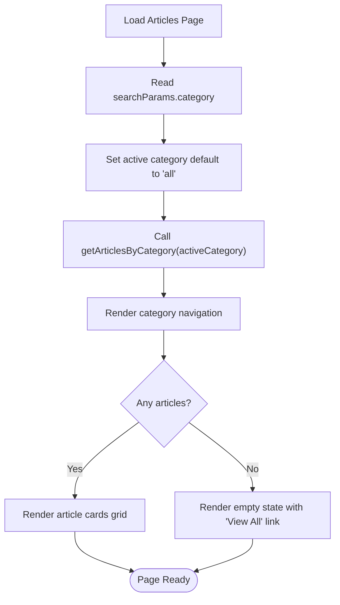
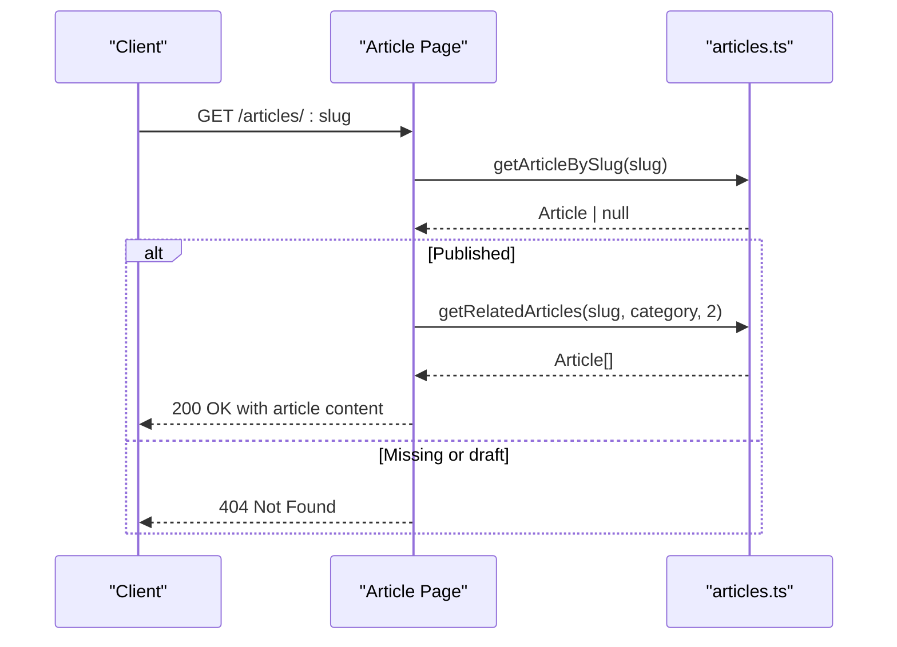
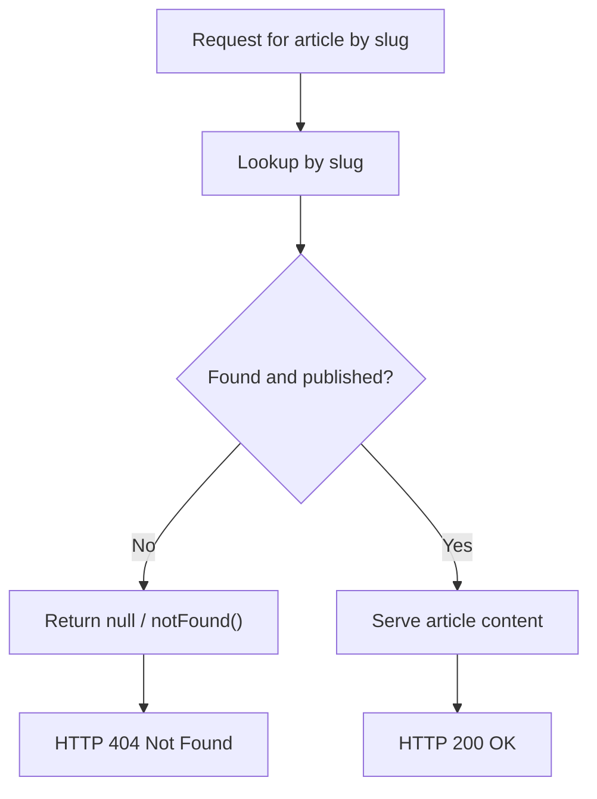
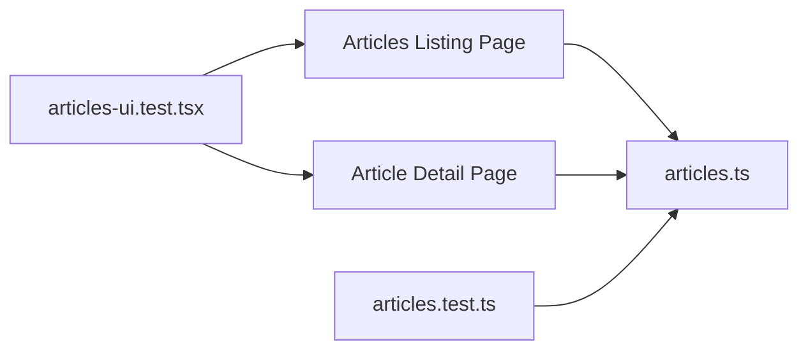

# Article Management System

<cite>
**Referenced Files in This Document**
- [articles.ts](file://src/lib/articles.ts)
- [page.tsx (Articles listing)](file://src/app/articles/page.tsx)
- [page.tsx (Article detail)](file://src/app/articles/[slug]/page.tsx)
- [articles.test.ts](file://src/__tests__/articles.test.ts)
- [articles-ui.test.tsx](file://src/__tests__/articles-ui.test.tsx)
</cite>

## Table of Contents
1. [Introduction](#introduction)
2. [Project Structure](#project-structure)
3. [Core Components](#core-components)
4. [Architecture Overview](#architecture-overview)
5. [Detailed Component Analysis](#detailed-component-analysis)
6. [Dependency Analysis](#dependency-analysis)
7. [Performance Considerations](#performance-considerations)
8. [Troubleshooting Guide](#troubleshooting-guide)
9. [Conclusion](#conclusion)

## Introduction
This document explains the SwimNigeria article management system implemented in a Next.js application. It covers the article data model, query functions for published content, the articles listing page with category filtering, and the individual article reader view. It also documents draft protection, related articles logic, and current rendering behavior around sections and callouts.

The system currently uses an in-memory dataset rather than a database. Articles are structured into sections and optional callouts, categorized by topic, and gated behind a publication flag to prevent drafts from being publicly accessible.

## Project Structure
The article feature is primarily implemented across three layers:

- Data layer: article types, sample data, and query helpers.
- Routing layer: Next.js App Router pages for the articles directory and individual article routes.
- Tests: unit and UI tests validating data integrity, query behavior, and page rendering.



**Diagram sources**
- [articles.ts:1-243](file://src/lib/articles.ts#L1-L243)
- [page.tsx (Articles listing):1-168](file://src/app/articles/page.tsx#L1-L168)
- [page.tsx (Article detail):1-206](file://src/app/articles/[slug]/page.tsx#L1-L206)
- [articles.test.ts:1-92](file://src/__tests__/articles.test.ts#L1-L92)
- [articles-ui.test.tsx:1-180](file://src/__tests__/articles-ui.test.tsx#L1-L180)

**Section sources**
- [articles.ts:1-243](file://src/lib/articles.ts#L1-L243)
- [page.tsx (Articles listing):1-168](file://src/app/articles/page.tsx#L1-L168)
- [page.tsx (Article detail):1-206](file://src/app/articles/[slug]/page.tsx#L1-L206)

## Core Components
This section summarizes the main building blocks of the article system.

- Article data model:
  - Category type: Water Safety, Beginner Technique, Community & Family.
  - Callout: safety, technique, or info note attached to a section.
  - Section: heading, paragraphs array, optional callout.
  - Article: slug, title, summary, category, readTimeMinutes, published, publishedAt, sections.

- Query functions:
  - getPublishedArticles(): returns only published articles sorted newest first.
  - getArticleBySlug(slug): returns a single published article or null.
  - getArticlesByCategory(category): filters published articles by normalized category.
  - getRelatedArticles(currentSlug, category, limit): suggests other articles excluding the current one.
  - getCategories(): returns unique categories from published articles.

- Pages:
  - Articles listing page: renders category navigation, filtered cards, empty state, and responsible educational notice.
  - Article detail page: renders metadata, header, sections, callouts, disclaimer, related articles, and back navigation.

**Section sources**
- [articles.ts:1-243](file://src/lib/articles.ts#L1-L243)
- [page.tsx (Articles listing):1-168](file://src/app/articles/page.tsx#L1-L168)
- [page.tsx (Article detail):1-206](file://src/app/articles/[slug]/page.tsx#L1-L206)

## Architecture Overview
The article system follows a simple server-side data access pattern using Next.js App Router. The data layer exposes typed interfaces and pure query functions. Pages consume these functions during server rendering to produce static or on-demand content.



**Diagram sources**
- [page.tsx (Articles listing):25-29](file://src/app/articles/page.tsx#L25-L29)
- [page.tsx (Article detail):13-46](file://src/app/articles/[slug]/page.tsx#L13-L46)
- [articles.ts:184-242](file://src/lib/articles.ts#L184-L242)

## Detailed Component Analysis

### Article Data Model
The data model defines a strongly typed structure for articles and their nested content.

```mermaid
classDiagram
class Article {
+string slug
+string title
+string summary
+ArticleCategory category
+number readTimeMinutes
+boolean published
+string publishedAt
+ArticleSection[] sections
}
class ArticleSection {
+string heading
+string[] paragraphs
+ArticleCallout callout
}
class ArticleCallout {
+string type
+string title
+string message
}
class ArticleCategory {
<<enum>>
"Water Safety"
"Beginner Technique"
"Community & Family"
}
Article --> ArticleSection : "has many"
ArticleSection --> ArticleCallout : "optional"
Article --> ArticleCategory : "uses"
```

Key modeling notes:
- Sections contain plain text paragraphs; there is no Markdown source field.
- Callouts are optional and can be safety, technique, or info.
- Publication gating is enforced via the published boolean.

**Diagram sources**
- [articles.ts:1-24](file://src/lib/articles.ts#L1-L24)

**Section sources**
- [articles.ts:1-24](file://src/lib/articles.ts#L1-L24)

### Query Functions

#### getPublishedArticles
- Purpose: Return all published articles sorted by publication date descending.
- Parameters: None.
- Return type: Article[].
- Error handling: No errors thrown; returns an empty array when no articles are published.
- Complexity: O(n log n) due to sorting after filtering.

#### getArticleBySlug
- Purpose: Resolve a single published article by its slug.
- Parameters:
  - slug: string.
- Return type: Article | null.
- Error handling: Returns null if not found or if the article is unpublished.
- Complexity: O(n).

#### getArticlesByCategory
- Purpose: Filter published articles by category.
- Parameters:
  - category: string. Supports "all" or any normalized category name.
- Return type: Article[].
- Behavior:
  - If category is missing or equals "all", return all published articles.
  - Normalizes both query and article category by lowercasing and removing non-alphanumeric characters before comparison.
- Complexity: O(n).

#### getRelatedArticles
- Purpose: Suggest related published articles excluding the current article.
- Parameters:
  - currentSlug: string.
  - category: string.
  - limit: number (default 2).
- Return type: Article[].
- Behavior:
  - Prefers same-category articles up to the limit.
  - Fills remaining slots with articles from other categories.
- Complexity: O(n).

#### getCategories
- Purpose: Return distinct category names from published articles.
- Parameters: None.
- Return type: ArticleCategory[].
- Complexity: O(n).



**Diagram sources**
- [articles.ts:204-216](file://src/lib/articles.ts#L204-L216)

**Section sources**
- [articles.ts:184-242](file://src/lib/articles.ts#L184-L242)
- [articles.test.ts:24-90](file://src/__tests__/articles.test.ts#L24-L90)

### Articles Listing Page
The articles listing page provides:
- A page-level heading and description.
- Category navigation links including All Guides and dynamic categories derived from published articles.
- A responsive card grid showing title, category badge, summary, read time, and publication month/year.
- An empty state when no articles match the selected category.
- A responsible educational scope notice.

Behavior highlights:
- Reads searchParams.category and defaults to "all".
- Uses getArticlesByCategory for filtering.
- Uses getCategories to render navigation links.
- Renders a user-friendly empty state with a link back to all guides.



**Diagram sources**
- [page.tsx (Articles listing):25-29](file://src/app/articles/page.tsx#L25-L29)
- [page.tsx (Articles listing):49-86](file://src/app/articles/page.tsx#L49-L86)
- [page.tsx (Articles listing):88-154](file://src/app/articles/page.tsx#L88-L154)

**Section sources**
- [page.tsx (Articles listing):1-168](file://src/app/articles/page.tsx#L1-L168)
- [articles-ui.test.tsx:17-79](file://src/__tests__/articles-ui.test.tsx#L17-L79)

### Individual Article Page
The individual article page handles:
- Static parameter generation for all published slugs.
- Metadata generation for SEO titles and descriptions.
- Rendering of article header, sections, callouts, safety disclaimer, and related articles.
- Proper 404 handling for missing or unpublished articles.

Rendering details:
- Header includes category badge, read time, and formatted publication date.
- Body iterates over sections, rendering headings, paragraphs, and optional callouts.
- Related articles are fetched and displayed as cards excluding the current article.
- Back navigation points to the articles listing.

Security and access control:
- Drafts are excluded from static params and direct access.
- Unpublished or missing slugs trigger Next.js notFound(), resulting in a 404 response.



**Diagram sources**
- [page.tsx (Article detail):13-46](file://src/app/articles/[slug]/page.tsx#L13-L46)
- [page.tsx (Article detail):48-205](file://src/app/articles/[slug]/page.tsx#L48-L205)
- [articles.ts:193-199](file://src/lib/articles.ts#L193-L199)

**Section sources**
- [page.tsx (Article detail):1-206](file://src/app/articles/[slug]/page.tsx#L1-L206)
- [articles-ui.test.tsx:81-178](file://src/__tests__/articles-ui.test.tsx#L81-L178)

### Content Security: Draft Protection
Draft articles must never be publicly accessible. The system enforces this through multiple layers:

- Data layer:
  - getArticleBySlug returns null for unpublished articles.
  - getPublishedArticles excludes drafts.
  - getRelatedArticles operates on published articles only.

- Routing layer:
  - generateStaticParams generates routes only for published slugs.
  - Article page calls notFound() when the resolved article is null or unpublished.

- Tests:
  - Verify that draft slugs return null from getArticleBySlug.
  - Verify that the article page throws NEXT_NOT_FOUND for drafts and unknown slugs.



**Diagram sources**
- [articles.ts:193-199](file://src/lib/articles.ts#L193-L199)
- [page.tsx (Article detail):13-46](file://src/app/articles/[slug]/page.tsx#L13-L46)
- [articles.test.ts:52-58](file://src/__tests__/articles.test.ts#L52-L58)
- [articles-ui.test.tsx:147-157](file://src/__tests__/articles-ui.test.tsx#L147-L157)

**Section sources**
- [articles.ts:193-199](file://src/lib/articles.ts#L193-L199)
- [page.tsx (Article detail):13-46](file://src/app/articles/[slug]/page.tsx#L13-L46)
- [articles.test.ts:52-58](file://src/__tests__/articles.test.ts#L52-L58)
- [articles-ui.test.tsx:147-157](file://src/__tests__/articles-ui.test.tsx#L147-L157)

### Example Article Content Structure
An example article record demonstrates how sections and callouts are organized:

- Slug-based URL identifier.
- Title and summary for listing and metadata.
- Category selection from the defined enum.
- Read time estimate and publication timestamp.
- Sections containing:
  - Heading.
  - Paragraphs array.
  - Optional callout with type, title, and message.

A draft article exists in the dataset with published set to false to validate security behavior.

**Section sources**
- [articles.ts:26-179](file://src/lib/articles.ts#L26-L179)

### Category Organization
Categories are defined as a strict union type and surfaced dynamically from published articles:

- Water Safety
- Beginner Technique
- Community & Family

The listing page derives navigation links from getCategories and normalizes query strings for robust filtering.

**Section sources**
- [articles.ts:1](file://src/lib/articles.ts#L1)
- [articles.ts:236-242](file://src/lib/articles.ts#L236-L242)
- [page.tsx (Articles listing):65-85](file://src/app/articles/page.tsx#L65-L85)

### Related Articles Functionality
Related articles are computed per article:

- Prefer same-category articles up to the configured limit.
- Fill remaining slots with articles from other categories.
- Always exclude the current article.

This supports cross-linking between related safety and technique guides.

**Section sources**
- [articles.ts:221-231](file://src/lib/articles.ts#L221-L231)
- [page.tsx (Article detail):46-46](file://src/app/articles/[slug]/page.tsx#L46-L46)
- [articles-ui.test.tsx:120-135](file://src/__tests__/articles-ui.test.tsx#L120-L135)

### Markdown Processing, Syntax Highlighting, and Responsive Design
Current implementation details:

- Markdown processing:
  - The article data model stores plain text paragraphs within sections. There is no Markdown source field in the Article interface.
  - The article detail page renders paragraphs directly without a Markdown parser.
  - Therefore, Markdown syntax in paragraph strings will not be processed into rich HTML.

- Syntax highlighting:
  - There is no code block parsing or syntax highlighting integration in the article renderer.
  - Any code-like content should be treated as plain text unless additional tooling is added.

- Responsive design:
  - The listing page uses responsive Tailwind classes for grid layout and typography scaling.
  - The article detail page uses responsive typography and spacing utilities.
  - Cards and badges adapt across screen sizes.

Recommendations if Markdown support is desired:
- Extend the ArticleSection model to include a markdownBody field.
- Add a server-side Markdown-to-HTML pipeline with sanitization.
- Integrate a syntax highlighter for code blocks.
- Ensure accessibility and performance considerations for large documents.

[No sources needed since this section provides general guidance based on observed implementation]

## Dependency Analysis
The following diagram shows how pages depend on the data layer and how tests validate behavior.



**Diagram sources**
- [page.tsx (Articles listing):13-13](file://src/app/articles/page.tsx#L13-L13)
- [page.tsx (Article detail):7-7](file://src/app/articles/[slug]/page.tsx#L7-L7)
- [articles.test.ts:3-9](file://src/__tests__/articles.test.ts#L3-L9)
- [articles-ui.test.tsx:3-5](file://src/__tests__/articles-ui.test.tsx#L3-L5)

**Section sources**
- [page.tsx (Articles listing):1-168](file://src/app/articles/page.tsx#L1-L168)
- [page.tsx (Article detail):1-206](file://src/app/articles/[slug]/page.tsx#L1-L206)
- [articles.test.ts:1-92](file://src/__tests__/articles.test.ts#L1-L92)
- [articles-ui.test.tsx:1-180](file://src/__tests__/articles-ui.test.tsx#L1-L180)

## Performance Considerations
Current characteristics and recommendations:

- In-memory dataset:
  - All articles are loaded into memory at module load time.
  - Filtering and sorting operate on small arrays, so performance is acceptable for the current dataset size.

- Server-side rendering:
  - Articles listing and detail pages fetch data synchronously during server rendering.
  - Static parameters are generated for published slugs, enabling static site generation benefits.

- Caching strategies:
  - Consider memoizing getPublishedArticles and getCategories results if the dataset grows or if multiple components request it frequently.
  - Use Next.js caching primitives where appropriate for route segments.

- Lazy loading for large articles:
  - For very long articles, consider splitting sections into separate components and lazy-loading them.
  - Implement progressive hydration for heavy client-side features if added later.

- Search functionality:
  - The listing page currently supports category filtering but not full-text search.
  - If search is added, prefer server-side filtering with normalization and pagination.

[No sources needed since this section provides general guidance]

## Troubleshooting Guide
Common issues and resolutions:

- Draft article accessed directly:
  - Symptom: Attempting to open a draft article URL returns a 404.
  - Cause: getArticleBySlug returns null for unpublished articles, and the page calls notFound().
  - Resolution: Publish the article by setting published to true, then rebuild or redeploy.

- Unknown slug:
  - Symptom: Non-existent slugs return 404.
  - Cause: getArticleBySlug returns null for missing slugs.
  - Resolution: Verify the slug exists and is published.

- Category filter returns empty:
  - Symptom: Selecting a category shows no articles.
  - Cause: No published articles match the normalized category.
  - Resolution: Confirm the category matches one of the defined values and that articles are published.

- Related articles not appearing:
  - Symptom: Related guides section is missing.
  - Cause: Fewer than the requested limit of related articles exist.
  - Resolution: Add more published articles in the same or different categories.

- Markdown not rendering:
  - Symptom: Markdown syntax appears as plain text.
  - Cause: The renderer does not process Markdown; paragraphs are rendered as-is.
  - Resolution: Add Markdown parsing and sanitization if rich formatting is required.

**Section sources**
- [articles.ts:193-199](file://src/lib/articles.ts#L193-L199)
- [page.tsx (Article detail):41-44](file://src/app/articles/[slug]/page.tsx#L41-L44)
- [articles.test.ts:47-58](file://src/__tests__/articles.test.ts#L47-L58)
- [articles-ui.test.tsx:137-157](file://src/__tests__/articles-ui.test.tsx#L137-L157)

## Conclusion
The SwimNigeria article management system provides a clear, secure, and testable foundation for publishing educational content. It enforces draft protection at both the data and routing layers, offers category-based filtering, and renders structured article content with callouts and related articles. While Markdown processing and syntax highlighting are not currently implemented, the architecture allows for straightforward extension. Future enhancements could include richer content authoring, search, caching, and performance optimizations for large articles.