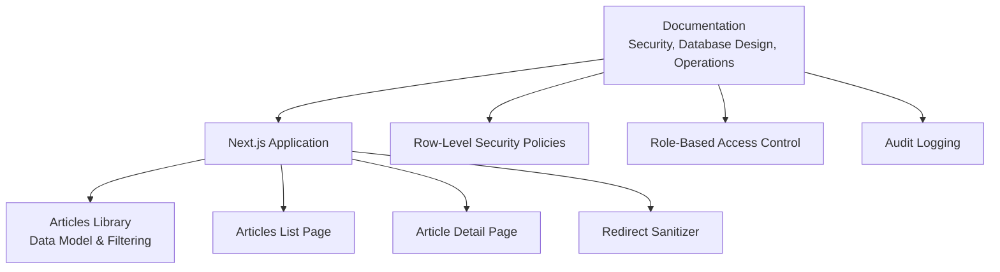
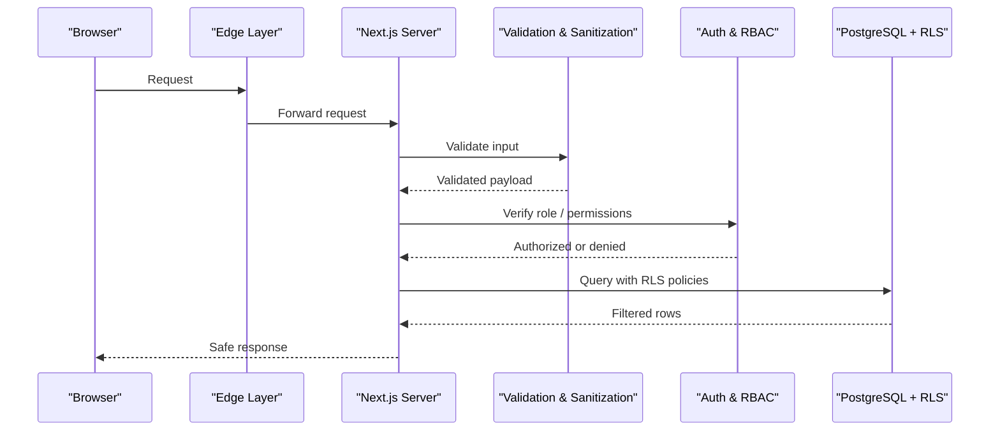
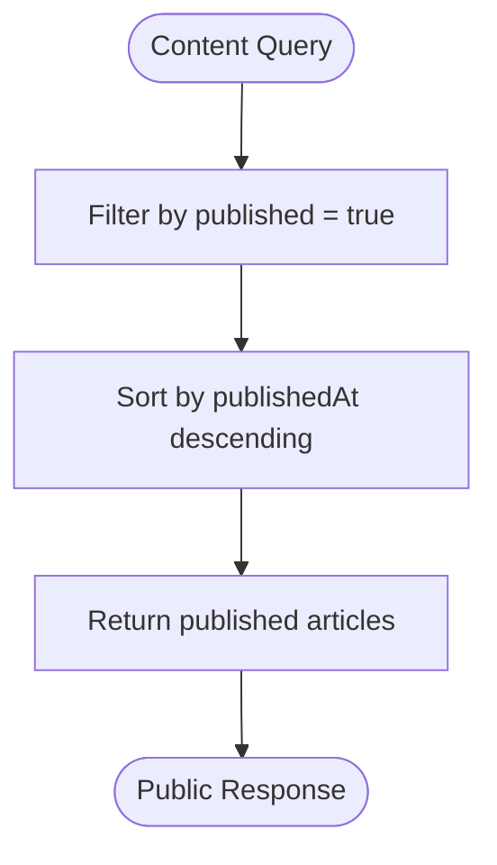
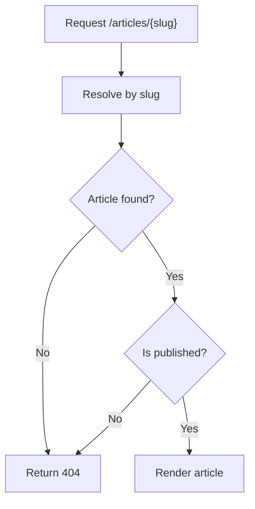
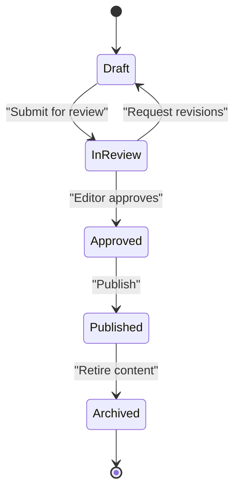
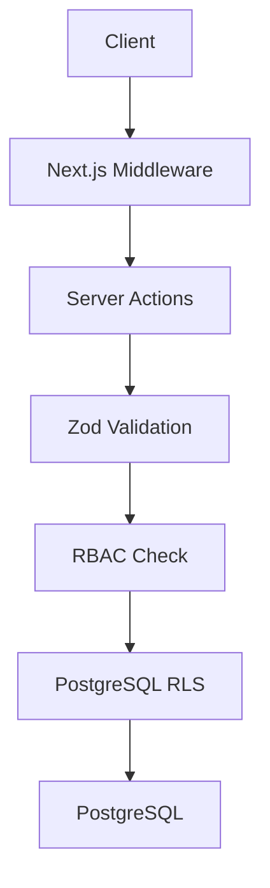
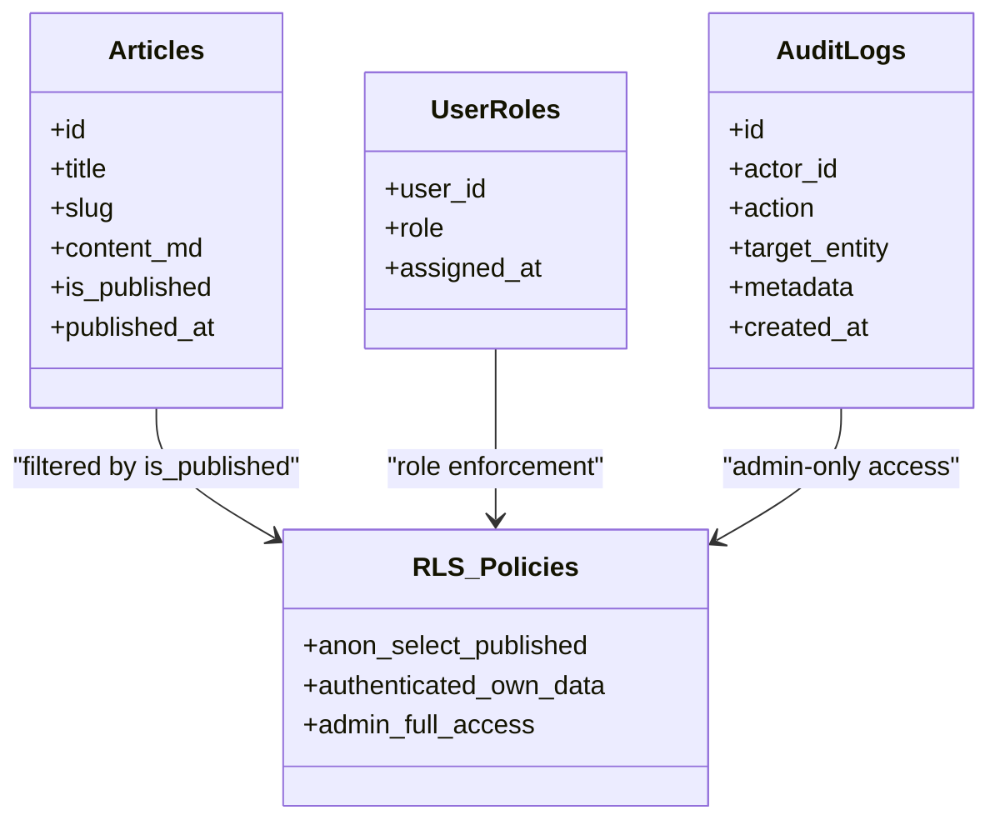
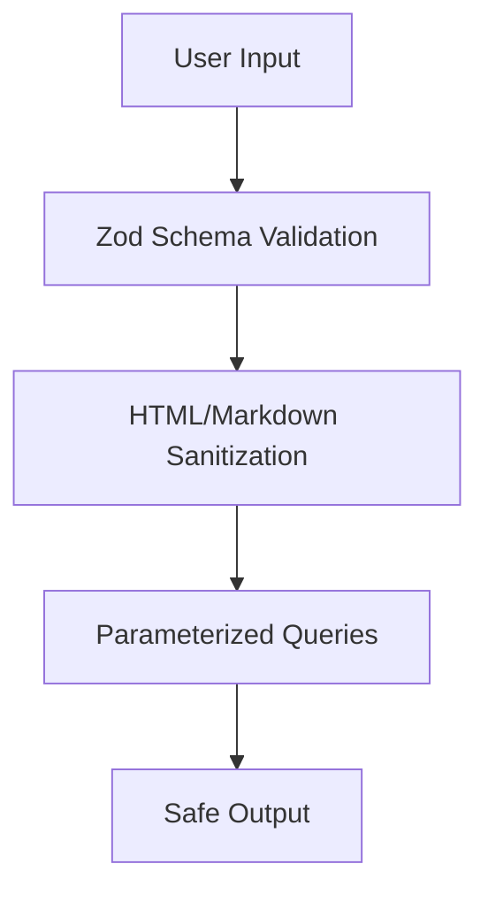
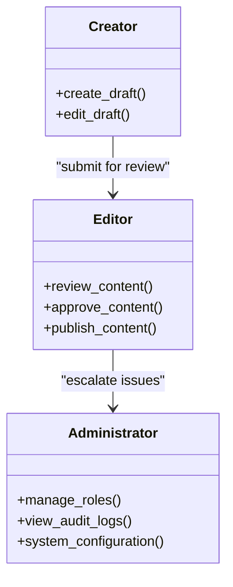
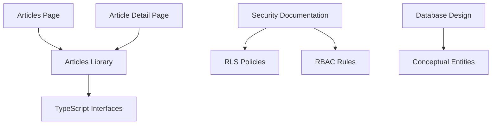

# Content Workflow & Security

<cite>
**Referenced Files in This Document**
- [README.md](file://README.md)
- [SECURITY.md](file://docs/SECURITY.md)
- [DATABASE_DESIGN.md](file://docs/DATABASE_DESIGN.md)
- [articles.ts](file://src/lib/articles.ts)
- [Articles Page](file://src/app/articles/page.tsx)
- [Article Detail Page](file://src/app/articles/[slug]/page.tsx)
- [Redirect Sanitizer](file://src/lib/supabase/redirect.ts)
- [Supabase Skill Guidance](file://.agents/skills/supabase/SKILL.md)
</cite>

## Table of Contents
1. [Introduction](#introduction)
2. [Project Structure](#project-structure)
3. [Core Components](#core-components)
4. [Architecture Overview](#architecture-overview)
5. [Detailed Component Analysis](#detailed-component-analysis)
6. [Dependency Analysis](#dependency-analysis)
7. [Performance Considerations](#performance-considerations)
8. [Troubleshooting Guide](#troubleshooting-guide)
9. [Conclusion](#conclusion)
10. [Appendices](#appendices)

## Introduction
This document explains SwimNigeria’s content workflow and security mechanisms with a focus on:
- Draft versus published content separation
- Public isolation of drafts
- Publication workflow, review, and approval stages
- Row-level security policies and access controls
- Input validation, sanitization, and XSS prevention
- Role-based access control for creators, editors, and administrators
- Audit logging for content changes and user activities
- Secure query patterns and data protection practices
- Compliance considerations under Nigerian data protection regulations and international privacy standards

The project is currently in Phase 1 scaffolding, meaning the repository contains foundational architecture, documentation, and example content structures rather than a fully implemented production database or admin system. The article module demonstrates the intended draft-vs-published behavior, while the security and database design documents define the required security model for future implementation.

**Section sources**
- [README.md:1-111](file://README.md#L1-L111)

## Project Structure
At a high level, the relevant parts of the repository are:
- Documentation defining security, database design, and operational guidance
- A Next.js application structure with pages for articles
- A TypeScript module modeling article data and filtering logic
- Utility code for redirect sanitization
- Agent skill references that include Supabase and PostgreSQL best practices

**Diagram sources**
- [SECURITY.md:1-155](file://docs/SECURITY.md#L1-L155)
- [DATABASE_DESIGN.md:1-181](file://docs/DATABASE_DESIGN.md#L1-L181)
- [articles.ts:1-243](file://src/lib/articles.ts#L1-L243)
- [Articles Page:1-168](file://src/app/articles/page.tsx#L1-L168)
- [Article Detail Page:1-206](file://src/app/articles/[slug]/page.tsx#L1-L206)
- [Redirect Sanitizer:1-38](file://src/lib/supabase/redirect.ts#L1-L38)

**Section sources**
- [README.md:71-101](file://README.md#L71-L101)
- [SECURITY.md:1-25](file://docs/SECURITY.md#L1-L25)
- [DATABASE_DESIGN.md:1-10](file://docs/DATABASE_DESIGN.md#L1-L10)

## Core Components
The core components relevant to content workflow and security are:
- **Articles data model and filtering**: Defines article types, sections, categories, and published-state filtering.
- **Articles list page**: Renders only published articles and derives category options from published content.
- **Article detail page**: Resolves an article by slug, returns a real 404 for missing or unpublished content, and renders related published articles.
- **Security policy documentation**: Defines zero-trust client principles, RBAC rules, RLS requirements, input validation, XSS mitigation, rate limiting, and NDPR compliance.
- **Database design documentation**: Defines conceptual entities including `articles`, `user_roles`, `audit_logs`, and RLS permission matrices.
- **Redirect sanitizer**: Protects against open redirects and malicious URL schemes during authentication flows.

**Section sources**
- [articles.ts:1-243](file://src/lib/articles.ts#L1-L243)
- [Articles Page:1-168](file://src/app/articles/page.tsx#L1-L168)
- [Article Detail Page:1-206](file://src/app/articles/[slug]/page.tsx#L1-L206)
- [SECURITY.md:1-155](file://docs/SECURITY.md#L1-L155)
- [DATABASE_DESIGN.md:128-181](file://docs/DATABASE_DESIGN.md#L128-L181)
- [Redirect Sanitizer:1-38](file://src/lib/supabase/redirect.ts#L1-L38)

## Architecture Overview
SwimNigeria’s security architecture follows a zero-trust client model:
- Client requests enter through edge protections such as HTTPS, rate limiting, and WAF.
- Next.js middleware and server actions enforce authorization and role checks.
- Input is validated and sanitized using strict schemas.
- Database access is enforced through Row-Level Security and scoped roles.
- Sensitive operations are logged through audit logs.

**Diagram sources**
- [SECURITY.md:3-25](file://docs/SECURITY.md#L3-L25)
- [DATABASE_DESIGN.md:161-181](file://docs/DATABASE_DESIGN.md#L161-L181)

## Detailed Component Analysis

### Draft vs Published Content Separation
The article module models content with a `published` boolean and a `publishedAt` timestamp. Only published articles are returned by the public API functions:
- `getPublishedArticles()` filters out drafts and sorts by publication date.
- `getArticleBySlug()` returns `null` for unpublished articles.
- `getArticlesByCategory()` operates only on published articles.
- `getRelatedArticles()` excludes the current article and selects from published content.
- `getCategories()` derives categories from published articles only.

**Diagram sources**
- [articles.ts:181-243](file://src/lib/articles.ts#L181-L243)

**Section sources**
- [articles.ts:15-24](file://src/lib/articles.ts#L15-L24)
- [articles.ts:160-179](file://src/lib/articles.ts#L160-L179)
- [articles.ts:181-243](file://src/lib/articles.ts#L181-L243)

### Public Isolation of Drafts
Drafts must remain hidden from public directories and individual article routes:
- The articles list page uses `getArticlesByCategory()`, which only includes published articles.
- The article detail page calls `getArticleBySlug()` and invokes `notFound()` when the article is missing or unpublished.
- Static parameter generation uses `getPublishedArticles()`, so only published slugs are pre-rendered.

**Diagram sources**
- [Article Detail Page:13-44](file://src/app/articles/[slug]/page.tsx#L13-L44)
- [articles.ts:190-199](file://src/lib/articles.ts#L190-L199)

**Section sources**
- [Articles Page:25-29](file://src/app/articles/page.tsx#L25-L29)
- [Article Detail Page:13-44](file://src/app/articles/[slug]/page.tsx#L13-L44)
- [articles.ts:181-199](file://src/lib/articles.ts#L181-L199)

### Content Publication Workflow
The current repository implements a conceptual publication model:
- Content authors create articles with `published: false`.
- Editors or administrators approve content by setting `published: true` and recording `publishedAt`.
- Public queries and routes only expose approved content.
- Future implementation should move this logic into a database-backed system with explicit review states such as `draft`, `in_review`, `approved`, and `published`.

Recommended workflow stages:
1. **Draft creation**: Author creates content with draft status.
2. **Internal review**: Editor reviews content for accuracy, safety, and compliance.
3. **Approval**: Approved content is marked for publication.
4. **Publication**: Content becomes publicly accessible via published queries.
5. **Maintenance**: Updates require re-review before republishing.

[No sources needed since this diagram shows conceptual workflow, not actual code structure]

### Review Processes and Approval Stages
While the current code does not implement a formal review state machine, the security and database design documents establish the required governance model:
- Roles must be authoritative and stored in `user_roles`, not derived from editable user metadata.
- Administrative actions must verify roles server-side.
- Audit logs must record sensitive changes.
- Row-Level Security must enforce data visibility based on roles and ownership.

For future implementation:
- Add a `review_status` field to the `articles` table.
- Restrict transitions to authorized roles.
- Log all status changes in `audit_logs`.
- Enforce RLS so only reviewers can see draft content.

**Section sources**
- [DATABASE_DESIGN.md:50-53](file://docs/DATABASE_DESIGN.md#L50-L53)
- [DATABASE_DESIGN.md:142-146](file://docs/DATABASE_DESIGN.md#L142-L146)
- [SECURITY.md:43-63](file://docs/SECURITY.md#L43-L63)

### Security Measures for Sensitive Content
SwimNigeria’s security model emphasizes defense-in-depth:
- Zero-trust client: No browser-side trust for authorization.
- Mandatory RLS on every table.
- Service role key protection.
- Strict input validation and sanitization.
- XSS mitigation through React escaping and sanitized Markdown rendering.
- Rate limiting for sensitive endpoints.
- Personal data minimization and right-to-erasure support.

**Diagram sources**
- [SECURITY.md:3-25](file://docs/SECURITY.md#L3-L25)
- [SECURITY.md:67-79](file://docs/SECURITY.md#L67-L79)
- [SECURITY.md:82-96](file://docs/SECURITY.md#L82-L96)

**Section sources**
- [SECURITY.md:3-25](file://docs/SECURITY.md#L3-L25)
- [SECURITY.md:67-79](file://docs/SECURITY.md#L67-L79)
- [SECURITY.md:82-96](file://docs/SECURITY.md#L82-L96)
- [SECURITY.md:136-155](file://docs/SECURITY.md#L136-L155)

### Row-Level Security Policies and Access Controls
The database design defines RLS expectations for each entity:
- Public users can only read published courses and articles.
- Learners can access preview lessons and enrolled course content.
- Admins have full access.
- Direct public access to underlying certificate tables is prohibited; verification is mediated through a restricted view or projection.
- Audit logs are readable only by admins.

**Diagram sources**
- [DATABASE_DESIGN.md:128-146](file://docs/DATABASE_DESIGN.md#L128-L146)
- [DATABASE_DESIGN.md:161-181](file://docs/DATABASE_DESIGN.md#L161-L181)

**Section sources**
- [DATABASE_DESIGN.md:161-181](file://docs/DATABASE_DESIGN.md#L161-L181)
- [SECURITY.md:67-79](file://docs/SECURITY.md#L67-L79)

### Content Validation and Sanitization
Input validation and sanitization are critical for preventing XSS and injection attacks:
- All inputs must pass strict schema validation.
- SQL and NoSQL injection must be prevented through parameterized queries.
- JSX variables are automatically escaped by React.
- Markdown content must be rendered through a sanitized parser with an allowlist of safe HTML tags.
- Open redirects must be blocked through URL sanitization.

**Diagram sources**
- [SECURITY.md:82-96](file://docs/SECURITY.md#L82-L96)
- [Redirect Sanitizer:1-38](file://src/lib/supabase/redirect.ts#L1-L38)

**Section sources**
- [SECURITY.md:82-96](file://docs/SECURITY.md#L82-L96)
- [Redirect Sanitizer:1-38](file://src/lib/supabase/redirect.ts#L1-L38)

### Role-Based Access Control for Creators, Editors, and Administrators
RBAC is defined by authoritative roles:
- Roles must come from `user_roles` or verified `app_metadata`, never from editable `raw_user_meta_data`.
- Administrative routes and server actions must re-verify roles.
- RLS policies enforce row-level visibility based on roles and ownership.

Recommended role mapping:
- **Creator**: Can create and edit drafts.
- **Editor**: Can review, approve, and publish content.
- **Administrator**: Can manage roles, audit logs, and system configuration.

**Diagram sources**
- [SECURITY.md:43-63](file://docs/SECURITY.md#L43-L63)
- [DATABASE_DESIGN.md:50-53](file://docs/DATABASE_DESIGN.md#L50-L53)

**Section sources**
- [SECURITY.md:43-63](file://docs/SECURITY.md#L43-L63)
- [DATABASE_DESIGN.md:50-53](file://docs/DATABASE_DESIGN.md#L50-L53)

### Audit Logging for Content Changes and User Activities
Audit logs capture sensitive platform actions:
- Actor identity
- Action type
- Target entity and ID
- Metadata capturing previous and new state
- Anonymized IP address
- Timestamp

Future implementation should log:
- Draft creation and edits
- Review status changes
- Publication events
- Role assignments
- Certificate issuance and revocation

**Section sources**
- [DATABASE_DESIGN.md:142-146](file://docs/DATABASE_DESIGN.md#L142-L146)

### Examples of Secure Content Queries, Permission Checks, and Data Protection Patterns
Secure query patterns:
- Always filter by `is_published = true` for public content.
- Use RLS to enforce row-level visibility.
- Avoid `SELECT *` on sensitive tables; project only necessary fields.
- Mediate public certificate verification through a restricted view or explicit projection.

Permission check patterns:
- Re-verify roles server-side for administrative actions.
- Never trust client-side role checks.
- Combine role checks with ownership predicates for BOLA/IDOR protection.

Data protection patterns:
- Minimize exposed fields.
- Anonymize personal data on account deletion.
- Enforce rate limits on sensitive endpoints.
- Store secrets securely and rotate them if exposed.

**Section sources**
- [SECURITY.md:43-79](file://docs/SECURITY.md#L43-L79)
- [SECURITY.md:107-133](file://docs/SECURITY.md#L107-L133)
- [DATABASE_DESIGN.md:111-124](file://docs/DATABASE_DESIGN.md#L111-L124)

### Compliance with Nigerian Data Protection Regulations and International Privacy Standards
Compliance requirements include:
- Data minimization: collect only necessary personal information.
- Right to erasure: anonymize personal data while preserving institutional integrity.
- Encrypted transmission: enforce HTTPS with modern TLS ciphers.
- Secure secret management: no hardcoded credentials, automated dependency auditing.
- Clear privacy boundaries for public verification endpoints.

**Section sources**
- [SECURITY.md:143-155](file://docs/SECURITY.md#L143-L155)

## Dependency Analysis
The article module depends on Next.js server components and TypeScript utilities. The security model depends on Supabase, PostgreSQL RLS, and Next.js middleware.

**Diagram sources**
- [Articles Page:1-168](file://src/app/articles/page.tsx#L1-L168)
- [Article Detail Page:1-206](file://src/app/articles/[slug]/page.tsx#L1-L206)
- [articles.ts:1-243](file://src/lib/articles.ts#L1-L243)
- [SECURITY.md:1-155](file://docs/SECURITY.md#L1-L155)
- [DATABASE_DESIGN.md:1-181](file://docs/DATABASE_DESIGN.md#L1-L181)

**Section sources**
- [Articles Page:1-168](file://src/app/articles/page.tsx#L1-L168)
- [Article Detail Page:1-206](file://src/app/articles/[slug]/page.tsx#L1-L206)
- [articles.ts:1-243](file://src/lib/articles.ts#L1-L243)

## Performance Considerations
- Pre-render only published article slugs to reduce static generation overhead.
- Cache published article lists where appropriate.
- Use efficient filtering and sorting on published content.
- Avoid unnecessary database joins for public reads.
- Apply rate limiting to prevent abuse of public endpoints.

[No sources needed since this section provides general guidance]

## Troubleshooting Guide
Common issues and resolutions:
- **Drafts appearing publicly**: Ensure all public queries filter by `published = true` and RLS policies enforce visibility.
- **Unauthorized access to drafts**: Verify RLS policies and server-side role checks.
- **XSS vulnerabilities**: Confirm that Markdown is sanitized and raw HTML is not rendered unsafely.
- **Open redirects**: Validate redirect URLs through the sanitizer utility.
- **Missing audit logs**: Ensure sensitive actions trigger audit log entries with actor, action, target, and metadata.

**Section sources**
- [SECURITY.md:82-96](file://docs/SECURITY.md#L82-L96)
- [Redirect Sanitizer:1-38](file://src/lib/supabase/redirect.ts#L1-L38)
- [DATABASE_DESIGN.md:142-146](file://docs/DATABASE_DESIGN.md#L142-L146)

## Conclusion
SwimNigeria’s content workflow and security model emphasize strict separation between drafts and published content, server-side authorization, database-enforced access controls, and comprehensive input validation. While the current repository focuses on scaffolding and conceptual design, the documented security policies, RLS expectations, and audit logging requirements provide a clear roadmap for implementing a secure, compliant, and maintainable content system.

[No sources needed since this section summarizes without analyzing specific files]

## Appendices

### Recommended Implementation Checklist
- Implement draft, review, approval, and publication states in the database.
- Enforce RLS on all tables with role-aware policies.
- Add server-side role verification for administrative actions.
- Integrate audit logging for all sensitive content changes.
- Sanitize all user-generated content before rendering.
- Validate all inputs with strict schemas.
- Protect secrets and rotate credentials regularly.
- Comply with NDPR and international privacy standards.

[No sources needed since this section provides general guidance]