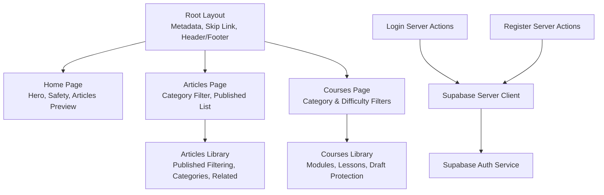
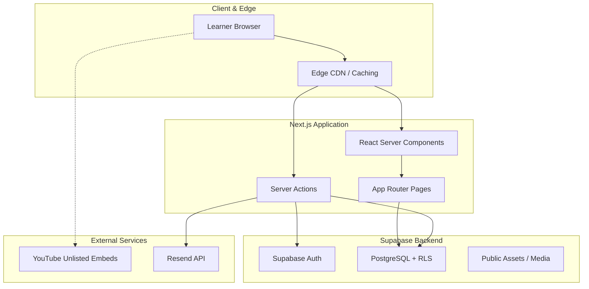
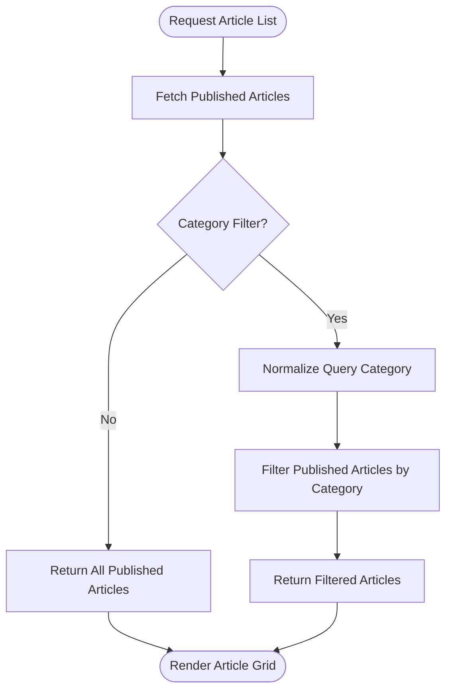
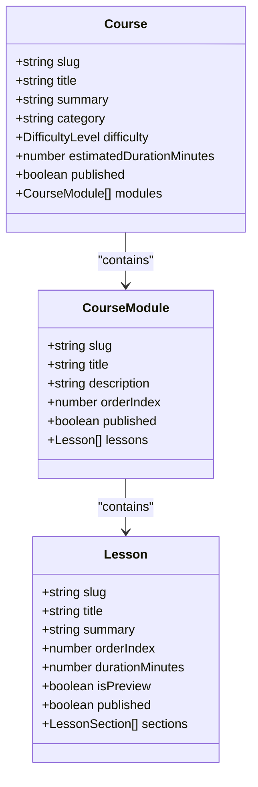
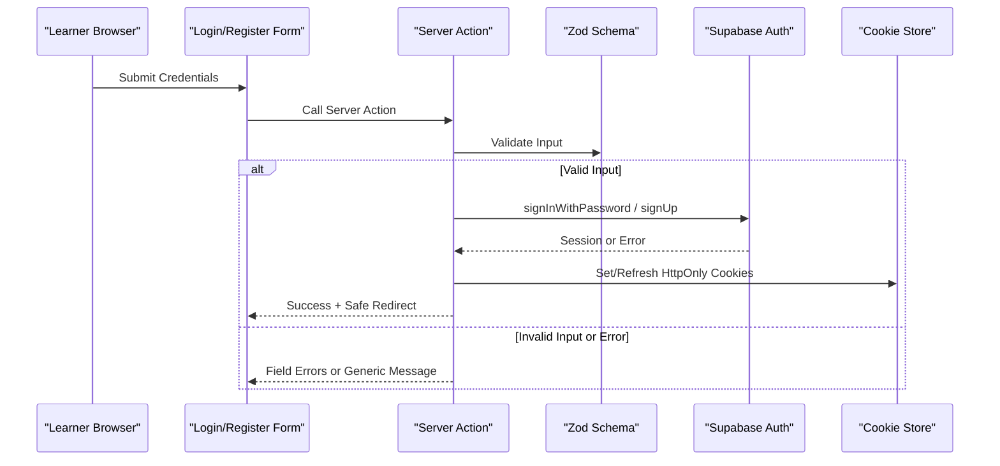
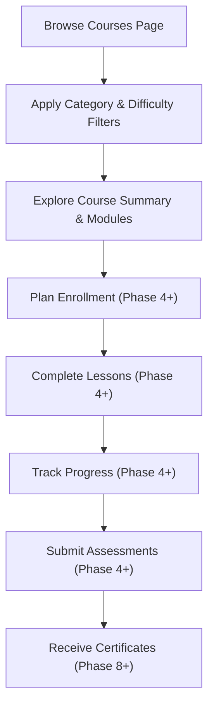
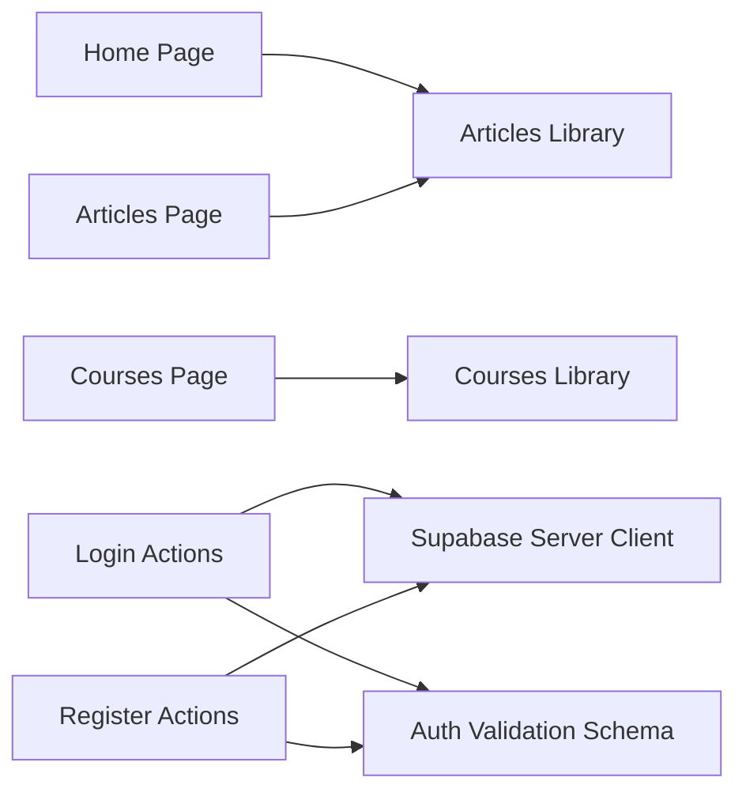

# Core Features

<cite>
**Referenced Files in This Document**   
- [README.md](file://README.md)
- [PROJECT_BRIEF.md](file://docs/PROJECT_BRIEF.md)
- [SYSTEM_ARCHITECTURE.md](file://docs/SYSTEM_ARCHITECTURE.md)
- [DATABASE_DESIGN.md](file://docs/DATABASE_DESIGN.md)
- [package.json](file://package.json)
- [layout.tsx](file://src/app/layout.tsx)
- [page.tsx](file://src/app/page.tsx)
- [articles.ts](file://src/lib/articles.ts)
- [courses.ts](file://src/lib/courses.ts)
- [actions.ts](file://src/app/login/actions.ts)
- [actions.ts](file://src/app/register/actions.ts)
- [page.tsx](file://src/app/articles/page.tsx)
- [page.tsx](file://src/app/courses/page.tsx)
- [server.ts](file://src/lib/supabase/server.ts)
- [auth.ts](file://src/lib/validation/auth.ts)
</cite>

## Table of Contents
1. [Introduction](#introduction)
2. [Project Structure](#project-structure)
3. [Core Components](#core-components)
4. [Architecture Overview](#architecture-overview)
5. [Detailed Component Analysis](#detailed-component-analysis)
6. [Dependency Analysis](#dependency-analysis)
7. [Performance Considerations](#performance-considerations)
8. [Troubleshooting Guide](#troubleshooting-guide)
9. [Conclusion](#conclusion)

## Introduction
SwimNigeria is a digital aquatic education platform focused on structured swimming instruction, water safety knowledge, and verifiable learning outcomes for Nigerian learners. The current Phase 1 foundation provides scaffolding, design tokens, quality tooling, and public-facing educational content structures. The core features documented here include:
- Educational article management with published-only exposure, category filtering, and related content discovery.
- Course curriculum structure with modules, lessons, difficulty levels, preview isolation, and draft protection.
- User authentication via Supabase including login, registration, email verification handling, and secure session management.
- Content publication workflow emphasizing draft isolation, safe redirects, and server-side validation.
- Data models, API-like Server Actions, component interactions, user workflows, performance optimizations, and accessibility compliance.

The project’s stated goals emphasize low-bandwidth optimization, zero initial infrastructure cost, strict security, and WCAG-aligned accessibility.

**Section sources**
- [README.md:1-101](file://README.md#L1-L101)
- [PROJECT_BRIEF.md:1-87](file://docs/PROJECT_BRIEF.md#L1-L87)

## Project Structure
At a high level, the application uses Next.js App Router with TypeScript, Tailwind CSS v4, and Supabase integration patterns. Public pages render educational content, while authentication flows are implemented through Next.js Server Actions backed by Supabase Auth.

**Diagram sources**
- [layout.tsx:1-42](file://src/app/layout.tsx#L1-L42)
- [page.tsx:1-645](file://src/app/page.tsx#L1-L645)
- [page.tsx:1-168](file://src/app/articles/page.tsx#L1-L168)
- [page.tsx:1-367](file://src/app/courses/page.tsx#L1-L367)
- [articles.ts:1-243](file://src/lib/articles.ts#L1-L243)
- [courses.ts:1-800](file://src/lib/courses.ts#L1-L800)
- [actions.ts:1-252](file://src/app/login/actions.ts#L1-L252)
- [actions.ts:1-224](file://src/app/register/actions.ts#L1-L224)
- [server.ts:1-61](file://src/lib/supabase/server.ts#L1-L61)

**Section sources**
- [layout.tsx:1-42](file://src/app/layout.tsx#L1-L42)
- [page.tsx:1-645](file://src/app/page.tsx#L1-L645)
- [package.json:1-48](file://package.json#L1-L48)

## Core Components
This section summarizes the primary feature areas and their responsibilities:
- Article Management System: Provides typed article data, published-only queries, category filtering, and related article suggestions.
- Course Curriculum System: Defines courses, modules, lessons, difficulty levels, preview flags, and draft isolation helpers.
- Authentication System: Implements login and registration Server Actions with Zod validation, Supabase Auth calls, safe redirects, and error handling.
- Supabase Integration: Provides a server client factory that reads cookies safely and uses the public anon key without service-role access.
- Validation Layer: Centralizes input schemas for registration, login, forgot password, and reset password flows.

Key implementation highlights:
- Articles library exposes functions to retrieve published articles, filter by category, resolve by slug, and generate related articles.
- Courses library defines rich curriculum data with modules and lessons, plus helper interfaces for syllabus and preview items.
- Authentication actions validate inputs, call Supabase Auth, handle unverified email states, rate limits, and sanitize redirect targets.
- Supabase server client wraps cookie store access and gracefully handles read-only cookie mutations during server rendering.

**Section sources**
- [articles.ts:1-243](file://src/lib/articles.ts#L1-L243)
- [courses.ts:1-800](file://src/lib/courses.ts#L1-L800)
- [actions.ts:1-252](file://src/app/login/actions.ts#L1-L252)
- [actions.ts:1-224](file://src/app/register/actions.ts#L1-L224)
- [server.ts:1-61](file://src/lib/supabase/server.ts#L1-L61)
- [auth.ts:1-140](file://src/lib/validation/auth.ts#L1-L140)

## Architecture Overview
The system architecture emphasizes SSR for SEO-critical pages, edge-friendly caching, strict server-side validation, and database-level Row-Level Security (RLS). It also plans for certificate generation and verification, though those features are future phases.

**Diagram sources**
- [SYSTEM_ARCHITECTURE.md:12-59](file://docs/SYSTEM_ARCHITECTURE.md#L12-L59)
- [SYSTEM_ARCHITECTURE.md:63-160](file://docs/SYSTEM_ARCHITECTURE.md#L63-L160)

**Section sources**
- [SYSTEM_ARCHITECTURE.md:1-225](file://docs/SYSTEM_ARCHITECTURE.md#L1-L225)

## Detailed Component Analysis

### Article Management System
The article system centers around a typed data model and utility functions that enforce published-only visibility, category filtering, and related content discovery.

Data model highlights:
- Article includes slug, title, summary, category, read time, published flag, published date, and sections.
- Sections contain headings, paragraphs, and optional callouts for safety or technique guidance.

Core functions:
- getPublishedArticles returns only published articles sorted by publication date descending.
- getArticleBySlug resolves a single published article by slug; unpublished articles return null.
- getArticlesByCategory filters published articles by normalized category string.
- getRelatedArticles suggests additional published articles from the same category or general pool, excluding the current article.
- getCategories enumerates distinct categories from published articles.

User workflow:
- Home page previews up to three published articles.
- Articles page lists all published articles with category navigation and empty state messaging.
- Individual article routes should use getArticleBySlug to ensure drafts remain hidden.

Draft protection:
- Draft articles have published set to false and are excluded from public listings and slug resolution.
- Category normalization ensures robust matching across whitespace and punctuation variations.

Accessibility:
- Articles page uses semantic headings, aria labels for navigation, and clear focus styles.
- Cards provide readable summaries and consistent link affordances.

**Diagram sources**
- [articles.ts:181-243](file://src/lib/articles.ts#L181-L243)
- [page.tsx:1-168](file://src/app/articles/page.tsx#L1-L168)

**Section sources**
- [articles.ts:1-243](file://src/lib/articles.ts#L1-L243)
- [page.tsx:1-645](file://src/app/page.tsx#L1-L645)
- [page.tsx:1-168](file://src/app/articles/page.tsx#L1-L168)

### Course Curriculum System
The course system defines a comprehensive curriculum with modules, lessons, difficulty levels, and preview flags. It enforces draft isolation at multiple levels: course, module, and lesson.

Data model highlights:
- Course includes slug, title, summary, description, category, difficulty, intended audience, prerequisites, learning outcomes, estimated duration, display order, published flag, published date, free status, and modules.
- Module includes slug, title, description, order index, published flag, and lessons.
- Lesson includes slug, title, summary, order index, duration, preview flag, published flag, sections, and optional video reference.
- Syllabus and preview interfaces expose sanitized views for public consumption.

Core behaviors:
- Published-only exposure: Only courses, modules, and lessons marked as published are returned by public query helpers.
- Preview isolation: Lessons marked as preview are not automatically exposed unless they belong to a published course/module and meet the preview policy enforced by query helpers.
- Difficulty and category filtering: Public pages support filtering by category and difficulty.

User workflow:
- Courses page displays published courses with category and difficulty filters.
- Each course card shows summary, estimated duration, learning outcomes preview, module count, and free access tag.
- Interactive syllabus exploration is planned for later phases; current UI indicates upcoming functionality.

Draft protection:
- Draft courses, modules, and lessons are excluded from public queries.
- Test entries intentionally mark some lessons as preview within draft modules to verify isolation behavior.

**Diagram sources**
- [courses.ts:16-127](file://src/lib/courses.ts#L16-L127)
- [courses.ts:139-800](file://src/lib/courses.ts#L139-L800)

**Section sources**
- [courses.ts:1-800](file://src/lib/courses.ts#L1-L800)
- [page.tsx:1-367](file://src/app/courses/page.tsx#L1-L367)

### User Authentication Flow via Supabase
Authentication is implemented using Next.js Server Actions and Supabase Auth with secure cookie handling.

Login flow:
- Server Action validates input using Zod schema.
- Sanitizes candidate redirect URL against trusted origin.
- Initializes Supabase server client using public anon key.
- Calls signInWithPassword and handles errors:
  - Unverified email detection and friendly message.
  - Rate limit detection and throttling feedback.
  - Invalid credentials without revealing whether the user exists.
- On success, returns safe redirect target.

Registration flow:
- Server Action validates input using Zod schema with password strength rules and confirmation match.
- Constructs PKCE email redirect URL pointing to /auth/callback with safe next parameter.
- Calls signUp with non-authoritative metadata (full_name) and emailRedirectTo.
- Handles duplicate registration responses to prevent account enumeration.
- Returns success with email and full name when confirmation is pending or already registered.

Session management:
- Supabase server client uses @supabase/ssr createServerClient with cookie adapter.
- Gracefully ignores read-only cookie mutation errors during server rendering because session refresh is handled upstream by request interception proxy.
- Uses strictly public anon keys; no service-role key usage.

Security measures:
- Zero service-role key usage.
- Never logs passwords, tokens, or sensitive payloads.
- Safe redirect sanitization prevents open-redirect attacks.
- Enumeration resistance for registration and login errors.

**Diagram sources**
- [actions.ts:1-252](file://src/app/login/actions.ts#L1-L252)
- [actions.ts:1-224](file://src/app/register/actions.ts#L1-L224)
- [server.ts:1-61](file://src/lib/supabase/server.ts#L1-L61)
- [auth.ts:1-140](file://src/lib/validation/auth.ts#L1-L140)

**Section sources**
- [actions.ts:1-252](file://src/app/login/actions.ts#L1-L252)
- [actions.ts:1-224](file://src/app/register/actions.ts#L1-L224)
- [server.ts:1-61](file://src/lib/supabase/server.ts#L1-L61)
- [auth.ts:1-140](file://src/lib/validation/auth.ts#L1-L140)

### Content Publication Workflow and Draft Protection
The publication workflow ensures that only approved content is visible to the public:
- Articles: getPublishedArticles filters out unpublished entries; getArticleBySlug returns null for unpublished slugs.
- Courses: Public query helpers exclude unpublished courses, modules, and lessons; preview flags do not bypass draft isolation.
- Redirects: Candidate next parameters are sanitized against trusted origins to prevent open redirects.
- Errors: Sensitive details are never exposed; generic messages guide users without leaking system internals.

Implementation details:
- Articles library normalizes category strings for robust filtering.
- Courses library defines strict draft isolation at course, module, and lesson levels.
- Authentication actions sanitize redirect URLs and handle configuration errors gracefully.

**Section sources**
- [articles.ts:181-243](file://src/lib/articles.ts#L181-L243)
- [courses.ts:1-800](file://src/lib/courses.ts#L1-L800)
- [actions.ts:1-252](file://src/app/login/actions.ts#L1-L252)
- [actions.ts:1-224](file://src/app/register/actions.ts#L1-L224)

### Data Models, API Endpoints, and Component Interactions
Data models:
- Articles: Typed interface with sections and callouts; utilities for filtering and related content.
- Courses: Rich curriculum model with modules and lessons; syllabus and preview interfaces for public consumption.
- Users and roles: Conceptual entities defined in database design for future enrollment, progress tracking, and certification.

API endpoints:
- No explicit REST endpoints are exposed; mutations and data operations are performed via Next.js Server Actions.
- Supabase Auth endpoints are invoked server-side; client receives safe results and redirects.

Component interactions:
- Home page integrates article previews and links to articles and courses.
- Articles page renders filtered article grids with category navigation.
- Courses page renders filtered course cards with category and difficulty filters.
- Layout provides global metadata, skip-to-content link, header, and footer.

**Section sources**
- [articles.ts:1-243](file://src/lib/articles.ts#L1-L243)
- [courses.ts:1-800](file://src/lib/courses.ts#L1-L800)
- [DATABASE_DESIGN.md:1-181](file://docs/DATABASE_DESIGN.md#L1-L181)
- [page.tsx:1-645](file://src/app/page.tsx#L1-L645)
- [page.tsx:1-168](file://src/app/articles/page.tsx#L1-L168)
- [page.tsx:1-367](file://src/app/courses/page.tsx#L1-L367)
- [layout.tsx:1-42](file://src/app/layout.tsx#L1-L42)

### User Workflows: Browsing Courses to Completing Lessons
Current phase focuses on browsing and exploring curriculum:
- Learners browse the courses page, apply category and difficulty filters, and view course summaries.
- Interactive enrollment and lesson completion toggles are planned for later phases; current UI indicates upcoming functionality.
- Progress tracking and assessments are conceptualized in database design and system architecture diagrams.

Future workflow (planned):
- Enroll in a course, mark lessons complete, track progress percentage, submit assessments, and receive certificates upon passing.

**Diagram sources**
- [page.tsx:1-367](file://src/app/courses/page.tsx#L1-L367)
- [SYSTEM_ARCHITECTURE.md:163-215](file://docs/SYSTEM_ARCHITECTURE.md#L163-L215)
- [DATABASE_DESIGN.md:106-125](file://docs/DATABASE_DESIGN.md#L106-L125)

**Section sources**
- [page.tsx:1-367](file://src/app/courses/page.tsx#L1-L367)
- [SYSTEM_ARCHITECTURE.md:163-215](file://docs/SYSTEM_ARCHITECTURE.md#L163-L215)
- [DATABASE_DESIGN.md:106-125](file://docs/DATABASE_DESIGN.md#L106-L125)

## Dependency Analysis
Key dependencies and relationships:
- Next.js App Router pages depend on libraries for articles and courses data.
- Authentication Server Actions depend on Supabase server client and environment configuration.
- Validation schemas are reused across login and registration flows.
- Package dependencies include Supabase SDK, Next.js, React, Zod, and testing/tooling libraries.

**Diagram sources**
- [page.tsx:1-645](file://src/app/page.tsx#L1-L645)
- [page.tsx:1-168](file://src/app/articles/page.tsx#L1-L168)
- [page.tsx:1-367](file://src/app/courses/page.tsx#L1-L367)
- [articles.ts:1-243](file://src/lib/articles.ts#L1-L243)
- [courses.ts:1-800](file://src/lib/courses.ts#L1-L800)
- [actions.ts:1-252](file://src/app/login/actions.ts#L1-L252)
- [actions.ts:1-224](file://src/app/register/actions.ts#L1-L224)
- [server.ts:1-61](file://src/lib/supabase/server.ts#L1-L61)
- [auth.ts:1-140](file://src/lib/validation/auth.ts#L1-L140)
- [package.json:1-48](file://package.json#L1-L48)

**Section sources**
- [package.json:1-48](file://package.json#L1-L48)

## Performance Considerations
Performance priorities aligned with Nigerian network conditions:
- Aggressive asset caching via CDN edge headers.
- Lazy media loading for videos; lightweight facades until user interaction.
- Optimized font strategy with self-hosted variable fonts and latin subsetting.
- Strict client payload budget for public routes.

Implementation notes:
- Next.js SSR reduces initial JavaScript for static content.
- Supabase Auth uses HTTP-only cookies to avoid storing sensitive tokens in localStorage.
- Article and course data is filtered server-side to minimize unnecessary client processing.

**Section sources**
- [SYSTEM_ARCHITECTURE.md:219-225](file://docs/SYSTEM_ARCHITECTURE.md#L219-L225)
- [server.ts:1-61](file://src/lib/supabase/server.ts#L1-L61)

## Troubleshooting Guide
Common issues and resolutions:
- Supabase configuration missing or placeholder:
  - Login and registration actions detect configuration errors and return safe messages indicating temporary unavailability.
- Email verification required:
  - Login action detects unverified email status and prompts users to check inbox.
- Rate limiting:
  - Both login and registration actions handle rate limit errors and provide throttling feedback.
- Open redirect prevention:
  - Candidate next parameters are sanitized against trusted origins to prevent malicious redirects.
- Read-only cookie mutation during server rendering:
  - Supabase server client ignores expected read-only cookie errors in server components; session refresh is handled upstream.

Operational recommendations:
- Ensure environment variables for Supabase URL and anon key are configured before enabling authentication.
- Monitor server logs for diagnostic messages without exposing sensitive data.
- Use safe redirect utilities consistently across all auth flows.

**Section sources**
- [actions.ts:1-252](file://src/app/login/actions.ts#L1-L252)
- [actions.ts:1-224](file://src/app/register/actions.ts#L1-L224)
- [server.ts:1-61](file://src/lib/supabase/server.ts#L1-L61)

## Conclusion
SwimNigeria’s core features establish a strong foundation for educational content delivery, secure authentication, and structured curriculum presentation. The article system enforces published-only visibility and supports category-based discovery. The course system provides a rich, modular curriculum with draft protection and preview isolation. Authentication flows are secure, validated, and integrated with Supabase Auth using best practices for session management and redirect safety. Future phases will expand into interactive enrollment, progress tracking, assessments, and certificate issuance, building on the current architecture and data models.

[No sources needed since this section summarizes without analyzing specific files]