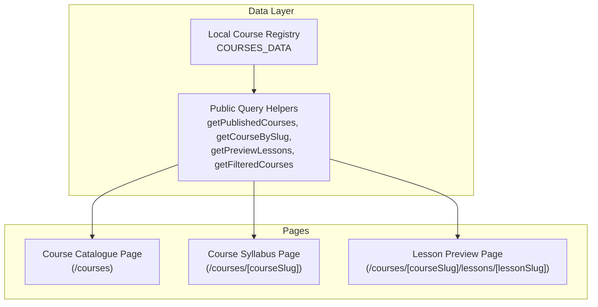
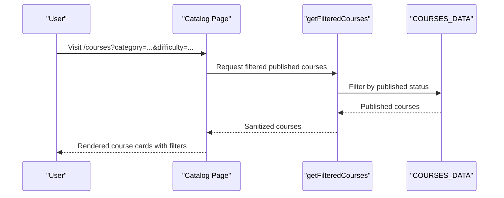
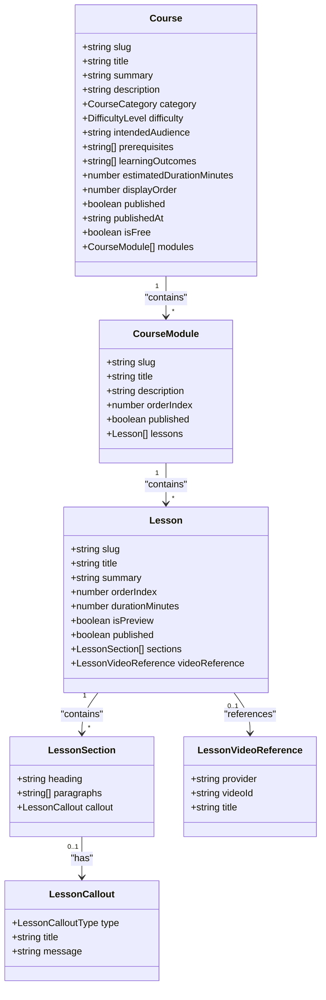
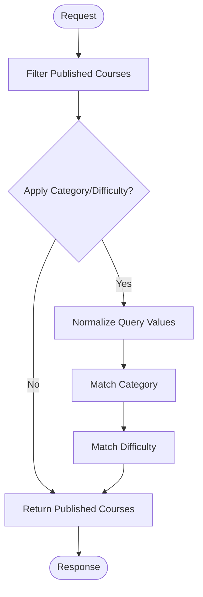
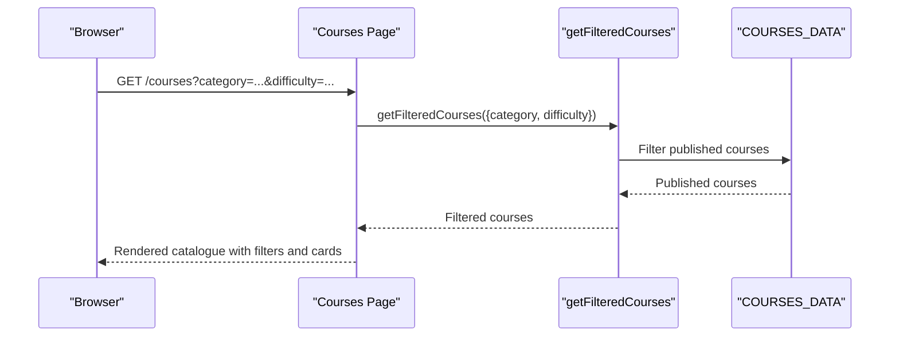
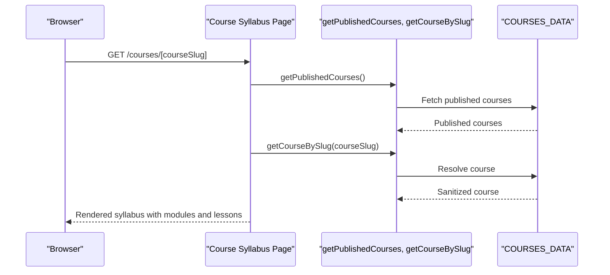
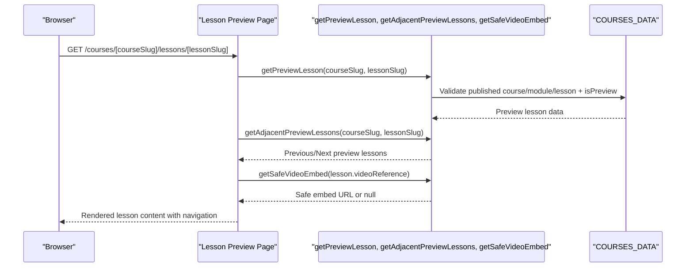
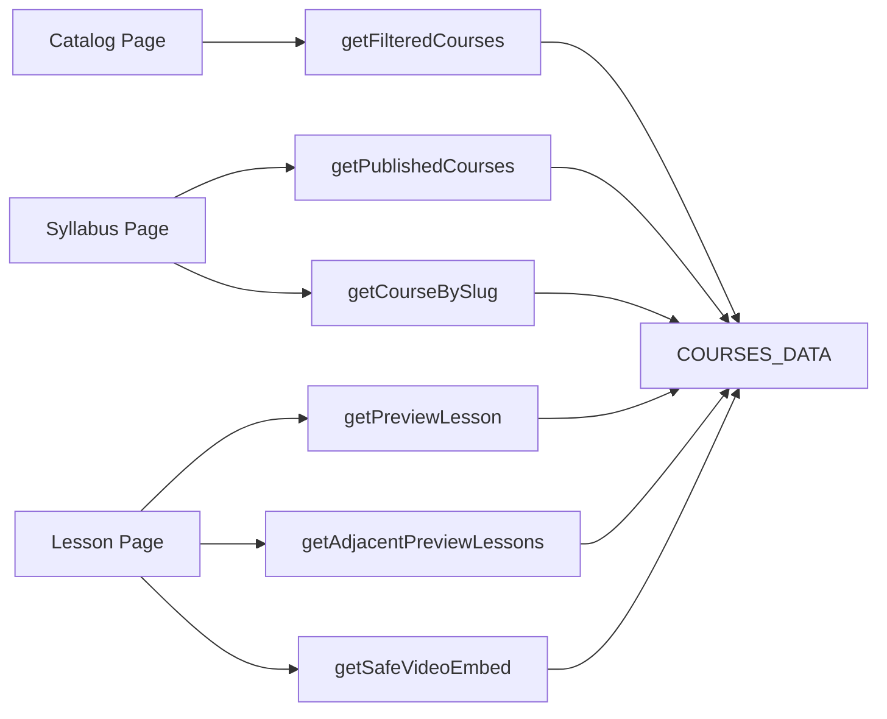

# Course Curriculum System

<cite>
**Referenced Files in This Document**
- [courses.ts](file://src/lib/courses.ts)
- [courses page](file://src/app/courses/page.tsx)
- [course syllabus page](file://src/app/courses/[courseSlug]/page.tsx)
- [lesson preview page](file://src/app/courses/[courseSlug]/lessons/[lessonSlug]/page.tsx)
- [courses test suite](file://src/__tests__/courses.test.ts)
- [courses UI test suite](file://src/__tests__/courses-ui.test.tsx)
</cite>

## Table of Contents
1. [Introduction](#introduction)
2. [Project Structure](#project-structure)
3. [Core Components](#core-components)
4. [Architecture Overview](#architecture-overview)
5. [Detailed Component Analysis](#detailed-component-analysis)
6. [Dependency Analysis](#dependency-analysis)
7. [Performance Considerations](#performance-considerations)
8. [Troubleshooting Guide](#troubleshooting-guide)
9. [Conclusion](#conclusion)

## Introduction
This document explains the SwimNigeria course curriculum system. It covers the hierarchical course structure with modules and lessons, difficulty levels, learning objectives, and the local course registry that powers public catalog, syllabus, and preview lesson features. It also documents the course catalog filtering experience, individual course pages, lesson delivery for preview content, safety disclaimers, data schemas, and integration points for future progress tracking and authentication.

## Project Structure
The curriculum system is implemented as a Next.js application with:
- A typed local course registry containing published and draft courses.
- Public query helpers that enforce strict draft isolation.
- Server-side Next.js pages for the course catalogue, course syllabus, and preview lessons.
- Tests validating data integrity, filtering behavior, and preview access control.

**Diagram sources**
- [courses.ts:1037-1042](file://src/lib/courses.ts#L1037-L1042)
- [courses.ts:1048-1059](file://src/lib/courses.ts#L1048-L1059)
- [courses.ts:1069-1099](file://src/lib/courses.ts#L1069-L1099)
- [courses.ts:1230-1247](file://src/lib/courses.ts#L1230-L1247)
- [courses page:32-44](file://src/app/courses/page.tsx#L32-L44)
- [course syllabus page:16-21](file://src/app/courses/[courseSlug]/page.tsx#L16-L21)
- [lesson preview page:21-27](file://src/app/courses/[courseSlug]/lessons/[lessonSlug]/page.tsx#L21-L27)

**Section sources**
- [courses.ts:1-15](file://src/lib/courses.ts#L1-L15)
- [courses page:1-26](file://src/app/courses/page.tsx#L1-L26)
- [course syllabus page:1-11](file://src/app/courses/[courseSlug]/page.tsx#L1-L11)
- [lesson preview page:1-12](file://src/app/courses/[courseSlug]/lessons/[lessonSlug]/page.tsx#L1-L12)

## Core Components
The core of the system is a strongly typed, maintainable local course registry and its public query helpers. The registry defines:
- Difficulty levels: foundational, beginner, intermediate.
- Course categories: Water Safety & Acclimatization, Buoyancy & Body Mechanics, Stroke Technique & Propulsion.
- Hierarchical data model: Course → Module → Lesson.
- Lesson sections with headings, paragraphs, and callouts (safety, technique, info).
- Optional video references to YouTube or Vimeo.
- Public-facing sanitized structures for syllabi and previews.

Key responsibilities:
- Enforce draft-content isolation so unpublished courses, modules, and lessons are never exposed through public queries.
- Provide deterministic ordering by display order and module/lesson indices.
- Support filtering by category and difficulty.
- Provide safe video embed validation.

**Section sources**
- [courses.ts:16-78](file://src/lib/courses.ts#L16-L78)
- [courses.ts:80-127](file://src/lib/courses.ts#L80-L127)
- [courses.ts:139-992](file://src/lib/courses.ts#L139-L992)

## Architecture Overview
The architecture separates data definition from presentation:
- Data layer: Local registry and query helpers.
- Presentation layer: Next.js server components render filtered catalogs, syllabi, and preview lessons.
- Security: Draft isolation ensures only published content is visible; preview lessons require explicit flags at all hierarchy levels.

**Diagram sources**
- [courses page:32-44](file://src/app/courses/page.tsx#L32-L44)
- [courses.ts:1230-1247](file://src/lib/courses.ts#L1230-L1247)

## Detailed Component Analysis

### Course Data Model and Hierarchy
The data model enforces a clear hierarchy:
- Course contains metadata such as slug, title, summary, description, category, difficulty, intended audience, prerequisites, learning outcomes, estimated duration, display order, publication flags, and an array of modules.
- Module contains slug, title, description, order index, publication flag, and ordered lessons.
- Lesson contains slug, title, summary, order index, duration, preview flag, publication flag, structured sections, and optional video reference.

**Diagram sources**
- [courses.ts:41-78](file://src/lib/courses.ts#L41-L78)
- [courses.ts:23-39](file://src/lib/courses.ts#L23-L39)

**Section sources**
- [courses.ts:41-78](file://src/lib/courses.ts#L41-L78)
- [courses.ts:23-39](file://src/lib/courses.ts#L23-L39)

### Course Registry Functions and Schemas
The registry exposes several public functions:
- getPublishedCourses: Returns all published courses sorted by display order, stripping unpublished modules and lessons.
- getCourseBySlug: Resolves a single published course by slug, returning null if not found or unpublished.
- getPreviewLessons: Returns all lessons marked as public previews across published courses and modules.
- getCourseSyllabus: Returns a sanitized syllabus representation for a published course.
- getLessonBySlug: Resolves a specific published lesson within a published course.
- isLessonPreviewEligible: Checks whether a lesson qualifies for unauthenticated preview.
- getCoursesByCategory: Filters published courses by normalized category name.
- getCourseCategories: Returns unique category names from published courses.
- getCourseDifficulties: Returns unique difficulty levels from published courses.
- getFilteredCourses: Filters published courses by category and/or difficulty.
- getSafeVideoEmbed: Validates and constructs safe embed/watch URLs for YouTube or Vimeo.
- getPreviewLesson: Resolves a specific public preview lesson ensuring strict four-point access control.
- getAdjacentPreviewLessons: Provides previous/next navigation among valid preview lessons.

**Diagram sources**
- [courses.ts:1037-1042](file://src/lib/courses.ts#L1037-L1042)
- [courses.ts:1185-1196](file://src/lib/courses.ts#L1185-L1196)
- [courses.ts:1230-1247](file://src/lib/courses.ts#L1230-L1247)

**Section sources**
- [courses.ts:1037-1042](file://src/lib/courses.ts#L1037-L1042)
- [courses.ts:1048-1059](file://src/lib/courses.ts#L1048-L1059)
- [courses.ts:1069-1099](file://src/lib/courses.ts#L1069-L1099)
- [courses.ts:1106-1138](file://src/lib/courses.ts#L1106-L1138)
- [courses.ts:1144-1165](file://src/lib/courses.ts#L1144-L1165)
- [courses.ts:1172-1179](file://src/lib/courses.ts#L1172-L1179)
- [courses.ts:1185-1196](file://src/lib/courses.ts#L1185-L1196)
- [courses.ts:1201-1207](file://src/lib/courses.ts#L1201-L1207)
- [courses.ts:1212-1218](file://src/lib/courses.ts#L1212-L1218)
- [courses.ts:1230-1247](file://src/lib/courses.ts#L1230-L1247)
- [courses.ts:1263-1298](file://src/lib/courses.ts#L1263-L1298)
- [courses.ts:1308-1317](file://src/lib/courses.ts#L1308-L1317)
- [courses.ts:1328-1345](file://src/lib/courses.ts#L1328-L1345)

### Course Catalog Page Implementation
The course catalogue page:
- Reads search parameters for category and difficulty.
- Uses getFilteredCourses to retrieve matching published courses.
- Displays filter navigation for categories and difficulties.
- Shows active filter summary and a reset link.
- Renders course cards with badges, summaries, estimated duration, key outcomes, module count, and free access indicators.
- Includes educational theory notice emphasizing digital coursework does not certify physical swimming competence.

**Diagram sources**
- [courses page:32-44](file://src/app/courses/page.tsx#L32-L44)
- [courses.ts:1230-1247](file://src/lib/courses.ts#L1230-L1247)

**Section sources**
- [courses page:28-44](file://src/app/courses/page.tsx#L28-L44)
- [courses page:123-244](file://src/app/courses/page.tsx#L123-L244)
- [courses page:246-362](file://src/app/courses/page.tsx#L246-L362)

### Individual Course Page Showing Module Progression and Lesson Navigation
The course syllabus page:
- Generates static params from published courses.
- Dynamically generates metadata based on the resolved course.
- Returns a 404 for missing or unpublished courses.
- Displays course overview, intended audience, prerequisites, learning outcomes, and a structured syllabus breakdown.
- Highlights preview lessons with links to the preview reader.

**Diagram sources**
- [course syllabus page:16-21](file://src/app/courses/[courseSlug]/page.tsx#L16-L21)
- [course syllabus page:23-38](file://src/app/courses/[courseSlug]/page.tsx#L23-L38)
- [course syllabus page:40-47](file://src/app/courses/[courseSlug]/page.tsx#L40-L47)
- [courses.ts:1037-1042](file://src/lib/courses.ts#L1037-L1042)
- [courses.ts:1048-1059](file://src/lib/courses.ts#L1048-L1059)

**Section sources**
- [course syllabus page:12-21](file://src/app/courses/[courseSlug]/page.tsx#L12-L21)
- [course syllabus page:23-47](file://src/app/courses/[courseSlug]/page.tsx#L23-L47)
- [course syllabus page:49-110](file://src/app/courses/[courseSlug]/page.tsx#L49-L110)
- [course syllabus page:112-130](file://src/app/courses/[courseSlug]/page.tsx#L112-L130)
- [course syllabus page:132-212](file://src/app/courses/[courseSlug]/page.tsx#L132-L212)
- [course syllabus page:214-309](file://src/app/courses/[courseSlug]/page.tsx#L214-L309)

### Lesson Delivery System with Content Rendering, Progress Tracking Integration Points, and Completion State Management
The lesson preview page:
- Generates static params from preview lessons.
- Generates metadata for the preview lesson.
- Returns a 404 for missing, unpublished, or non-preview lessons.
- Renders breadcrumb navigation, lesson header, mandatory disclaimer, optional safe video embed, ordered lesson sections, and adjacent preview navigation.
- Indicates enrollment and progress tracking will launch in future phases.

**Diagram sources**
- [lesson preview page:21-27](file://src/app/courses/[courseSlug]/lessons/[lessonSlug]/page.tsx#L21-L27)
- [lesson preview page:29-45](file://src/app/courses/[courseSlug]/lessons/[lessonSlug]/page.tsx#L29-L45)
- [lesson preview page:47-58](file://src/app/courses/[courseSlug]/lessons/[lessonSlug]/page.tsx#L47-L58)
- [courses.ts:1308-1317](file://src/lib/courses.ts#L1308-L1317)
- [courses.ts:1328-1345](file://src/lib/courses.ts#L1328-L1345)
- [courses.ts:1263-1298](file://src/lib/courses.ts#L1263-L1298)

**Section sources**
- [lesson preview page:14-27](file://src/app/courses/[courseSlug]/lessons/[lessonSlug]/page.tsx#L14-L27)
- [lesson preview page:29-58](file://src/app/courses/[courseSlug]/lessons/[lessonSlug]/page.tsx#L29-L58)
- [lesson preview page:60-154](file://src/app/courses/[courseSlug]/lessons/[lessonSlug]/page.tsx#L60-L154)
- [lesson preview page:156-188](file://src/app/courses/[courseSlug]/lessons/[lessonSlug]/page.tsx#L156-L188)
- [lesson preview page:190-265](file://src/app/courses/[courseSlug]/lessons/[lessonSlug]/page.tsx#L190-L265)
- [lesson preview page:267-320](file://src/app/courses/[courseSlug]/lessons/[lessonSlug]/page.tsx#L267-L320)
- [lesson preview page:322-350](file://src/app/courses/[courseSlug]/lessons/[lessonSlug]/page.tsx#L322-L350)

### Examples of Course Data Structure, Module Organization, and Lesson Content Formatting
Examples embedded in the registry include:
- Water Safety & Overcoming Fear of Water: Foundational level, three published modules covering fear physiology, shallow-water acclimatization, and hazard awareness.
- Buoyancy & Breathing Mechanics: Beginner level, three published modules covering flotation physics, head alignment/respiration, and floating drills/recovery.
- Beginner Freestyle & Horizontal Propulsion: Beginner level, three published modules covering streamlining/drag reduction, flutter kick mechanics, and arm stroke/side-breathing.

Lesson content formatting includes:
- Structured sections with headings and paragraphs.
- Callouts categorized as safety, technique, or info.
- Optional video references validated via getSafeVideoEmbed.

**Section sources**
- [courses.ts:139-439](file://src/lib/courses.ts#L139-L439)
- [courses.ts:441-706](file://src/lib/courses.ts#L441-L706)
- [courses.ts:708-935](file://src/lib/courses.ts#L708-L935)
- [courses.ts:23-39](file://src/lib/courses.ts#L23-L39)
- [courses.ts:1263-1298](file://src/lib/courses.ts#L1263-L1298)

### Relationship Between Courses and User Authentication for Personalized Experiences
Current implementation focuses on public, unauthenticated access to published content and preview lessons. Future phases indicate:
- Interactive student enrollment.
- Lesson progress tracking.
- Knowledge assessments.
- Certificate assessment.

Integration points for authentication and personalization:
- Enrollment flow can be added to course pages to gate full lessons.
- Progress tracking can integrate with user sessions or backend storage to record completed lessons and module completion states.
- Certificates can be issued upon completion of assessments and practical evaluations.

**Section sources**
- [course syllabus page:311-341](file://src/app/courses/[courseSlug]/page.tsx#L311-L341)
- [lesson preview page:322-350](file://src/app/courses/[courseSlug]/lessons/[lessonSlug]/page.tsx#L322-L350)

### Accessibility Considerations for Educational Content and Mobile-Responsive Design Patterns
Accessibility and responsiveness are built into the pages:
- Semantic headings and landmarks.
- Breadcrumb navigation with aria-labels.
- Active filter regions with aria-labelledby.
- Focus-visible outlines and keyboard-friendly interactions.
- Responsive grid layouts and typography scaling.
- Clear visual hierarchy for callouts and badges.

**Section sources**
- [courses page:123-244](file://src/app/courses/page.tsx#L123-L244)
- [course syllabus page:57-68](file://src/app/courses/[courseSlug]/page.tsx#L57-L68)
- [lesson preview page:63-95](file://src/app/courses/[courseSlug]/lessons/[lessonSlug]/page.tsx#L63-L95)

## Dependency Analysis
The pages depend on the registry helpers for data retrieval and sanitization. The helper functions encapsulate draft isolation logic, ensuring consistent security boundaries across the application.

**Diagram sources**
- [courses page:32-44](file://src/app/courses/page.tsx#L32-L44)
- [course syllabus page:16-21](file://src/app/courses/[courseSlug]/page.tsx#L16-L21)
- [course syllabus page:23-38](file://src/app/courses/[courseSlug]/page.tsx#L23-L38)
- [lesson preview page:21-27](file://src/app/courses/[courseSlug]/lessons/[lessonSlug]/page.tsx#L21-L27)
- [lesson preview page:29-45](file://src/app/courses/[courseSlug]/lessons/[lessonSlug]/page.tsx#L29-L45)
- [courses.ts:1037-1042](file://src/lib/courses.ts#L1037-L1042)
- [courses.ts:1048-1059](file://src/lib/courses.ts#L1048-L1059)
- [courses.ts:1069-1099](file://src/lib/courses.ts#L1069-L1099)
- [courses.ts:1230-1247](file://src/lib/courses.ts#L1230-L1247)
- [courses.ts:1263-1298](file://src/lib/courses.ts#L1263-L1298)
- [courses.ts:1308-1317](file://src/lib/courses.ts#L1308-L1317)
- [courses.ts:1328-1345](file://src/lib/courses.ts#L1328-L1345)

**Section sources**
- [courses.ts:1037-1042](file://src/lib/courses.ts#L1037-L1042)
- [courses.ts:1048-1059](file://src/lib/courses.ts#L1048-L1059)
- [courses.ts:1069-1099](file://src/lib/courses.ts#L1069-L1099)
- [courses.ts:1230-1247](file://src/lib/courses.ts#L1230-L1247)
- [courses.ts:1263-1298](file://src/lib/courses.ts#L1263-L1298)
- [courses.ts:1308-1317](file://src/lib/courses.ts#L1308-L1317)
- [courses.ts:1328-1345](file://src/lib/courses.ts#L1328-L1345)

## Performance Considerations
- Static generation: Pages use generateStaticParams to precompute available slugs for performance and SEO.
- Filtering efficiency: getFilteredCourses normalizes inputs and applies simple string comparisons; complexity is linear in the number of published courses.
- Draft isolation: sanitizeCourseForPublic filters and sorts modules and lessons once per course; this avoids leaking unpublished content while keeping rendering predictable.
- Video embedding: getSafeVideoEmbed validates IDs with regex patterns to prevent unsafe URLs and reduces client-side errors.

[No sources needed since this section provides general guidance]

## Troubleshooting Guide
Common issues and resolutions:
- No courses match selection: Ensure filter values are correct; unknown categories or difficulties return empty results safely.
- Draft content appears unexpectedly: Verify published flags at course, module, and lesson levels; preview lessons require isPreview true plus published flags at all levels.
- Lesson preview returns 404: Confirm the lesson is published, belongs to a published module, belongs to a published course, and is marked as preview.
- Video not loading: Check provider and videoId format; getSafeVideoEmbed rejects invalid identifiers.

Validation checks are covered by tests:
- Data integrity and schema constraints.
- Draft isolation guarantees.
- Preview eligibility and adjacency navigation.
- Catalog UI filtering and accessibility attributes.

**Section sources**
- [courses test suite:18-107](file://src/__tests__/courses.test.ts#L18-L107)
- [courses test suite:109-232](file://src/__tests__/courses.test.ts#L109-L232)
- [courses test suite:234-304](file://src/__tests__/courses.test.ts#L234-L304)
- [courses test suite:315-445](file://src/__tests__/courses.test.ts#L315-L445)
- [courses UI test suite:6-32](file://src/__tests__/courses-ui.test.tsx#L6-L32)
- [courses UI test suite:34-67](file://src/__tests__/courses-ui.test.tsx#L34-L67)
- [courses UI test suite:69-177](file://src/__tests__/courses-ui.test.tsx#L69-L177)
- [courses UI test suite:179-255](file://src/__tests__/courses-ui.test.tsx#L179-L255)

## Conclusion
The SwimNigeria course curriculum system provides a robust, secure foundation for delivering water safety education and swimming technique instruction. Its typed data model, strict draft isolation, and carefully designed public APIs support a scalable path toward interactive enrollment, progress tracking, and certification. The current pages emphasize clarity, safety disclaimers, and accessibility, while preparing integration points for personalized learner experiences in upcoming phases.