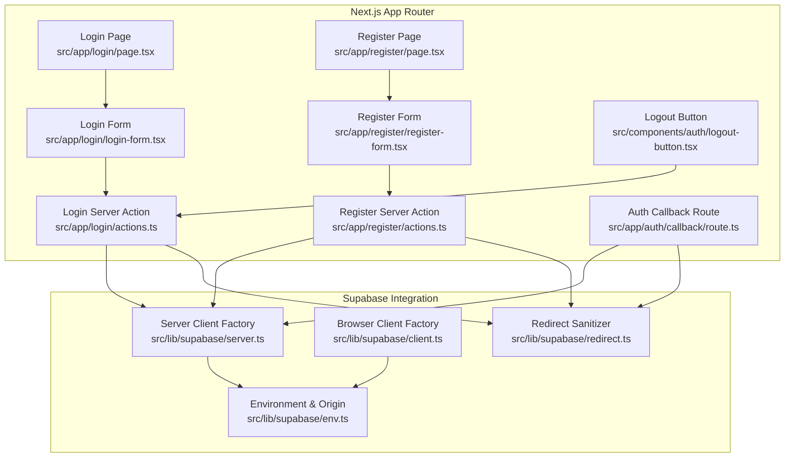
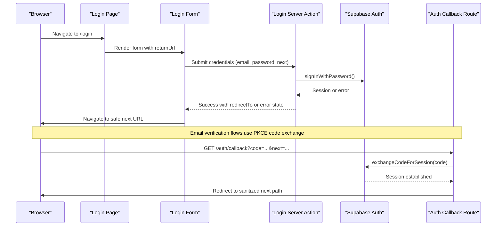
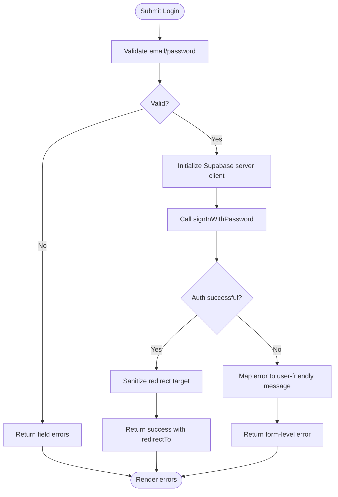
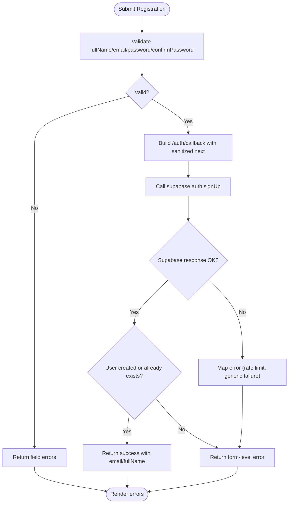
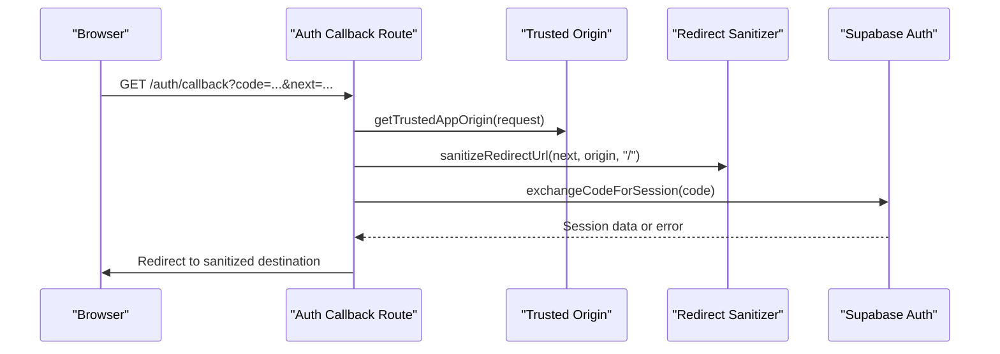
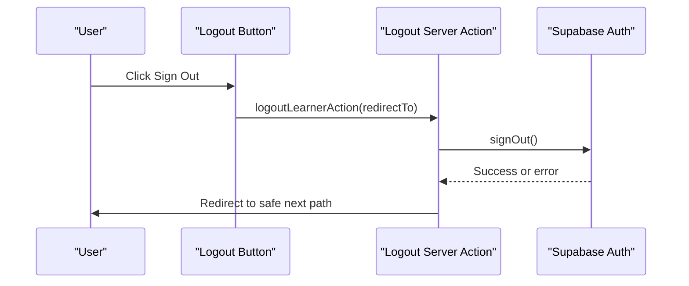
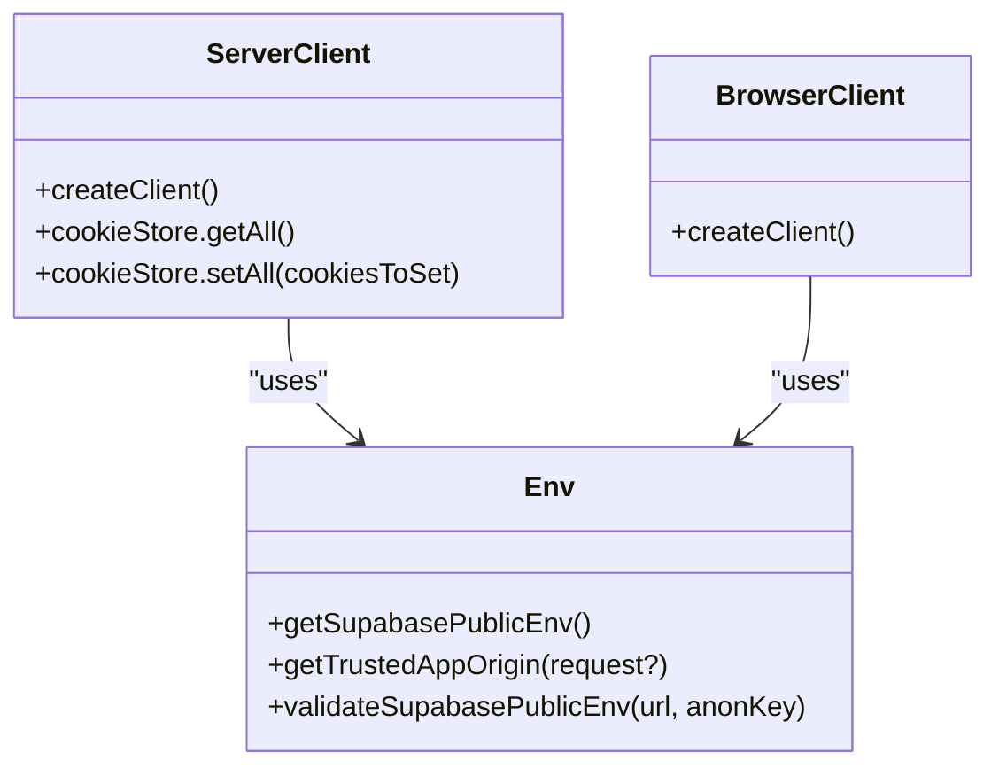
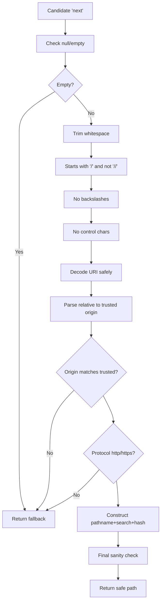
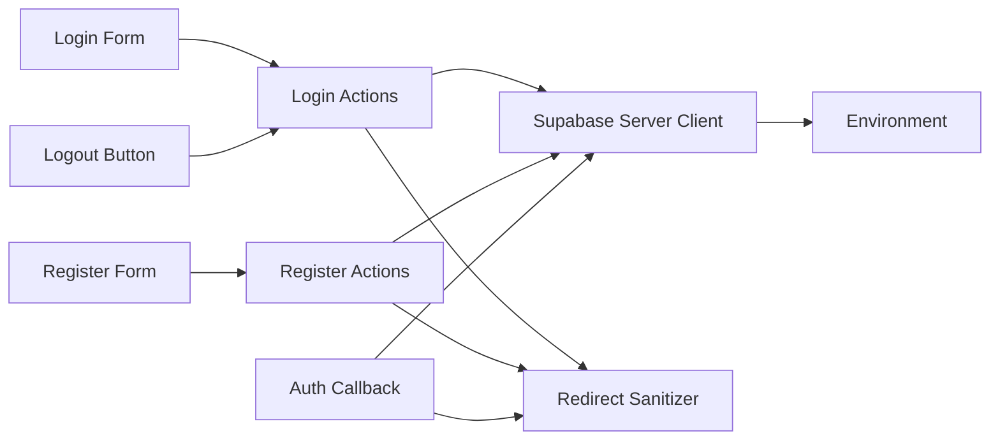

# User Authentication System

<cite>
**Referenced Files in This Document**
- [README.md](file://README.md)
- [route.ts](file://src/app/auth/callback/route.ts)
- [actions.ts](file://src/app/login/actions.ts)
- [login-form.tsx](file://src/app/login/login-form.tsx)
- [page.tsx](file://src/app/login/page.tsx)
- [actions.ts](file://src/app/register/actions.ts)
- [register-form.tsx](file://src/app/register/register-form.tsx)
- [page.tsx](file://src/app/register/page.tsx)
- [logout-button.tsx](file://src/components/auth/logout-button.tsx)
- [server.ts](file://src/lib/supabase/server.ts)
- [client.ts](file://src/lib/supabase/client.ts)
- [env.ts](file://src/lib/supabase/env.ts)
- [redirect.ts](file://src/lib/supabase/redirect.ts)
</cite>

## Table of Contents
1. [Introduction](#introduction)
2. [Project Structure](#project-structure)
3. [Core Components](#core-components)
4. [Architecture Overview](#architecture-overview)
5. [Detailed Component Analysis](#detailed-component-analysis)
6. [Dependency Analysis](#dependency-analysis)
7. [Performance Considerations](#performance-considerations)
8. [Troubleshooting Guide](#troubleshooting-guide)
9. [Conclusion](#conclusion)

## Introduction
This document explains the SwimNigeria user authentication system built on Supabase and integrated with Next.js App Router. It covers the complete authentication flow, including login form validation, registration with email verification, PKCE callback handling, session management via HttpOnly cookies, logout, and safe redirect handling. It also documents Supabase client integration, error handling, security best practices, accessibility considerations, and how server-side checks are structured for protected routes.

## Project Structure
The authentication implementation is organized by feature:
- Login page and server actions under `src/app/login`.
- Registration page and server actions under `src/app/register`.
- Authentication callback route under `src/app/auth/callback`.
- Shared Supabase client configuration under `src/lib/supabase`.
- Reusable logout button component under `src/components/auth`.

**Diagram sources**
- [page.tsx:1-102](file://src/app/login/page.tsx#L1-L102)
- [login-form.tsx:1-239](file://src/app/login/login-form.tsx#L1-L239)
- [actions.ts:1-236](file://src/app/login/actions.ts#L1-L236)
- [page.tsx:1-127](file://src/app/register/page.tsx#L1-L127)
- [register-form.tsx:1-372](file://src/app/register/register-form.tsx#L1-L372)
- [actions.ts:1-214](file://src/app/register/actions.ts#L1-L214)
- [route.ts:1-61](file://src/app/auth/callback/route.ts#L1-L61)
- [logout-button.tsx:1-48](file://src/components/auth/logout-button.tsx#L1-L48)
- [server.ts:1-61](file://src/lib/supabase/server.ts#L1-L61)
- [client.ts:1-23](file://src/lib/supabase/client.ts#L1-L23)
- [env.ts:1-143](file://src/lib/supabase/env.ts#L1-L143)
- [redirect.ts:1-94](file://src/lib/supabase/redirect.ts#L1-L94)

**Section sources**
- [README.md:1-111](file://README.md#L1-L111)

## Core Components
- Login page and form: Renders a secure login UI, validates inputs, submits to a server action, handles unverified email states, and navigates after success.
- Registration page and form: Collects legal full name, email, password, and confirmation; enforces validation; calls Supabase signup with email verification; shows a post-registration verification screen.
- Auth callback route: Exchanges one-time authorization codes from Supabase for sessions, sets cookies, and redirects safely.
- Logout button: Triggers server-side sign-out and redirects to a sanitized target.
- Supabase clients: Provide browser and server clients using public keys and cookie adapters.
- Environment utilities: Validate Supabase environment variables and resolve trusted application origin.
- Redirect sanitizer: Enforces same-origin internal paths and prevents open-redirect attacks.

**Section sources**
- [page.tsx:1-102](file://src/app/login/page.tsx#L1-L102)
- [login-form.tsx:1-239](file://src/app/login/login-form.tsx#L1-L239)
- [actions.ts:1-236](file://src/app/login/actions.ts#L1-L236)
- [page.tsx:1-127](file://src/app/register/page.tsx#L1-L127)
- [register-form.tsx:1-372](file://src/app/register/register-form.tsx#L1-L372)
- [actions.ts:1-214](file://src/app/register/actions.ts#L1-L214)
- [route.ts:1-61](file://src/app/auth/callback/route.ts#L1-L61)
- [logout-button.tsx:1-48](file://src/components/auth/logout-button.tsx#L1-L48)
- [server.ts:1-61](file://src/lib/supabase/server.ts#L1-L61)
- [client.ts:1-23](file://src/lib/supabase/client.ts#L1-L23)
- [env.ts:1-143](file://src/lib/supabase/env.ts#L1-L143)
- [redirect.ts:1-94](file://src/lib/supabase/redirect.ts#L1-L94)

## Architecture Overview
The authentication architecture uses Next.js App Router server actions for secure credential processing, Supabase Auth for identity, and @supabase/ssr for cookie-based sessions. The callback route exchanges PKCE codes for sessions and performs safe redirects. All redirect targets are validated against a trusted origin.

**Diagram sources**
- [login-form.tsx:1-239](file://src/app/login/login-form.tsx#L1-L239)
- [actions.ts:1-236](file://src/app/login/actions.ts#L1-L236)
- [route.ts:1-61](file://src/app/auth/callback/route.ts#L1-L61)

## Detailed Component Analysis

### Login Flow
- Validation: Server-side Zod schema validates email and password before calling Supabase.
- Authentication: Uses Supabase `signInWithPassword` with the server client.
- Error Handling:
  - Unverified email: Returns a dedicated state prompting users to verify their inbox.
  - Rate limiting: Detects rate limit responses and returns a friendly message.
  - Invalid credentials: Generic message that does not reveal whether the email exists.
  - Configuration errors: Handles missing Supabase environment gracefully.
- Redirect Safety: Candidate `next` parameter is sanitized to same-origin internal paths.
- UI Feedback: Accessible alerts, inline field errors, password visibility toggle, and pending state.

**Diagram sources**
- [actions.ts:1-236](file://src/app/login/actions.ts#L1-L236)
- [redirect.ts:1-94](file://src/lib/supabase/redirect.ts#L1-L94)

**Section sources**
- [actions.ts:1-236](file://src/app/login/actions.ts#L1-L236)
- [login-form.tsx:1-239](file://src/app/login/login-form.tsx#L1-L239)
- [page.tsx:1-102](file://src/app/login/page.tsx#L1-L102)

### Registration Flow
- Validation: Server-side Zod schema validates full name, email, password, and confirm password.
- Supabase Signup: Calls `signUp` with email verification enabled and stores non-authoritative metadata (`full_name`) in `user_metadata`.
- Email Verification: Constructs a PKCE callback URL with a sanitized `next` parameter.
- Enumeration Resistance: Treats duplicate account attempts as success to avoid revealing existing emails.
- Post-Registration UI: Shows an accessible verification screen with instructions and certificate name notice.

**Diagram sources**
- [actions.ts:1-214](file://src/app/register/actions.ts#L1-L214)
- [redirect.ts:1-94](file://src/lib/supabase/redirect.ts#L1-L94)

**Section sources**
- [actions.ts:1-214](file://src/app/register/actions.ts#L1-L214)
- [register-form.tsx:1-372](file://src/app/register/register-form.tsx#L1-L372)
- [page.tsx:1-127](file://src/app/register/page.tsx#L1-L127)

### Authentication Callback and PKCE Code Exchange
- Receives one-time authorization code and optional `next` parameter.
- Validates trusted app origin and sanitizes redirect target.
- Exchanges code for session using Supabase server client.
- Handles recovery flows by routing to password reset when appropriate.
- Redirects strictly to sanitized internal paths.

**Diagram sources**
- [route.ts:1-61](file://src/app/auth/callback/route.ts#L1-L61)
- [env.ts:1-143](file://src/lib/supabase/env.ts#L1-L143)
- [redirect.ts:1-94](file://src/lib/supabase/redirect.ts#L1-L94)

**Section sources**
- [route.ts:1-61](file://src/app/auth/callback/route.ts#L1-L61)

### Logout and Session Cleanup
- Triggered via a reusable logout button component.
- Invokes server action to call Supabase `signOut`.
- Redirects to a sanitized target (default home).
- Provides pending state feedback during transition.

**Diagram sources**
- [logout-button.tsx:1-48](file://src/components/auth/logout-button.tsx#L1-L48)
- [actions.ts:1-236](file://src/app/login/actions.ts#L1-L236)

**Section sources**
- [logout-button.tsx:1-48](file://src/components/auth/logout-button.tsx#L1-L48)
- [actions.ts:1-236](file://src/app/login/actions.ts#L1-L236)

### Supabase Client Integration
- Server client: Initializes `@supabase/ssr` server client with Next.js cookie store adapter. Handles read-only cookie mutation in Server Components by catching expected errors and relying on upstream request interception proxy.
- Browser client: Initializes `@supabase/ssr` browser client for client-side operations.
- Environment: Validates public Supabase URL and anonymous key, rejects placeholders, ensures HTTP/HTTPS protocols, and resolves trusted application origin.

**Diagram sources**
- [server.ts:1-61](file://src/lib/supabase/server.ts#L1-L61)
- [client.ts:1-23](file://src/lib/supabase/client.ts#L1-L23)
- [env.ts:1-143](file://src/lib/supabase/env.ts#L1-L143)

**Section sources**
- [server.ts:1-61](file://src/lib/supabase/server.ts#L1-L61)
- [client.ts:1-23](file://src/lib/supabase/client.ts#L1-L23)
- [env.ts:1-143](file://src/lib/supabase/env.ts#L1-L143)

### Redirect Security
- Enforces strict same-origin internal destinations.
- Rejects protocol-relative paths, backslash tricks, control characters, unsafe schemes, and malformed URIs.
- Always falls back to a safe default path if candidate is invalid.

**Diagram sources**
- [redirect.ts:1-94](file://src/lib/supabase/redirect.ts#L1-L94)

**Section sources**
- [redirect.ts:1-94](file://src/lib/supabase/redirect.ts#L1-L94)

## Dependency Analysis
Authentication components depend on shared utilities for environment validation, redirect sanitization, and Supabase client factories.

**Diagram sources**
- [login-form.tsx:1-239](file://src/app/login/login-form.tsx#L1-L239)
- [register-form.tsx:1-372](file://src/app/register/register-form.tsx#L1-L372)
- [actions.ts:1-236](file://src/app/login/actions.ts#L1-L236)
- [actions.ts:1-214](file://src/app/register/actions.ts#L1-L214)
- [route.ts:1-61](file://src/app/auth/callback/route.ts#L1-L61)
- [server.ts:1-61](file://src/lib/supabase/server.ts#L1-L61)
- [env.ts:1-143](file://src/lib/supabase/env.ts#L1-L143)
- [redirect.ts:1-94](file://src/lib/supabase/redirect.ts#L1-L94)
- [logout-button.tsx:1-48](file://src/components/auth/logout-button.tsx#L1-L48)

**Section sources**
- [login-form.tsx:1-239](file://src/app/login/login-form.tsx#L1-L239)
- [register-form.tsx:1-372](file://src/app/register/register-form.tsx#L1-L372)
- [actions.ts:1-236](file://src/app/login/actions.ts#L1-L236)
- [actions.ts:1-214](file://src/app/register/actions.ts#L1-L214)
- [route.ts:1-61](file://src/app/auth/callback/route.ts#L1-L61)
- [server.ts:1-61](file://src/lib/supabase/server.ts#L1-L61)
- [env.ts:1-143](file://src/lib/supabase/env.ts#L1-L143)
- [redirect.ts:1-94](file://src/lib/supabase/redirect.ts#L1-L94)
- [logout-button.tsx:1-48](file://src/components/auth/logout-button.tsx#L1-L48)

## Performance Considerations
- Prefer server-side validation and authentication to minimize client-side risk and reduce unnecessary re-renders.
- Use React Server Components where possible; rely on Next.js request interception for cookie updates to avoid read-only cookie mutations.
- Avoid logging sensitive payloads; keep diagnostic logs minimal and safe.
- Keep redirect logic deterministic and fast; early rejection of invalid candidates reduces parsing overhead.
- For high traffic, consider rate-limiting at the platform level and monitoring Supabase quotas.

[No sources needed since this section provides general guidance]

## Troubleshooting Guide
Common issues and resolutions:
- Missing or placeholder Supabase environment variables:
  - Symptom: Errors indicating unconfigured Supabase URL or anonymous key.
  - Resolution: Configure `NEXT_PUBLIC_SUPABASE_URL` and `NEXT_PUBLIC_SUPABASE_ANON_KEY` with valid values; ensure they are not placeholders.
- Open redirect protection:
  - Symptom: Redirects ignored or falling back to default.
  - Resolution: Ensure `next` parameters are relative paths starting with `/` and do not contain backslashes or encoded double slashes.
- Unverified email login:
  - Symptom: Login fails with unverified email state.
  - Resolution: Direct users to check inbox and click verification link; handle recovery flows via callback route.
- Rate limits:
  - Symptom: Messages about too many attempts.
  - Resolution: Instruct users to wait before retrying; monitor Supabase rate limits.
- Cookie mutation in Server Components:
  - Symptom: Read-only cookie errors during rendering.
  - Resolution: Rely on upstream request interception proxy; do not attempt direct cookie writes in Server Components.

**Section sources**
- [env.ts:1-143](file://src/lib/supabase/env.ts#L1-L143)
- [redirect.ts:1-94](file://src/lib/supabase/redirect.ts#L1-L94)
- [actions.ts:1-236](file://src/app/login/actions.ts#L1-L236)
- [actions.ts:1-214](file://src/app/register/actions.ts#L1-L214)
- [server.ts:1-61](file://src/lib/supabase/server.ts#L1-L61)

## Conclusion
The SwimNigeria authentication system integrates Supabase Auth with Next.js App Router through secure server actions, robust validation, and strict redirect sanitization. It supports login, registration with email verification, PKCE code exchange, and logout with safe redirection. The design emphasizes security (no service-role keys, enumeration resistance, safe redirects), accessibility (ARIA attributes, clear alerts), and maintainability (clear separation between pages, forms, server actions, and shared utilities). Future phases can extend this foundation with protected routes, server-side guards, and advanced session timeout handling.

[No sources needed since this section summarizes without analyzing specific files]