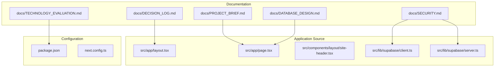
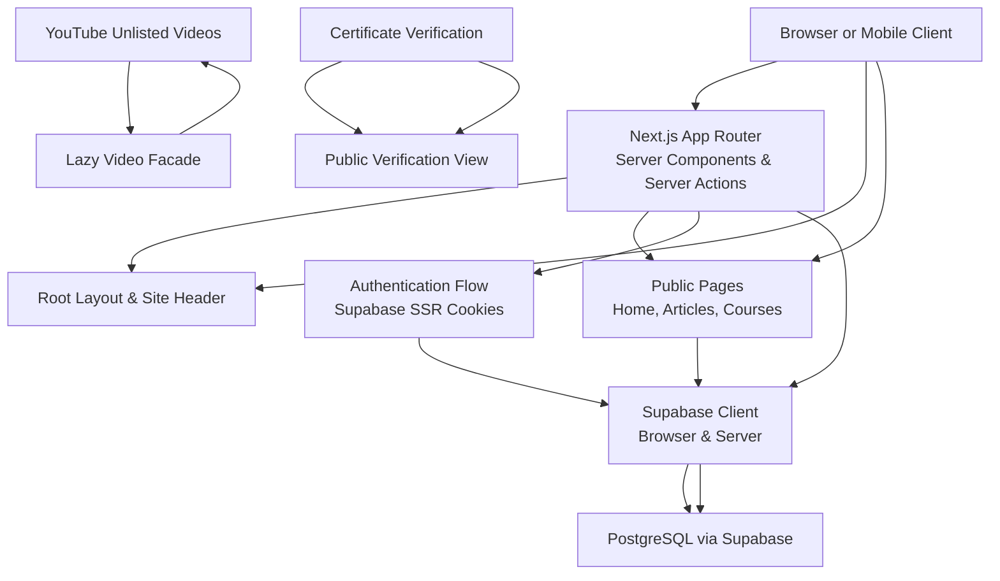
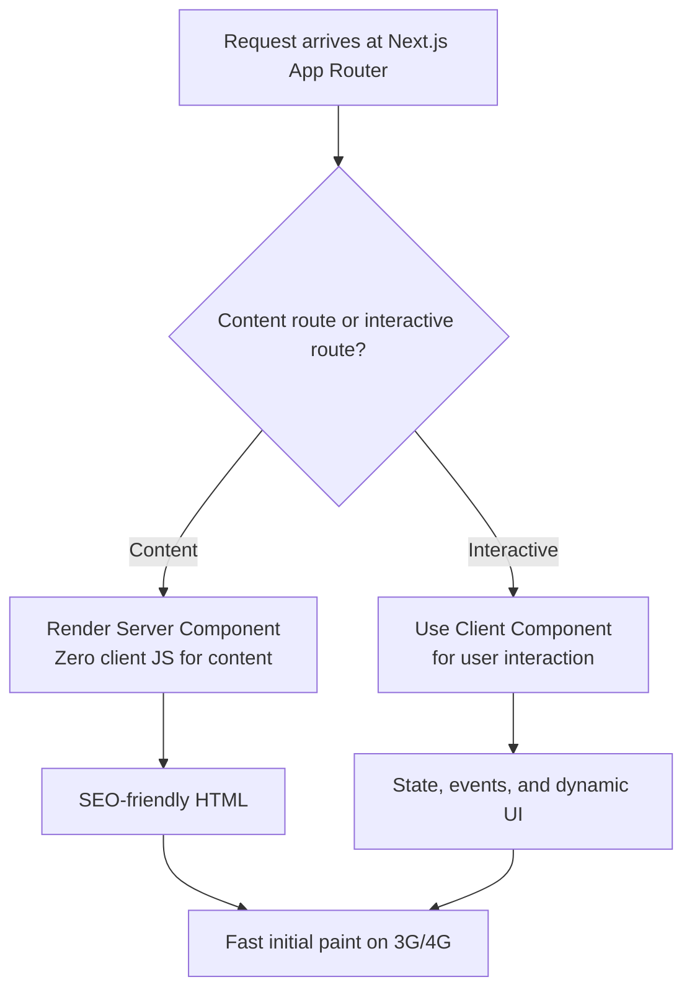
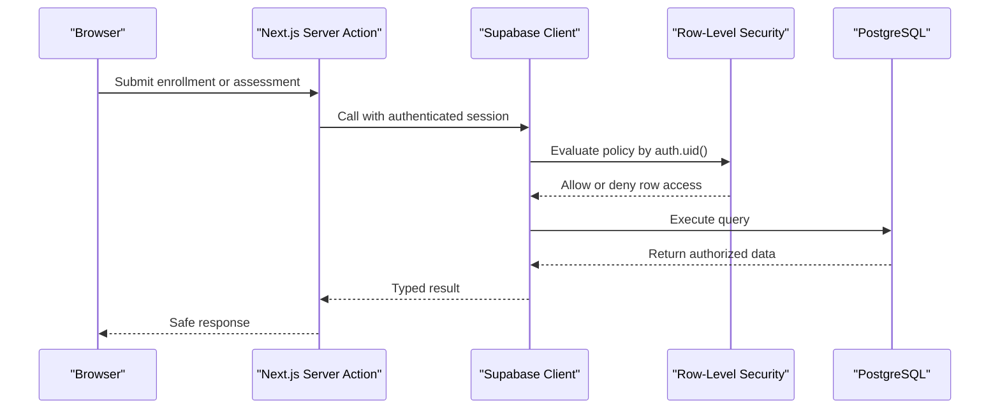
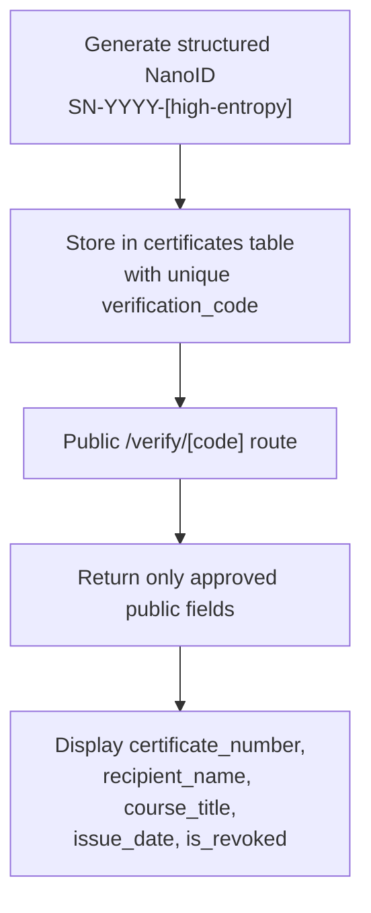
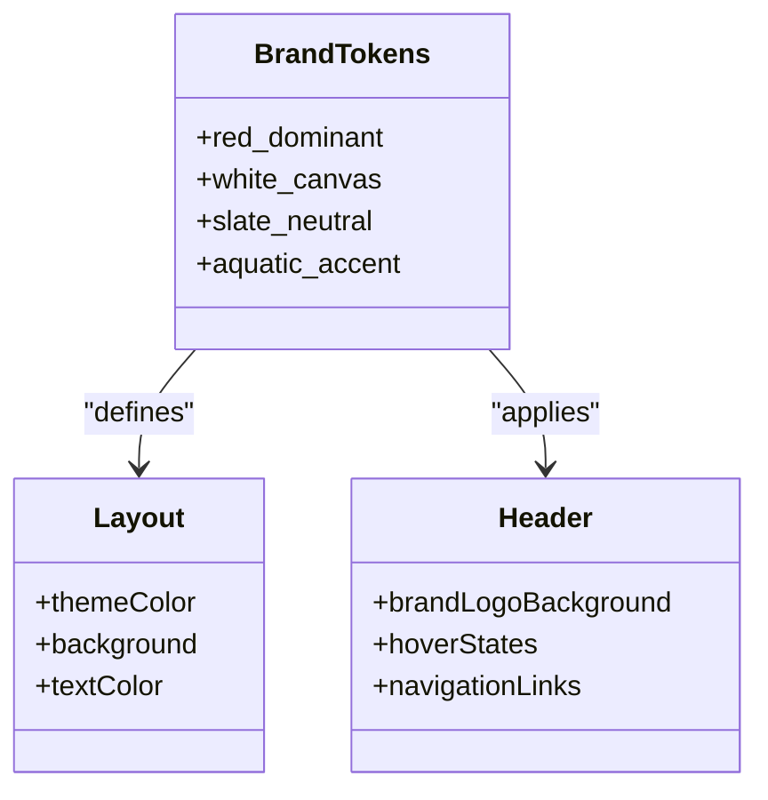
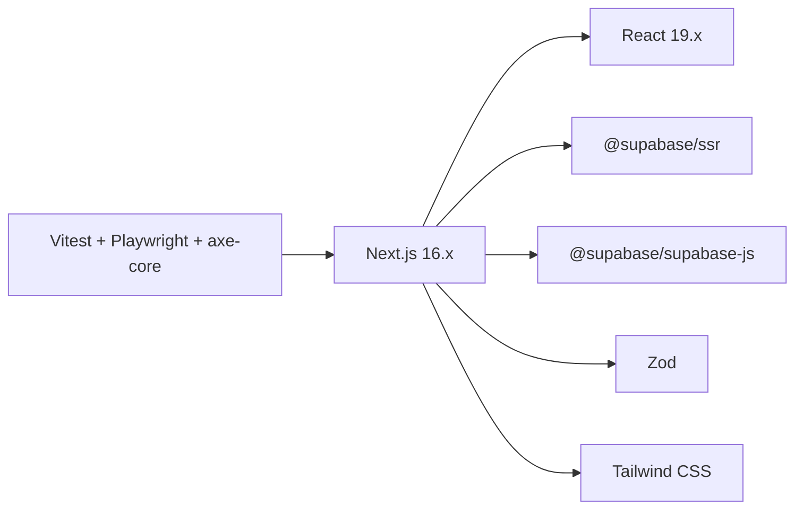

# Architectural Decision Records

<cite>
**Referenced Files in This Document**
- [DECISION_LOG.md](file://docs/DECISION_LOG.md)
- [PROJECT_BRIEF.md](file://docs/PROJECT_BRIEF.md)
- [TECHNOLOGY_EVALUATION.md](file://docs/TECHNOLOGY_EVALUATION.md)
- [SECURITY.md](file://docs/SECURITY.md)
- [DATABASE_DESIGN.md](file://docs/DATABASE_DESIGN.md)
- [layout.tsx](file://src/app/layout.tsx)
- [page.tsx](file://src/app/page.tsx)
- [site-header.tsx](file://src/components/layout/site-header.tsx)
- [client.ts](file://src/lib/supabase/client.ts)
- [server.ts](file://src/lib/supabase/server.ts)
- [package.json](file://package.json)
- [next.config.ts](file://next.config.ts)
</cite>

## Table of Contents
1. [Introduction](#introduction)
2. [Project Structure](#project-structure)
3. [Core Components](#core-components)
4. [Architecture Overview](#architecture-overview)
5. [Detailed Component Analysis](#detailed-component-analysis)
6. [Dependency Analysis](#dependency-analysis)
7. [Performance Considerations](#performance-considerations)
8. [Troubleshooting Guide](#troubleshooting-guide)
9. [Conclusion](#conclusion)
10. [Appendices](#appendices)

## Introduction
This document consolidates SwimNigeria’s settled architectural decisions into a single, accessible reference. It explains the context, problem statements, considered alternatives, trade-offs, and final choices for ADR-001 through ADR-007. It also connects these decisions to SwimNigeria’s mission of making structured swimming education and water safety knowledge accessible across Nigeria, especially for learners on mobile devices with limited bandwidth.

SwimNigeria is an educational initiative focused on reducing drowning risk by delivering clear, low-bandwidth-friendly curricula, verifiable certificates, and community-oriented safety guidance. The platform must remain secure, reliable, and cost-conscious during launch while remaining extensible for future monetization, multi-instructor expansion, and localized language support.

## Project Structure
At a high level, the repository separates documentation from implementation:
- `docs/` contains project briefs, technology evaluations, security guidelines, database design, and the Architectural Decision Records log.
- `src/` implements the Next.js App Router application, including pages, layout, shared UI components, and Supabase client integration.
- Configuration files such as `package.json`, `next.config.ts`, and TypeScript configuration define the runtime stack and build behavior.

**Diagram sources**
- [DECISION_LOG.md:1-143](file://docs/DECISION_LOG.md#L1-L143)
- [PROJECT_BRIEF.md:1-87](file://docs/PROJECT_BRIEF.md#L1-L87)
- [TECHNOLOGY_EVALUATION.md:1-134](file://docs/TECHNOLOGY_EVALUATION.md#L1-L134)
- [SECURITY.md:1-155](file://docs/SECURITY.md#L1-L155)
- [DATABASE_DESIGN.md:1-181](file://docs/DATABASE_DESIGN.md#L1-L181)
- [layout.tsx:1-42](file://src/app/layout.tsx#L1-L42)
- [page.tsx:1-645](file://src/app/page.tsx#L1-L645)
- [site-header.tsx:1-84](file://src/components/layout/site-header.tsx#L1-L84)
- [client.ts:1-23](file://src/lib/supabase/client.ts#L1-L23)
- [server.ts:1-61](file://src/lib/supabase/server.ts#L1-L61)
- [package.json:1-48](file://package.json#L1-L48)
- [next.config.ts:1-9](file://next.config.ts#L1-L9)

**Section sources**
- [PROJECT_BRIEF.md:1-87](file://docs/PROJECT_BRIEF.md#L1-L87)
- [package.json:1-48](file://package.json#L1-L48)
- [next.config.ts:1-9](file://next.config.ts#L1-L9)

## Core Components
The core architectural decisions are captured in the decision log and reinforced by the technology evaluation, security guidelines, and database design documents. They govern how the frontend, backend, authentication, data model, media delivery, branding, and AI-assisted development workflow operate together.

Key decision themes include:
- Phased foundation before application code generation.
- Next.js App Router with TypeScript and Tailwind CSS.
- Managed PostgreSQL via Supabase Free Tier.
- Privacy-enhanced YouTube unlisted embeds for video.
- Tamper-evident certificate verification using structured NanoIDs.
- AI skill-based development workflow.
- Red and white brand strategy with slate neutrals.

These decisions directly influence:
- How content is rendered for SEO and low-bandwidth performance.
- How user sessions and authorization are handled securely.
- How course and lesson data will be modeled and accessed.
- How certificates are issued and verified without leaking private information.
- How the team can scale development safely with AI skills.

**Section sources**
- [DECISION_LOG.md:1-143](file://docs/DECISION_LOG.md#L1-L143)
- [TECHNOLOGY_EVALUATION.md:1-134](file://docs/TECHNOLOGY_EVALUATION.md#L1-L134)
- [SECURITY.md:1-155](file://docs/SECURITY.md#L1-L155)
- [DATABASE_DESIGN.md:1-181](file://docs/DATABASE_DESIGN.md#L1-L181)

## Architecture Overview
The current architecture balances public educational content, interactive learning features, and secure authentication while keeping infrastructure costs at zero during launch.

**Diagram sources**
- [layout.tsx:1-42](file://src/app/layout.tsx#L1-L42)
- [page.tsx:1-645](file://src/app/page.tsx#L1-L645)
- [site-header.tsx:1-84](file://src/components/layout/site-header.tsx#L1-L84)
- [client.ts:1-23](file://src/lib/supabase/client.ts#L1-L23)
- [server.ts:1-61](file://src/lib/supabase/server.ts#L1-L61)
- [DATABASE_DESIGN.md:106-125](file://docs/DATABASE_DESIGN.md#L106-L125)

## Detailed Component Analysis

### ADR-001: Separation of Foundation Phase from Application Implementation
ADR-001 establishes that engineering documentation, agent working rules, security modeling, and testing strategies must be completed before scaffolding application code. This prevents conflicting architectures, missed security invariants, and inconsistent design system discipline.

- Context: Real-world educational client work requires rigor, phase boundaries, and thorough documentation.
- Alternatives considered: Immediate full-stack scaffolding versus strict foundation phase.
- Decision: Complete Phase 0 artifacts first; defer application scaffolding to Phase 1.
- Trade-offs: Slower initial coding velocity but stronger long-term stability, security, and maintainability.
- Mission alignment: Ensures the platform is safe, trustworthy, and scalable for Nigerian learners before adding interactive features.

**Section sources**
- [DECISION_LOG.md:21-31](file://docs/DECISION_LOG.md#L21-L31)
- [PROJECT_BRIEF.md:29-59](file://docs/PROJECT_BRIEF.md#L29-L59)

### ADR-002: Selection of Next.js App Router, TypeScript, and Tailwind CSS
ADR-002 selects Next.js App Router with TypeScript and Tailwind CSS because it supports SEO-heavy public content, interactive dashboards, and minimal JavaScript payloads for Nigerian mobile networks.

- Context: Fast SEO-indexed landing pages and articles, plus interactive learning players and dashboards.
- Alternatives considered: Vite + React SPA, Astro, Remix/React Router v7.
- Decision: Next.js App Router with Server Components for static HTML and Client Components for interactivity; Tailwind for utility-first styling.
- Trade-offs: Better SEO and streaming HTML vs framework churn and caching mental model; zero client JS for content routes vs more complex component boundaries.
- Mission alignment: Optimizes for slow connections and metered mobile data while preserving accessibility and professionalism.

Implementation signals:
- Root layout defines metadata, viewport, theme color, and global structure.
- Home page uses server-rendered sections for hero, curriculum roadmap, safety principles, resources, and contact entry points.
- Site header provides consistent navigation and brand identity.

**Diagram sources**
- [layout.tsx:7-17](file://src/app/layout.tsx#L7-L17)
- [page.tsx:16-26](file://src/app/page.tsx#L16-L26)
- [site-header.tsx:6-12](file://src/components/layout/site-header.tsx#L6-L12)

**Section sources**
- [DECISION_LOG.md:34-45](file://docs/DECISION_LOG.md#L34-L45)
- [TECHNOLOGY_EVALUATION.md:24-43](file://docs/TECHNOLOGY_EVALUATION.md#L24-L43)
- [layout.tsx:1-42](file://src/app/layout.tsx#L1-L42)
- [page.tsx:1-645](file://src/app/page.tsx#L1-L645)
- [site-header.tsx:1-84](file://src/components/layout/site-header.tsx#L1-L84)

### ADR-003: Selection of Managed PostgreSQL via Supabase Free Tier
ADR-003 chooses Supabase-hosted PostgreSQL because it provides relational integrity, Row-Level Security, turnkey authentication, and generous free-tier limits suitable for launch.

- Context: Relational data modeling for courses, lessons, enrollments, assessments, and certificates with strict row-level authorization.
- Alternatives considered: Self-hosted PostgreSQL, Firebase/Firestore, Neon Serverless Postgres.
- Decision: Supabase Managed PostgreSQL with RLS and Auth.
- Trade-offs: Enterprise-grade security at zero upfront cost vs auto-pause after inactivity and migration planning.
- Mission alignment: Keeps the platform affordable and secure while supporting structured learning progress and verifiable credentials.

Security and data implications:
- All tables require RLS.
- Service role keys must never be exposed to clients.
- Public certificate verification uses a restricted projection or view.

**Diagram sources**
- [SECURITY.md:67-79](file://docs/SECURITY.md#L67-L79)
- [DATABASE_DESIGN.md:161-181](file://docs/DATABASE_DESIGN.md#L161-L181)
- [server.ts:26-60](file://src/lib/supabase/server.ts#L26-L60)

**Section sources**
- [DECISION_LOG.md:48-59](file://docs/DECISION_LOG.md#L48-L59)
- [TECHNOLOGY_EVALUATION.md:47-55](file://docs/TECHNOLOGY_EVALUATION.md#L47-L55)
- [SECURITY.md:67-79](file://docs/SECURITY.md#L67-L79)
- [DATABASE_DESIGN.md:161-181](file://docs/DATABASE_DESIGN.md#L161-L181)

### ADR-004: Video Delivery via Privacy-Enhanced YouTube Unlisted Embeds
ADR-004 selects privacy-enhanced YouTube unlisted embeds to avoid massive bandwidth egress costs while providing adaptive streaming for Nigerian mobile networks.

- Context: Swimming technique instruction relies on video demonstrations; direct hosting or premium CDNs violate the ₦0 budget.
- Alternatives considered: Self-hosted storage, Cloudflare Stream/Mux, unlisted YouTube embeds with facades.
- Decision: Use unlisted YouTube videos embedded through lightweight facades that delay third-party tracking until play.
- Trade-offs: Zero bandwidth cost and global CDN caching vs dependency on YouTube availability and less control over player customization.
- Mission alignment: Delivers world-class adaptive streaming without charging learners or draining limited budgets.

**Section sources**
- [DECISION_LOG.md:62-73](file://docs/DECISION_LOG.md#L62-L73)
- [TECHNOLOGY_EVALUATION.md:103-109](file://docs/TECHNOLOGY_EVALUATION.md#L103-L109)

### ADR-005: Tamper-Evident Certificate Verification via Unique Cryptographic NanoIDs
ADR-005 mandates structured identifiers combining a human-readable prefix with high-entropy NanoID characters for tamper-resistant, professional-looking certificates.

- Context: Certificates must be verifiable by schools, employers, and parents without enabling enumeration or forgery.
- Alternatives considered: Sequential integer IDs, UUIDv4, structured NanoID identifiers.
- Decision: Structured NanoID identifiers with a public verification URL and QR code.
- Trade-offs: High tamper resistance and readability vs additional verification endpoint logic and unique indexing.
- Mission alignment: Builds trust in achievement records and supports institutional validation of learner competence.

Data model implications:
- Unique index on verification code.
- Public verification exposes only approved fields.
- Internal identifiers and private URLs are never leaked.

**Diagram sources**
- [DATABASE_DESIGN.md:106-125](file://docs/DATABASE_DESIGN.md#L106-L125)
- [SECURITY.md:107-133](file://docs/SECURITY.md#L107-L133)

**Section sources**
- [DECISION_LOG.md:76-87](file://docs/DECISION_LOG.md#L76-L87)
- [DATABASE_DESIGN.md:106-125](file://docs/DATABASE_DESIGN.md#L106-L125)
- [SECURITY.md:107-133](file://docs/SECURITY.md#L107-L133)

### ADR-006: AI Development Workflow and Skill Architecture Integration
ADR-006 adopts Antigravity-style workspace skills under `.agents/skills/` with progressive disclosure to enforce quality standards without polluting the base context window.

- Context: AI coding assistants must follow consistent design systems, database practices, and security rules.
- Alternatives considered: Monolithic prompting vs curated agent skills and persistent directives.
- Decision: Install domain-specific skills and track them in a lock file so agents load relevant knowledge on demand.
- Trade-offs: Higher setup complexity initially vs better code quality, consistency, and reduced token waste.
- Mission alignment: Ensures disciplined engineering even when AI generates large amounts of code.

**Section sources**
- [DECISION_LOG.md:90-100](file://docs/DECISION_LOG.md#L90-L100)

### ADR-007: Dominant Red & White Brand Color Strategy with Slate Neutrals
ADR-007 preserves the founder’s confirmed red and white brand colors while ensuring WCAG AA contrast ratios and avoiding emergency or hospital-like visuals.

- Context: The brand must feel professional, energetic, and educational.
- Alternatives considered: Pure red and stark white only, replacing red with blue, or using vibrant red with clean white and deep slate neutrals plus subtle aquatic accents.
- Decision: Vibrant red as dominant call-to-action and brand identifier, crisp white as background canvas, deep slate for typography, and subtle aquatic blue for water context.
- Trade-offs: Maintains client identity and accessibility vs requiring strict token enforcement across components.
- Mission alignment: Communicates authority and clarity while reinforcing aquatic education through restrained color usage.

Visual signals:
- Root layout sets theme color and neutral backgrounds.
- Site header uses red brand tokens for logo background and hover states.
- Home page applies brand and aquatic badges consistently.

**Diagram sources**
- [layout.tsx:13-17](file://src/app/layout.tsx#L13-L17)
- [site-header.tsx:19-43](file://src/components/layout/site-header.tsx#L19-L43)
- [page.tsx:38-69](file://src/app/page.tsx#L38-L69)

**Section sources**
- [DECISION_LOG.md:103-114](file://docs/DECISION_LOG.md#L103-L114)
- [PROJECT_BRIEF.md:53-58](file://docs/PROJECT_BRIEF.md#L53-L58)
- [layout.tsx:13-17](file://src/app/layout.tsx#L13-L17)
- [site-header.tsx:19-43](file://src/components/layout/site-header.tsx#L19-L43)

## Dependency Analysis
The application depends on Next.js, React, Supabase SDKs, Zod, Tailwind CSS, and testing tooling. These dependencies reflect the chosen architecture: server-rendered content, secure authentication, type-safe validation, and accessible UI patterns.

**Diagram sources**
- [package.json:18-45](file://package.json#L18-L45)

**Section sources**
- [package.json:1-48](file://package.json#L1-L48)
- [TECHNOLOGY_EVALUATION.md:122-134](file://docs/TECHNOLOGY_EVALUATION.md#L122-L134)

## Performance Considerations
The architecture prioritizes fast initial loads on Nigerian mobile networks:
- Server Components render static HTML for content routes, minimizing client-side JavaScript.
- Tailwind CSS purges unused styles at build time, reducing bundle size.
- YouTube unlisted embeds offload video bandwidth and provide adaptive bitrate streaming.
- Supabase RLS reduces unnecessary data exposure and improves security without heavy client-side checks.
- Environment configuration keeps secrets out of the browser and avoids exposing service role keys.

Recommendations:
- Keep content routes as Server Components unless user interaction is required.
- Lazy-load non-critical assets and third-party scripts.
- Monitor Supabase auto-pause behavior and schedule health pings if needed.
- Audit dependencies regularly and prefer lightweight libraries.

[No sources needed since this section provides general guidance]

## Troubleshooting Guide
Common issues and their architectural causes:

- Authentication cookie errors in Server Components:
  - Cause: Attempting to mutate cookies during Server Component rendering.
  - Resolution: Rely on Next.js request interception and handle expected read-only cookie errors gracefully in the server client factory.

- Unauthorized data access:
  - Cause: Missing or incorrect RLS policies.
  - Resolution: Ensure every table has RLS enabled and policies scoped to `auth.uid()` and roles.

- Certificate verification leaks:
  - Cause: Using `SELECT *` on certificates or exposing internal fields publicly.
  - Resolution: Use a dedicated public projection or view returning only approved fields.

- Excessive client-side JavaScript:
  - Cause: Overusing Client Components for static content.
  - Resolution: Default to Server Components and move interactivity to explicit Client Components.

- Budget surprises:
  - Cause: Hosting video directly or using paid CDNs.
  - Resolution: Use unlisted YouTube embeds with lazy facades.

**Section sources**
- [server.ts:10-20](file://src/lib/supabase/server.ts#L10-L20)
- [SECURITY.md:67-79](file://docs/SECURITY.md#L67-L79)
- [DATABASE_DESIGN.md:106-125](file://docs/DATABASE_DESIGN.md#L106-L125)
- [DECISION_LOG.md:48-73](file://docs/DECISION_LOG.md#L48-L73)

## Conclusion
SwimNigeria’s ADRs form a cohesive foundation for a secure, accessible, and cost-conscious educational platform. The decisions prioritize:
- Strong separation between foundation and implementation.
- Next.js App Router for SEO, performance, and interactivity.
- Supabase PostgreSQL with RLS for secure, relational data management.
- YouTube unlisted embeds for bandwidth-efficient video delivery.
- Structured NanoID certificates for tamper-resistant verification.
- AI-driven development with curated skills for consistent quality.
- A professional red-and-white brand identity with accessible contrast.

Together, these choices align with SwimNigeria’s mission to reduce drowning risk through accessible, structured, and trustworthy swimming education across Nigeria.

[No sources needed since this section summarizes without analyzing specific files]

## Appendices

### Guidance for Creating New ADRs
Create a new ADR when:
- A significant technical choice affects multiple modules or long-term architecture.
- There are meaningful alternatives with documented trade-offs.
- The decision impacts security, data model, deployment, or user experience.
- Future developers need context to avoid repeating debates.

When writing an ADR:
- State status, date, context, options considered, reasoning, and consequences.
- Link to related documentation, code paths, and existing ADRs.
- Avoid locking premature implementation details unless necessary.
- Review ADRs during design reviews and before major feature branches.

### Referencing Existing ADRs in Code and Documentation
- Reference ADR numbers in comments and PR descriptions when implementing related features.
- Link to `docs/DECISION_LOG.md` in README or feature documentation.
- Add cross-references in security, database, and deployment guides where relevant.
- Use ADRs to justify architectural constraints in code comments and tests.

[No sources needed since this section provides general guidance]