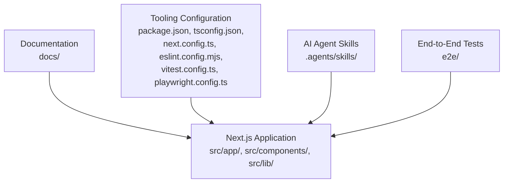
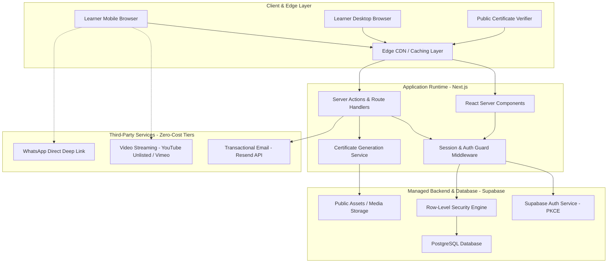
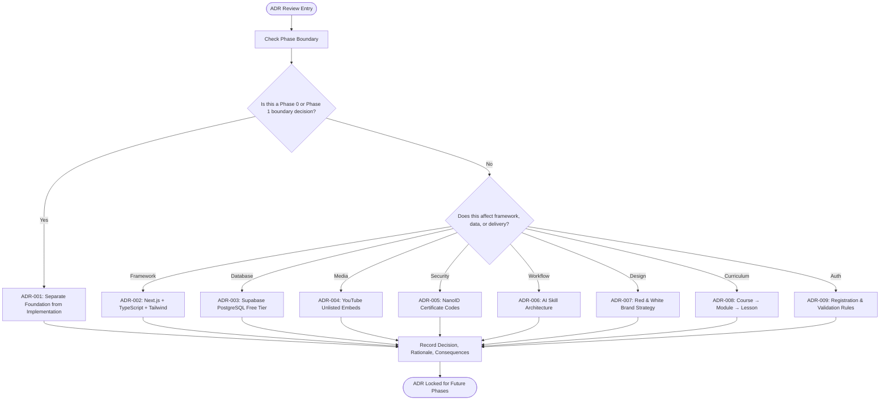
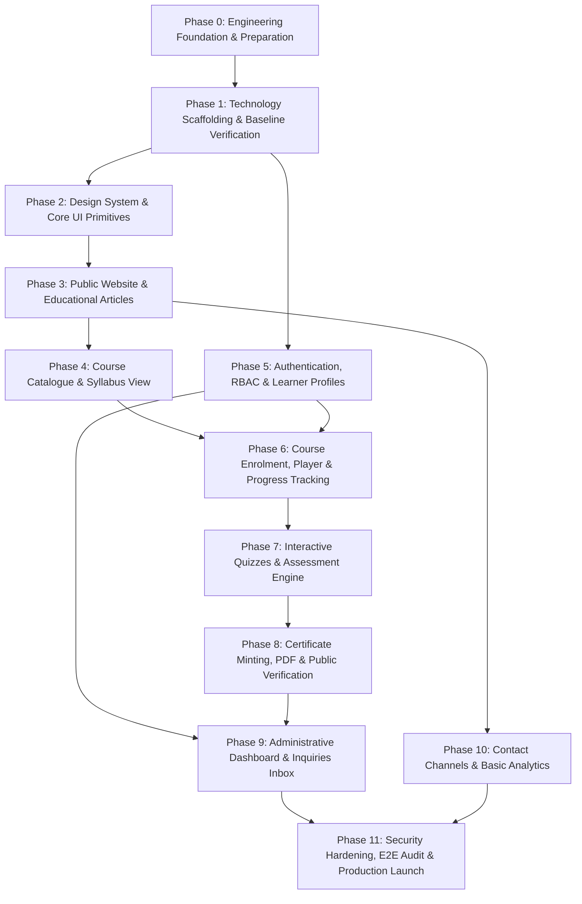
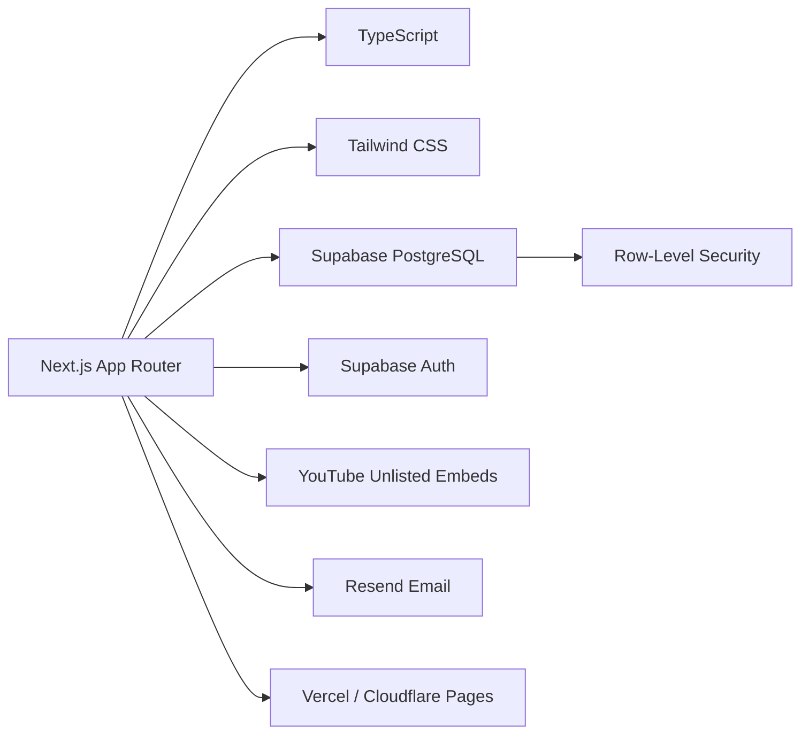
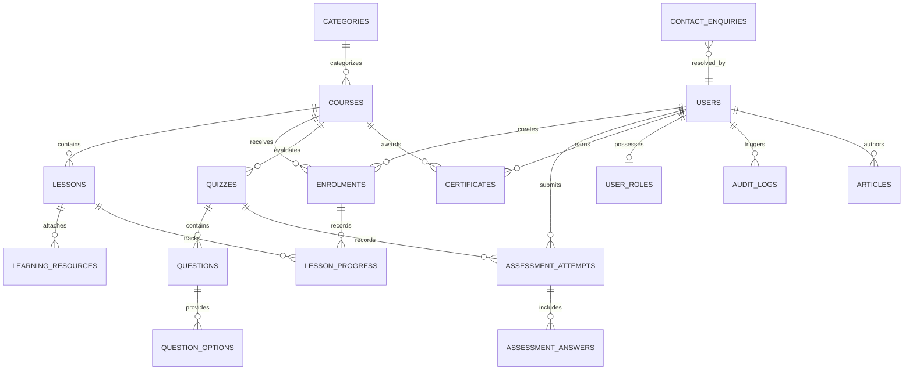

# Decision Records & Roadmap

<cite>
**Referenced Files in This Document**   
- [DECISION_LOG.md](file://docs/DECISION_LOG.md)
- [IMPLEMENTATION_ROADMAP.md](file://docs/IMPLEMENTATION_ROADMAP.md)
- [TECHNOLOGY_EVALUATION.md](file://docs/TECHNOLOGY_EVALUATION.md)
- [KNOWN_LIMITATIONS.md](file://docs/KNOWN_LIMITATIONS.md)
- [SYSTEM_ARCHITECTURE.md](file://docs/SYSTEM_ARCHITECTURE.md)
- [DESIGN_SYSTEM.md](file://docs/DESIGN_SYSTEM.md)
- [DATABASE_DESIGN.md](file://docs/DATABASE_DESIGN.md)
- [PRODUCT_REQUIREMENTS.md](file://docs/PRODUCT_REQUIREMENTS.md)
- [SECURITY.md](file://docs/SECURITY.md)
- [README.md](file://README.md)
</cite>

## Table of Contents
1. [Introduction](#introduction)
2. [Project Structure](#project-structure)
3. [Core Components](#core-components)
4. [Architecture Overview](#architecture-overview)
5. [Detailed Component Analysis](#detailed-component-analysis)
6. [Dependency Analysis](#dependency-analysis)
7. [Performance Considerations](#performance-considerations)
8. [Troubleshooting Guide](#troubleshooting-guide)
9. [Conclusion](#conclusion)
10. [Appendices](#appendices)

## Introduction
This document consolidates SwimNigeria’s settled architectural decisions, phased implementation roadmap, technology evaluations, known limitations, and operational constraints into a single authoritative reference. It is intended for technical contributors, product owners, and reviewers who need to understand why the platform was designed this way, what has been completed, what remains, and how future phases should proceed without violating established boundaries.

SwimNigeria is positioned as a zero-cost-launch educational platform optimized for Nigerian mobile networks, with strict security, accessibility, and phase-gated development. The project has completed Phase 0 (engineering foundation) and Phase 1 (technology scaffolding), and is preparing for Phase 2 (design system and core UI primitives).

## Project Structure
The repository separates documentation, application code, end-to-end tests, and agent skill definitions:

- `docs/` contains all foundational engineering documents, including ADRs, architecture, database design, security, design system, product requirements, roadmap, and limitations.
- `src/` contains the Next.js application, components, routes, tests, and library utilities.
- `e2e/` contains Playwright end-to-end test specifications.
- `.agents/skills/` contains curated AI agent skills used during development.
- Root configuration files define TypeScript, ESLint, Prettier, Vitest, Playwright, PostCSS, and Next.js behavior.

**Diagram sources**
- [README.md:71-90](file://README.md#L71-L90)
- [IMPLEMENTATION_ROADMAP.md:30-51](file://docs/IMPLEMENTATION_ROADMAP.md#L30-L51)

**Section sources**
- [README.md:71-101](file://README.md#L71-L101)
- [IMPLEMENTATION_ROADMAP.md:30-51](file://docs/IMPLEMENTATION_ROADMAP.md#L30-L51)

## Core Components
SwimNigeria’s core components are defined by its architecture, data model, design system, security posture, and phased delivery plan:

| Component | Responsibility | Key Source |
|---|---|---|
| Architecture Decision Records | Settled technical choices, trade-offs, and consequences | [DECISION_LOG.md](file://docs/DECISION_LOG.md) |
| Phased Implementation Roadmap | Dependency-aware milestones, prerequisites, deliverables, exit criteria | [IMPLEMENTATION_ROADMAP.md](file://docs/IMPLEMENTATION_ROADMAP.md) |
| System Architecture | High-level runtime layers, data flow, video strategy, hosting considerations | [SYSTEM_ARCHITECTURE.md](file://docs/SYSTEM_ARCHITECTURE.md) |
| Database Design | Conceptual entities, relationships, integrity rules, RLS policy matrix | [DATABASE_DESIGN.md](file://docs/DATABASE_DESIGN.md) |
| Design System | Brand identity, color tokens, typography, spacing, component specs, accessibility | [DESIGN_SYSTEM.md](file://docs/DESIGN_SYSTEM.md) |
| Security Architecture | Zero-trust client, session security, RBAC, RLS, anti-cheating, certificate verification security | [SECURITY.md](file://docs/SECURITY.md) |
| Product Requirements | Functional features, permissions, edge cases, acceptance criteria, unresolved business decisions | [PRODUCT_REQUIREMENTS.md](file://docs/PRODUCT_REQUIREMENTS.md) |
| Technology Evaluation | Framework, styling, database, auth, hosting, video, email comparisons and commercial terms | [TECHNOLOGY_EVALUATION.md](file://docs/TECHNOLOGY_EVALUATION.md) |
| Known Limitations | Unresolved requirements, unverified assumptions, free-tier quotas, missing credentials | [KNOWN_LIMITATIONS.md](file://docs/KNOWN_LIMITATIONS.md) |
| Project Status & Milestones | Current completion state and next milestone guidance | [README.md](file://README.md) |

**Section sources**
- [DECISION_LOG.md:1-18](file://docs/DECISION_LOG.md#L1-L18)
- [IMPLEMENTATION_ROADMAP.md:1-24](file://docs/IMPLEMENTATION_ROADMAP.md#L1-L24)
- [SYSTEM_ARCHITECTURE.md:1-11](file://docs/SYSTEM_ARCHITECTURE.md#L1-L11)
- [DATABASE_DESIGN.md:1-7](file://docs/DATABASE_DESIGN.md#L1-L7)
- [DESIGN_SYSTEM.md:1-12](file://docs/DESIGN_SYSTEM.md#L1-L12)
- [SECURITY.md:1-8](file://docs/SECURITY.md#L1-L8)
- [PRODUCT_REQUIREMENTS.md:1-13](file://docs/PRODUCT_REQUIREMENTS.md#L1-L13)
- [TECHNOLOGY_EVALUATION.md:1-19](file://docs/TECHNOLOGY_EVALUATION.md#L1-L19)
- [KNOWN_LIMITATIONS.md:1-6](file://docs/KNOWN_LIMITATIONS.md#L1-L6)
- [README.md:7-18](file://README.md#L7-L18)

## Architecture Overview
SwimNigeria uses a layered architecture optimized for low-bandwidth Nigerian networks, strong security, and zero-cost sustainability:

- **Client & Edge Layer:** Learner browsers and public verifiers access the application through an edge CDN or caching layer.
- **Application Runtime:** Next.js Server Components render lightweight HTML for content; Server Actions handle mutations; middleware enforces authentication and authorization.
- **Managed Backend & Database:** Supabase provides PostgreSQL, Row-Level Security, and Auth.
- **External Services:** YouTube/Vimeo for video, Resend for transactional email, WhatsApp deep links for direct communication.

**Diagram sources**
- [SYSTEM_ARCHITECTURE.md:12-59](file://docs/SYSTEM_ARCHITECTURE.md#L12-L59)

**Section sources**
- [SYSTEM_ARCHITECTURE.md:1-11](file://docs/SYSTEM_ARCHITECTURE.md#L1-L11)
- [SYSTEM_ARCHITECTURE.md:63-160](file://docs/SYSTEM_ARCHITECTURE.md#L63-L160)

## Detailed Component Analysis

### Architecture Decision Records (ADR-001 through ADR-009)
The ADR log captures settled decisions that constrain future development. While the objective references ADR-001 through ADR-007, the repository includes ADR-008 and ADR-009, which extend the decision surface into curriculum modeling and registration validation.

| ADR | Topic | Settled Choice | Trade-offs & Consequences |
|---|---|---|---|
| ADR-001 | Foundation Phase Separation | Complete engineering documentation, agent rules, security modeling, and testing strategies before application code. | Prevents conflicting architectures and poor design-system discipline; defers scaffolding to Phase 1. |
| ADR-002 | Next.js App Router + TypeScript + Tailwind CSS | Server Components for SEO and static content; Client Components only where interaction is required. | Better SEO and lower client JS than SPA; requires strict Server Component boundaries. |
| ADR-003 | Managed PostgreSQL via Supabase Free Tier | Relational data with native Row-Level Security at zero upfront cost. | Requires RLS-based logic; must mitigate auto-pause after inactivity. |
| ADR-004 | Video Delivery via Privacy-Enhanced YouTube Unlisted Embeds | Lightweight facades load third-party players only on user interaction. | Eliminates bandwidth costs but depends on YouTube availability and privacy trade-offs. |
| ADR-005 | Tamper-Evident Certificate Verification via NanoID | Structured verification codes with public verification URL and QR support. | Prevents enumeration and forgery; requires unique index and public route. |
| ADR-006 | AI Development Workflow & Skill Architecture | Curated agent skills installed under `.agents/skills/` with progressive disclosure. | Preserves token context while enforcing quality standards; skills must be tracked and maintained. |
| ADR-007 | Dominant Red & White Brand Color Strategy with Slate Neutrals | Red CTAs, white backgrounds, slate typography, aquatic accents. | Maintains brand identity while meeting WCAG contrast and UX expectations. |
| ADR-008 | Pedagogical Module Hierarchy | Course → Module → Lesson hierarchy modeled conceptually before database migration. | Preserves curriculum structure; no immediate database change required in Phase 4. |
| ADR-009 | Registration, Zod Validation, Non-Authoritative Metadata, Email Verification | Server-side validation, Supabase Auth metadata, email verification flow, no premature DB migration. | Minimizes scope and avoids service-role key exposure; `user_metadata` must not drive authorization. |

**Diagram sources**
- [DECISION_LOG.md:21-143](file://docs/DECISION_LOG.md#L21-L143)

**Section sources**
- [DECISION_LOG.md:1-18](file://docs/DECISION_LOG.md#L1-L18)
- [DECISION_LOG.md:21-143](file://docs/DECISION_LOG.md#L21-L143)

### Phased Implementation Roadmap
The roadmap defines a dependency-aware sequence from Phase 0 through Phase 11. Phase 0 and Phase 1 are marked complete; Phase 2 is the immediate next milestone.

**Diagram sources**
- [IMPLEMENTATION_ROADMAP.md:8-24](file://docs/IMPLEMENTATION_ROADMAP.md#L8-L24)

Key phase characteristics:

| Phase | Goal | Prerequisites | Exit Criteria Highlights |
|---|---|---|---|
| Phase 0 | Engineering foundation, agent rules, skills, architecture evaluation | None | Documentation verified; zero application code scaffolded. |
| Phase 1 | Next.js scaffolding, tooling, baseline verification | Phase 0 | Build, lint, typecheck, unit tests, E2E smoke tests pass. |
| Phase 2 | Reusable accessible UI primitives and layout containers | Phase 1 | WCAG AA contrast, keyboard navigation, no layout shift. |
| Phase 3 | Public marketing pages and Markdown-driven articles | Phase 2 | Lighthouse Performance > 90, valid OpenGraph tags, responsive to 320px. |
| Phase 4 | Course catalogue and syllabus exploration | Phase 3 | Syllabus loads without authentication; unregistered users see enrollment CTA. |
| Phase 5 | Supabase Auth, SSR cookies, RBAC, learner profiles | Phase 1 + Supabase setup | Session persists; unauthorized admin routes return 404/403; no client-side token storage. |
| Phase 6 | Enrollment, lesson player, progress tracking | Phase 4 + Phase 5 | Progress persists; unauthenticated users cannot access non-preview lessons. |
| Phase 7 | Quizzes and assessment engine | Phase 6 | Grading is server-side; cheating via client payload modification prevented. |
| Phase 8 | Certificate minting, PDF generation, public verification | Phase 7 | Verification URL validates authentic IDs; PDF renders cleanly on A4. |
| Phase 9 | Admin dashboard and inquiries inbox | Phase 5 + Phase 6 + Phase 8 | Admin access strictly enforced; audit logs recorded. |
| Phase 10 | Contact channels and basic analytics | Phase 3 | Form submissions recorded; zero third-party cross-site cookies. |
| Phase 11 | Security hardening, E2E audit, production launch | All prior phases | Zero critical vulnerabilities; Lighthouse Performance and Accessibility > 90; green test suite. |

**Section sources**
- [IMPLEMENTATION_ROADMAP.md:1-24](file://docs/IMPLEMENTATION_ROADMAP.md#L1-L24)
- [IMPLEMENTATION_ROADMAP.md:30-167](file://docs/IMPLEMENTATION_ROADMAP.md#L30-L167)

### Feature Prioritization Strategy
Feature prioritization follows three principles:

1. **Dependency Awareness:** Features requiring authentication, enrollments, assessments, or certificates cannot be implemented before their prerequisite phases.
2. **Zero-First Scope Discipline:** Phase 0 and Phase 1 deliberately avoid business features, course data, mock learner records, and database migrations until the foundation is approved.
3. **Risk-Driven Sequencing:** Security-sensitive features (auth, RBAC, grading, certificates) are gated behind earlier infrastructure and design-system work.

The product requirements explicitly separate public-facing features (website, articles, course catalogue) from authenticated features (enrollment, lessons, assessments, certificates, dashboards), ensuring that public value can be delivered even while backend capabilities are still being built.

**Section sources**
- [PRODUCT_REQUIREMENTS.md:16-231](file://docs/PRODUCT_REQUIREMENTS.md#L16-L231)
- [README.md:7-18](file://README.md#L7-L18)

### Milestone Tracking Approach
Milestones are tracked through:

- Explicit prerequisites per phase.
- Deliverables listed per phase.
- Measurable exit criteria per phase.
- Quality gates enforced by automated commands (`build`, `lint`, `typecheck`, `test`, `test:e2e`).
- Documentation-first gating: Phase 0 must be fully documented and approved before application code begins.

This approach prevents “future-phase creep” from justifying premature implementation.

**Section sources**
- [IMPLEMENTATION_ROADMAP.md:1-7](file://docs/IMPLEMENTATION_ROADMAP.md#L1-L7)
- [IMPLEMENTATION_ROADMAP.md:30-51](file://docs/IMPLEMENTATION_ROADMAP.md#L30-L51)
- [README.md:48-67](file://README.md#L48-L67)

### Release Planning Methodology
Release planning is tied to phase completion rather than calendar dates:

- Staging and initial educational launch can use Vercel Hobby Tier while non-commercial.
- Commercial monetization triggers a hosting migration decision between Vercel Pro and Cloudflare Pages.
- Certificate generation implementation is coupled with hosting runtime compatibility.
- Production launch requires full E2E coverage, accessibility audit, performance optimization, and live verification URL functionality.

**Section sources**
- [TECHNOLOGY_EVALUATION.md:70-95](file://docs/TECHNOLOGY_EVALUATION.md#L70-L95)
- [SYSTEM_ARCHITECTURE.md:142-159](file://docs/SYSTEM_ARCHITECTURE.md#L142-L159)
- [IMPLEMENTATION_ROADMAP.md:157-167](file://docs/IMPLEMENTATION_ROADMAP.md#L157-L167)

### Technology Evaluation Comparisons
The technology evaluation compares frameworks, styling systems, databases, authentication providers, hosting platforms, video delivery, and email services against budget, performance, security, and commercial-use constraints.

| Category | Recommended Choice | Primary Rationale |
|---|---|---|
| Frontend Framework | Next.js 15+ (App Router) | Server Components for low-bandwidth mobile performance; excellent SEO for articles. |
| Language | TypeScript (Strict Mode) | Full-stack type safety preventing runtime errors in grading and enrollment. |
| Styling | Tailwind CSS v4 | Zero runtime CSS overhead; rapid design-system token implementation. |
| Database | PostgreSQL via Supabase | Native RLS for authorization; ACID transactions; free-tier sustainability. |
| Authentication | Supabase Auth (`@supabase/ssr`) | Secure HTTP-only cookie handling; PKCE flow; tight integration with database roles. |
| Video Delivery | Unlisted YouTube Embeds | ₦0 bandwidth cost; adaptive streaming on Nigerian networks. |
| Email Service | Resend | 3,000 free emails/month; high deliverability. |
| Hosting | Vercel (Launch) / Cloudflare Pages (Commercial) | Edge CDN; preview deployments; zero server maintenance costs. |

**Section sources**
- [TECHNOLOGY_EVALUATION.md:9-19](file://docs/TECHNOLOGY_EVALUATION.md#L9-L19)
- [TECHNOLOGY_EVALUATION.md:22-134](file://docs/TECHNOLOGY_EVALUATION.md#L22-L134)

### Framework Selection Rationale
Next.js was selected over Vite + React SPA, Remix/React Router v7, and Astro because it balances:

- SEO-critical public content rendering.
- Streaming HTML for slow connections.
- Co-located Server Actions for backend logic.
- Image optimization and routing maturity.
- Agent skill ecosystem support.

Astro is acknowledged as ideal for static blogs but less cohesive for an LMS with dynamic authentication and assessments.

**Section sources**
- [TECHNOLOGY_EVALUATION.md:24-32](file://docs/TECHNOLOGY_EVALUATION.md#L24-L32)
- [SYSTEM_ARCHITECTURE.md:65-73](file://docs/SYSTEM_ARCHITECTURE.md#L65-L73)

### Vendor Assessments
Vendor decisions emphasize free-tier viability, commercial-use terms, and operational risk:

- **Supabase:** Preferred for relational modeling, RLS, and integrated Auth/Storage under one free umbrella.
- **Firebase/Firestore:** Rejected due to non-relational constraints and complex progress tracking.
- **Neon Serverless Postgres:** Viable alternative but requires separate auth provider.
- **Self-hosted PostgreSQL:** Rejected due to maintenance overhead on a ₦0 budget.
- **Vercel Hobby Tier:** Legally suitable for non-commercial educational launch; commercial revenue requires upgrade or migration.
- **Cloudflare Pages:** Permits commercial use on free tier; edge runtime compatibility affects PDF generation.
- **Resend:** Chosen for developer experience, free quota, and commercial permission.

**Section sources**
- [TECHNOLOGY_EVALUATION.md:47-95](file://docs/TECHNOLOGY_EVALUATION.md#L47-L95)
- [TECHNOLOGY_EVALUATION.md:112-118](file://docs/TECHNOLOGY_EVALUATION.md#L112-L118)

### Migration Paths
Migration paths are explicitly considered:

- **Hosting Migration:** From Vercel Hobby to Vercel Pro or Cloudflare Pages when commercial monetization begins.
- **PDF Generation Migration:** If moving to Cloudflare Pages, heavy Node-dependent libraries like `@react-pdf/renderer` may fail; edge-compatible alternatives such as `pdf-lib` or client-side SVG rendering must be evaluated.
- **Video Provider Abstraction:** The video player interface should be abstracted so YouTube can be swapped for Vimeo or Cloudflare Stream if network restrictions arise.
- **Profile Data Migration:** Registration collects legal full name in Supabase Auth metadata temporarily; an authoritative `profiles` table is planned for later phases.

**Section sources**
- [TECHNOLOGY_EVALUATION.md:70-95](file://docs/TECHNOLOGY_EVALUATION.md#L70-L95)
- [SYSTEM_ARCHITECTURE.md:142-149](file://docs/SYSTEM_ARCHITECTURE.md#L142-L149)
- [KNOWN_LIMITATIONS.md:20-33](file://docs/KNOWN_LIMITATIONS.md#L20-L33)
- [KNOWN_LIMITATIONS.md:54-60](file://docs/KNOWN_LIMITATIONS.md#L54-L60)

### Technical Debt Management Strategies
Technical debt is managed through:

- Strict phase boundaries preventing feature creep.
- Zero business features in early phases.
- Automated quality gates (`format:check`, `typecheck`, `lint`, `test`, `test:e2e`, `build`).
- Security policies prohibiting client-side token storage, raw SQL concatenation, and unsafe markdown rendering.
- Database RLS as the final authorization enforcement layer.
- Explicitly tracked known limitations and unresolved business requirements.

**Section sources**
- [IMPLEMENTATION_ROADMAP.md:1-7](file://docs/IMPLEMENTATION_ROADMAP.md#L1-L7)
- [SECURITY.md:82-96](file://docs/SECURITY.md#L82-L96)
- [SECURITY.md:150-155](file://docs/SECURITY.md#L150-L155)
- [KNOWN_LIMITATIONS.md:1-6](file://docs/KNOWN_LIMITATIONS.md#L1-L6)

## Dependency Analysis
The SwimNigeria system has clear dependency chains across frontend, backend, database, and external services.

**Diagram sources**
- [SYSTEM_ARCHITECTURE.md:12-59](file://docs/SYSTEM_ARCHITECTURE.md#L12-L59)
- [TECHNOLOGY_EVALUATION.md:9-19](file://docs/TECHNOLOGY_EVALUATION.md#L9-L19)

**Section sources**
- [SYSTEM_ARCHITECTURE.md:63-160](file://docs/SYSTEM_ARCHITECTURE.md#L63-L160)
- [TECHNOLOGY_EVALUATION.md:22-134](file://docs/TECHNOLOGY_EVALUATION.md#L22-L134)

## Performance Considerations
Performance is constrained by Nigerian mobile network conditions and a zero-budget launch:

- JavaScript bundle budget: under 120KB gzipped for public routes.
- Aggressive asset caching via CDN.
- Lazy media loading; video players embedded only on explicit user interaction.
- Optimized fonts using WOFF2 subsets.
- Server Components delivering pre-rendered HTML for content-heavy routes.
- Adaptive bitrate video streaming through YouTube to handle fluctuating 2G/3G/4G connectivity.

These constraints directly influence component design, routing strategy, and media handling.

**Section sources**
- [SYSTEM_ARCHITECTURE.md:219-225](file://docs/SYSTEM_ARCHITECTURE.md#L219-L225)
- [PRODUCT_REQUIREMENTS.md:233-249](file://docs/PRODUCT_REQUIREMENTS.md#L233-L249)
- [TECHNOLOGY_EVALUATION.md:103-109](file://docs/TECHNOLOGY_EVALUATION.md#L103-L109)

## Troubleshooting Guide
Common operational issues and mitigations include:

| Issue | Cause | Mitigation |
|---|---|---|
| Database connection errors after inactivity | Supabase free-tier auto-pauses after 7 days | Implement automated ping every 48 hours. |
| Email confirmation failures | Missing DNS records or spam filtering | Configure SPF, DKIM, DMARC; test across major providers. |
| Video embed failures | Network restrictions or YouTube blocking | Provide text transcripts and diagrams; abstract video provider. |
| Commercial hosting violation | Using Vercel Hobby for paid courses | Migrate to Vercel Pro or Cloudflare Pages. |
| Certificate verification leaks | Exposing internal fields publicly | Use strict public field allowlist and secure view/projection. |
| Assessment cheating | Client receiving correct answers | Keep answer keys server-side; submit only selected option IDs. |
| Rate-limit exhaustion | Free serverless concurrency limits | Configure WAF/DDoS protection; implement throttling. |

**Section sources**
- [KNOWN_LIMITATIONS.md:37-69](file://docs/KNOWN_LIMITATIONS.md#L37-L69)
- [SECURITY.md:99-140](file://docs/SECURITY.md#L99-L140)

## Conclusion
SwimNigeria’s architecture is intentionally conservative, security-focused, and phase-gated. The ADRs lock in foundational choices around Next.js, Supabase, YouTube embeds, NanoID certificates, AI skill workflows, brand colors, curriculum hierarchy, and registration validation. The roadmap enforces sequential delivery, while the technology evaluation and known limitations document expose operational risks, commercial-use constraints, and unresolved business decisions.

For future work:

- Do not begin Phase 2 until Phase 1 is reviewed and approved.
- Treat hosting selection and PDF generation as a coupled decision before Phase 8.
- Keep `user_metadata` out of authorization logic.
- Maintain RLS as the final authority for data access.
- Track unresolved business requirements and verify assumptions before implementing dependent phases.

[No sources needed since this section summarizes without analyzing specific files]

## Appendices

### Appendix A: Current Project Status and Next Milestone
- Phase 0 and Phase 1 are complete.
- No business features, course data, mock learner records, or database migrations have been introduced yet.
- Immediate next milestone: Phase 2 — Design System & Core UI Primitives.

**Section sources**
- [README.md:7-18](file://README.md#L7-L18)
- [README.md:105-111](file://README.md#L105-L111)

### Appendix B: Data Model Relationships
The conceptual data model emphasizes integrity, ownership, and auditability, with explicit RLS policies separating public, learner, and admin access.

**Diagram sources**
- [DATABASE_DESIGN.md:12-38](file://docs/DATABASE_DESIGN.md#L12-L38)

**Section sources**
- [DATABASE_DESIGN.md:1-7](file://docs/DATABASE_DESIGN.md#L1-L7)
- [DATABASE_DESIGN.md:42-146](file://docs/DATABASE_DESIGN.md#L42-L146)
- [DATABASE_DESIGN.md:149-181](file://docs/DATABASE_DESIGN.md#L149-L181)