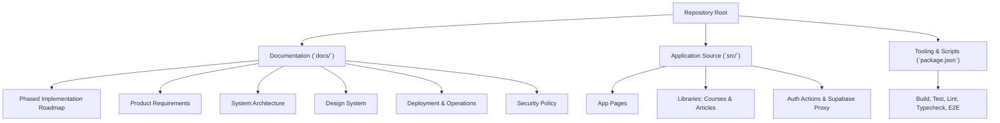
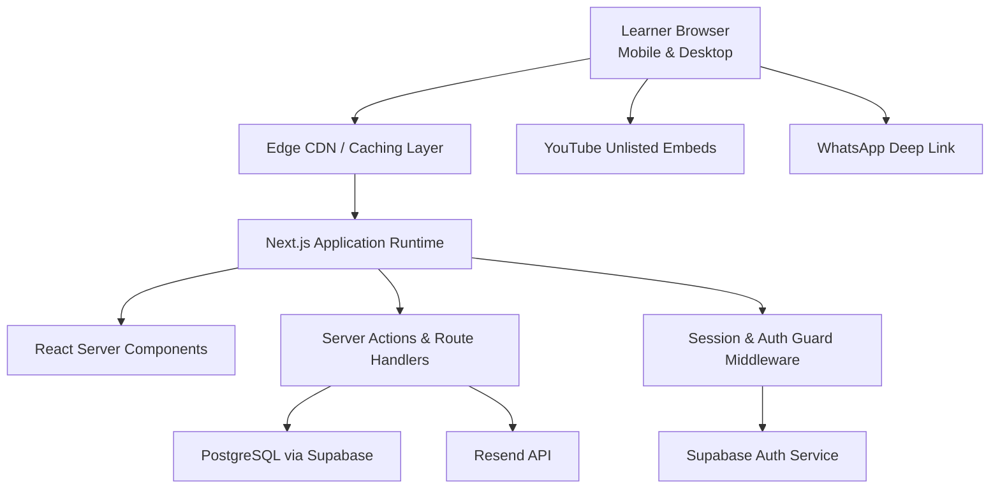
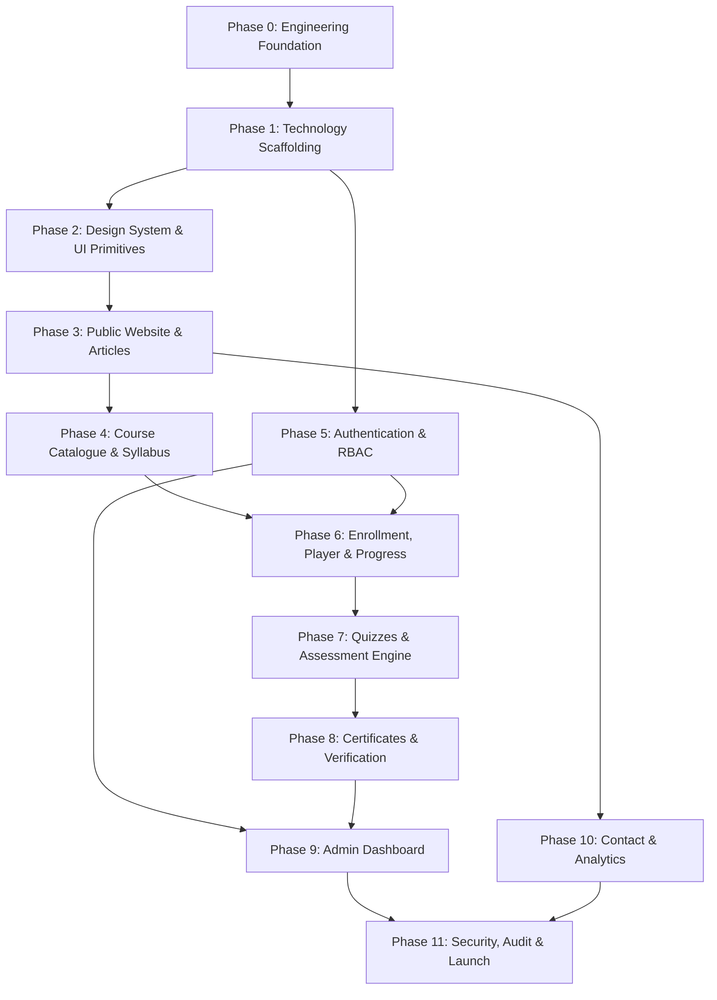
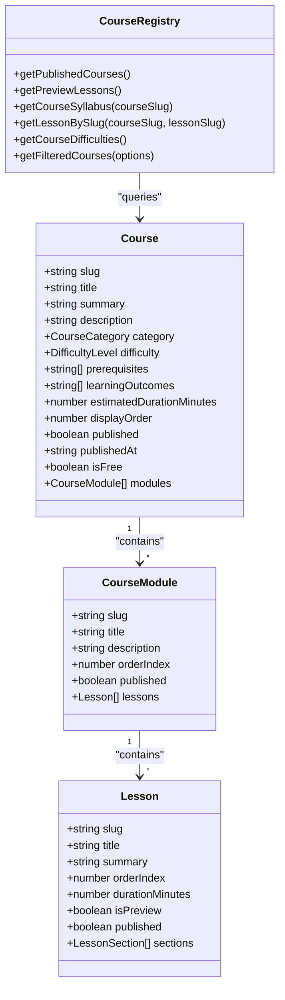
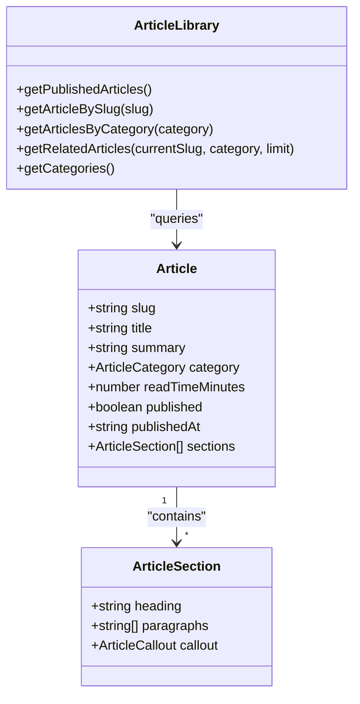
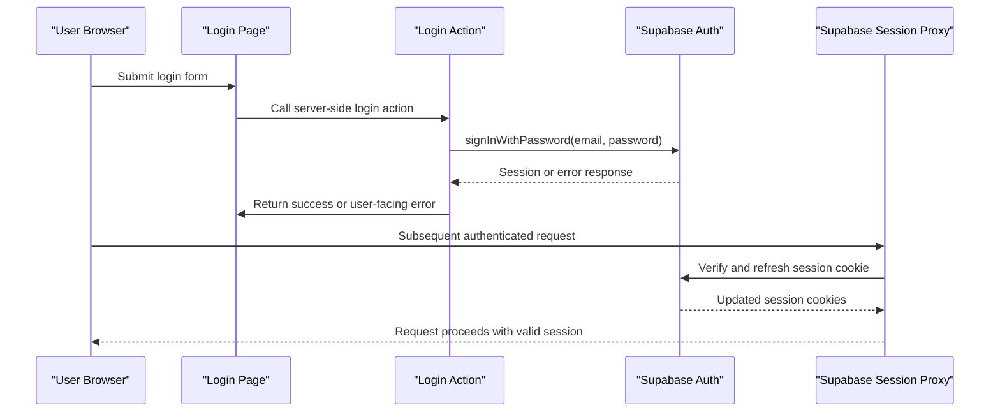
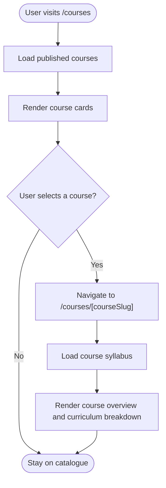
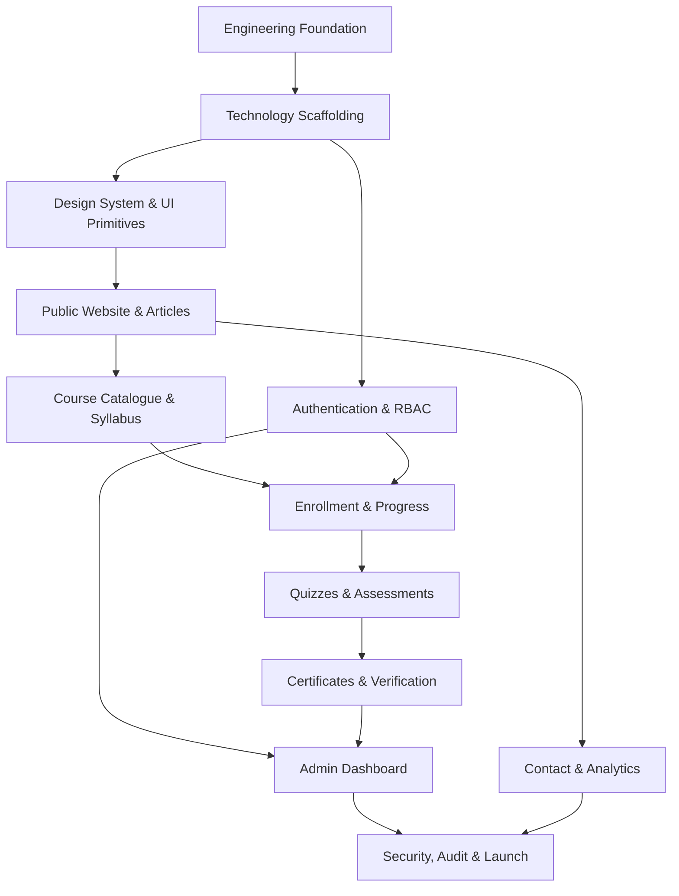
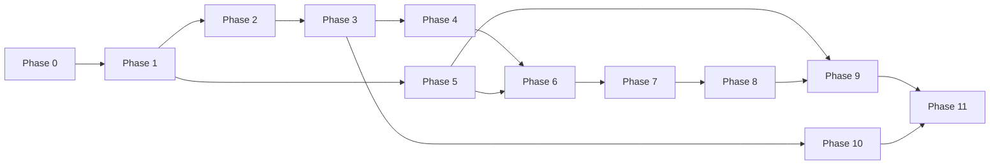

# Implementation Roadmap & Phases

<cite>
**Referenced Files in This Document**   
- [IMPLEMENTATION_ROADMAP.md](file://docs/IMPLEMENTATION_ROADMAP.md)
- [README.md](file://README.md)
- [PROJECT_BRIEF.md](file://docs/PROJECT_BRIEF.md)
- [DESIGN_SYSTEM.md](file://docs/DESIGN_SYSTEM.md)
- [PRODUCT_REQUIREMENTS.md](file://docs/PRODUCT_REQUIREMENTS.md)
- [SYSTEM_ARCHITECTURE.md](file://docs/SYSTEM_ARCHITECTURE.md)
- [DEPLOYMENT_AND_OPERATIONS.md](file://docs/DEPLOYMENT_AND_OPERATIONS.md)
- [SECURITY.md](file://docs/SECURITY.md)
- [package.json](file://package.json)
- [courses.ts](file://src/lib/courses.ts)
- [articles.ts](file://src/lib/articles.ts)
- [page.tsx (Course Detail)](file://src/app/courses/[courseSlug]/page.tsx)
- [page.tsx (Courses Index)](file://src/app/courses/page.tsx)
- [actions.ts (Login)](file://src/app/login/actions.ts)
- [proxy.ts (Supabase Proxy)](file://src/lib/supabase/proxy.ts)
</cite>

## Table of Contents
1. [Introduction](#introduction)
2. [Project Structure](#project-structure)
3. [Core Components](#core-components)
4. [Architecture Overview](#architecture-overview)
5. [Detailed Component Analysis](#detailed-component-analysis)
6. [Dependency Analysis](#dependency-analysis)
7. [Performance Considerations](#performance-considerations)
8. [Troubleshooting Guide](#troubleshooting-guide)
9. [Conclusion](#conclusion)
10. [Appendices](#appendices)

## Introduction
This document explains SwimNigeria’s phased implementation roadmap and clarifies what is completed, planned, and ready for contributor work. It focuses on:
- Phase 1 completion status and current project state.
- Planned Phase 2 design system and UI primitive delivery.
- Milestone tracking, feature prioritization, and release planning methodology.
- Timeline estimates, resource requirements, and cross-phase dependencies.
- Criteria for moving between phases, success metrics, and rollback strategies.
- Contributor guidance distinguishing implemented features from those still in planning.

SwimNigeria is a digital aquatic education platform intended to make structured swimming instruction and water safety knowledge accessible across Nigeria. The initial launch scope includes public educational content, a beginner course catalogue, learner authentication, enrollment, progress tracking, assessments, certificates, dashboards, administrative operations, contact channels, and basic analytics.

**Section sources**
- [README.md:1-17](file://README.md#L1-L17)
- [PROJECT_BRIEF.md:1-40](file://docs/PROJECT_BRIEF.md#L1-L40)

## Project Structure
The repository follows a Next.js App Router structure with TypeScript, Tailwind CSS, and comprehensive documentation under `docs/`. Key areas relevant to the roadmap are:
- Documentation: product requirements, architecture, design system, deployment, security, and the phased roadmap.
- Source code: application pages, reusable UI components, local data libraries for courses and articles, and early authentication integration.
- Tooling: package scripts for development, linting, type checking, testing, E2E testing, formatting, and production builds.

**Diagram sources**
- [IMPLEMENTATION_ROADMAP.md:1-24](file://docs/IMPLEMENTATION_ROADMAP.md#L1-L24)
- [package.json:6-16](file://package.json#L6-L16)

**Section sources**
- [README.md:71-90](file://README.md#L71-L90)
- [package.json:1-16](file://package.json#L1-L16)

## Core Components
The core components that anchor the roadmap are:
- **Phased Roadmap:** A strict sequence from engineering foundation through production launch, with explicit prerequisites and exit criteria.
- **Course Management Library:** A strongly typed local registry for launch courses, modules, lessons, preview filtering, syllabus exposure, and draft isolation.
- **Article System Library:** A typed article model with published/draft protection, category listing, related articles, and slug resolution.
- **Authentication Integration:** Login actions using Supabase Auth, error handling for unverified email and rate limits, and a Supabase session proxy for authenticated requests.
- **Design System:** Brand palette, typography, spacing, responsive breakpoints, component specifications, and accessibility requirements.

| Area | Current Status | Primary Responsibility |
|---|---:|---|
| Engineering Foundation | Completed | Documentation, agent rules, coding standards, skill ecosystem. |
| Technology Scaffolding | Completed | Next.js App Router, TypeScript, Tailwind, quality tooling, baseline verification. |
| Design System & UI Primitives | Planned next milestone | Reusable accessible components and layout containers. |
| Public Website & Articles | Partially implemented | Article data model and query helpers exist; page-level rendering depends on app routes. |
| Course Catalogue & Syllabus | Partially implemented | Local course registry and detail page scaffolding exist; interactive exploration deferred. |
| Authentication | Early implementation | Login action and Supabase session proxy present; full RBAC and profile management deferred. |
| Enrollment, Progress, Assessments, Certificates | Planned | Defined in roadmap and product requirements but not yet implemented. |

**Section sources**
- [IMPLEMENTATION_ROADMAP.md:30-50](file://docs/IMPLEMENTATION_ROADMAP.md#L30-L50)
- [README.md:7-17](file://README.md#L7-L17)
- [courses.ts:1-14](file://src/lib/courses.ts#L1-L14)
- [articles.ts:1-24](file://src/lib/articles.ts#L1-L24)
- [actions.ts (Login):93-158](file://src/app/login/actions.ts#L93-L158)
- [proxy.ts (Supabase Proxy):31-68](file://src/lib/supabase/proxy.ts#L31-L68)

## Architecture Overview
The architecture is designed for low-latency performance on Nigerian networks, server-side security, modular separation of static content and dynamic learning state, and zero-cost sustainability at launch.

**Diagram sources**
- [SYSTEM_ARCHITECTURE.md:12-59](file://docs/SYSTEM_ARCHITECTURE.md#L12-L59)

Key architectural decisions affecting the roadmap:
- Next.js App Router with React Server Components for SEO-friendly public pages and efficient SSR.
- Server Actions for mutations such as enrollment, lesson completion, and assessment grading.
- PostgreSQL with Row-Level Security for multi-tenant data isolation.
- Supabase Auth with PKCE and HTTP-only cookies for secure sessions.
- YouTube embeds for video delivery to avoid bandwidth costs.
- Resend API for transactional email.
- Vercel or Cloudflare Pages for hosting within free-tier constraints.

**Section sources**
- [SYSTEM_ARCHITECTURE.md:63-160](file://docs/SYSTEM_ARCHITECTURE.md#L63-L160)

## Detailed Component Analysis

### Phased Implementation Roadmap
The roadmap defines a dependency-aware sequence. Each phase has goals, prerequisites, deliverables, and exit criteria. The most important milestones for contributors are:
- **Phase 0:** Engineering foundation and preparation — completed.
- **Phase 1:** Technology scaffolding and baseline verification — completed and awaiting review.
- **Phase 2:** Design system and core UI primitives — immediate next milestone.
- **Phase 3:** Public website and educational articles.
- **Phase 4:** Course catalogue and syllabus exploration.
- **Phase 5:** Authentication, RBAC, and learner profiles.
- **Phase 6:** Course enrollment, lesson player, and progress tracking.
- **Phase 7:** Interactive quizzes and assessment engine.
- **Phase 8:** Certificate generation and public verification.
- **Phase 9:** Administrative dashboard and inquiries inbox.
- **Phase 10:** Multi-channel contact and basic analytics.
- **Phase 11:** Security hardening, E2E audit, and production launch.

**Diagram sources**
- [IMPLEMENTATION_ROADMAP.md:8-24](file://docs/IMPLEMENTATION_ROADMAP.md#L8-L24)

Milestone tracking approach:
- Phases are sequential and must be verified before starting the next.
- Each phase documents prerequisites, deliverables, and measurable exit criteria.
- Future phases do not authorize premature implementation.

Feature prioritization strategy:
- Prioritize foundational engineering, then design system, then public content, then authenticated learning flows, then assessments and certificates, then administration and launch hardening.

Release planning methodology:
- Releases align with phase completion gates rather than arbitrary dates.
- Production launch requires all prior phases, E2E coverage, accessibility validation, performance optimization, and live verification functionality.

**Section sources**
- [IMPLEMENTATION_ROADMAP.md:3-24](file://docs/IMPLEMENTATION_ROADMAP.md#L3-L24)
- [IMPLEMENTATION_ROADMAP.md:30-167](file://docs/IMPLEMENTATION_ROADMAP.md#L30-L167)

### Course Management
The course management layer currently provides a strongly typed local registry for launch courses. It supports:
- Published course discovery.
- Draft isolation for unpublished courses, modules, and lessons.
- Preview lesson enumeration.
- Sanitized syllabus exposure.
- Lesson resolution by slug.
- Difficulty extraction and filtered course queries.

**Diagram sources**
- [courses.ts:16-78](file://src/lib/courses.ts#L16-L78)
- [courses.ts:1072-1247](file://src/lib/courses.ts#L1072-L1247)

Complexity considerations:
- Published course retrieval filters and sorts by `displayOrder`, ensuring deterministic presentation.
- Preview lesson enumeration traverses published courses, published modules, and preview lessons, returning a flattened list.
- Syllabus exposure strips internal fields and returns only sanitized public structures.
- Filtering normalizes category and difficulty inputs to prevent malformed queries from breaking the catalogue.

Error handling and edge cases:
- Unpublished courses return null for syllabus and lesson lookups.
- Unknown filter values return empty arrays rather than throwing.
- Draft modules and lessons are excluded from public queries even if marked as previews.

**Section sources**
- [courses.ts:1-14](file://src/lib/courses.ts#L1-L14)
- [courses.ts:1072-1247](file://src/lib/courses.ts#L1072-L1247)

### Article System
The article system provides a typed model for public educational content with draft protection and category-based navigation.

**Diagram sources**
- [articles.ts:1-24](file://src/lib/articles.ts#L1-L24)
- [articles.ts:181-242](file://src/lib/articles.ts#L181-L242)

Processing logic:
- Published articles are sorted by publication date descending.
- Slug resolution returns null for missing or unpublished articles.
- Category filtering normalizes input and matches against published categories.
- Related articles prefer same-category results and fall back to general articles.

Data flow pattern:
- Page routes request published articles or a specific article by slug.
- If an article is unpublished, the route should treat it as unavailable.
- Category pages use the category helper to render filtered lists.

**Section sources**
- [articles.ts:1-24](file://src/lib/articles.ts#L1-L24)
- [articles.ts:181-242](file://src/lib/articles.ts#L181-L242)

### Authentication Integration
Authentication is partially implemented through Supabase Auth and a session proxy.

**Diagram sources**
- [actions.ts (Login):93-158](file://src/app/login/actions.ts#L93-L158)
- [proxy.ts (Supabase Proxy):31-68](file://src/lib/supabase/proxy.ts#L31-L68)

Implementation patterns:
- Login action validates credentials through Supabase Auth.
- Errors include unverified email, rate limiting, invalid credentials, and generic service failures.
- Successful login returns session and user context.
- Session proxy avoids unnecessary Supabase calls for anonymous visitors by inspecting auth cookies first.
- For requests with potential auth cookies, the proxy creates a Supabase client, synchronizes cookies, and refreshes sessions when needed.

Security considerations:
- Credentials and session tokens must remain server-managed.
- Rate limiting and credential stuffing defenses are part of the broader security policy.
- Authorization decisions must not rely on editable client metadata.

**Section sources**
- [actions.ts (Login):93-158](file://src/app/login/actions.ts#L93-L158)
- [proxy.ts (Supabase Proxy):31-68](file://src/lib/supabase/proxy.ts#L31-L68)
- [SECURITY.md:29-48](file://docs/SECURITY.md#L29-L48)

### UI and Course Pages
The course catalogue and course detail pages demonstrate how the local course registry is used in the UI.

**Diagram sources**
- [page.tsx (Courses Index):328-355](file://src/app/courses/page.tsx#L328-L355)
- [page.tsx (Course Detail):91-227](file://src/app/courses/[courseSlug]/page.tsx#L91-L227)

Current behavior:
- The catalogue renders published courses and includes placeholders for interactive syllabus exploration.
- The course detail page displays summary facts, module counts, lesson counts, and a curriculum breakdown section.
- Non-interactive UI elements indicate upcoming features rather than claiming functionality that is not yet built.

**Section sources**
- [page.tsx (Courses Index):328-355](file://src/app/courses/page.tsx#L328-L355)
- [page.tsx (Course Detail):91-227](file://src/app/courses/[courseSlug]/page.tsx#L91-L227)

### Conceptual Overview
The following diagram shows the conceptual relationship between roadmap phases and implemented artifacts without mapping directly to source files.

[No sources needed since this diagram shows conceptual workflow, not actual code structure]

## Dependency Analysis
The roadmap explicitly models phase dependencies so that later features build on stable foundations.

**Diagram sources**
- [IMPLEMENTATION_ROADMAP.md:8-24](file://docs/IMPLEMENTATION_ROADMAP.md#L8-L24)

Coupling and cohesion:
- Authentication is a prerequisite for enrollment, admin access, and certificate issuance.
- Course catalogue and syllabus views are prerequisites for enrollment and progress tracking.
- Assessments are prerequisites for certificates.
- Public website and articles are independent enough to proceed after the design system, but they also feed into contact and analytics.

External dependencies:
- Supabase Auth and PostgreSQL.
- Resend API for transactional email.
- YouTube embeds for video delivery.
- Hosting platform (Vercel or Cloudflare Pages).

**Section sources**
- [IMPLEMENTATION_ROADMAP.md:8-24](file://docs/IMPLEMENTATION_ROADMAP.md#L8-L24)
- [SYSTEM_ARCHITECTURE.md:96-160](file://docs/SYSTEM_ARCHITECTURE.md#L96-L160)

## Performance Considerations
Performance targets are central to the project because many users will access the platform via mobile networks with limited bandwidth.

Key constraints and targets:
- Low-latency initial page loads for 3G/4G connections.
- JavaScript bundle budget under 120KB compressed for public routes.
- Optimized fonts, images, and lazy-loaded video players.
- Lighthouse Performance and Accessibility scores above 90 where applicable.
- Zero layout shift and strong mobile responsiveness down to small screen widths.

Operational constraints:
- Supabase free-tier storage, MAU, egress, and auto-pause policies.
- Hosting platform function duration limits.
- Resend email quotas.

**Section sources**
- [SYSTEM_ARCHITECTURE.md:219-225](file://docs/SYSTEM_ARCHITECTURE.md#L219-L225)
- [DEPLOYMENT_AND_OPERATIONS.md:52-71](file://docs/DEPLOYMENT_AND_OPERATIONS.md#L52-L71)

## Troubleshooting Guide
Common operational issues and their documented mitigation paths:

| Issue | Symptom | Mitigation |
|---|---|---|
| Supabase free-tier pause | Database becomes unreachable after inactivity | Use a scheduled lightweight health check; monitor uptime; manually unpause via Supabase dashboard. |
| Email delivery failure | Contact form or welcome emails fail | Record inquiry in database regardless of delivery; verify Resend quota and API key; rate-limit submissions. |
| Authentication errors | Login fails due to unverified email, rate limit, or invalid credentials | Surface user-friendly messages; avoid leaking whether email exists; enforce server-side validation. |
| Build or test failure | CI or local pipeline blocks deployment | Run format checks, type checks, linting, unit tests, E2E tests, and production build before deploying. |
| Critical regression | Live site breaks after deployment | Perform instant rollback to previous successful deployment; investigate locally; patch and redeploy. |

Rollback strategy:
- Use the hosting provider’s deployment history to roll back instantly to the last known good build.
- Keep environment variables and secrets managed securely in the hosting provider console.
- Maintain database backups and follow the recovery runbook for catastrophic corruption.

**Section sources**
- [DEPLOYMENT_AND_OPERATIONS.md:34-48](file://docs/DEPLOYMENT_AND_OPERATIONS.md#L34-L48)
- [DEPLOYMENT_AND_OPERATIONS.md:52-71](file://docs/DEPLOYMENT_AND_OPERATIONS.md#L52-L71)
- [DEPLOYMENT_AND_OPERATIONS.md:74-99](file://docs/DEPLOYMENT_AND_OPERATIONS.md#L74-L99)
- [actions.ts (Login):93-158](file://src/app/login/actions.ts#L93-L158)

## Conclusion
SwimNigeria’s roadmap is intentionally sequential and risk-aware. Phase 1 scaffolding is complete, establishing the Next.js foundation, TypeScript strictness, Tailwind configuration, and quality tooling. The immediate next milestone is Phase 2: building reusable, accessible UI primitives aligned with the design system.

For contributors:
- Ready for development now: Phase 2 design system and UI primitives, plus any supporting documentation and tests required by the roadmap’s exit criteria.
- Planning stage: public website pages, article rendering, course catalogue interactivity, authentication completion, enrollment, progress tracking, assessments, certificates, admin dashboard, contact channels, analytics, and production launch hardening.
- Do not implement future phases prematurely; each phase must meet its exit criteria before the next begins.

Success across phases is measured by explicit deliverables, automated quality gates, accessibility compliance, performance budgets, security controls, and verifiable user journeys. Rollbacks are supported through hosting provider deployment history, while database backups and operational monitoring protect against data loss and downtime.

**Section sources**
- [README.md:7-17](file://README.md#L7-L17)
- [IMPLEMENTATION_ROADMAP.md:3-24](file://docs/IMPLEMENTATION_ROADMAP.md#L3-L24)
- [IMPLEMENTATION_ROADMAP.md:54-62](file://docs/IMPLEMENTATION_ROADMAP.md#L54-L62)
- [DEPLOYMENT_AND_OPERATIONS.md:93-99](file://docs/DEPLOYMENT_AND_OPERATIONS.md#L93-L99)

## Appendices

### Phase Completion Criteria Summary
| Phase | Goal | Exit Criteria Highlights |
|---|---|---|
| Phase 0 | Engineering foundation | Documentation suite, agent instructions, skills installed, Git initialized. |
| Phase 1 | Technology scaffolding | Clean build, lint, typecheck, unit tests, E2E smoke tests pass. |
| Phase 2 | Design system & UI primitives | Accessible primitives, layout containers, WCAG AA contrast, keyboard navigation. |
| Phase 3 | Public website & articles | Performance, SEO tags, mobile responsiveness. |
| Phase 4 | Course catalogue & syllabus | Public syllabus view, preview lessons, enrollment CTA for unregistered users. |
| Phase 5 | Authentication & RBAC | Secure sessions, role guards, no client-side token storage. |
| Phase 6 | Enrollment, player & progress | Idempotent enrollment, lesson progression, persistent progress. |
| Phase 7 | Quizzes & assessments | Server-side grading, attempt logging, anti-cheating. |
| Phase 8 | Certificates & verification | Unique verification ID, PDF generation, public verification portal. |
| Phase 9 | Admin dashboard | Role-restricted admin access, audit logs. |
| Phase 10 | Contact & analytics | Validated contact form, privacy-respecting analytics. |
| Phase 11 | Security, audit & launch | Full E2E suite, accessibility audit, performance optimization, live verification. |

**Section sources**
- [IMPLEMENTATION_ROADMAP.md:30-167](file://docs/IMPLEMENTATION_ROADMAP.md#L30-L167)

### Contributor Guidance
- **Start here:** Review the design system and Phase 2 deliverables before implementing new UI features.
- **Use existing libraries:** Refer to the course and article libraries for data models, published/draft isolation, and query helpers.
- **Follow quality gates:** Run formatting, type checking, linting, unit tests, E2E tests, and production builds before submitting changes.
- **Avoid premature features:** Do not begin Phase 5+ work until earlier phases are approved and verified.
- **Respect security boundaries:** Never store sensitive tokens in browser storage; rely on server-side validation and Supabase Auth.

**Section sources**
- [README.md:48-67](file://README.md#L48-L67)
- [SECURITY.md:29-48](file://docs/SECURITY.md#L29-L48)
- [DESIGN_SYSTEM.md:168-182](file://docs/DESIGN_SYSTEM.md#L168-L182)