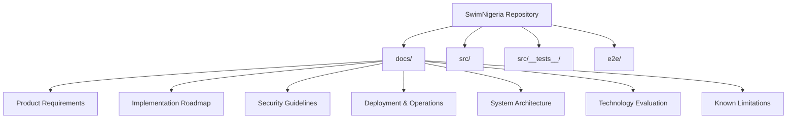
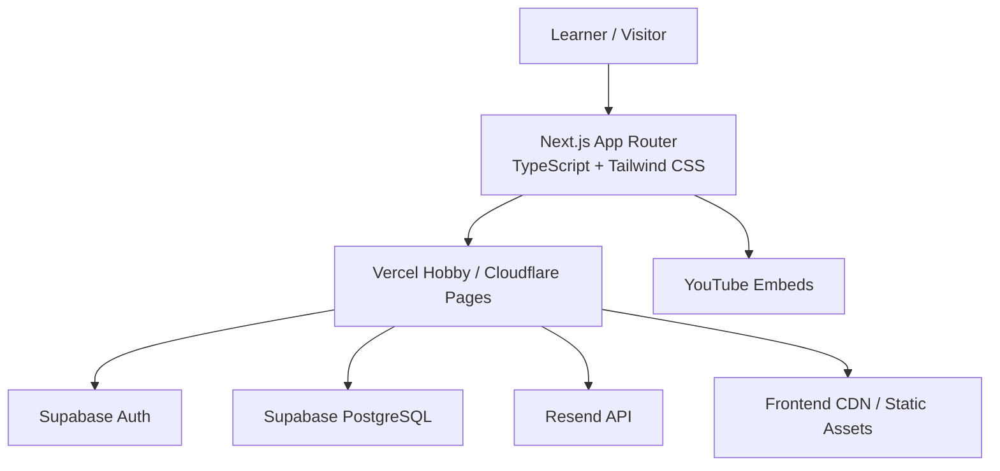
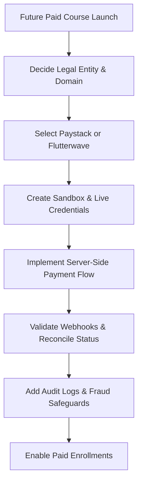
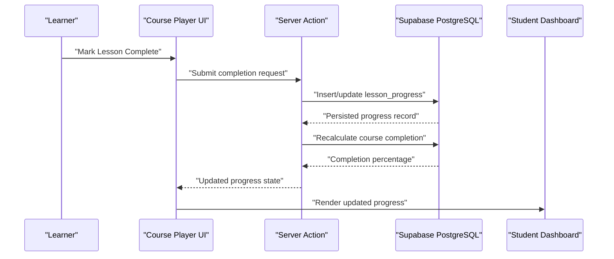
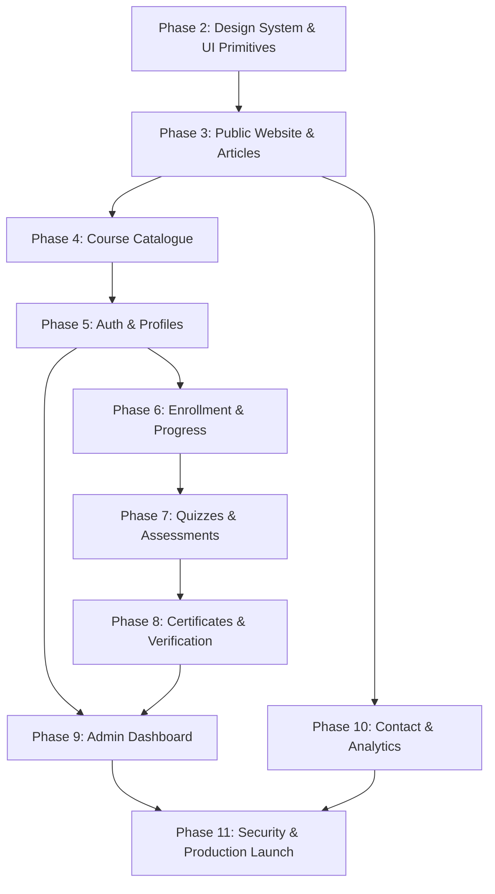
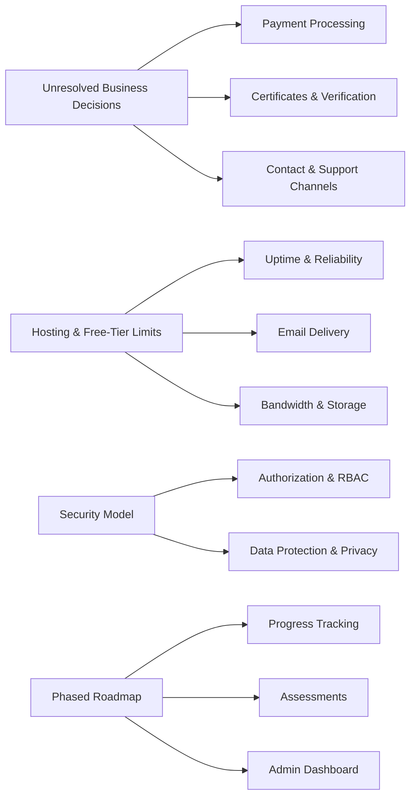

# Known Limitations & Constraints

<cite>
**Referenced Files in This Document**   
- [KNOWN_LIMITATIONS.md](file://docs/KNOWN_LIMITATIONS.md)
- [PRODUCT_REQUIREMENTS.md](file://docs/PRODUCT_REQUIREMENTS.md)
- [IMPLEMENTATION_ROADMAP.md](file://docs/IMPLEMENTATION_ROADMAP.md)
- [SECURITY.md](file://docs/SECURITY.md)
- [DEPLOYMENT_AND_OPERATIONS.md](file://docs/DEPLOYMENT_AND_OPERATIONS.md)
- [SYSTEM_ARCHITECTURE.md](file://docs/SYSTEM_ARCHITECTURE.md)
- [TECHNOLOGY_EVALUATION.md](file://docs/TECHNOLOGY_EVALUATION.md)
- [README.md](file://README.md)
</cite>

## Table of Contents
1. [Introduction](#introduction)
2. [Project Structure](#project-structure)
3. [Core Components](#core-components)
4. [Architecture Overview](#architecture-overview)
5. [Detailed Component Analysis](#detailed-component-analysis)
6. [Dependency Analysis](#dependency-analysis)
7. [Performance Considerations](#performance-considerations)
8. [Troubleshooting Guide](#troubleshooting-guide)
9. [Conclusion](#conclusion)
10. [Appendices](#appendices)

## Introduction
This document consolidates SwimNigeria’s known limitations, unresolved business requirements, unverified assumptions, and operational constraints. It is intended for stakeholders who need to understand what functionality is not yet available, and for developers who must prioritize implementation, refactoring, monitoring, and migration work.

At a high level:
- The project is currently at Phase 1 scaffolding with no live database, email delivery, payment gateway, or Google OAuth credentials configured.
- Core learner features such as enrollment, progress tracking, assessments, certificates, dashboards, admin tools, contact channels, and analytics are explicitly planned for later phases.
- Free-tier hosting, database, and email services impose real operational limits that require proactive monitoring and mitigation.
- Several foundational business decisions remain undecided and must be resolved before related features can be implemented safely.

**Section sources**
- [README.md:7-16](file://README.md#L7-L16)
- [README.md:93-101](file://README.md#L93-L101)
- [KNOWN_LIMITATIONS.md:54-60](file://docs/KNOWN_LIMITATIONS.md#L54-L60)

## Project Structure
The repository follows a Next.js App Router structure with TypeScript, Tailwind CSS, and comprehensive documentation under `docs/`. The most relevant files for this document are the product requirements, roadmap, security, deployment, architecture, technology evaluation, and the explicit known limitations register.

**Diagram sources**
- [README.md:71-90](file://README.md#L71-L90)
- [IMPLEMENTATION_ROADMAP.md:1-24](file://docs/IMPLEMENTATION_ROADMAP.md#L1-L24)

**Section sources**
- [README.md:71-90](file://README.md#L71-L90)
- [IMPLEMENTATION_ROADMAP.md:1-24](file://docs/IMPLEMENTATION_ROADMAP.md#L1-L24)

## Core Components
The following components represent the primary areas where limitations, constraints, and future work apply:

| Area | Current Status | Key Limitation | Future Target |
|---|---|---|---|
| Authentication & Profiles | Not integrated | No live Supabase Auth; temporary profile metadata stored only in auth metadata | Phase 5 |
| Course Catalogue | Planned | No course data or database schema yet | Phase 4 |
| Enrollment & Progress Tracking | Planned | No enrollment records, lesson progress, or completion engine | Phase 6 |
| Quizzes & Assessments | Planned | No assessment engine, grading, attempt logging, or pass/fail logic | Phase 7 |
| Certificates & Verification | Planned | No certificate minting, PDF generation, or public verification route | Phase 8 |
| Admin Dashboard | Planned | No admin routes, metrics, or inquiry inbox | Phase 9 |
| Contact Channels & Analytics | Planned | No Resend integration, WhatsApp number, Instagram handle, or analytics pipeline | Phase 10 |
| Payment Processing | Not started | No Paystack/Flutterwave credentials or checkout flow | Post-MVP monetization phase |

**Section sources**
- [PRODUCT_REQUIREMENTS.md:64-184](file://docs/PRODUCT_REQUIREMENTS.md#L64-L184)
- [IMPLEMENTATION_ROADMAP.md:87-153](file://docs/IMPLEMENTATION_ROADMAP.md#L87-L153)
- [KNOWN_LIMITATIONS.md:54-60](file://docs/KNOWN_LIMITATIONS.md#L54-L60)

## Architecture Overview
SwimNigeria is designed as a modern web application built on Next.js with TypeScript and Tailwind CSS. The target production architecture includes an edge-hosted frontend, Supabase PostgreSQL for data, Supabase Auth for authentication, Resend for transactional email, and YouTube for video delivery.

**Diagram sources**
- [README.md:93-101](file://README.md#L93-L101)
- [SYSTEM_ARCHITECTURE.md:142-152](file://docs/SYSTEM_ARCHITECTURE.md#L142-L152)
- [DEPLOYMENT_AND_OPERATIONS.md:52-71](file://docs/DEPLOYMENT_AND_OPERATIONS.md#L52-L71)

**Section sources**
- [README.md:93-101](file://README.md#L93-L101)
- [SYSTEM_ARCHITECTURE.md:142-152](file://docs/SYSTEM_ARCHITECTURE.md#L142-L152)
- [DEPLOYMENT_AND_OPERATIONS.md:52-71](file://docs/DEPLOYMENT_AND_OPERATIONS.md#L52-L71)

## Detailed Component Analysis

### Unresolved Business Requirements
Several foundational business decisions are still pending founder input. These directly affect legal compliance, user experience, assessment policy, support channels, and certificate authenticity.

| Requirement | Current State | Impact | Resolution Phase |
|---|---|---|---|
| Legal entity structure | Unconfirmed (Business Name, Company, or Incorporated Trustee) | Affects terms, privacy statements, and payment gateway KYC | Phase 11 |
| Official domain name | Unregistered | Required for DNS, SSL, absolute URLs, and verification links | Phase 1 |
| Assessment passing score | Provisionally assumed 75% | Controls pass/fail logic and certificate eligibility | Phase 7 |
| Assessment retake limit | Provisionally unlimited with cooldown | Affects anti-cheat rules and attempt logging | Phase 7 |
| Official support numbers | Placeholder values | Required for WhatsApp click-to-chat integration | Phase 10 |
| Certificate signatory name | Not finalized | Required for certificate template and issuer identity | Phase 8 |

These items should be treated as blockers for their respective feature phases rather than optional enhancements.

**Section sources**
- [KNOWN_LIMITATIONS.md:7-17](file://docs/KNOWN_LIMITATIONS.md#L7-L17)
- [PRODUCT_REQUIREMENTS.md:260-266](file://docs/PRODUCT_REQUIREMENTS.md#L260-L266)

### Payment Processing Gaps
Payment processing is explicitly out of scope for the current free launch but is architecturally prepared for future monetization.

Key gaps:
- No Paystack or Flutterwave credentials exist.
- No checkout flow, payment intent creation, webhook routing, or payment status reconciliation is implemented.
- The product requirements define readiness fields such as price columns and enrollment payment status/reference, but these are not yet backed by a live payment provider.

Operational implications:
- Any future paid course or coaching program cannot be launched until legal entity structure, domain, payment gateway accounts, webhook endpoints, and refund/refundability policies are defined.
- The hosting platform choice may affect commercial use terms if revenue-generating features are introduced.

Recommended migration path:
1. Finalize legal entity and brand domain.
2. Select Paystack or Flutterwave based on Nigerian merchant requirements.
3. Create sandbox and live API keys.
4. Implement server-side payment initiation, webhook validation, idempotent payment updates, and audit logging.
5. Add RLS and role checks so only authorized admins can inspect payment records.
6. Introduce rate limiting and fraud safeguards around payment-related endpoints.

**Diagram sources**
- [PRODUCT_REQUIREMENTS.md:252-257](file://docs/PRODUCT_REQUIREMENTS.md#L252-L257)
- [KNOWN_LIMITATIONS.md:59-60](file://docs/KNOWN_LIMITATIONS.md#L59-L60)
- [PROJECT_BRIEF.md:45-69](file://docs/PROJECT_BRIEF.md#L45-L69)

**Section sources**
- [PRODUCT_REQUIREMENTS.md:252-257](file://docs/PRODUCT_REQUIREMENTS.md#L252-L257)
- [KNOWN_LIMITATIONS.md:59-60](file://docs/KNOWN_LIMITATIONS.md#L59-L60)

### Progress Tracking Limitations
Progress tracking is a core learner feature but is not yet implemented. The product requirements describe expected behavior, including marking lessons complete, updating a `lesson_progress` table, recalculating completion percentage, and displaying progress on the player and dashboard.

Current constraints:
- No enrollment records exist.
- No lesson progress persistence exists.
- No completion engine or prerequisite enforcement is implemented.
- No student dashboard exists to display active courses or resume last lesson.

Workaround guidance:
- Until Phase 6, learners cannot enroll or track progress.
- Public articles and course catalogue exploration are the primary available experiences.
- Administrators cannot yet view engagement metrics because enrollment and progress tables are not populated.

Migration path:
1. Implement enrollment with idempotency protection.
2. Create lesson progress records per user and course.
3. Build server actions to mark lessons complete and recalculate completion.
4. Add prerequisites and final assessment gating.
5. Surface progress in the learner dashboard and course player.

**Diagram sources**
- [PRODUCT_REQUIREMENTS.md:115-126](file://docs/PRODUCT_REQUIREMENTS.md#L115-L126)
- [IMPLEMENTATION_ROADMAP.md:99-107](file://docs/IMPLEMENTATION_ROADMAP.md#L99-L107)

**Section sources**
- [PRODUCT_REQUIREMENTS.md:115-126](file://docs/PRODUCT_REQUIREMENTS.md#L115-L126)
- [IMPLEMENTATION_ROADMAP.md:99-107](file://docs/IMPLEMENTATION_ROADMAP.md#L99-L107)

### Content Moderation Needs
The current codebase does not include a dedicated content moderation system. While the product requirements emphasize responsible, accessible content and safety disclaimers, there is no automated moderation pipeline for user-generated content, instructor-authored materials, or contact form abuse beyond basic rate limiting.

Relevant constraints:
- Contact form submissions have rate limiting guidance, but spam filtering relies on honeypot fields and server-side IP rate limiting rather than advanced moderation APIs.
- Articles and lessons are planned as curated educational content, reducing the immediate risk of large-scale user-generated content moderation.
- Security guidelines emphasize sanitization and strict allowlists when rendering Markdown or HTML, which is essential if future content authoring is introduced.

Recommended approach:
- Treat initial content as admin-curated.
- If instructors or community contributors are added later, introduce content review workflows, profanity/toxicity filters, image moderation, and approval queues.
- Log moderation actions for auditability.
- Ensure moderation UI complies with WCAG 2.1 AA.

**Section sources**
- [PRODUCT_REQUIREMENTS.md:203-218](file://docs/PRODUCT_REQUIREMENTS.md#L203-L218)
- [SECURITY.md:82-96](file://docs/SECURITY.md#L82-L96)

### Unverified Assumptions About Users, Connectivity, and Devices
The known limitations document explicitly calls out several unverified assumptions that could materially affect learner experience in Nigeria.

Assumption categories:
- **Mobile bandwidth and latency:** Assumes sufficient bandwidth for YouTube embeds; rural or riverine areas may have 2G/3G connectivity issues.
- **Third-party video availability:** Assumes YouTube remains accessible without throttling or blocking.
- **Email deliverability:** Assumes free-tier Resend emails reach major providers without landing in spam.
- **Device compatibility:** Product requirements assume mobile-first design down to 320px screens, touch-friendly hit targets, and responsive layouts.

Mitigations already documented:
- Every video lesson should have full readable transcripts and diagrams.
- Video player interface should be abstracted to allow alternative providers.
- Email DNS records (SPF, DKIM, DMARC) must be configured correctly.
- Accessibility and performance targets are defined in the product requirements.

**Section sources**
- [KNOWN_LIMITATIONS.md:20-33](file://docs/KNOWN_LIMITATIONS.md#L20-L33)
- [PRODUCT_REQUIREMENTS.md:233-249](file://docs/PRODUCT_REQUIREMENTS.md#L233-L249)

### Technical Constraints: Hosting, Database, and Email Quotas
Free-tier services provide a low-cost starting point but introduce real operational risks.

| Service | Constraint | Operational Risk | Mitigation |
|---|---|---|---|
| Supabase | Auto-pause after 7 days of inactivity | Public site may fail with database connection errors | Scheduled ping every 48 hours; uptime monitoring |
| Supabase | 500MB database storage | Cannot store large media in rows | Use external video/image hosting |
| Vercel Hobby Tier | Personal/non-commercial use policy | Commercial revenue may violate terms | Upgrade to Pro or migrate to Cloudflare Pages |
| Resend | 100 emails/day and monthly quota | Registration spikes delay transactional emails | Monitor volume; queue non-critical notifications |

**Section sources**
- [KNOWN_LIMITATIONS.md:37-50](file://docs/KNOWN_LIMITATIONS.md#L37-L50)
- [DEPLOYMENT_AND_OPERATIONS.md:52-71](file://docs/DEPLOYMENT_AND_OPERATIONS.md#L52-L71)
- [TECHNOLOGY_EVALUATION.md:74-85](file://docs/TECHNOLOGY_EVALUATION.md#L74-L85)

### Performance Limitations With Large Datasets
Although SwimNigeria is primarily text-based education content, future admin dashboards, analytics, and learner history could grow into larger datasets.

Constraints and recommendations:
- Avoid rendering thousands of rows directly in the browser.
- Use pagination, server-side filtering, and indexed queries for admin tables.
- Aggregate metrics instead of exposing raw row-level data to the client.
- Monitor query performance via Supabase logs and database explain plans.
- For charts and analytics, aggregate or sample large datasets and provide drill-down capabilities.

**Section sources**
- [DEPLOYMENT_AND_OPERATIONS.md:87-92](file://docs/DEPLOYMENT_AND_OPERATIONS.md#L87-L92)
- [PRODUCT_REQUIREMENTS.md:188-199](file://docs/PRODUCT_REQUIREMENTS.md#L188-L199)

### Mobile Optimization Challenges
The product requirements specify mobile-first design, responsive layouts, and accessibility standards. However, real-world constraints include:
- Low-end Android devices.
- Slow 3G connections.
- Data-saver modes.
- Aggressive browser optimizations that block third-party resources.

Recommendations:
- Test on low-bandwidth network throttles.
- Keep initial JavaScript bundle small.
- Optimize images and fonts.
- Ensure video fallbacks do not break the page layout.
- Validate touch targets and keyboard navigation.

**Section sources**
- [PRODUCT_REQUIREMENTS.md:233-249](file://docs/PRODUCT_REQUIREMENTS.md#L233-L249)
- [README.md:48-62](file://README.md#L48-L62)

### Accessibility Compliance Gaps
The project targets WCAG 2.1 Level AA compliance and includes axe-core audits in testing. However, accessibility is a continuous requirement, not a one-time check.

Current status:
- Testing infrastructure includes accessibility audits.
- Design system and product requirements define contrast ratios, semantic landmarks, and keyboard navigation expectations.
- No specific failing accessibility test results are included in this document, so gaps should be identified through actual test runs and manual audits.

Action items:
- Run Playwright E2E accessibility smoke tests regularly.
- Perform manual screen reader and keyboard-only testing.
- Fix P0/P1 accessibility failures before feature release.
- Preserve accessibility when adding new components, charts, or interactive elements.

**Section sources**
- [README.md:15-16](file://README.md#L15-L16)
- [README.md:48-62](file://README.md#L48-L62)
- [PRODUCT_REQUIREMENTS.md:239-243](file://docs/PRODUCT_REQUIREMENTS.md#L239-L243)

### Workarounds for Current Limitations
Until core features are implemented, teams can use these practical workarounds:

| Limitation | Workaround |
|---|---|
| No live database or auth | Continue local development with mocks; verify registration pipeline using existing test setup |
| No email delivery | Do not claim live email capability; configure Resend only after credentials and DNS records are ready |
| No payment processing | Keep all courses free; defer monetization until legal and technical prerequisites are met |
| No progress tracking | Use static course catalogue and articles as the primary learning experience |
| No admin dashboard | Manage operations manually through Supabase dashboard and spreadsheets during early phases |
| No certificate generation | Do not issue credentials until Phase 8 is implemented and verified |
| Free-tier Supabase pause risk | Implement scheduled health checks and monitor uptime alerts |

**Section sources**
- [KNOWN_LIMITATIONS.md:37-60](file://docs/KNOWN_LIMITATIONS.md#L37-L60)
- [DEPLOYMENT_AND_OPERATIONS.md:55-71](file://docs/DEPLOYMENT_AND_OPERATIONS.md#L55-L71)

### Migration Paths for Future Improvements
The roadmap provides a clear dependency-aware sequence. Teams should not implement future phases out of order.

High-level migration path:
1. Finish Phase 2: Design system and core UI primitives.
2. Build Phase 3: Public website and educational articles.
3. Build Phase 4: Course catalogue and syllabus views.
4. Build Phase 5: Authentication, RBAC, and learner profiles.
5. Build Phase 6: Enrollment, lesson player, and progress tracking.
6. Build Phase 7: Quizzes and assessment engine.
7. Build Phase 8: Certificates and verification portal.
8. Build Phase 9: Admin dashboard and inquiries inbox.
9. Build Phase 10: Contact channels and basic analytics.
10. Execute Phase 11: Security hardening, E2E audit, and production launch.

**Diagram sources**
- [IMPLEMENTATION_ROADMAP.md:8-24](file://docs/IMPLEMENTATION_ROADMAP.md#L8-L24)
- [IMPLEMENTATION_ROADMAP.md:54-166](file://docs/IMPLEMENTATION_ROADMAP.md#L54-L166)

**Section sources**
- [IMPLEMENTATION_ROADMAP.md:8-24](file://docs/IMPLEMENTATION_ROADMAP.md#L8-L24)
- [IMPLEMENTATION_ROADMAP.md:54-166](file://docs/IMPLEMENTATION_ROADMAP.md#L54-L166)

### Monitoring Strategies to Identify When Limitations Become Critical
Monitoring should focus on service quotas, uptime, error rates, and user-facing failures.

Critical monitoring areas:
- Supabase project pause events and database connection failures.
- Resend email delivery success and failure rates.
- Rate limit hits on contact forms, authentication, and public verification endpoints.
- Lighthouse performance and accessibility scores in CI and production.
- Bundle size growth and slow serverless function execution times.

Recommended operational practices:
- Configure uptime monitoring for the production URL.
- Alert on Supabase log errors and failed scheduled pings.
- Track email send success vs. bounce/spam complaints.
- Include automated accessibility smoke tests in CI.
- Review serverless function durations and database query performance regularly.

**Section sources**
- [DEPLOYMENT_AND_OPERATIONS.md:87-98](file://docs/DEPLOYMENT_AND_OPERATIONS.md#L87-L98)
- [SECURITY.md:136-139](file://docs/SECURITY.md#L136-L139)
- [README.md:48-62](file://README.md#L48-L62)

## Dependency Analysis
The limitations in this document are tightly coupled across product planning, hosting constraints, security posture, and phased implementation.

**Diagram sources**
- [KNOWN_LIMITATIONS.md:7-60](file://docs/KNOWN_LIMITATIONS.md#L7-L60)
- [PRODUCT_REQUIREMENTS.md:252-266](file://docs/PRODUCT_REQUIREMENTS.md#L252-L266)
- [IMPLEMENTATION_ROADMAP.md:8-24](file://docs/IMPLEMENTATION_ROADMAP.md#L8-L24)
- [SECURITY.md:1-25](file://docs/SECURITY.md#L1-L25)

**Section sources**
- [KNOWN_LIMITATIONS.md:7-60](file://docs/KNOWN_LIMITATIONS.md#L7-L60)
- [PRODUCT_REQUIREMENTS.md:252-266](file://docs/PRODUCT_REQUIREMENTS.md#L252-L266)
- [IMPLEMENTATION_ROADMAP.md:8-24](file://docs/IMPLEMENTATION_ROADMAP.md#L8-L24)
- [SECURITY.md:1-25](file://docs/SECURITY.md#L1-L25)

## Performance Considerations
Performance constraints are both architectural and operational:
- Initial JavaScript bundle size should remain small.
- Images and fonts must be optimized.
- Video content should be offloaded to YouTube or another external provider.
- Serverless functions must complete quickly, ideally under 500ms.
- Large datasets should be paginated and aggregated.
- Real-user performance should be validated on low-end devices and slow networks.

No specific performance regression data is present in this repository snapshot, so ongoing measurement is required before scaling.

[No sources needed since this section provides general guidance]

## Troubleshooting Guide
Common operational issues and recommended responses:

| Symptom | Likely Cause | Recommended Response |
|---|---|---|
| Database connection errors in production | Supabase free tier paused due to inactivity | Check uptime monitors; run scheduled ping; unpause via Supabase dashboard |
| Transactional emails not delivered | Missing Resend API key or incorrect DNS records | Verify environment variables; configure SPF/DKIM/DMARC; test across providers |
| Payment flows fail | No gateway credentials or webhook configuration | Stand up sandbox credentials; validate webhook signatures; add audit logs |
| Admin dashboard loads slowly | Large dataset rendered client-side | Add pagination, server-side filtering, and indexes |
| Accessibility tests fail | Missing labels, contrast issues, or keyboard navigation problems | Fix P0/P1 issues; re-run axe-core and manual audits |
| Site becomes unavailable after deployment | Broken build or missing secrets | Roll back to previous successful deployment; inspect CI logs |

**Section sources**
- [DEPLOYMENT_AND_OPERATIONS.md:55-71](file://docs/DEPLOYMENT_AND_OPERATIONS.md#L55-L71)
- [DEPLOYMENT_AND_OPERATIONS.md:93-98](file://docs/DEPLOYMENT_AND_OPERATIONS.md#L93-L98)
- [SECURITY.md:136-139](file://docs/SECURITY.md#L136-L139)

## Conclusion
SwimNigeria has a strong engineering foundation but is intentionally early in its lifecycle. The most important limitations right now are:
- No live backend integrations for authentication, database, email, payments, or social login.
- No learner progress tracking, assessments, certificates, admin dashboard, or analytics.
- Free-tier hosting and service quotas that require monitoring and proactive mitigation.
- Several foundational business decisions that must be resolved before related features can be safely implemented.

Stakeholders should treat the current state as scaffolding and planning, not as a production-ready learner platform. Developers should prioritize completing the phased roadmap while continuously validating accessibility, performance, security, and operational reliability.

[No sources needed since this section summarizes without analyzing specific files]

## Appendices

### Stakeholder Checklist
- Confirm legal entity structure and official domain.
- Decide assessment passing score and retake policy.
- Provide official support phone number and social handles.
- Approve certificate signatory and disclaimer language.
- Decide whether future monetization requires Vercel Pro or Cloudflare Pages.
- Establish monitoring and alerting for Supabase, Resend, and production uptime.

**Section sources**
- [KNOWN_LIMITATIONS.md:7-17](file://docs/KNOWN_LIMITATIONS.md#L7-L17)
- [TECHNOLOGY_EVALUATION.md:74-85](file://docs/TECHNOLOGY_EVALUATION.md#L74-L85)

### Developer Checklist
- Do not implement future phases out of order.
- Keep all authorization and grading server-side.
- Never trust client-side role claims or tokens.
- Validate all inputs with strict schemas.
- Protect service role keys and avoid bundling secrets.
- Test mobile responsiveness, accessibility, and low-bandwidth scenarios.
- Prepare migration paths for payments, certificates, and admin operations.

**Section sources**
- [SECURITY.md:1-25](file://docs/SECURITY.md#L1-L25)
- [SECURITY.md:43-79](file://docs/SECURITY.md#L43-L79)
- [IMPLEMENTATION_ROADMAP.md:8-24](file://docs/IMPLEMENTATION_ROADMAP.md#L8-L24)