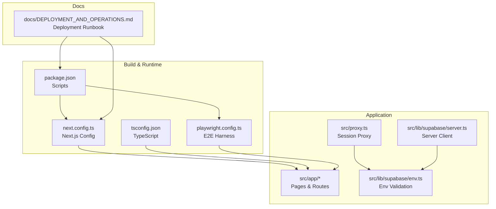
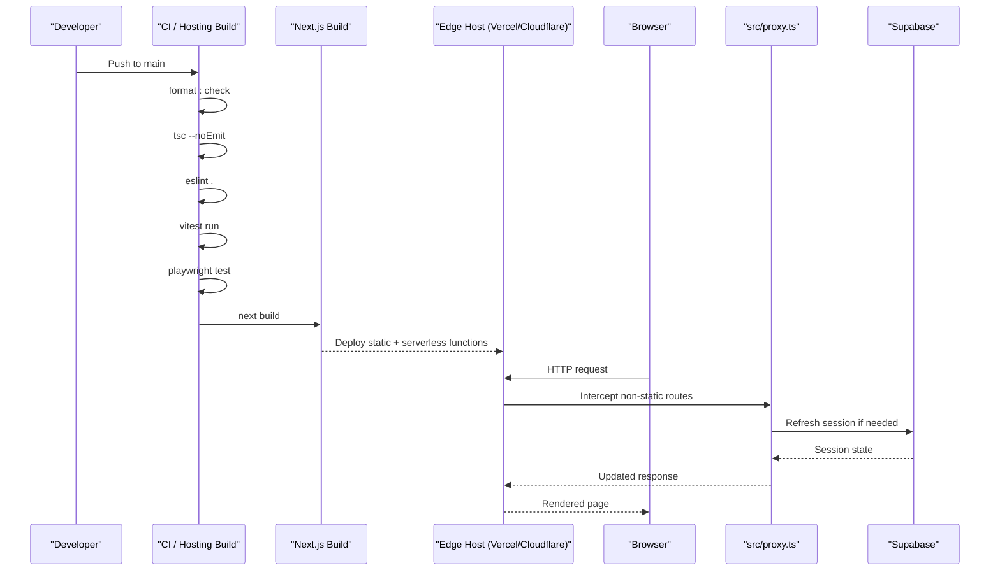
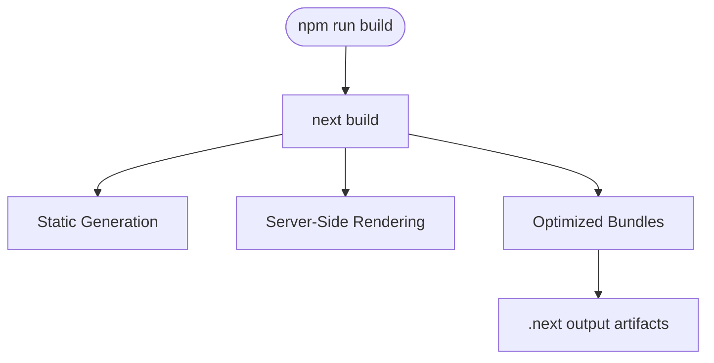
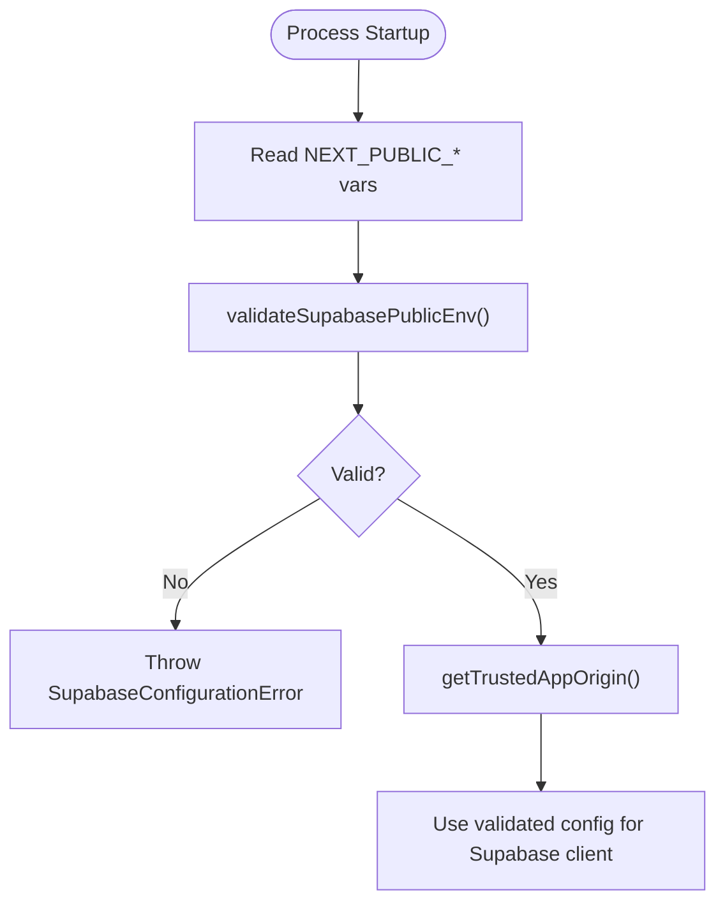
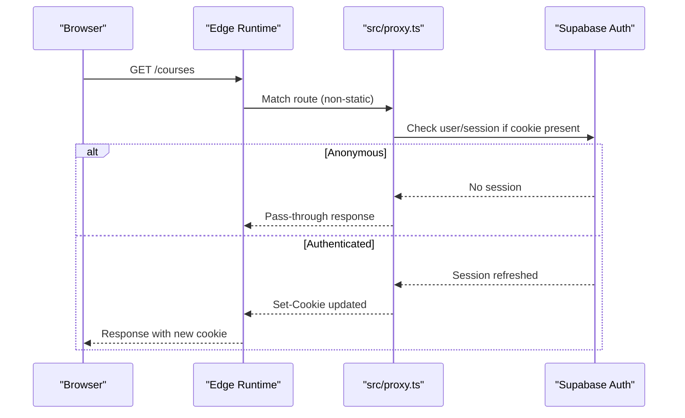
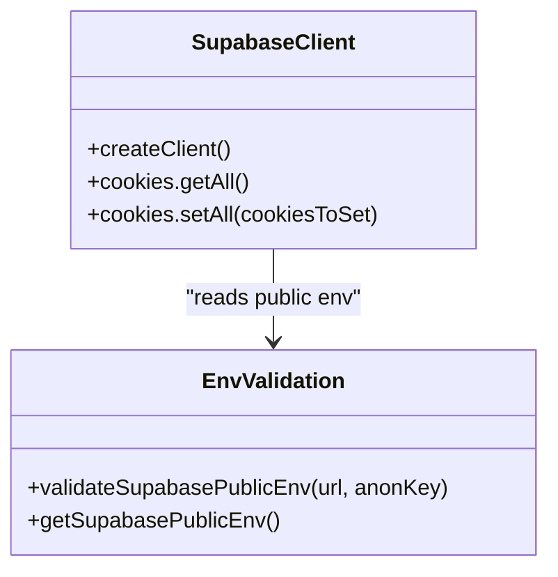
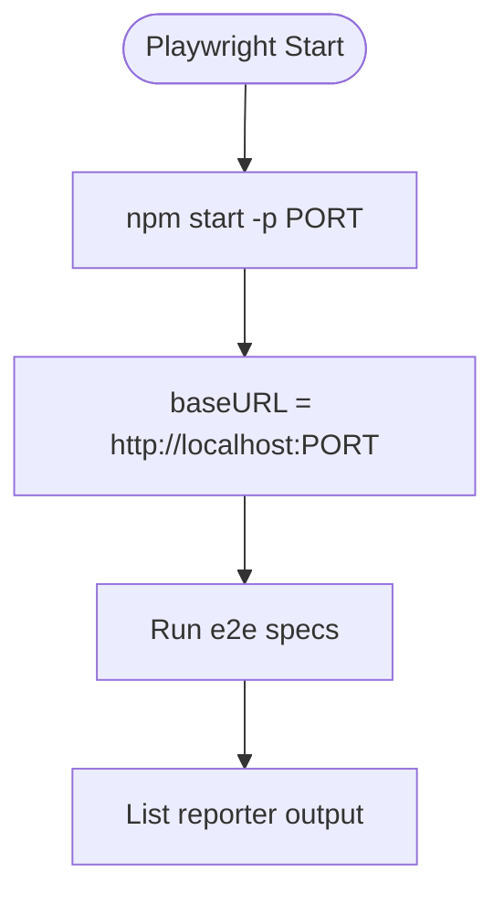
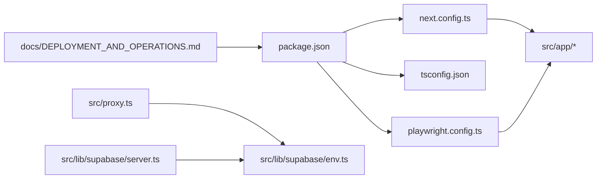

# Build & Deployment Process

<cite>
**Referenced Files in This Document**
- [package.json](file://package.json)
- [next.config.ts](file://next.config.ts)
- [tsconfig.json](file://tsconfig.json)
- [playwright.config.ts](file://playwright.config.ts)
- [src/proxy.ts](file://src/proxy.ts)
- [src/lib/supabase/env.ts](file://src/lib/supabase/env.ts)
- [src/lib/supabase/server.ts](file://src/lib/supabase/server.ts)
- [docs/DEPLOYMENT_AND_OPERATIONS.md](file://docs/DEPLOYMENT_AND_OPERATIONS.md)
</cite>

## Table of Contents
1. [Introduction](#introduction)
2. [Project Structure](#project-structure)
3. [Core Components](#core-components)
4. [Architecture Overview](#architecture-overview)
5. [Detailed Component Analysis](#detailed-component-analysis)
6. [Dependency Analysis](#dependency-analysis)
7. [Performance Considerations](#performance-considerations)
8. [Troubleshooting Guide](#troubleshooting-guide)
9. [Conclusion](#conclusion)
10. [Appendices](#appendices)

## Introduction
This document explains the SwimNigeria build and deployment process for a Next.js application targeting Vercel Hobby and Cloudflare Pages. It covers production build configuration, environment variable management, hosting-specific constraints, free-tier limitations, scaling considerations, step-by-step deployment procedures, post-deployment verification, common issues, troubleshooting, rollback strategies, and examples of scripts and configuration files.

## Project Structure
SwimNigeria is a Next.js 16 application using TypeScript, Tailwind CSS, Supabase for authentication and data, and Playwright for end-to-end testing. The repository includes:
- Application source under src/app with App Router pages and route handlers.
- Shared libraries under src/lib for Supabase client setup and environment validation.
- A request interception proxy under src/proxy.ts for session synchronization.
- Configuration files for Next.js, TypeScript, PostCSS, ESLint, Prettier, Vitest, and Playwright.
- Documentation including deployment and operations guidance.

**Diagram sources**
- [package.json:6-16](file://package.json#L6-L16)
- [next.config.ts:3-6](file://next.config.ts#L3-L6)
- [tsconfig.json:2-25](file://tsconfig.json#L2-L25)
- [playwright.config.ts:6-31](file://playwright.config.ts#L6-L31)
- [src/proxy.ts:16-32](file://src/proxy.ts#L16-L32)
- [src/lib/supabase/env.ts:49-106](file://src/lib/supabase/env.ts#L49-L106)
- [src/lib/supabase/server.ts:26-60](file://src/lib/supabase/server.ts#L26-L60)
- [docs/DEPLOYMENT_AND_OPERATIONS.md:34-48](file://docs/DEPLOYMENT_AND_OPERATIONS.md#L34-L48)

**Section sources**
- [package.json:6-16](file://package.json#L6-L16)
- [next.config.ts:3-6](file://next.config.ts#L3-L6)
- [tsconfig.json:2-25](file://tsconfig.json#L2-L25)
- [playwright.config.ts:6-31](file://playwright.config.ts#L6-L31)
- [src/proxy.ts:16-32](file://src/proxy.ts#L16-L32)
- [src/lib/supabase/env.ts:49-106](file://src/lib/supabase/env.ts#L49-L106)
- [src/lib/supabase/server.ts:26-60](file://src/lib/supabase/server.ts#L26-L60)
- [docs/DEPLOYMENT_AND_OPERATIONS.md:34-48](file://docs/DEPLOYMENT_AND_OPERATIONS.md#L34-L48)

## Core Components
- Next.js Production Build:
  - Triggered by npm script next build.
  - Uses React Strict Mode and configured allowed development origins.
- Environment Management:
  - Public variables are validated at runtime to prevent placeholder or malformed values from reaching the browser.
  - Server-only secrets are documented and must be set in the hosting provider’s secret store.
- Request Interception Proxy:
  - Synchronizes Supabase session cookies on requests matching application routes while excluding static assets.
- E2E Testing Harness:
  - Starts the production server via npm start and runs Playwright tests against it.

**Section sources**
- [package.json:6-16](file://package.json#L6-L16)
- [next.config.ts:3-6](file://next.config.ts#L3-L6)
- [src/lib/supabase/env.ts:49-106](file://src/lib/supabase/env.ts#L49-L106)
- [src/proxy.ts:16-32](file://src/proxy.ts#L16-L32)
- [playwright.config.ts:23-31](file://playwright.config.ts#L23-L31)

## Architecture Overview
The deployment pipeline validates code quality, runs tests, builds the app, and deploys to an edge platform. At runtime, the proxy refreshes sessions for authenticated users, while Supabase clients read public environment variables and use server-only keys only on the server.

**Diagram sources**
- [docs/DEPLOYMENT_AND_OPERATIONS.md:34-48](file://docs/DEPLOYMENT_AND_OPERATIONS.md#L34-L48)
- [package.json:6-16](file://package.json#L6-L16)
- [src/proxy.ts:16-32](file://src/proxy.ts#L16-L32)

## Detailed Component Analysis

### Next.js Production Build Configuration
- Build command: npm run build invokes next build.
- React Strict Mode enabled.
- Allowed dev origins configured for local development.
- TypeScript target ES2022 with bundler module resolution and path aliases.

**Diagram sources**
- [package.json:6-16](file://package.json#L6-L16)
- [next.config.ts:3-6](file://next.config.ts#L3-L6)
- [tsconfig.json:2-25](file://tsconfig.json#L2-L25)

**Section sources**
- [package.json:6-16](file://package.json#L6-L16)
- [next.config.ts:3-6](file://next.config.ts#L3-L6)
- [tsconfig.json:2-25](file://tsconfig.json#L2-L25)

### Environment Variable Management
- Public variables include site URL, name, Supabase URL and anon key, WhatsApp number, and Instagram handle.
- Server-only secrets include Supabase service role key, Resend API key, and contact recipient email.
- Runtime validation ensures missing or placeholder values fail fast with actionable errors.
- Trusted origin resolution prioritizes configured app URL, then request origin, then localhost fallback.

**Diagram sources**
- [src/lib/supabase/env.ts:49-106](file://src/lib/supabase/env.ts#L49-L106)
- [src/lib/supabase/env.ts:116-117](file://src/lib/supabase/env.ts#L116-L117)
- [docs/DEPLOYMENT_AND_OPERATIONS.md:10-31](file://docs/DEPLOYMENT_AND_OPERATIONS.md#L10-L31)

**Section sources**
- [docs/DEPLOYMENT_AND_OPERATIONS.md:10-31](file://docs/DEPLOYMENT_AND_OPERATIONS.md#L10-L31)
- [src/lib/supabase/env.ts:49-106](file://src/lib/supabase/env.ts#L49-L106)
- [src/lib/supabase/env.ts:116-117](file://src/lib/supabase/env.ts#L116-L117)

### Request Interception Proxy and Session Sync
- The proxy intercepts application routes and delegates to updateSession to refresh Supabase auth cookies.
- Static assets and common file extensions are excluded from interception.
- Tests verify anonymous fast-path behavior, cookie synchronization, and error resilience without redirect loops.

**Diagram sources**
- [src/proxy.ts:16-32](file://src/proxy.ts#L16-L32)
- [src/__tests__/supabase-proxy.test.ts:35-105](file://src/__tests__/supabase-proxy.test.ts#L35-L105)

**Section sources**
- [src/proxy.ts:16-32](file://src/proxy.ts#L16-L32)
- [src/__tests__/supabase-proxy.test.ts:35-105](file://src/__tests__/supabase-proxy.test.ts#L35-L105)

### Supabase Client Setup
- Server-side client creation reads validated public env and integrates with Next.js cookie store.
- Handles expected readonly cookie errors in Server Components gracefully.

**Diagram sources**
- [src/lib/supabase/server.ts:26-60](file://src/lib/supabase/server.ts#L26-L60)
- [src/lib/supabase/env.ts:49-106](file://src/lib/supabase/env.ts#L49-L106)

**Section sources**
- [src/lib/supabase/server.ts:26-60](file://src/lib/supabase/server.ts#L26-L60)
- [src/lib/supabase/env.ts:49-106](file://src/lib/supabase/env.ts#L49-L106)

### End-to-End Test Harness
- Playwright starts the production server using npm start on a configurable port.
- CI mode enables retries and single worker execution.
- Sets ENABLE_TEST_HARNESS for test-specific behavior.

**Diagram sources**
- [playwright.config.ts:3-31](file://playwright.config.ts#L3-L31)

**Section sources**
- [playwright.config.ts:3-31](file://playwright.config.ts#L3-L31)

## Dependency Analysis
- package.json defines build, lint, typecheck, test, and E2E scripts used by CI and hosting providers.
- next.config.ts sets runtime behavior for development origins and strict mode.
- tsconfig.json configures TypeScript compilation targets and Next.js plugin integration.
- src/proxy.ts depends on Supabase session utilities and excludes static assets.
- docs/DEPLOYMENT_AND_OPERATIONS.md documents environment strategy, build pipeline, hosting constraints, and rollback procedures.

**Diagram sources**
- [package.json:6-16](file://package.json#L6-L16)
- [next.config.ts:3-6](file://next.config.ts#L3-L6)
- [tsconfig.json:2-25](file://tsconfig.json#L2-L25)
- [playwright.config.ts:6-31](file://playwright.config.ts#L6-L31)
- [src/proxy.ts:16-32](file://src/proxy.ts#L16-L32)
- [src/lib/supabase/env.ts:49-106](file://src/lib/supabase/env.ts#L49-L106)
- [src/lib/supabase/server.ts:26-60](file://src/lib/supabase/server.ts#L26-L60)
- [docs/DEPLOYMENT_AND_OPERATIONS.md:34-48](file://docs/DEPLOYMENT_AND_OPERATIONS.md#L34-L48)

**Section sources**
- [package.json:6-16](file://package.json#L6-L16)
- [next.config.ts:3-6](file://next.config.ts#L3-L6)
- [tsconfig.json:2-25](file://tsconfig.json#L2-L25)
- [playwright.config.ts:6-31](file://playwright.config.ts#L6-L31)
- [src/proxy.ts:16-32](file://src/proxy.ts#L16-L32)
- [src/lib/supabase/env.ts:49-106](file://src/lib/supabase/env.ts#L49-L106)
- [src/lib/supabase/server.ts:26-60](file://src/lib/supabase/server.ts#L26-L60)
- [docs/DEPLOYMENT_AND_OPERATIONS.md:34-48](file://docs/DEPLOYMENT_AND_OPERATIONS.md#L34-L48)

## Performance Considerations
- Asset Optimization:
  - Prefer static generation where possible; avoid heavy client bundles.
  - Offload large media (e.g., videos) to external platforms to reduce bandwidth.
- Serverless Constraints:
  - Keep server actions under function duration limits; optimize to sub-500ms where feasible.
- Free-Tier Limits:
  - Database storage and MAU quotas apply; monitor auto-pause policies.
  - Email delivery quotas require rate limiting and deferring bulk mailings.

[No sources needed since this section provides general guidance]

## Troubleshooting Guide
Common deployment issues and resolutions:
- Missing or placeholder environment variables:
  - Symptom: Runtime errors indicating missing or placeholder values for Supabase URL or anon key.
  - Resolution: Configure NEXT_PUBLIC_SUPABASE_URL and NEXT_PUBLIC_SUPABASE_ANON_KEY in the hosting provider’s environment settings.
- Build failures due to type or lint errors:
  - Symptom: CI aborts before deployment.
  - Resolution: Fix type errors (tsc --noEmit), resolve lint violations (eslint .), and re-run tests.
- Session sync problems:
  - Symptom: Authenticated users not recognized or cookies not refreshed.
  - Resolution: Ensure proxy matcher does not exclude required routes and that Supabase public env is valid.
- Hosting free-tier pauses:
  - Symptom: Database becomes inactive and pauses.
  - Resolution: Follow operational mitigation and monitoring guidance; manually unpause if necessary.

Operational references:
- Build and pre-deployment verification pipeline steps.
- Rollback procedure via hosting provider console.
- Domain and SSL configuration notes.

**Section sources**
- [docs/DEPLOYMENT_AND_OPERATIONS.md:34-48](file://docs/DEPLOYMENT_AND_OPERATIONS.md#L34-L48)
- [docs/DEPLOYMENT_AND_OPERATIONS.md:93-108](file://docs/DEPLOYMENT_AND_OPERATIONS.md#L93-L108)
- [src/lib/supabase/env.ts:49-106](file://src/lib/supabase/env.ts#L49-L106)
- [src/proxy.ts:16-32](file://src/proxy.ts#L16-L32)

## Conclusion
SwimNigeria uses a robust, test-gated build pipeline and secure environment validation to deploy safely to Vercel Hobby and Cloudflare Pages. By adhering to the documented environment strategy, respecting free-tier constraints, and following the rollback runbook, teams can maintain reliable, scalable deployments with minimal operational overhead.

[No sources needed since this section summarizes without analyzing specific files]

## Appendices

### Step-by-Step Deployment Procedures

- Local Environment Setup:
  - Install dependencies and run development server.
  - Configure local environment variables for Supabase and other services.
  - Run type checks, linters, unit tests, and E2E tests locally.

- Pre-Deployment Checks:
  - Format check, type check, linting, unit tests, E2E tests, and production build.

- Hosting Provider Setup:
  - Connect repository to Vercel or Cloudflare Pages.
  - Configure environment variables in the provider dashboard.
  - Set domain and enable HTTPS.

- Post-Deployment Verification:
  - Verify homepage loads and navigation works.
  - Confirm Supabase connectivity and authentication flows.
  - Run smoke tests via Playwright against the deployed URL.

**Section sources**
- [package.json:6-16](file://package.json#L6-L16)
- [playwright.config.ts:23-31](file://playwright.config.ts#L23-L31)
- [docs/DEPLOYMENT_AND_OPERATIONS.md:34-48](file://docs/DEPLOYMENT_AND_OPERATIONS.md#L34-L48)
- [docs/DEPLOYMENT_AND_OPERATIONS.md:102-108](file://docs/DEPLOYMENT_AND_OPERATIONS.md#L102-L108)

### Environment Setup Checklist

- Public Variables:
  - NEXT_PUBLIC_APP_URL
  - NEXT_PUBLIC_SITE_NAME
  - NEXT_PUBLIC_SUPABASE_URL
  - NEXT_PUBLIC_SUPABASE_ANON_KEY
  - NEXT_PUBLIC_WHATSAPP_NUMBER
  - NEXT_PUBLIC_INSTAGRAM_HANDLE

- Server-Only Secrets:
  - SUPABASE_SERVICE_ROLE_KEY
  - RESEND_API_KEY
  - CONTACT_RECIPIENT_EMAIL

- Operational Notes:
  - Never commit secrets.
  - Rotate exposed secrets immediately.
  - Monitor free-tier quotas and pause policies.

**Section sources**
- [docs/DEPLOYMENT_AND_OPERATIONS.md:10-31](file://docs/DEPLOYMENT_AND_OPERATIONS.md#L10-L31)

### Rollback Strategy

- Identify previous successful deployment in hosting provider console.
- Perform instant rollback to shift traffic to prior immutable build.
- Investigate failure locally, prepare patch, verify, and redeploy.

**Section sources**
- [docs/DEPLOYMENT_AND_OPERATIONS.md:93-98](file://docs/DEPLOYMENT_AND_OPERATIONS.md#L93-L98)