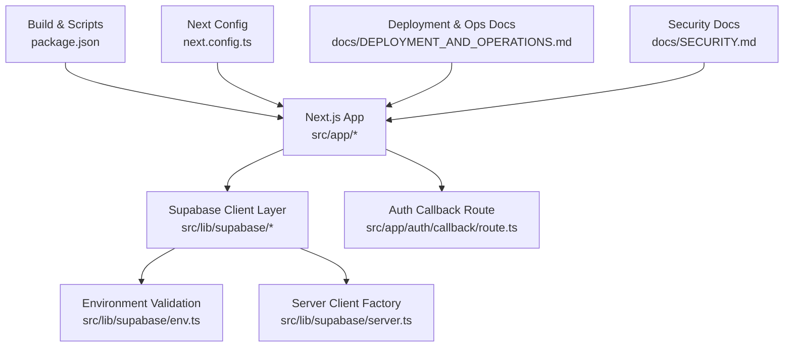
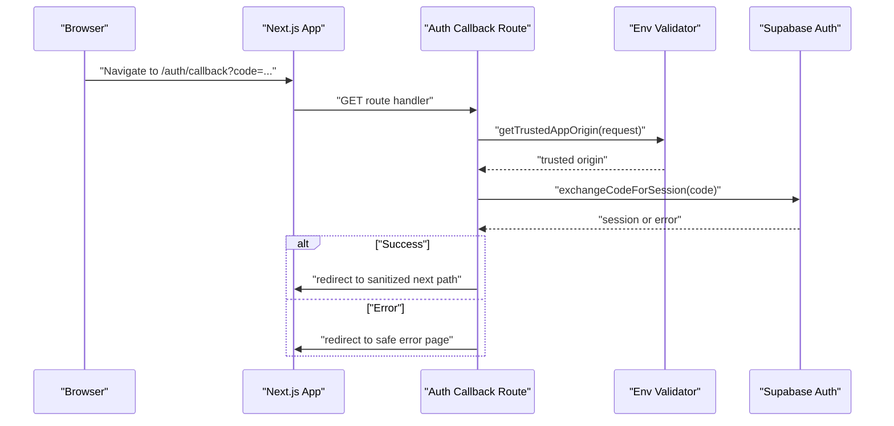
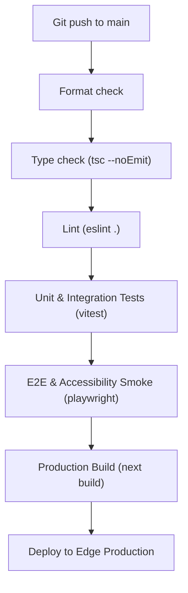
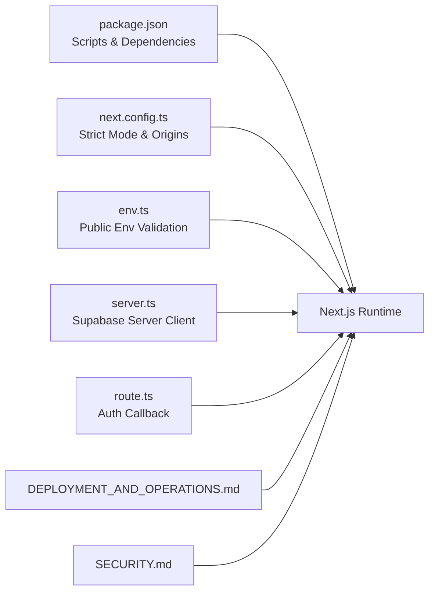

# Deployment & Operations

<cite>
**Referenced Files in This Document**
- [package.json](file://package.json)
- [next.config.ts](file://next.config.ts)
- [DEPLOYMENT_AND_OPERATIONS.md](file://docs/DEPLOYMENT_AND_OPERATIONS.md)
- [SECURITY.md](file://docs/SECURITY.md)
- [route.ts](file://src/app/auth/callback/route.ts)
- [env.ts](file://src/lib/supabase/env.ts)
- [server.ts](file://src/lib/supabase/server.ts)
- [.gitignore](file://.gitignore)
</cite>

## Table of Contents
1. [Introduction](#introduction)
2. [Project Structure](#project-structure)
3. [Core Components](#core-components)
4. [Architecture Overview](#architecture-overview)
5. [Detailed Component Analysis](#detailed-component-analysis)
6. [Dependency Analysis](#dependency-analysis)
7. [Performance Considerations](#performance-considerations)
8. [Troubleshooting Guide](#troubleshooting-guide)
9. [Conclusion](#conclusion)

## Introduction
This document provides production-ready deployment and operations guidance for SwimNigeria, a Next.js application backed by Supabase. It covers build processes, environment configuration, hosting options, security practices, monitoring, backups, disaster recovery, deployment pipelines, rollback procedures, performance monitoring, operational quotas, cost optimization, maintenance tasks, and troubleshooting.

## Project Structure
SwimNigeria is a Next.js project with:
- Application routes under `src/app`.
- Shared libraries under `src/lib`, including Supabase client configuration and environment validation.
- Documentation under `docs` covering deployment, operations, and security.
- Build and test scripts defined in the package manifest.

**Diagram sources**
- [package.json:6-16](file://package.json#L6-L16)
- [next.config.ts:3-6](file://next.config.ts#L3-L6)
- [env.ts:1-143](file://src/lib/supabase/env.ts#L1-L143)
- [server.ts:1-60](file://src/lib/supabase/server.ts#L1-L60)
- [route.ts:1-61](file://src/app/auth/callback/route.ts#L1-L61)
- [DEPLOYMENT_AND_OPERATIONS.md:1-108](file://docs/DEPLOYMENT_AND_OPERATIONS.md#L1-L108)
- [SECURITY.md:1-155](file://docs/SECURITY.md#L1-L155)

**Section sources**
- [package.json:6-16](file://package.json#L6-L16)
- [next.config.ts:3-6](file://next.config.ts#L3-L6)
- [DEPLOYMENT_AND_OPERATIONS.md:1-108](file://docs/DEPLOYMENT_AND_OPERATIONS.md#L1-L108)
- [SECURITY.md:1-155](file://docs/SECURITY.md#L1-L155)

## Core Components
- Build system: Next.js with standard scripts for development, building, linting, type checking, testing, and end-to-end tests.
- Environment configuration: Strict validation of public Supabase variables and trusted origin resolution.
- Server-side client factory: Secure cookie handling for Supabase sessions across Server Components, Server Actions, and Route Handlers.
- Authentication callback: PKCE-based session exchange with safe redirect handling.
- Operational documentation: Hosting constraints, backup strategy, logging, monitoring, and rollback runbooks.
- Security architecture: Zero-trust model, RBAC, RLS, anti-cheating assessment design, certificate verification security, rate limiting, and NDPR compliance.

**Section sources**
- [package.json:6-16](file://package.json#L6-L16)
- [env.ts:1-143](file://src/lib/supabase/env.ts#L1-L143)
- [server.ts:1-60](file://src/lib/supabase/server.ts#L1-L60)
- [route.ts:1-61](file://src/app/auth/callback/route.ts#L1-L61)
- [DEPLOYMENT_AND_OPERATIONS.md:1-108](file://docs/DEPLOYMENT_AND_OPERATIONS.md#L1-L108)
- [SECURITY.md:1-155](file://docs/SECURITY.md#L1-L155)

## Architecture Overview
The runtime flow emphasizes secure authentication, strict environment validation, and server-side authorization.

**Diagram sources**
- [route.ts:24-59](file://src/app/auth/callback/route.ts#L24-L59)
- [env.ts:116-142](file://src/lib/supabase/env.ts#L116-L142)

## Detailed Component Analysis

### Build Process and Pre-Deployment Pipeline
- Development and production builds are driven by Next.js scripts.
- Recommended CI pipeline stages include format checks, type checks, linting, unit/integration tests, e2e smoke tests, and final Next.js build before deployment.

**Diagram sources**
- [DEPLOYMENT_AND_OPERATIONS.md:34-48](file://docs/DEPLOYMENT_AND_OPERATIONS.md#L34-L48)
- [package.json:6-16](file://package.json#L6-L16)

**Section sources**
- [package.json:6-16](file://package.json#L6-L16)
- [DEPLOYMENT_AND_OPERATIONS.md:34-48](file://docs/DEPLOYMENT_AND_OPERATIONS.md#L34-L48)

### Environment Configuration Management
- Public Supabase configuration is validated at startup to prevent placeholder values and malformed URLs.
- Trusted application origin resolution prioritizes configured app URL, then request origin, then local fallback.
- Secrets must never be committed; `.gitignore` enforces exclusion of `.env*` files and certificates.

Key responsibilities:
- Validate `NEXT_PUBLIC_SUPABASE_URL` and `NEXT_PUBLIC_SUPABASE_ANON_KEY`.
- Detect placeholder strings from templates.
- Resolve trusted origins for redirects and callbacks.
- Provide actionable errors without exposing secrets.

Operational directives:
- Configure all required variables in the hosting provider’s environment settings.
- Rotate any exposed secret immediately in the respective provider console.
- Use scoped anonymous keys for browser access; keep service role keys strictly server-only.

**Section sources**
- [env.ts:1-143](file://src/lib/supabase/env.ts#L1-L143)
- [.gitignore:21-32](file://.gitignore#L21-L32)
- [DEPLOYMENT_AND_OPERATIONS.md:10-31](file://docs/DEPLOYMENT_AND_OPERATIONS.md#L10-L31)

### Secret Rotation Procedures
- If a credential is exposed, rotate it immediately in the corresponding provider console (Supabase, Resend, Vercel).
- Update production environment variables and redeploy.
- Ensure no secret appears in logs, redirects, or client bundles.

**Section sources**
- [DEPLOYMENT_AND_OPERATIONS.md:27-31](file://docs/DEPLOYMENT_AND_OPERATIONS.md#L27-L31)
- [SECURITY.md:150-155](file://docs/SECURITY.md#L150-L155)

### Hosting Options and Free-Tier Limitations
- Supabase free tier: database size limit, MAU limits, auto-pause policy, bandwidth egress limits.
- Hosting platforms: Vercel Hobby vs Cloudflare Pages commercial-free considerations.
- Email delivery: Resend free-tier quotas and mitigation strategies.

Operational notes:
- Monitor database activity to avoid auto-pause on Supabase free tier.
- Prefer Cloudflare Pages if commercial usage applies to avoid fair-use constraints.
- Rate-limit contact submissions and reserve transactional email channels for critical notifications.

**Section sources**
- [DEPLOYMENT_AND_OPERATIONS.md:52-71](file://docs/DEPLOYMENT_AND_OPERATIONS.md#L52-L71)

### Session Security and Authentication Flow
- PKCE-based authentication flow via Supabase Auth.
- Secure cookie handling using `@supabase/ssr` with HttpOnly, Secure, SameSite attributes.
- Safe redirect sanitization and trusted origin enforcement.

Implementation highlights:
- Exchange authorization code for session securely.
- Sanitize redirect targets against trusted origins.
- Handle recovery flows and error cases gracefully.

**Section sources**
- [route.ts:1-61](file://src/app/auth/callback/route.ts#L1-L61)
- [server.ts:1-60](file://src/lib/supabase/server.ts#L1-L60)
- [SECURITY.md:29-40](file://docs/SECURITY.md#L29-L40)

### Server-Side RBAC and Database Access Controls
- Roles must not be derived from editable user metadata; use authoritative tables or verified claims.
- Enforce admin checks in middleware and every administrative Server Action.
- Enable Row-Level Security (RLS) on all tables; restrict direct client access to authorized rows.
- Protect the service role key; never expose it to the client.

**Section sources**
- [SECURITY.md:43-79](file://docs/SECURITY.md#L43-L79)

### Assessment Anti-Cheating Measures
- Server-side grading only; correct answers and explanations are never sent to the client.
- Submission payloads contain minimal data; server compares selections against answer keys.
- Throttle rapid submissions and enforce cooldowns after failures.

**Section sources**
- [SECURITY.md:99-104](file://docs/SECURITY.md#L99-L104)

### Certificate Verification Security
- Public verification endpoint exposes only allowlisted fields.
- Prohibit leakage of internal identifiers, private paths, emails, and session info.
- Enforce explicit column projections or secure views; do not allow raw table enumeration.
- Snapshot immutable student data at issuance time; support revocation.

**Section sources**
- [SECURITY.md:107-133](file://docs/SECURITY.md#L107-L133)

### Monitoring, Logging, and Incident Response
- Application-level errors captured via Next.js error boundaries.
- Supabase Logs Explorer for query performance, auth failures, and API status codes.
- Rollback procedure via hosting provider deployment history.

**Section sources**
- [DEPLOYMENT_AND_OPERATIONS.md:87-98](file://docs/DEPLOYMENT_AND_OPERATIONS.md#L87-L98)

### Backup Procedures and Disaster Recovery
- Automated daily backups retained for seven days on Supabase free tier.
- Manual logical dumps (`pg_dump`) before major milestones; store encrypted backups offsite.
- Restore latest known-good backup via Supabase Console or CLI (`pg_restore`).

**Section sources**
- [DEPLOYMENT_AND_OPERATIONS.md:74-84](file://docs/DEPLOYMENT_AND_OPERATIONS.md#L74-L84)

### Deployment Pipeline and Rollback Procedures
- CI pipeline gates: format, typecheck, lint, tests, e2e, build, deploy.
- Instant rollback through hosting provider deployment history when critical defects occur.

**Section sources**
- [DEPLOYMENT_AND_OPERATIONS.md:34-48](file://docs/DEPLOYMENT_AND_OPERATIONS.md#L34-L48)
- [DEPLOYMENT_AND_OPERATIONS.md:93-98](file://docs/DEPLOYMENT_AND_OPERATIONS.md#L93-L98)

### Performance Monitoring
- Use Supabase Logs Explorer for query performance and API status.
- Consider enabling pg_stat_statements for deeper query analysis where supported.

**Section sources**
- [DEPLOYMENT_AND_OPERATIONS.md:87-92](file://docs/DEPLOYMENT_AND_OPERATIONS.md#L87-L92)

### Operational Quotas and Cost Optimization
- Respect Supabase free-tier constraints (storage, MAU, bandwidth).
- Offload heavy video content to YouTube; serve static assets via CDN.
- Rate-limit contact submissions; reserve transactional email channels.
- Choose hosting platform aligned with commercial usage and fair-use policies.

**Section sources**
- [DEPLOYMENT_AND_OPERATIONS.md:52-71](file://docs/DEPLOYMENT_AND_OPERATIONS.md#L52-L71)

### Maintenance Tasks
- Regularly audit dependencies and remove placeholders from environment templates.
- Verify DNS records and SSL automation for domain and subdomains.
- Review logs and monitor uptime; respond to auto-pause alerts promptly.

**Section sources**
- [DEPLOYMENT_AND_OPERATIONS.md:102-108](file://docs/DEPLOYMENT_AND_OPERATIONS.md#L102-L108)
- [SECURITY.md:150-155](file://docs/SECURITY.md#L150-L155)

## Dependency Analysis
High-level dependency relationships among core operational components:

**Diagram sources**
- [package.json:18-24](file://package.json#L18-L24)
- [next.config.ts:3-6](file://next.config.ts#L3-L6)
- [env.ts:1-143](file://src/lib/supabase/env.ts#L1-L143)
- [server.ts:1-60](file://src/lib/supabase/server.ts#L1-L60)
- [route.ts:1-61](file://src/app/auth/callback/route.ts#L1-L61)
- [DEPLOYMENT_AND_OPERATIONS.md:1-108](file://docs/DEPLOYMENT_AND_OPERATIONS.md#L1-L108)
- [SECURITY.md:1-155](file://docs/SECURITY.md#L1-L155)

**Section sources**
- [package.json:18-24](file://package.json#L18-L24)
- [next.config.ts:3-6](file://next.config.ts#L3-L6)
- [env.ts:1-143](file://src/lib/supabase/env.ts#L1-L143)
- [server.ts:1-60](file://src/lib/supabase/server.ts#L1-L60)
- [route.ts:1-61](file://src/app/auth/callback/route.ts#L1-L61)
- [DEPLOYMENT_AND_OPERATIONS.md:1-108](file://docs/DEPLOYMENT_AND_OPERATIONS.md#L1-L108)
- [SECURITY.md:1-155](file://docs/SECURITY.md#L1-L155)

## Performance Considerations
- Keep server actions short; optimize grading and verification to complete well within function duration limits.
- Avoid unnecessary serialization and duplicate data transfer between server and client.
- Leverage edge hosting capabilities and CDN caching for static assets.
- Monitor database queries and optimize slow endpoints using available observability tools.

[No sources needed since this section provides general guidance]

## Troubleshooting Guide
Common deployment and operational issues:
- Missing or placeholder environment variables: The environment validator throws clear errors indicating missing or placeholder values for Supabase URL and anon key.
- Redirect misconfigurations: Ensure `NEXT_PUBLIC_APP_URL` is set correctly; the trusted origin resolver falls back safely but may default to localhost during development.
- Cookie mutation errors in Server Components: The server client factory handles expected read-only cookie errors during rendering and relies on upstream proxy interception for session refresh.
- Auto-paused Supabase projects: Monitor scheduled pings and external uptime checks; unpause via Supabase dashboard when necessary.
- Exposed secrets: Rotate credentials immediately in provider consoles and update environment variables.

Actionable steps:
- Validate environment variables using the provided validators before deploying.
- Check hosting provider logs and deployment history for failed builds or rollbacks.
- Inspect Supabase Logs Explorer for authentication and query anomalies.
- Confirm DNS and SSL configuration for domain and subdomain routing.

**Section sources**
- [env.ts:49-96](file://src/lib/supabase/env.ts#L49-L96)
- [env.ts:116-142](file://src/lib/supabase/env.ts#L116-L142)
- [server.ts:26-60](file://src/lib/supabase/server.ts#L26-L60)
- [DEPLOYMENT_AND_OPERATIONS.md:52-71](file://docs/DEPLOYMENT_AND_OPERATIONS.md#L52-L71)
- [DEPLOYMENT_AND_OPERATIONS.md:87-98](file://docs/DEPLOYMENT_AND_OPERATIONS.md#L87-L98)

## Conclusion
SwimNigeria’s production readiness hinges on strict environment validation, secure authentication flows, server-side authorization, robust backups, and clear operational runbooks. By following the documented build pipeline, hosting constraints, security practices, and troubleshooting steps, operators can maintain a reliable, secure, and cost-effective deployment on free-tier platforms while preparing for scaling and commercial requirements.