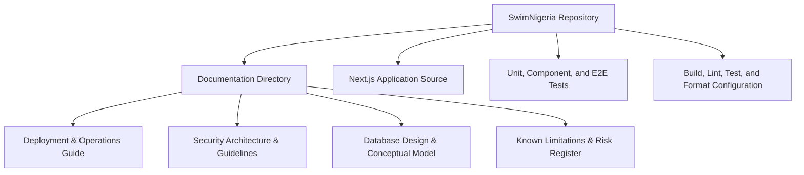
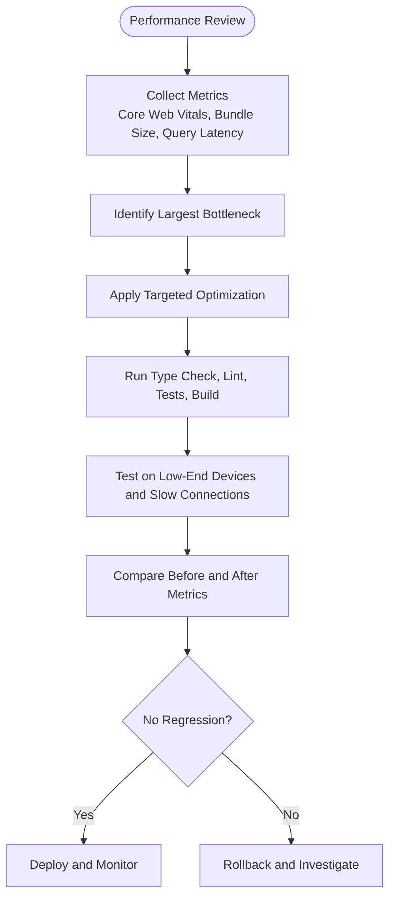
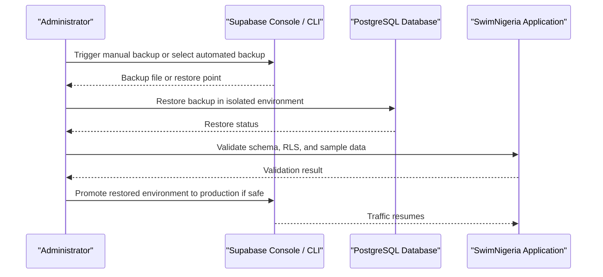
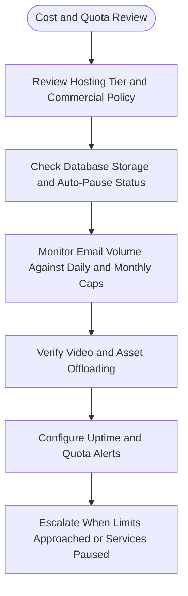
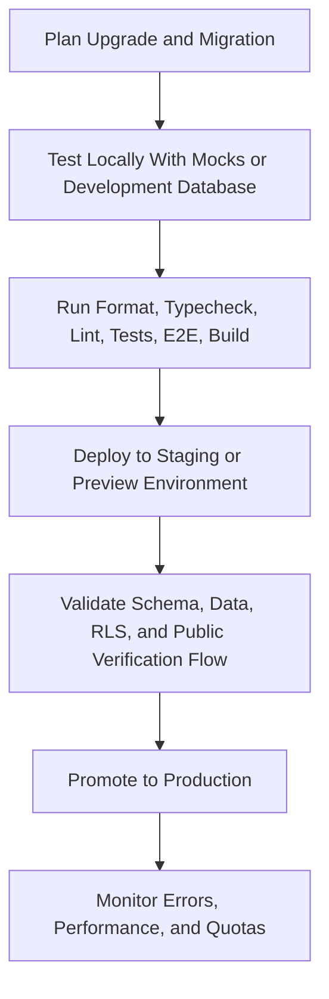

# Maintenance & Backup Procedures

<cite>
**Referenced Files in This Document**
- [README.md](file://README.md)
- [package.json](file://package.json)
- [docs/DEPLOYMENT_AND_OPERATIONS.md](file://docs/DEPLOYMENT_AND_OPERATIONS.md)
- [docs/SECURITY.md](file://docs/SECURITY.md)
- [docs/DATABASE_DESIGN.md](file://docs/DATABASE_DESIGN.md)
- [docs/KNOWN_LIMITATIONS.md](file://docs/KNOWN_LIMITATIONS.md)
- [.agents/skills/supabase/SKILL.md](file://.agents/skills/supabase/SKILL.md)
</cite>

## Table of Contents
1. [Introduction](#introduction)
2. [Project Structure and Operational Context](#project-structure-and-operational-context)
3. [Maintenance Scope and Responsibilities](#maintenance-scope-and-responsibilities)
4. [Routine Maintenance Tasks](#routine-maintenance-tasks)
5. [Dependency Updates and Security Patching](#dependency-updates-and-security-patching)
6. [Performance Optimization and Resource Utilization Monitoring](#performance-optimization-and-resource-utilization-monitoring)
7. [Database Backup, Export, Import, and Disaster Recovery](#database-backup-export-import-and-disaster-recovery)
8. [Cost Optimization, Quota Management, and Free-Tier Constraints](#cost-optimization-quota-management-and-free-tier-constraints)
9. [Cleanup Procedures for Temporary Files, Logs, and Unused Assets](#cleanup-procedures-for-temporary-files-logs-and-unused-assets)
10. [Version Upgrade Procedures, Migration Strategy, and Compatibility Testing](#version-upgrade-procedures-migration-strategy-and-compatibility-testing)
11. [Maintenance Schedules and Verification Procedures](#maintenance-schedules-and-verification-procedures)
12. [Recovery Testing Protocols](#recovery-testing-protocols)
13. [Operational Runbooks and Escalation](#operational-runbooks-and-escalation)
14. [Conclusion](#conclusion)

## Introduction
This document defines the maintenance and backup procedures for SwimNigeria operations. It covers routine maintenance, dependency updates, security patching, performance optimization, database backups, data export/import, disaster recovery, cost optimization, resource monitoring, quota management, cleanup procedures, version upgrades, migration strategies, compatibility testing, schedules, verification procedures, and recovery testing protocols.

SwimNigeria is currently in a scaffolding and baseline phase with no business features, course data, learner records, or database migrations introduced yet. The operational model targets Next.js on Vercel or Cloudflare Pages, PostgreSQL via Supabase, YouTube-hosted video content, Resend for transactional email, and strict server-side validation and authorization.

## Project Structure and Operational Context
The repository follows a Next.js App Router structure with TypeScript, Tailwind CSS, ESLint, Prettier, Vitest, Playwright, and axe-core. Documentation is centralized under `docs/`, including deployment, security, database design, known limitations, and technology decisions.

**Diagram sources**
- [README.md:71-90](file://README.md#L71-L90)
- [docs/DEPLOYMENT_AND_OPERATIONS.md:1-7](file://docs/DEPLOYMENT_AND_OPERATIONS.md#L1-L7)
- [docs/SECURITY.md:1-8](file://docs/SECURITY.md#L1-L8)
- [docs/DATABASE_DESIGN.md:1-8](file://docs/DATABASE_DESIGN.md#L1-L8)
- [docs/KNOWN_LIMITATIONS.md:1-6](file://docs/KNOWN_LIMITATIONS.md#L1-L6)

**Section sources**
- [README.md:1-111](file://README.md#L1-L111)
- [docs/DEPLOYMENT_AND_OPERATIONS.md:1-108](file://docs/DEPLOYMENT_AND_OPERATIONS.md#L1-L108)

## Maintenance Scope and Responsibilities
Maintenance responsibilities should be divided into clear operational categories:

| Category | Owner | Frequency | Key Activities |
|---|---|---:|---|
| Dependency Maintenance | Engineering | Weekly or biweekly | Review npm audit results, update dependencies, run type checks, linting, tests, and build verification. |
| Security Maintenance | Security Lead / Engineering | Continuous | Monitor vulnerability advisories, rotate secrets if exposed, enforce secret hygiene, review RLS and RBAC policies. |
| Database Maintenance | Database Administrator / Engineering | Daily to weekly | Verify automated backups, monitor storage growth, review slow queries, validate RLS policies, perform manual snapshots before milestones. |
| Hosting and Platform Maintenance | DevOps / Engineering | Monthly or per provider change | Review free-tier limits, domain and SSL configuration, environment variables, rollback readiness, uptime monitoring. |
| Performance Maintenance | Frontend / Backend Engineers | Monthly or after major changes | Measure Core Web Vitals, analyze bundle size, optimize server actions, verify edge hosting constraints. |
| Cleanup and Housekeeping | Engineering | Weekly or monthly | Remove unused assets, archive logs, prune temporary files, validate test artifacts. |

No specific code files define these roles; this is an operational governance model aligned with the project’s zero-budget, serverless, and managed-database architecture.

## Routine Maintenance Tasks
Routine maintenance tasks should follow the established quality gates and operational documentation:

- **Formatting and Style:** Use formatting verification and auto-fix commands to maintain consistent code style.
- **Type Safety:** Run strict TypeScript checks across application and test files.
- **Linting:** Execute ESLint rules focused on correctness, performance, and security.
- **Testing:** Run unit and component tests with Vitest, and Playwright smoke tests with accessibility audits.
- **Build Verification:** Compile production bundles and verify static exports and route pre-rendering.
- **Environment Validation:** Ensure environment variables are correctly configured for development and production.

These tasks align with the documented command set and deployment pipeline requirements.

**Section sources**
- [README.md:48-67](file://README.md#L48-L67)
- [docs/DEPLOYMENT_AND_OPERATIONS.md:34-49](file://docs/DEPLOYMENT_AND_OPERATIONS.md#L34-L49)

## Dependency Updates and Security Patching
### Dependency Update Process
1. **Inventory Dependencies:** Identify runtime and development dependencies from the package manifest.
2. **Audit Vulnerabilities:** Run dependency auditing tools as part of CI and local workflows.
3. **Evaluate Changes:** Review changelogs for breaking changes, deprecations, and security fixes.
4. **Update in Staging:** Apply updates to a feature branch, run full quality gates, and verify behavior.
5. **Test Compatibility:** Validate TypeScript types, linting, unit tests, E2E tests, and production builds.
6. **Deploy Incrementally:** Prefer small, incremental updates rather than bulk upgrades.
7. **Monitor Post-Deployment:** Watch error rates, performance metrics, and user-facing regressions.

### Security Patching Process
- Treat critical vulnerabilities as immediate work items.
- Rotate any potentially exposed secrets immediately through the relevant provider console.
- Enforce zero hardcoded secrets and ensure `.env` files are excluded from version control.
- Restrict service role keys to server-only contexts and never expose them to client code.
- Validate that all inputs are sanitized and validated server-side using strict schemas.

**Section sources**
- [package.json:18-46](file://package.json#L18-L46)
- [docs/SECURITY.md:150-155](file://docs/SECURITY.md#L150-L155)
- [docs/SECURITY.md:76-79](file://docs/SECURITY.md#L76-L79)
- [docs/SECURITY.md:82-96](file://docs/SECURITY.md#L82-L96)

## Performance Optimization and Resource Utilization Monitoring
### Optimization Principles
- Optimize based on measured bottlenecks rather than assumptions.
- Avoid premature optimization and micro-optimizations that do not improve user-perceived performance.
- Preserve accessibility while improving speed.
- Test on low-end devices and throttled connections.
- Compare before-and-after metrics such as Lighthouse scores and real-user monitoring data.

### SwimNigeria-Specific Considerations
- Serverless function execution time is limited; keep server actions fast and efficient.
- Offload heavy media to YouTube to avoid bandwidth egress costs.
- Host static assets through frontend CDN where possible.
- Monitor Supabase query performance and authentication failures using available logging and monitoring tools.
- Keep public certificate verification endpoints minimal and strictly allowlisted to reduce exposure and processing overhead.

**Diagram sources**
- [docs/DEPLOYMENT_AND_OPERATIONS.md:64-70](file://docs/DEPLOYMENT_AND_OPERATIONS.md#L64-L70)
- [README.md:93-101](file://README.md#L93-L101)

**Section sources**
- [docs/DEPLOYMENT_AND_OPERATIONS.md:64-70](file://docs/DEPLOYMENT_AND_OPERATIONS.md#L64-L70)
- [README.md:93-101](file://README.md#L93-L101)

## Database Backup, Export, Import, and Disaster Recovery
### Backup Strategy
- **Automated Backups:** Supabase free tier provides automated daily backups retained for seven days.
- **Manual Snapshots:** Before major milestones, perform logical database dumps and store encrypted backups offsite.
- **Retention Policy:** Maintain at least one recent automated backup plus one manually verified snapshot for critical releases.

### Export and Import Procedures
- Use logical database dump tools for export.
- Validate exported schema and data integrity before import.
- Import only into isolated environments first (development or staging).
- Confirm foreign key relationships, RLS policies, and view projections remain intact after restore.

### Disaster Recovery Procedure
1. Detect data corruption or unexpected state.
2. Stop new writes if necessary to prevent further inconsistency.
3. Identify the latest known good backup.
4. Restore via the Supabase Management Console or CLI.
5. Validate restored data against expected entities and relationships.
6. Re-enable application traffic and monitor errors and query performance.
7. Document incident details, root cause, and corrective actions.

**Diagram sources**
- [docs/DEPLOYMENT_AND_OPERATIONS.md:74-84](file://docs/DEPLOYMENT_AND_OPERATIONS.md#L74-L84)

**Section sources**
- [docs/DEPLOYMENT_AND_OPERATIONS.md:74-84](file://docs/DEPLOYMENT_AND_OPERATIONS.md#L74-L84)
- [docs/DATABASE_DESIGN.md:149-158](file://docs/DATABASE_DESIGN.md#L149-L158)

## Cost Optimization, Quota Management, and Free-Tier Constraints
### Hosting and Compute
- Vercel Hobby Tier is intended for personal or non-commercial projects; commercial use may require upgrading or migrating to Cloudflare Pages.
- Serverless functions have short execution limits; optimize server actions to complete quickly.

### Database and Storage
- Supabase free tier includes a 500MB database storage limit.
- Auto-pause policy can suspend projects after seven days of inactivity; mitigate with scheduled lightweight health pings.
- Store large media externally; do not embed videos or high-resolution images directly in the database.

### Email Delivery
- Resend free tier allows 3,000 emails per month with a daily cap.
- Reserve transactional emails for essential flows such as welcome messages, password resets, and certificate issuance.
- Rate-limit contact submissions and defer marketing communications to dedicated newsletter tools.

### Bandwidth and Egress
- Offload video delivery to YouTube to avoid platform egress costs.
- Use frontend CDN hosting for static assets.

**Diagram sources**
- [docs/DEPLOYMENT_AND_OPERATIONS.md:52-71](file://docs/DEPLOYMENT_AND_OPERATIONS.md#L52-L71)
- [docs/KNOWN_LIMITATIONS.md:37-50](file://docs/KNOWN_LIMITATIONS.md#L37-L50)

**Section sources**
- [docs/DEPLOYMENT_AND_OPERATIONS.md:52-71](file://docs/DEPLOYMENT_AND_OPERATIONS.md#L52-L71)
- [docs/KNOWN_LIMITATIONS.md:37-50](file://docs/KNOWN_LIMITATIONS.md#L37-L50)

## Cleanup Procedures for Temporary Files, Logs, and Unused Assets
### Temporary Files and Build Artifacts
- Clean build directories and generated artifacts regularly in local development.
- Avoid committing generated files or large binaries.
- Use `.gitignore` to exclude environment files and sensitive configuration.

### Logs and Observability Data
- Application runtime errors are captured via Next.js error boundaries and logged with structured context.
- Supabase logs provide database query performance, authentication failures, and API status codes.
- Archive or rotate logs according to retention policies; avoid retaining unnecessary personal data.

### Unused Assets
- Remove unused images, fonts, icons, and third-party libraries during dependency updates.
- Audit bundle size and eliminate dead code paths.
- Verify that removed assets are not referenced by routes, components, or static imports.

**Section sources**
- [docs/DEPLOYMENT_AND_OPERATIONS.md:87-92](file://docs/DEPLOYMENT_AND_OPERATIONS.md#L87-L92)
- [docs/SECURITY.md:150-155](file://docs/SECURITY.md#L150-L155)

## Version Upgrade Procedures, Migration Strategy, and Compatibility Testing
### Framework and Runtime Upgrades
- Upgrade Node.js and package manager versions only when supported by the project’s toolchain.
- Validate compatibility with Next.js, React, TypeScript, and testing frameworks.
- Run full quality gates after upgrade: format check, typecheck, lint, tests, E2E, and production build.

### Database Schema Migrations
- Manage schema changes through declarative, version-controlled migration files.
- Test migrations locally before applying to production.
- Apply migrations sequentially and verify data integrity afterward.
- Use Supabase advisory tools and debugging guidance when working with migrations, views, functions, triggers, or storage.

### Compatibility Testing
- Run unit and component tests to detect behavioral regressions.
- Run Playwright E2E smoke tests to validate critical user flows.
- Run accessibility audits to ensure WCAG compliance remains intact.
- Validate environment variable contracts and secret handling after upgrades.

**Diagram sources**
- [docs/DEPLOYMENT_AND_OPERATIONS.md:34-49](file://docs/DEPLOYMENT_AND_OPERATIONS.md#L34-L49)
- [docs/DEPLOYMENT_AND_OPERATIONS.md:74-84](file://docs/DEPLOYMENT_AND_OPERATIONS.md#L74-L84)
- [.agents/skills/supabase/SKILL.md:139-150](file://.agents/skills/supabase/SKILL.md#L139-L150)

**Section sources**
- [docs/DEPLOYMENT_AND_OPERATIONS.md:34-49](file://docs/DEPLOYMENT_AND_OPERATIONS.md#L34-L49)
- [docs/DEPLOYMENT_AND_OPERATIONS.md:74-84](file://docs/DEPLOYMENT_AND_OPERATIONS.md#L74-L84)
- [.agents/skills/supabase/SKILL.md:139-150](file://.agents/skills/supabase/SKILL.md#L139-L150)

## Maintenance Schedules and Verification Procedures
### Recommended Maintenance Cadence
| Task | Frequency | Verification |
|---|---:|---|
| Dependency audit and updates | Weekly or biweekly | npm audit, typecheck, lint, tests, build |
| Secret rotation review | As needed or quarterly | Confirm no hardcoded secrets, confirm environment variables are current |
| Database backup verification | Daily automated, weekly manual check | Confirm backup exists, test restore in isolated environment |
| Performance review | Monthly or after major changes | Core Web Vitals, bundle analysis, query latency |
| Free-tier quota review | Weekly | Email volume, database storage, bandwidth, active users |
| Cleanup of temporary files and logs | Weekly or monthly | Disk usage, artifact size, log retention |
| Rollback readiness check | Before each release | Confirm previous successful deployment is available |

### Backup Verification Procedures
- Confirm automated daily backups exist.
- Download or inspect a recent backup file.
- Restore it to a non-production environment.
- Validate tables, relationships, RLS policies, and sample data.
- Record verification results and timestamp.

### Recovery Testing Protocols
- Schedule periodic disaster recovery drills.
- Simulate database corruption or accidental deletion.
- Restore from the latest known good backup.
- Validate application functionality and data integrity.
- Measure recovery time objective and document findings.

**Section sources**
- [docs/DEPLOYMENT_AND_OPERATIONS.md:80-84](file://docs/DEPLOYMENT_AND_OPERATIONS.md#L80-L84)
- [docs/DEPLOYMENT_AND_OPERATIONS.md:93-99](file://docs/DEPLOYMENT_AND_OPERATIONS.md#L93-L99)

## Operational Runbooks and Escalation
### Secret Exposure Runbook
1. Identify the exposed credential.
2. Rotate the secret in the relevant provider console.
3. Update production environment variables.
4. Redeploy affected services.
5. Review access logs for unauthorized usage.
6. Document the incident and preventive controls.

### Rollback Runbook
1. Open the hosting provider console.
2. Locate the previous successful deployment.
3. Perform instant rollback to shift traffic to the prior immutable build.
4. Investigate the failure locally.
5. Prepare a patch, verify with quality gates, and redeploy.

### Database Pause or Connection Failure Runbook
1. Check uptime monitoring alerts.
2. Inspect Supabase project status for auto-pause.
3. Manually unpause the project if required.
4. Verify database connectivity from the application.
5. Review scheduled ping jobs and monitoring configurations.
6. Notify stakeholders if downtime occurred.

**Section sources**
- [docs/DEPLOYMENT_AND_OPERATIONS.md:27-31](file://docs/DEPLOYMENT_AND_OPERATIONS.md#L27-L31)
- [docs/DEPLOYMENT_AND_OPERATIONS.md:93-99](file://docs/DEPLOYMENT_AND_OPERATIONS.md#L93-L99)
- [docs/DEPLOYMENT_AND_OPERATIONS.md:55-62](file://docs/DEPLOYMENT_AND_OPERATIONS.md#L55-L62)

## Conclusion
SwimNigeria’s maintenance and backup procedures should emphasize disciplined quality gates, secure secret management, conservative database operations, and careful adherence to free-tier constraints. Routine maintenance must be scheduled, repeatable, and verifiable. Backups should be tested regularly, and recovery drills should confirm that the team can restore data and resume operations within acceptable timeframes. Performance optimizations should be measured, scoped, and validated against both technical metrics and user experience. As the project progresses beyond Phase 1, these procedures should evolve alongside implemented features, migrations, and production integrations.