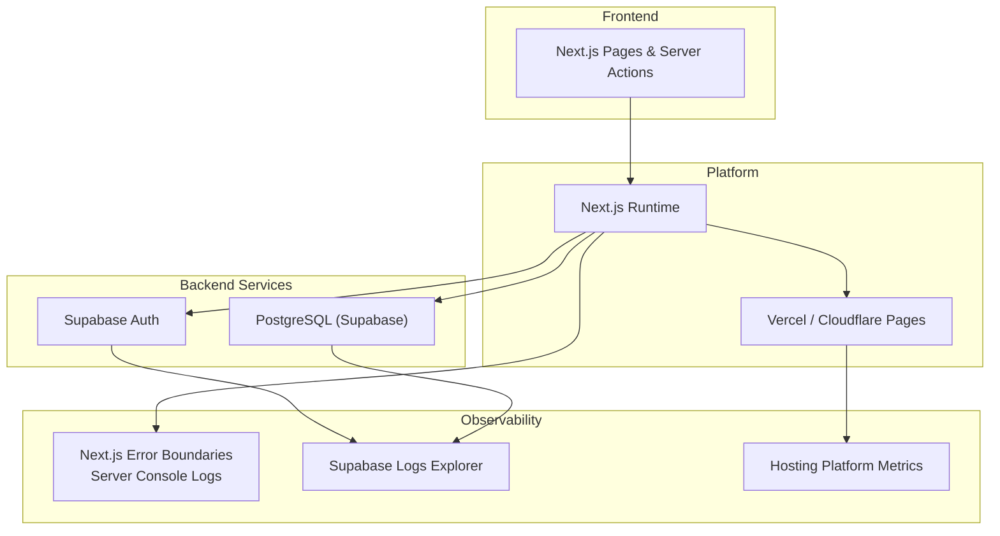
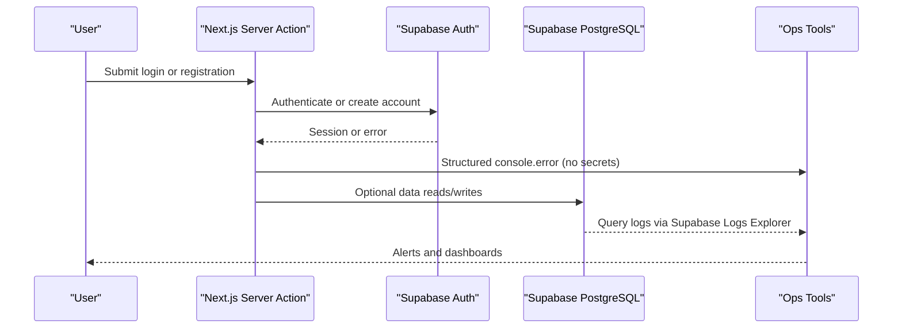
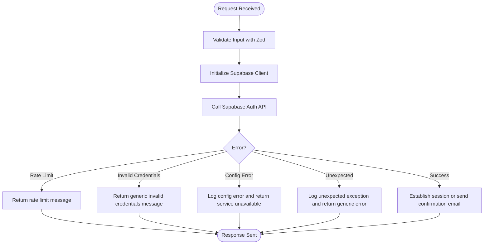
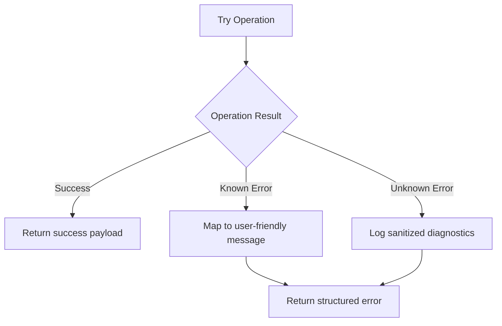
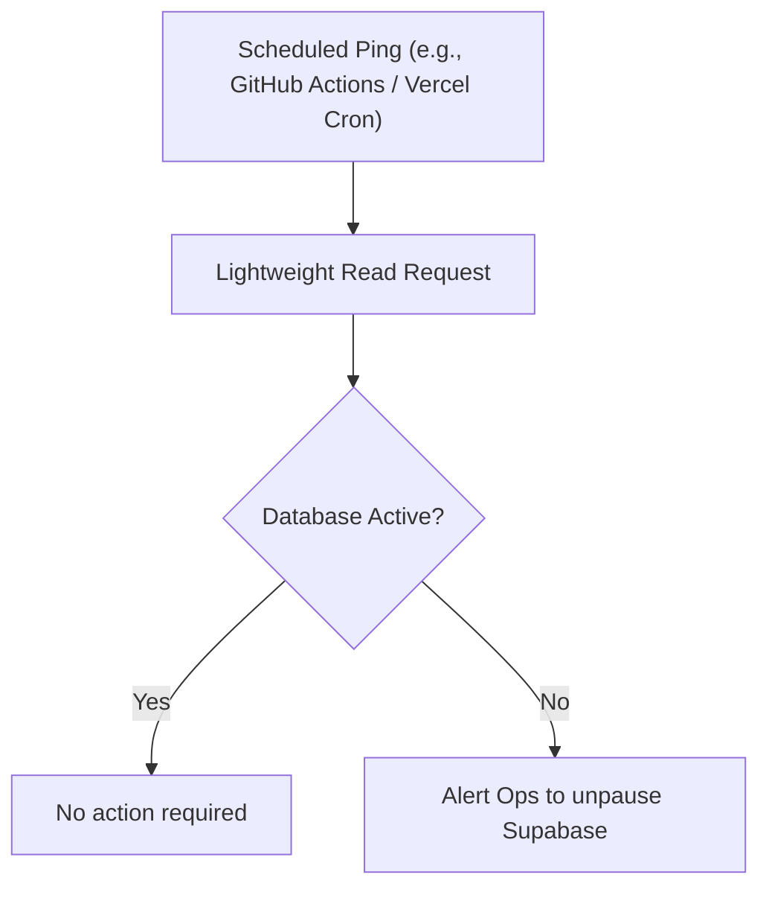
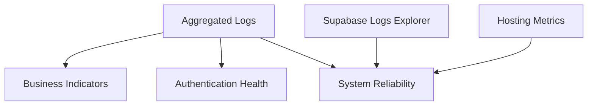
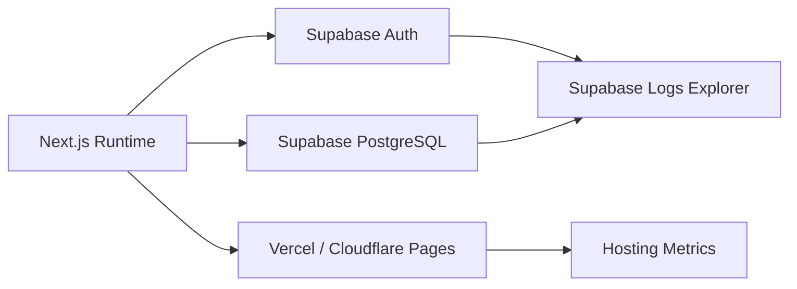

# Monitoring & Logging

<cite>
**Referenced Files in This Document**
- [README.md](file://README.md)
- [package.json](file://package.json)
- [next.config.ts](file://next.config.ts)
- [DEPLOYMENT_AND_OPERATIONS.md](file://docs/DEPLOYMENT_AND_OPERATIONS.md)
- [SECURITY.md](file://docs/SECURITY.md)
- [CODING_STANDARDS.md](file://docs/CODING_STANDARDS.md)
- [actions.ts (login)](file://src/app/login/actions.ts)
- [actions.ts (register)](file://src/app/register/actions.ts)
- [actions.ts (forgot-password)](file://src/app/forgot-password/actions.ts)
</cite>

## Table of Contents
1. [Introduction](#introduction)
2. [Project Structure](#project-structure)
3. [Core Components](#core-components)
4. [Architecture Overview](#architecture-overview)
5. [Detailed Component Analysis](#detailed-component-analysis)
6. [Dependency Analysis](#dependency-analysis)
7. [Performance Considerations](#performance-considerations)
8. [Troubleshooting Guide](#troubleshooting-guide)
9. [Conclusion](#conclusion)
10. [Appendices](#appendices)

## Introduction
This document defines the monitoring and logging strategy for SwimNigeria operations. It explains how to observe application health, collect performance and business metrics, aggregate logs safely, set up alerts, and perform debugging and profiling. It also covers log retention, privacy safeguards, and recommended tools aligned with the current Next.js + Supabase stack and free-tier hosting constraints.

## Project Structure
SwimNigeria is a Next.js App Router application using TypeScript, Tailwind CSS, Vitest, Playwright, and Supabase for authentication and database access. The repository currently focuses on scaffolding, quality tooling, and foundational security and deployment guidance. Observability is intentionally minimal at this stage: runtime errors are captured via Next.js error boundaries and logged server-side, while Supabase Logs Explorer provides database and API visibility.

**Diagram sources**
- [DEPLOYMENT_AND_OPERATIONS.md:87-91](file://docs/DEPLOYMENT_AND_OPERATIONS.md#L87-L91)
- [README.md:93-101](file://README.md#L93-L101)

**Section sources**
- [README.md:93-101](file://README.md#L93-L101)
- [DEPLOYMENT_AND_OPERATIONS.md:87-91](file://docs/DEPLOYMENT_AND_OPERATIONS.md#L87-L91)

## Core Components
The operational observability surface currently includes:
- Application logs from Next.js server actions and error boundaries.
- Supabase Logs Explorer for database queries, authentication events, and API status codes.
- Hosting platform metrics and uptime monitoring for edge deployments.

Key responsibilities:
- Capture structured, non-sensitive diagnostic information during authentication flows.
- Surface user-friendly error messages without leaking internal details.
- Monitor free-tier constraints such as Supabase auto-pause and email quotas.

**Section sources**
- [DEPLOYMENT_AND_OPERATIONS.md:87-91](file://docs/DEPLOYMENT_AND_OPERATIONS.md#L87-L91)
- [DEPLOYMENT_AND_OPERATIONS.md:52-70](file://docs/DEPLOYMENT_AND_OPERATIONS.md#L52-L70)

## Architecture Overview
The monitoring architecture integrates three primary layers:
- Application layer: Next.js server actions emit structured console logs; Next.js error boundaries capture unhandled exceptions.
- Service layer: Supabase Auth and PostgreSQL provide logs through Supabase Logs Explorer.
- Platform layer: Vercel or Cloudflare Pages expose runtime metrics and can integrate external uptime monitors.

**Diagram sources**
- [actions.ts (login):93-182](file://src/app/login/actions.ts#L93-L182)
- [actions.ts (register):106-193](file://src/app/register/actions.ts#L106-L193)
- [actions.ts (forgot-password):92-138](file://src/app/forgot-password/actions.ts#L92-L138)
- [DEPLOYMENT_AND_OPERATIONS.md:87-91](file://docs/DEPLOYMENT_AND_OPERATIONS.md#L87-L91)

## Detailed Component Analysis

### Authentication Flows and Logging
Login, registration, and password recovery server actions follow a consistent pattern:
- Validate inputs with Zod.
- Initialize Supabase client.
- Call Supabase Auth APIs.
- Handle rate limits and specific error codes.
- Emit safe diagnostic logs without sensitive data.
- Return user-friendly results.

**Diagram sources**
- [actions.ts (login):34-182](file://src/app/login/actions.ts#L34-L182)
- [actions.ts (register):35-193](file://src/app/register/actions.ts#L35-L193)
- [actions.ts (forgot-password):40-138](file://src/app/forgot-password/actions.ts#L40-L138)

**Section sources**
- [actions.ts (login):34-182](file://src/app/login/actions.ts#L34-L182)
- [actions.ts (register):35-193](file://src/app/register/actions.ts#L35-L193)
- [actions.ts (forgot-password):40-138](file://src/app/forgot-password/actions.ts#L40-L138)

### Error Handling Strategy
- Structured result objects are returned instead of throwing raw exceptions to clients.
- Specific error conditions (rate limits, invalid credentials, configuration issues) are handled explicitly.
- Diagnostic logs use `console.error` with contextual labels but never include passwords, tokens, emails, or other PII.
- User-facing messages are plain-language and actionable.

**Diagram sources**
- [actions.ts (login):100-182](file://src/app/login/actions.ts#L100-L182)
- [actions.ts (register):120-193](file://src/app/register/actions.ts#L120-L193)
- [actions.ts (forgot-password):97-138](file://src/app/forgot-password/actions.ts#L97-L138)

**Section sources**
- [CODING_STANDARDS.md:76-102](file://docs/CODING_STANDARDS.md#L76-L102)
- [actions.ts (login):100-182](file://src/app/login/actions.ts#L100-L182)
- [actions.ts (register):120-193](file://src/app/register/actions.ts#L120-L193)
- [actions.ts (forgot-password):97-138](file://src/app/forgot-password/actions.ts#L97-L138)

### Health Checks and Uptime Monitoring
- Free-tier Supabase projects may pause after inactivity; an informal mitigation is a lightweight scheduled ping every 48 hours.
- External uptime monitoring should alert on connection failures, failed pings, or project pauses.
- Hosting platforms (Vercel / Cloudflare) provide basic availability and request metrics.

**Diagram sources**
- [DEPLOYMENT_AND_OPERATIONS.md:55-62](file://docs/DEPLOYMENT_AND_OPERATIONS.md#L55-L62)

**Section sources**
- [DEPLOYMENT_AND_OPERATIONS.md:55-62](file://docs/DEPLOYMENT_AND_OPERATIONS.md#L55-L62)

### Performance Monitoring Strategies
- Use Next.js built-in error boundaries and server action diagnostics to detect runtime failures.
- Monitor Supabase Logs Explorer for slow queries, auth failures, and API status anomalies.
- Track hosting platform metrics for request latency, error rates, and cold starts.
- Avoid heavy synchronous work in server actions; keep operations under typical serverless function duration limits.

[No sources needed since this section provides general guidance]

### Metrics Collection Plan
Recommended categories:
- User engagement:
  - Registration attempts and success rate.
  - Login success and failure rates.
  - Password recovery requests and completion.
- System performance:
  - Server action latency and error rates.
  - Supabase query latency and error codes.
  - Hosting platform request volume and error distribution.
- Business KPIs:
  - Course enrollment counts (future).
  - Certificate issuance and verification counts (future).

Implementation approach:
- Instrument server actions with structured logs that include operation names, outcomes, and anonymized context.
- Aggregate logs into a central system (e.g., hosting provider logs, third-party log aggregator).
- Derive metrics from logs and Supabase Logs Explorer; visualize in dashboards.

[No sources needed since this section provides general guidance]

### Logging Configuration and Aggregation
Current state:
- Application logs are emitted via `console.error` in server actions.
- Next.js error boundaries capture runtime errors.
- Supabase Logs Explorer captures database and API activity.

Recommended aggregation:
- Centralize Next.js server logs via hosting provider log export or a third-party service.
- Forward Supabase Logs Explorer output to the same aggregator for unified search and correlation.
- Ensure all logs exclude PII and secrets per coding standards.

**Section sources**
- [DEPLOYMENT_AND_OPERATIONS.md:87-91](file://docs/DEPLOYMENT_AND_OPERATIONS.md#L87-L91)
- [CODING_STANDARDS.md:97-102](file://docs/CODING_STANDARDS.md#L97-L102)

### Alerting Setup
Suggested alert rules:
- Authentication error spikes (invalid credentials, rate limits).
- Supabase connection failures or project pause events.
- Email delivery quota exhaustion or rate limiting.
- Elevated 5xx error rates from hosting platform.

Notification channels:
- Email or messaging platform for ops team.
- Pager-style escalation for critical outages.

[No sources needed since this section provides general guidance]

### Debugging Procedures
- Reproduce locally using the development server and verify environment variables.
- Inspect structured console logs for operation names and sanitized error context.
- Correlate with Supabase Logs Explorer for auth and database events.
- Use hosting platform deployment history for rollback if necessary.

**Section sources**
- [DEPLOYMENT_AND_OPERATIONS.md:93-98](file://docs/DEPLOYMENT_AND_OPERATIONS.md#L93-L98)

### Performance Profiling Techniques
- Profile server actions by measuring time-to-first-byte and total execution time in hosting metrics.
- Identify slow Supabase queries via Supabase Logs Explorer and optimize with indexes or query restructuring.
- Reduce waterfalls by running independent fetches concurrently where applicable.

**Section sources**
- [CODING_STANDARDS.md:105-114](file://docs/CODING_STANDARDS.md#L105-L114)

### Bottleneck Identification Methods
- Look for repeated rate-limit responses in logs.
- Investigate high-latency endpoints and database calls.
- Review hosting platform CPU/memory utilization and cold start patterns.
- Validate that server actions remain within function duration limits.

[No sources needed since this section provides general guidance]

### Log Retention Policies
- Define retention periods per log source (application logs, Supabase logs, hosting logs).
- Archive older logs to cost-effective storage for compliance and audits.
- Implement automated cleanup jobs to avoid exceeding storage quotas.

[No sources needed since this section provides general guidance]

### Privacy Considerations for Sensitive Data
- Never log emails, passwords, phone numbers, tokens, or session cookies.
- Sanitize redirect URLs and avoid including query parameters containing secrets.
- Follow NDPR principles: minimize collected data and protect personal information.

**Section sources**
- [CODING_STANDARDS.md:97-102](file://docs/CODING_STANDARDS.md#L97-L102)
- [SECURITY.md:143-147](file://docs/SECURITY.md#L143-L147)

### Log Analysis Tools
- Hosting provider log viewers and dashboards.
- Supabase Logs Explorer for database and API insights.
- Third-party log aggregators for centralized querying and alerting.

[No sources needed since this section provides general guidance]

### Example Monitoring Dashboards
Conceptual dashboard panels:
- Authentication health: login success rate, registration success rate, password recovery success rate.
- System reliability: error rates, latency percentiles, uptime.
- Business indicators: enrollment and certificate metrics (when implemented).

[No sources needed since this diagram shows conceptual workflow, not actual code structure]

### Example Alert Configurations
- Rule: If login error rate exceeds threshold over 5 minutes, trigger notification.
- Rule: If Supabase project is paused or unreachable, trigger urgent alert.
- Rule: If email delivery rate limit is hit, notify ops to throttle or scale.

[No sources needed since this section provides general guidance]

## Dependency Analysis
Observability depends on:
- Next.js runtime for server actions and error boundaries.
- Supabase Auth and PostgreSQL for authentication and data persistence.
- Hosting platform for deployment, runtime metrics, and optional log export.

**Diagram sources**
- [README.md:93-101](file://README.md#L93-L101)
- [DEPLOYMENT_AND_OPERATIONS.md:87-91](file://docs/DEPLOYMENT_AND_OPERATIONS.md#L87-L91)

**Section sources**
- [README.md:93-101](file://README.md#L93-L101)
- [DEPLOYMENT_AND_OPERATIONS.md:87-91](file://docs/DEPLOYMENT_AND_OPERATIONS.md#L87-L91)

## Performance Considerations
- Keep server actions fast and idempotent where possible.
- Avoid unnecessary logging in hot paths; prefer sampled or aggregated metrics.
- Use concurrent fetching for independent data sources to reduce latency.
- Monitor free-tier constraints and plan mitigations proactively.

[No sources needed since this section provides general guidance]

## Troubleshooting Guide
Common issues and resolutions:
- Authentication failures:
  - Check rate-limit responses and user-friendly messages.
  - Verify Supabase environment configuration and public keys.
  - Inspect server logs for sanitized diagnostics.
- Registration problems:
  - Confirm email confirmation flow and redirect targets.
  - Watch for enumeration-resistant behavior when accounts already exist.
- Password recovery issues:
  - Ensure recovery authorization checks pass.
  - Validate reset endpoint and AMR/session state handling.

Operational steps:
- Use Next.js error boundaries and server action logs to pinpoint failures.
- Cross-reference Supabase Logs Explorer for auth and database events.
- Roll back to previous deployment if regression detected.

**Section sources**
- [actions.ts (login):100-182](file://src/app/login/actions.ts#L100-L182)
- [actions.ts (register):120-193](file://src/app/register/actions.ts#L120-L193)
- [actions.ts (forgot-password):97-138](file://src/app/forgot-password/actions.ts#L97-L138)
- [DEPLOYMENT_AND_OPERATIONS.md:93-98](file://docs/DEPLOYMENT_AND_OPERATIONS.md#L93-L98)

## Conclusion
SwimNigeria’s current observability posture centers on structured server-side logging, Next.js error boundaries, and Supabase Logs Explorer. To mature monitoring and logging:
- Centralize logs and derive actionable metrics.
- Implement proactive uptime monitoring and alerting.
- Enforce strict privacy controls in all logs.
- Build dashboards for authentication health, system reliability, and business KPIs.
- Continuously profile and optimize performance within hosting constraints.

[No sources needed since this section summarizes without analyzing specific files]

## Appendices

### Environment and Tooling References
- Development scripts and dependencies are defined in package configuration.
- Next.js configuration enables strict mode and local dev origins.

**Section sources**
- [package.json:6-16](file://package.json#L6-L16)
- [next.config.ts:1-9](file://next.config.ts#L1-L9)