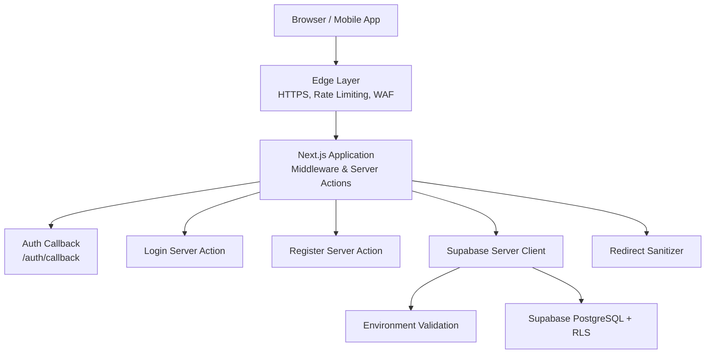
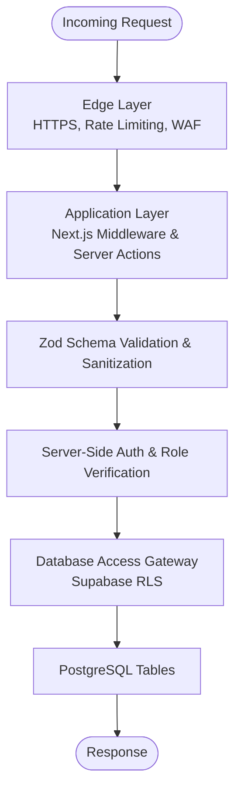
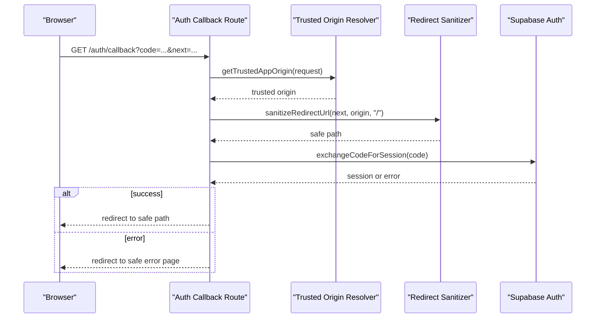
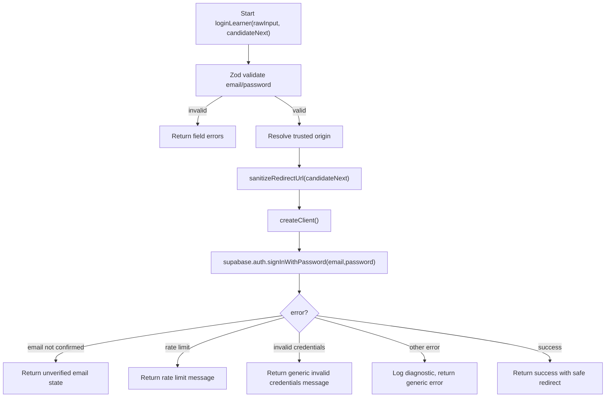
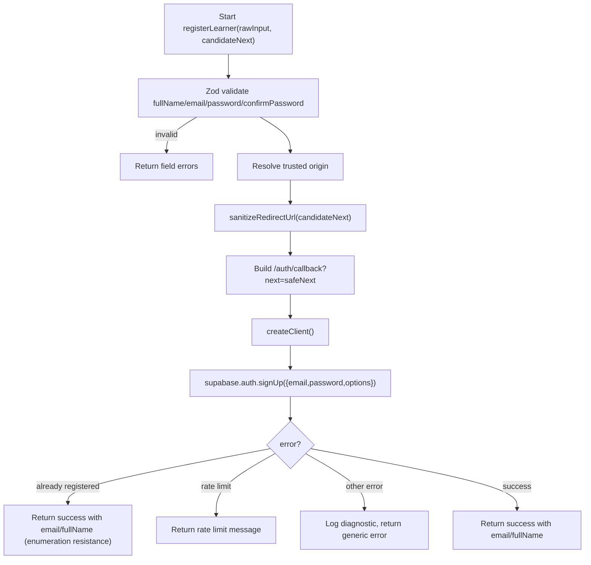
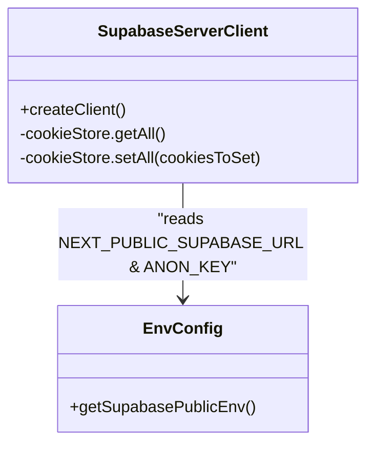
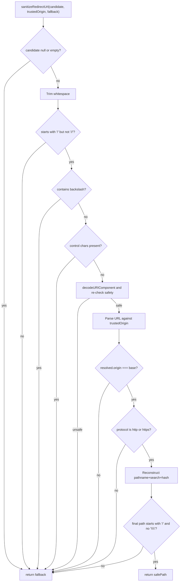
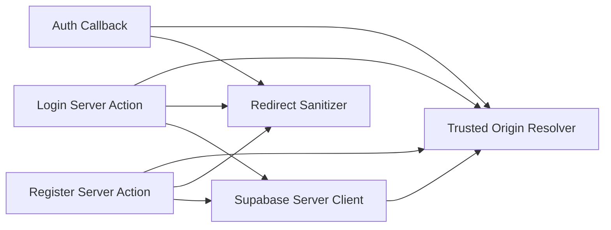

# Security Practices & Compliance

<cite>
**Referenced Files in This Document**
- [SECURITY.md](file://docs/SECURITY.md)
- [route.ts](file://src/app/auth/callback/route.ts)
- [actions.ts](file://src/app/login/actions.ts)
- [actions.ts](file://src/app/register/actions.ts)
- [server.ts](file://src/lib/supabase/server.ts)
- [env.ts](file://src/lib/supabase/env.ts)
- [redirect.ts](file://src/lib/supabase/redirect.ts)
- [next.config.ts](file://next.config.ts)
- [.gitignore](file://.gitignore)
</cite>

## Table of Contents
1. [Introduction](#introduction)
2. [Project Structure](#project-structure)
3. [Core Components](#core-components)
4. [Architecture Overview](#architecture-overview)
5. [Detailed Component Analysis](#detailed-component-analysis)
6. [Dependency Analysis](#dependency-analysis)
7. [Performance Considerations](#performance-considerations)
8. [Troubleshooting Guide](#troubleshooting-guide)
9. [Conclusion](#conclusion)
10. [Appendices](#appendices)

## Introduction
This document defines SwimNigeria’s security posture, covering authentication and session management, server-side authorization, data protection, assessment integrity, certificate verification security, Supabase integration safeguards, environment secret handling, input validation, XSS and CSRF defenses, operational security, compliance considerations, and monitoring guidance. It is intended for developers, operators, and auditors who need to understand how SwimNigeria enforces a Zero-Trust Client model across the edge, application, validation, authorization, and database layers.

## Project Structure
Security-relevant code is concentrated in:
- Documentation policy and threat model: docs/SECURITY.md
- Authentication flows: src/app/auth/callback/route.ts
- Server Actions for login and registration: src/app/login/actions.ts, src/app/register/actions.ts
- Supabase client and environment utilities: src/lib/supabase/server.ts, src/lib/supabase/env.ts
- Redirect sanitizer: src/lib/supabase/redirect.ts
- Next.js configuration: next.config.ts
- Secret hygiene via .gitignore: .gitignore

**Diagram sources**
- [SECURITY.md:9-25](file://docs/SECURITY.md#L9-L25)
- [route.ts:1-61](file://src/app/auth/callback/route.ts#L1-L61)
- [actions.ts:1-236](file://src/app/login/actions.ts#L1-L236)
- [actions.ts:1-214](file://src/app/register/actions.ts#L1-L214)
- [server.ts:1-61](file://src/lib/supabase/server.ts#L1-L61)
- [env.ts:1-143](file://src/lib/supabase/env.ts#L1-L143)
- [redirect.ts:1-94](file://src/lib/supabase/redirect.ts#L1-L94)

**Section sources**
- [SECURITY.md:1-25](file://docs/SECURITY.md#L1-L25)
- [next.config.ts:1-9](file://next.config.ts#L1-L9)

## Core Components
- Authentication callback handler: exchanges one-time authorization codes for sessions, validates trusted origins, sanitizes redirect targets, and returns safe generic errors without leaking secrets.
- Login server action: performs strict Zod validation, calls Supabase Auth, handles unverified email and rate-limit responses safely, and redirects only to sanitized same-origin paths.
- Registration server action: validates inputs, creates accounts with email confirmation enabled, constructs safe PKCE redirect URLs, and prevents account enumeration by returning consistent outcomes.
- Supabase server client factory: initializes the public anon client, preserves secure cookie options, and gracefully handles read-only cookie store constraints in React Server Components.
- Environment configuration: validates public Supabase URL and anonymous key, rejects placeholders, ensures valid protocols, and resolves trusted application origin.
- Redirect sanitizer: enforces same-origin internal paths, blocks protocol-relative and unsafe schemes, strips control characters and backslashes, and reconstructs clean relative paths.

**Section sources**
- [route.ts:1-61](file://src/app/auth/callback/route.ts#L1-L61)
- [actions.ts:1-236](file://src/app/login/actions.ts#L1-L236)
- [actions.ts:1-214](file://src/app/register/actions.ts#L1-L214)
- [server.ts:1-61](file://src/lib/supabase/server.ts#L1-L61)
- [env.ts:1-143](file://src/lib/supabase/env.ts#L1-L143)
- [redirect.ts:1-94](file://src/lib/supabase/redirect.ts#L1-L94)

## Architecture Overview
SwimNigeria follows a layered defense-in-depth strategy:
- Edge layer: HTTPS, rate limiting, and WAF protections.
- Application layer: Next.js middleware and server actions enforce business logic and security checks.
- Validation layer: Zod schemas validate and sanitize all incoming data.
- Authorization layer: Server-side auth and role verification using authoritative data sources.
- Database layer: Supabase Row-Level Security (RLS) restricts row visibility based on authenticated user context.

**Diagram sources**
- [SECURITY.md:9-25](file://docs/SECURITY.md#L9-L25)

**Section sources**
- [SECURITY.md:1-25](file://docs/SECURITY.md#L1-L25)

## Detailed Component Analysis

### Authentication Callback Flow
The authentication callback route:
- Validates the trusted application origin.
- Exchanges the one-time authorization code for a session.
- Sanitizes the redirect target to prevent open redirects.
- Returns safe generic error redirects without exposing tokens or stack traces.

**Diagram sources**
- [route.ts:24-59](file://src/app/auth/callback/route.ts#L24-L59)
- [env.ts:116-142](file://src/lib/supabase/env.ts#L116-L142)
- [redirect.ts:21-93](file://src/lib/supabase/redirect.ts#L21-L93)

**Section sources**
- [route.ts:1-61](file://src/app/auth/callback/route.ts#L1-L61)

### Login Server Action
The login server action:
- Validates inputs with Zod.
- Resolves trusted origin and sanitizes redirect targets.
- Initializes the Supabase client using the public anon key.
- Handles unverified email and rate-limit scenarios securely.
- Prevents information leakage by providing uniform error messages.

**Diagram sources**
- [actions.ts:34-183](file://src/app/login/actions.ts#L34-L183)
- [env.ts:116-142](file://src/lib/supabase/env.ts#L116-L142)
- [redirect.ts:21-93](file://src/lib/supabase/redirect.ts#L21-L93)

**Section sources**
- [actions.ts:1-236](file://src/app/login/actions.ts#L1-L236)

### Registration Server Action
The registration server action:
- Validates full name, email, password, and confirm password with Zod.
- Constructs a safe PKCE email redirect URL through /auth/callback.
- Calls Supabase Auth signUp with email confirmation enabled.
- Treats duplicate registration attempts consistently to avoid account enumeration.
- Returns safe generic error messages and never logs sensitive payloads.

**Diagram sources**
- [actions.ts:35-194](file://src/app/register/actions.ts#L35-L194)
- [env.ts:116-142](file://src/lib/supabase/env.ts#L116-L142)
- [redirect.ts:21-93](file://src/lib/supabase/redirect.ts#L21-L93)

**Section sources**
- [actions.ts:1-214](file://src/app/register/actions.ts#L1-L214)

### Supabase Server Client Factory
Key security behaviors:
- Uses strictly public anon keys; never uses the service role key.
- Preserves HttpOnly, Secure, SameSite cookie options from @supabase/ssr.
- Gracefully ignores expected read-only cookie store errors in React Server Components while rethrowing unrelated errors.

**Diagram sources**
- [server.ts:26-60](file://src/lib/supabase/server.ts#L26-L60)
- [env.ts:102-107](file://src/lib/supabase/env.ts#L102-L107)

**Section sources**
- [server.ts:1-61](file://src/lib/supabase/server.ts#L1-L61)
- [env.ts:1-143](file://src/lib/supabase/env.ts#L1-L143)

### Redirect Sanitizer
The sanitizer enforces:
- Single forward slash start and no double slashes.
- No backslash characters.
- Control character rejection to prevent header injection.
- Decoded URI safety checks.
- Strict same-origin assertion against the trusted origin.
- Protocol must remain http or https.
- Final reconstruction of clean relative paths.

**Diagram sources**
- [redirect.ts:21-93](file://src/lib/supabase/redirect.ts#L21-L93)

**Section sources**
- [redirect.ts:1-94](file://src/lib/supabase/redirect.ts#L1-L94)

## Dependency Analysis
Authentication and registration flows depend on:
- Trusted origin resolution to constrain redirects.
- Redirect sanitizer to prevent open redirects and scheme-based attacks.
- Supabase server client to interact with Supabase Auth using the public anon key.
- Environment validation to ensure correct configuration and reject placeholders.

**Diagram sources**
- [route.ts:24-59](file://src/app/auth/callback/route.ts#L24-L59)
- [actions.ts:34-183](file://src/app/login/actions.ts#L34-L183)
- [actions.ts:35-194](file://src/app/register/actions.ts#L35-L194)
- [server.ts:26-60](file://src/lib/supabase/server.ts#L26-L60)
- [env.ts:102-142](file://src/lib/supabase/env.ts#L102-L142)
- [redirect.ts:21-93](file://src/lib/supabase/redirect.ts#L21-L93)

**Section sources**
- [route.ts:1-61](file://src/app/auth/callback/route.ts#L1-L61)
- [actions.ts:1-236](file://src/app/login/actions.ts#L1-L236)
- [actions.ts:1-214](file://src/app/register/actions.ts#L1-L214)
- [server.ts:1-61](file://src/lib/supabase/server.ts#L1-L61)
- [env.ts:1-143](file://src/lib/supabase/env.ts#L1-L143)
- [redirect.ts:1-94](file://src/lib/supabase/redirect.ts#L1-L94)

## Performance Considerations
- Keep authentication and registration operations efficient by avoiding unnecessary logging and minimizing network round-trips.
- Use Zod validation early to fail fast and reduce downstream processing.
- Prefer minimal response payloads to reduce bandwidth and parsing overhead.
- Ensure rate limiting is enforced at both application and platform levels to mitigate abuse without overloading services.

[No sources needed since this section provides general guidance]

## Troubleshooting Guide
Common issues and mitigations:
- Missing or placeholder environment variables: The environment validator throws actionable errors when NEXT_PUBLIC_SUPABASE_URL or NEXT_PUBLIC_SUPABASE_ANON_KEY are missing or contain placeholders.
- Open redirect attempts: All redirect targets are sanitized; unexpected or malicious paths fall back to a safe default.
- Unverified email after login: The login action detects unverified email states and instructs users to verify their inbox.
- Rate limiting feedback: Both login and registration handle rate-limit responses gracefully and inform users to retry later.
- Cookie mutation in React Server Components: The server client catches expected read-only cookie store errors and relies on upstream request interception for session refresh.

Operational recommendations:
- Validate environment configuration before deployment.
- Monitor error logs for generic failure messages and avoid surfacing stack traces.
- Test redirect sanitization with various malformed inputs.
- Enforce rate limits and monitor for repeated failures.

**Section sources**
- [env.ts:49-96](file://src/lib/supabase/env.ts#L49-L96)
- [redirect.ts:21-93](file://src/lib/supabase/redirect.ts#L21-L93)
- [actions.ts:100-154](file://src/app/login/actions.ts#L100-L154)
- [actions.ts:120-162](file://src/app/register/actions.ts#L120-L162)
- [server.ts:31-58](file://src/lib/supabase/server.ts#L31-L58)

## Conclusion
SwimNigeria implements a robust, layered security model that prioritizes server-side enforcement, strict input validation, safe redirect handling, and protected Supabase integration. By adhering to these practices—Zero-Trust Client principles, RBAC via authoritative data sources, RLS-enforced database access, anti-cheating assessment design, and careful secret management—the application minimizes attack surfaces and supports compliance and auditability.

[No sources needed since this section summarizes without analyzing specific files]

## Appendices

### Security Policies and Threat Model
- Zero-Trust Client: Never trust the browser; perform authorization, assessment evaluation, and data mutations server-side.
- Defense-in-Depth: Controls span edge CDN, Next.js middleware/server actions, validation, and database RLS.
- Frontend UI hiding is not security: Every privileged route and server action must perform authoritative server-side permission checks.

**Section sources**
- [SECURITY.md:3-8](file://docs/SECURITY.md#L3-L8)

### Authentication and Session Security
- Password hashing standards and complexity requirements.
- Brute-force and credential stuffing defenses via rate limiting and exponential backoff.
- Session cookies must be HttpOnly, Secure, SameSite=Lax; tokens must not be stored in localStorage/sessionStorage.
- PKCE flow for all auth redirects and OAuth callbacks.
- Immediate session revocation on sign-out.

**Section sources**
- [SECURITY.md:29-40](file://docs/SECURITY.md#L29-L40)

### Authorization and RBAC
- Roles must be determined from authoritative sources (e.g., user_roles table or verified app_metadata claims), never from raw_user_meta_data.
- Administrative routes and server actions must re-verify roles server-side.

**Section sources**
- [SECURITY.md:43-63](file://docs/SECURITY.md#L43-L63)

### Database Access and RLS
- Enable RLS on every table; direct client queries use scoped anon/authenticated roles filtered by auth.uid().
- Service role key must never be exposed to clients or bundled into frontend code; use only in secure server-only handlers.

**Section sources**
- [SECURITY.md:67-79](file://docs/SECURITY.md#L67-L79)

### Input Validation, Sanitization, and Injection Defense
- Strict runtime schema validation with Zod for all inputs.
- Parameterized SQL statements; no concatenation of raw user strings.
- XSS mitigation: React escapes JSX; sanitize Markdown content with strict allowlists; prohibit dangerouslySetInnerHTML unless sanitized.

**Section sources**
- [SECURITY.md:82-96](file://docs/SECURITY.md#L82-L96)

### Assessment Integrity and Anti-Cheating
- Server-side grading; correct answers and explanations are never sent to the client.
- Submission payload contains only questionId and selectedOptionId; server compares against answer key.
- Throttling and cooldowns to prevent rapid automated submissions.

**Section sources**
- [SECURITY.md:99-104](file://docs/SECURITY.md#L99-L104)

### Certificate Issuance and Verification Security
- Unique non-sequential identifiers with structured prefix and high-entropy NanoID.
- Public verification endpoint exposes only minimum fields; prohibits leaking internal IDs, private storage paths, emails, and session info.
- Data snapshot immutability for legal names, course titles, and completion dates.
- Revocation support with clear public notices.
- Required verification tests for unauthorized fields, unknown codes, revoked certificates, and valid certificates.

**Section sources**
- [SECURITY.md:107-133](file://docs/SECURITY.md#L107-L133)

### Rate Limiting and DoS Defense
- Contact inquiries: max 3 per IP per 10 minutes.
- Authentication endpoints: max 5 failed attempts per IP/email per 15 minutes with exponential delay.
- Public certificate verification: max 30 lookups per IP per minute.

**Section sources**
- [SECURITY.md:136-140](file://docs/SECURITY.md#L136-L140)

### Personal Information and NDPR Compliance
- Data minimization: collect only necessary fields.
- Right to erasure: anonymize personal identifying information on deletion while preserving non-identifiable metrics.
- Encrypted transmission: HTTPS with modern TLS ciphers.

**Section sources**
- [SECURITY.md:143-147](file://docs/SECURITY.md#L143-L147)

### Secrets Management and Operational Security
- Zero hardcoded secrets; all credentials in environment variables.
- Git hygiene: .gitignore excludes .env, .env.local, and certificate files.
- Secret rotation procedures for compromised credentials.
- Dependency auditing via npm audit in CI.

**Section sources**
- [SECURITY.md:150-155](file://docs/SECURITY.md#L150-L155)
- [.gitignore:21-32](file://.gitignore#L21-L32)

### Content Security Policy, XSS Prevention, and CSRF Protection
- CSP: Implement strict CSP headers; avoid inline scripts unless absolutely necessary; use allowlists for script-src and connect-src.
- XSS prevention: Rely on React escaping; sanitize any HTML rendering with strict allowlists; avoid dangerouslySetInnerHTML.
- CSRF protection: Use framework-level CSRF protections where applicable; ensure state-changing requests require proper authentication and token validation.

[No sources needed since this section provides general guidance]

### Development and Production Security Best Practices
- Enforce HTTPS and modern TLS in production.
- Validate environment configuration at startup; reject placeholders.
- Restrict allowed dev origins explicitly.
- Run dependency audits and vulnerability scans in CI.
- Avoid logging sensitive data; sanitize error messages.

**Section sources**
- [next.config.ts:3-6](file://next.config.ts#L3-L6)
- [env.ts:49-96](file://src/lib/supabase/env.ts#L49-L96)

### Vulnerability Scanning Procedures
- Automated npm audit in CI pipelines.
- Regular dependency updates and review of advisories.
- Pre-deployment security checks including CSP validation and redirect sanitization tests.

[No sources needed since this section provides general guidance]

### Security Audit Guidelines
- Verify RBAC enforcement via authoritative data sources.
- Confirm RLS policies on all tables.
- Validate certificate verification endpoints for field allowlisting and revocation behavior.
- Review rate limiting configurations and logs.
- Inspect environment variable handling and secret rotation procedures.

**Section sources**
- [SECURITY.md:43-79](file://docs/SECURITY.md#L43-L79)
- [SECURITY.md:107-140](file://docs/SECURITY.md#L107-L140)

### Security Monitoring Strategies
- Centralize logs with sensitive data redaction.
- Monitor authentication failures and rate limit triggers.
- Alert on unusual patterns in certificate verification lookups.
- Track environment configuration drift and placeholder usage.

[No sources needed since this section provides general guidance]