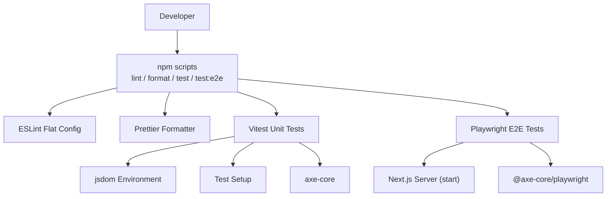
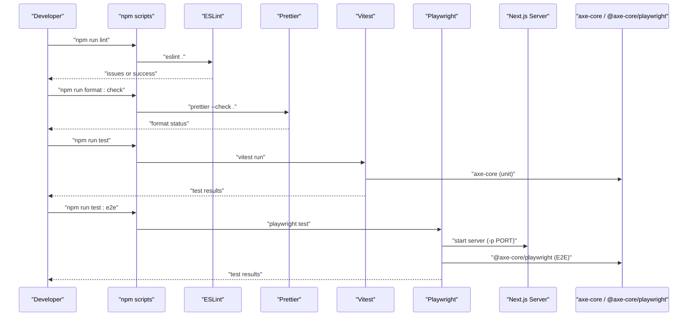
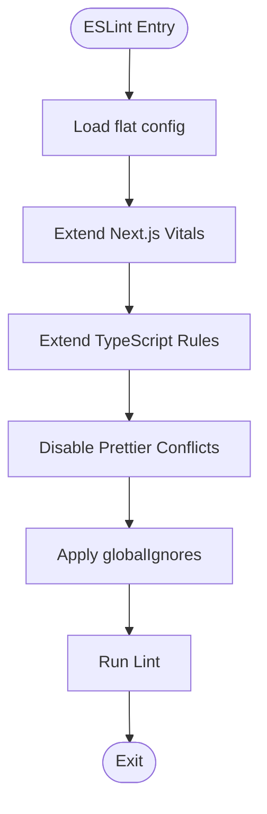
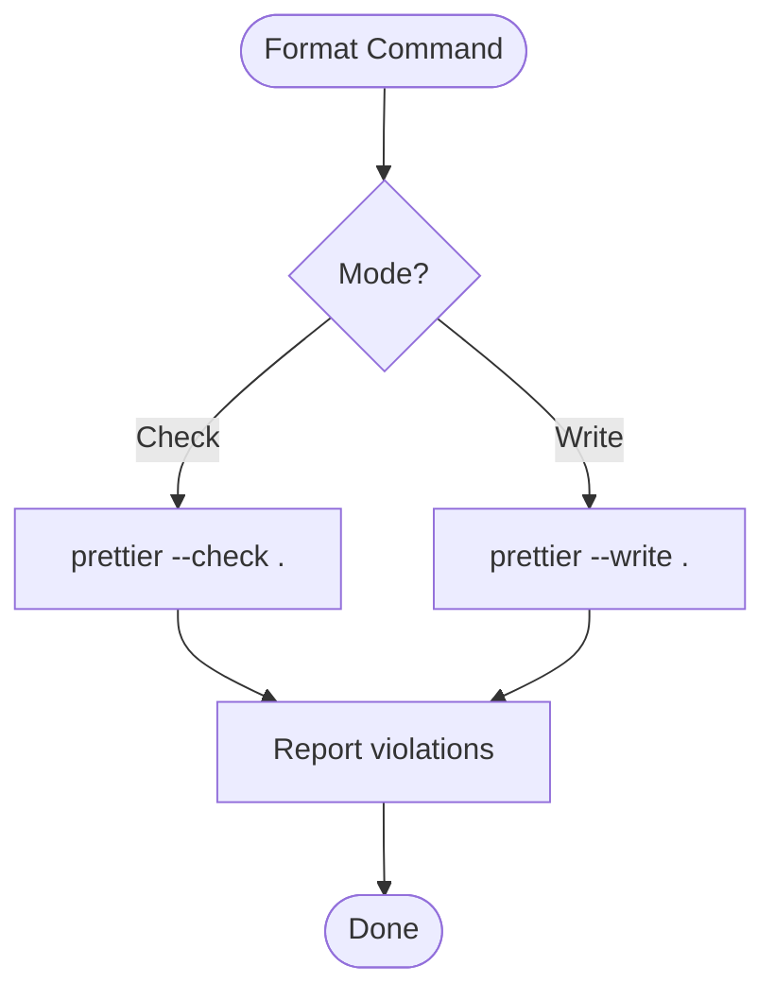
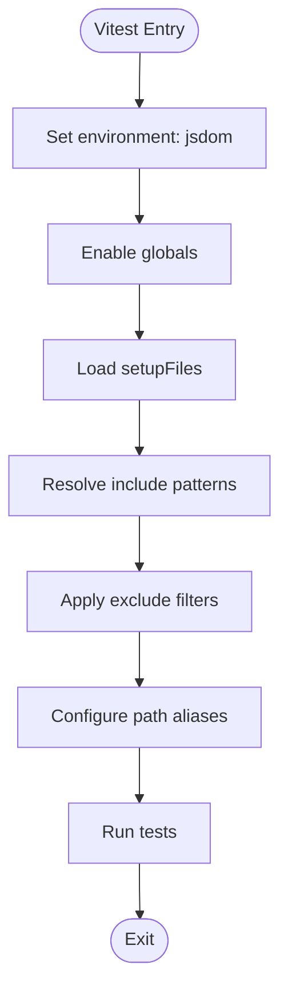
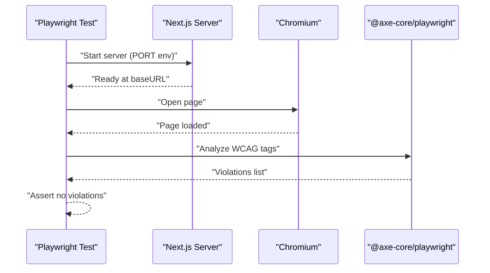
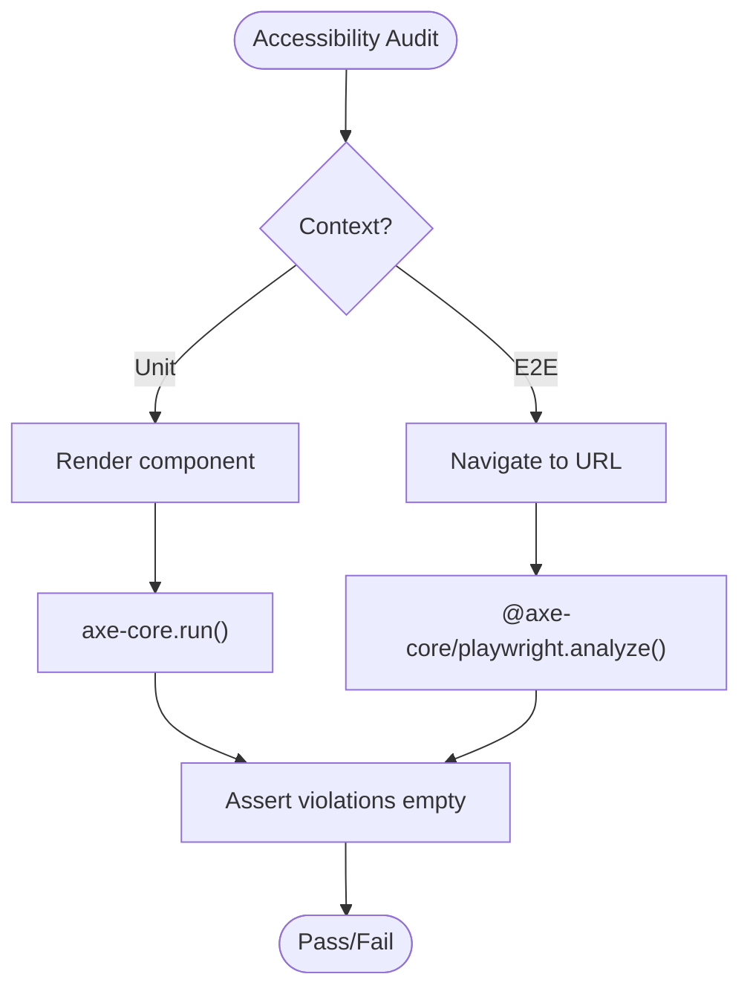
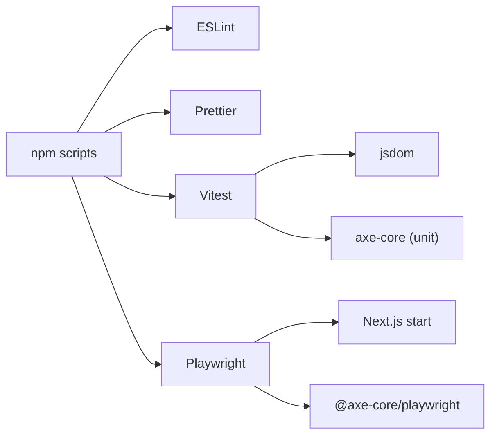

# Code Quality & Automated Tools

<cite>
**Referenced Files in This Document**
- [package.json](file://package.json)
- [eslint.config.mjs](file://eslint.config.mjs)
- [.prettierrc](file://.prettierrc)
- [vitest.config.ts](file://vitest.config.ts)
- [playwright.config.ts](file://playwright.config.ts)
- [src/__tests__/setup.ts](file://src/__tests__/setup.ts)
- [src/__tests__/accessibility.test.tsx](file://src/__tests__/accessibility.test.tsx)
- [e2e/smoke.spec.ts](file://e2e/smoke.spec.ts)
</cite>

## Table of Contents
1. [Introduction](#introduction)
2. [Project Structure](#project-structure)
3. [Core Components](#core-components)
4. [Architecture Overview](#architecture-overview)
5. [Detailed Component Analysis](#detailed-component-analysis)
6. [Dependency Analysis](#dependency-analysis)
7. [Performance Considerations](#performance-considerations)
8. [Troubleshooting Guide](#troubleshooting-guide)
9. [Conclusion](#conclusion)

## Introduction
This document explains the code quality and automated tools setup for SwimNigeria, focusing on ESLint flat configuration, Prettier formatting, Vitest unit testing, Playwright end-to-end testing, accessibility auditing with axe-core, and how these tools integrate into development workflows. It also provides guidance for extending configurations, adding new tools, and troubleshooting common issues.

## Project Structure
The project uses a modern toolchain:
- Next.js application with TypeScript
- ESLint 9 flat config with Next.js Vitals and TypeScript rules
- Prettier for consistent formatting
- Vitest for unit and component tests using jsdom
- Playwright for E2E smoke tests with accessibility checks via @axe-core/playwright
- axe-core for programmatic accessibility audits in unit tests

**Diagram sources**
- [package.json:6-16](file://package.json#L6-L16)
- [eslint.config.mjs:1-23](file://eslint.config.mjs#L1-L23)
- [.prettierrc:1-8](file://.prettierrc#L1-L8)
- [vitest.config.ts:1-18](file://vitest.config.ts#L1-L18)
- [playwright.config.ts:1-33](file://playwright.config.ts#L1-L33)
- [src/__tests__/setup.ts:1-16](file://src/__tests__/setup.ts#L1-L16)
- [src/__tests__/accessibility.test.tsx:1-13](file://src/__tests__/accessibility.test.tsx#L1-L13)
- [e2e/smoke.spec.ts:1-36](file://e2e/smoke.spec.ts#L1-L36)

**Section sources**
- [package.json:1-48](file://package.json#L1-L48)

## Core Components
- ESLint flat configuration composes Next.js Vitals and TypeScript rule sets and disables conflicting Prettier rules.
- Prettier enforces consistent formatting with semicolons, double quotes, trailing commas, tab width, and print width.
- Vitest runs unit/component tests in jsdom with global APIs and an alias for the source directory.
- Playwright runs E2E tests against a local Next.js server with retries and trace capture in CI.
- Accessibility is validated both in unit tests (axe-core) and E2E tests (@axe-core/playwright).

Key responsibilities:
- Linting: enforce code quality and web vitals best practices
- Formatting: ensure consistent style across the codebase
- Testing: validate behavior and accessibility at unit and E2E levels
- Accessibility: automate WCAG checks to prevent regressions

**Section sources**
- [eslint.config.mjs:1-23](file://eslint.config.mjs#L1-L23)
- [.prettierrc:1-8](file://.prettierrc#L1-L8)
- [vitest.config.ts:1-18](file://vitest.config.ts#L1-L18)
- [playwright.config.ts:1-33](file://playwright.config.ts#L1-L33)
- [src/__tests__/accessibility.test.tsx:1-13](file://src/__tests__/accessibility.test.tsx#L1-L13)
- [e2e/smoke.spec.ts:1-36](file://e2e/smoke.spec.ts#L1-L36)

## Architecture Overview
The quality pipeline integrates multiple tools orchestrated by npm scripts. The diagram maps each script to its runtime environment and dependencies.

**Diagram sources**
- [package.json:6-16](file://package.json#L6-L16)
- [eslint.config.mjs:1-23](file://eslint.config.mjs#L1-L23)
- [.prettierrc:1-8](file://.prettierrc#L1-L8)
- [vitest.config.ts:1-18](file://vitest.config.ts#L1-L18)
- [playwright.config.ts:1-33](file://playwright.config.ts#L1-L33)
- [src/__tests__/accessibility.test.tsx:1-13](file://src/__tests__/accessibility.test.tsx#L1-L13)
- [e2e/smoke.spec.ts:1-36](file://e2e/smoke.spec.ts#L1-L36)

## Detailed Component Analysis

### ESLint Flat Configuration
- Composes Next.js Vitals and TypeScript rules from official configs.
- Disables conflicting Prettier rules via eslint-config-prettier.
- Ignores generated and non-source directories and files.

Configuration highlights:
- Uses the flat config API with defineConfig and globalIgnores.
- Extends nextVitals and nextTs for comprehensive checks.
- Applies prettierConfig to avoid conflicts between ESLint and Prettier.

**Diagram sources**
- [eslint.config.mjs:1-23](file://eslint.config.mjs#L1-L23)

**Section sources**
- [eslint.config.mjs:1-23](file://eslint.config.mjs#L1-L23)

### Prettier Formatting
- Enforces consistent formatting across the codebase.
- Key options include semicolons, single quote preference, trailing commas, tab width, and line length.

Formatting workflow:
- Check mode: validates formatting without changes.
- Write mode: applies formatting automatically.

**Diagram sources**
- [.prettierrc:1-8](file://.prettierrc#L1-L8)
- [package.json:15-16](file://package.json#L15-L16)

**Section sources**
- [.prettierrc:1-8](file://.prettierrc#L1-L8)
- [package.json:15-16](file://package.json#L15-L16)

### Vitest Unit Testing
- Runs tests in a jsdom environment with globals enabled.
- Loads a setup file to extend DOM APIs and polyfill missing methods.
- Includes only relevant test files and excludes e2e and build artifacts.
- Provides path aliasing for cleaner imports.

Testing flow:
- Initialize jsdom environment.
- Execute setup file to augment DOM.
- Discover and run tests matching the include pattern.

**Diagram sources**
- [vitest.config.ts:1-18](file://vitest.config.ts#L1-L18)
- [src/__tests__/setup.ts:1-16](file://src/__tests__/setup.ts#L1-L16)

**Section sources**
- [vitest.config.ts:1-18](file://vitest.config.ts#L1-L18)
- [src/__tests__/setup.ts:1-16](file://src/__tests__/setup.ts#L1-L16)

### Playwright E2E Testing
- Executes tests under ./e2e with parallel execution.
- Starts the Next.js server on a configurable port and waits for it to be ready.
- Enables trace capture on first retry and restricts workers in CI.
- Integrates @axe-core/playwright for automated accessibility checks.

E2E sequence:
- Launch browser project (Chromium).
- Start web server with environment variables.
- Navigate to pages and assert content and accessibility.

**Diagram sources**
- [playwright.config.ts:1-33](file://playwright.config.ts#L1-L33)
- [e2e/smoke.spec.ts:1-36](file://e2e/smoke.spec.ts#L1-L36)

**Section sources**
- [playwright.config.ts:1-33](file://playwright.config.ts#L1-L33)
- [e2e/smoke.spec.ts:1-36](file://e2e/smoke.spec.ts#L1-L36)

### Accessibility Auditing with axe-core
- Unit tests use axe-core directly against rendered components.
- E2E tests use @axe-core/playwright to scan live pages for WCAG violations.

Accessibility flow:
- Render component or navigate to page.
- Run axe analysis with specified WCAG tags.
- Assert zero violations.

**Diagram sources**
- [src/__tests__/accessibility.test.tsx:1-13](file://src/__tests__/accessibility.test.tsx#L1-L13)
- [e2e/smoke.spec.ts:1-36](file://e2e/smoke.spec.ts#L1-L36)

**Section sources**
- [src/__tests__/accessibility.test.tsx:1-13](file://src/__tests__/accessibility.test.tsx#L1-L13)
- [e2e/smoke.spec.ts:1-36](file://e2e/smoke.spec.ts#L1-L36)

## Dependency Analysis
The following diagram shows how npm scripts orchestrate the tools and their runtime dependencies.

**Diagram sources**
- [package.json:6-16](file://package.json#L6-L16)
- [package.json:26-46](file://package.json#L26-L46)
- [vitest.config.ts:1-18](file://vitest.config.ts#L1-L18)
- [playwright.config.ts:1-33](file://playwright.config.ts#L1-L33)

**Section sources**
- [package.json:6-16](file://package.json#L6-L16)
- [package.json:26-46](file://package.json#L26-L46)

## Performance Considerations
- Keep test environments minimal: jsdom is sufficient for most UI tests; avoid heavy mocks unless necessary.
- Prefer targeted includes/excludes in Vitest to reduce discovery overhead.
- In CI, Playwright runs with limited workers and retries to stabilize flaky tests while keeping feedback fast.
- Use trace capture selectively (on-first-retry) to limit artifact size.
- For bundle performance, follow Next.js and React best practices outside this document’s scope; consider dynamic imports for large libraries when needed.

[No sources needed since this section provides general guidance]

## Troubleshooting Guide
Common issues and resolutions:
- ESLint reports conflicts with Prettier:
  - Ensure eslint-config-prettier is included in the flat config to disable conflicting rules.
  - Verify that globalIgnores covers generated folders to avoid noise.
- Prettier check fails:
  - Run the write command to auto-format, then commit the changes.
  - Confirm .prettierrc settings match team preferences.
- Vitest cannot find modules:
  - Verify the path alias points to the correct src directory.
  - Ensure setupFiles are executed before tests.
- Dialog-related test failures in jsdom:
  - Polyfill HTMLDialogElement showModal/close in the setup file if missing.
- Playwright cannot connect to the server:
  - Confirm the server starts successfully on the configured port and baseURL.
  - In CI, ensure reuseExistingServer is disabled and timeouts are adequate.
- Accessibility scans report violations:
  - Review violation details and fix semantic or contrast issues.
  - Narrow axe tag scopes if necessary, but prefer fixing root causes.

**Section sources**
- [eslint.config.mjs:1-23](file://eslint.config.mjs#L1-L23)
- [.prettierrc:1-8](file://.prettierrc#L1-L8)
- [vitest.config.ts:1-18](file://vitest.config.ts#L1-L18)
- [src/__tests__/setup.ts:1-16](file://src/__tests__/setup.ts#L1-L16)
- [playwright.config.ts:1-33](file://playwright.config.ts#L1-L33)

## Conclusion
SwimNigeria’s quality pipeline combines ESLint, Prettier, Vitest, Playwright, and axe-core to enforce code standards, maintain consistency, and validate functionality and accessibility. The flat ESLint configuration, clear Prettier rules, robust Vitest setup, and integrated Playwright E2E tests provide a strong foundation for reliable development. Extending or customizing these tools should follow the established patterns to keep the pipeline predictable and maintainable.

[No sources needed since this section summarizes without analyzing specific files]