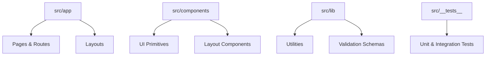
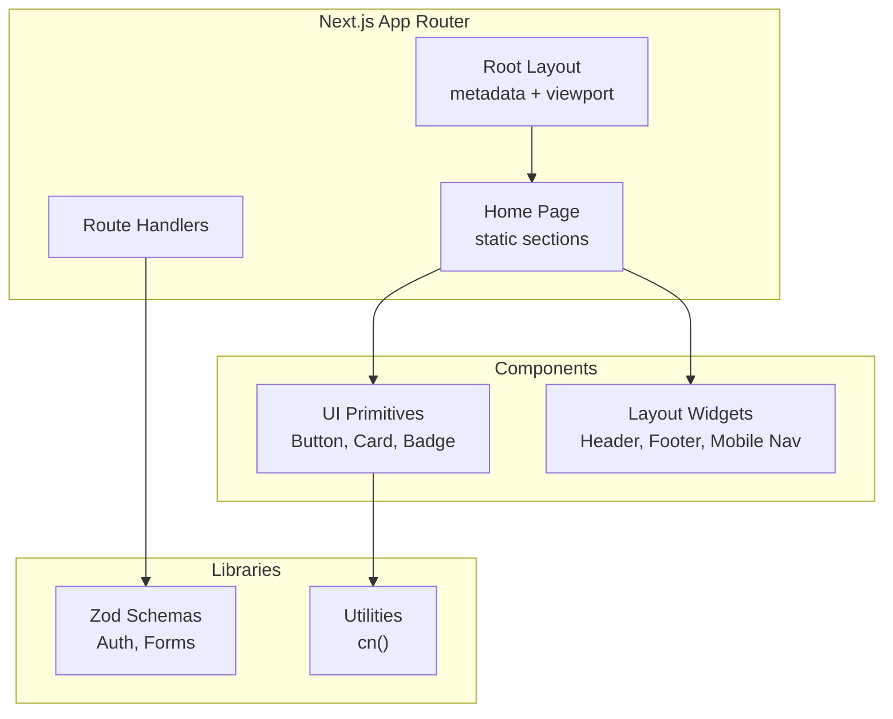
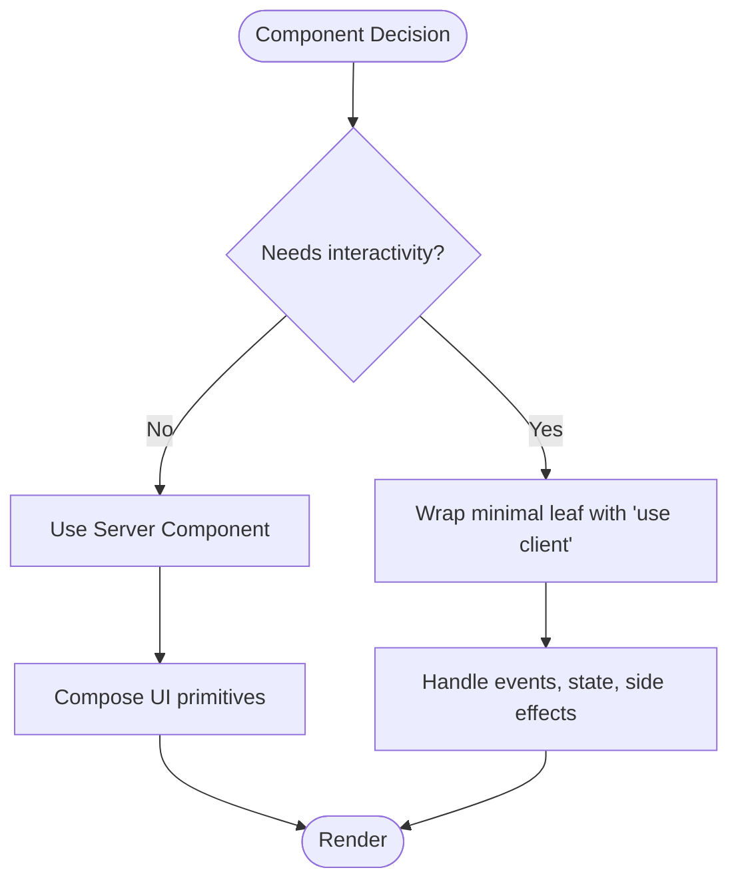
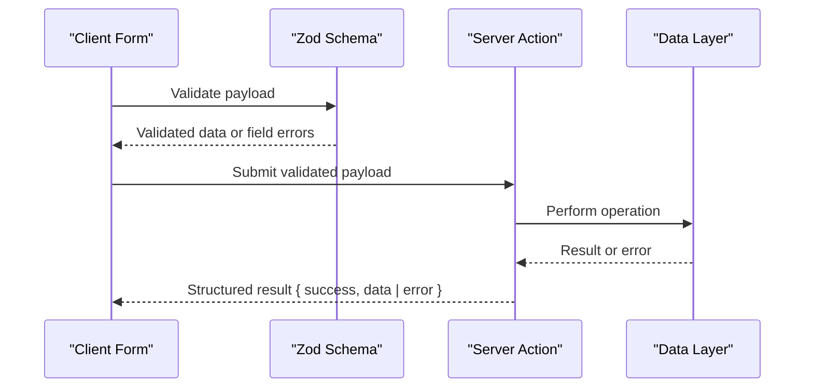
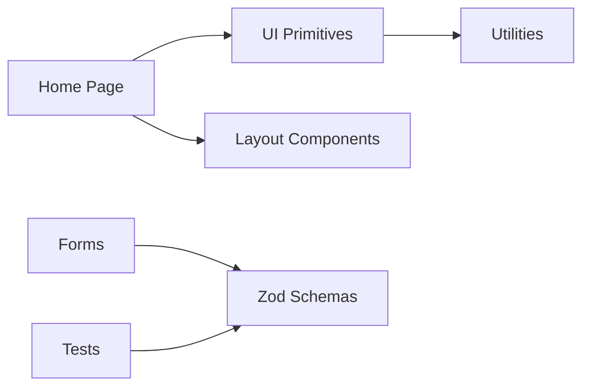

# Coding Standards & Conventions

<cite>
**Referenced Files in This Document**
- [tsconfig.json](file://tsconfig.json)
- [eslint.config.mjs](file://eslint.config.mjs)
- [.prettierrc](file://.prettierrc)
- [CODING_STANDARDS.md](file://docs/CODING_STANDARDS.md)
- [layout.tsx](file://src/app/layout.tsx)
- [page.tsx](file://src/app/page.tsx)
- [button.tsx](file://src/components/ui/button.tsx)
- [utils.ts](file://src/lib/utils.ts)
- [auth.ts](file://src/lib/validation/auth.ts)
- [auth-validation.test.ts](file://src/__tests__/auth-validation.test.ts)
</cite>

## Table of Contents
1. [Introduction](#introduction)
2. [Project Structure](#project-structure)
3. [Core Components](#core-components)
4. [Architecture Overview](#architecture-overview)
5. [Detailed Component Analysis](#detailed-component-analysis)
6. [Dependency Analysis](#dependency-analysis)
7. [Performance Considerations](#performance-considerations)
8. [Troubleshooting Guide](#troubleshooting-guide)
9. [Conclusion](#conclusion)

## Introduction
This document defines the coding standards and conventions for SwimNigeria. It covers strict TypeScript requirements, ESLint flat configuration, Prettier formatting rules, Next.js App Router directory organization, component architecture patterns, naming conventions, validation with Zod, error handling approaches, import ordering, and comment standards. The goal is to keep code predictable, type-safe, accessible, and maintainable across server components, client components, routes, utilities, and tests.

## Project Structure
SwimNigeria follows Next.js App Router conventions:
- `src/app/` contains route-based pages, layouts, and route handlers.
- `src/components/` holds reusable UI and layout components.
- `src/lib/` contains shared libraries, utilities, and validation schemas.
- Tests live under `src/__tests__/`.

**Diagram sources**
- [layout.tsx:1-42](file://src/app/layout.tsx#L1-L42)
- [page.tsx:1-645](file://src/app/page.tsx#L1-L645)
- [button.tsx:1-103](file://src/components/ui/button.tsx#L1-L103)
- [utils.ts:1-27](file://src/lib/utils.ts#L1-L27)
- [auth.ts:1-105](file://src/lib/validation/auth.ts#L1-L105)

**Section sources**
- [layout.tsx:1-42](file://src/app/layout.tsx#L1-L42)
- [page.tsx:1-645](file://src/app/page.tsx#L1-L645)

## Core Components
The project’s core building blocks include:
- Root layout and page components that compose global metadata, viewport settings, header/footer, and main content.
- Primitive UI components such as Button, which encapsulate variants, sizes, accessibility attributes, and loading states.
- Utility functions like a zero-dependency class name combinator used by UI components.
- Validation schemas using Zod for authentication flows, with corresponding tests ensuring normalization and security behavior.

Key responsibilities:
- Layout and page files define structure, metadata, and high-level composition without embedding business logic.
- UI components expose typed props, default behaviors, and consistent accessibility semantics.
- Utilities provide pure helpers (e.g., class merging).
- Validation schemas centralize input contracts and user-facing messages.

**Section sources**
- [layout.tsx:1-42](file://src/app/layout.tsx#L1-L42)
- [page.tsx:1-645](file://src/app/page.tsx#L1-L645)
- [button.tsx:1-103](file://src/components/ui/button.tsx#L1-L103)
- [utils.ts:1-27](file://src/lib/utils.ts#L1-L27)
- [auth.ts:1-105](file://src/lib/validation/auth.ts#L1-L105)

## Architecture Overview
SwimNigeria uses React Server Components by default and isolates interactivity to small client boundaries. Pages and layouts are server-rendered; interactive widgets are marked as client components. Data fetching and presentation are separated from stateful UI.

**Diagram sources**
- [layout.tsx:1-42](file://src/app/layout.tsx#L1-L42)
- [page.tsx:1-645](file://src/app/page.tsx#L1-L645)
- [button.tsx:1-103](file://src/components/ui/button.tsx#L1-L103)
- [utils.ts:1-27](file://src/lib/utils.ts#L1-L27)
- [auth.ts:1-105](file://src/lib/validation/auth.ts#L1-L105)

## Detailed Component Analysis

### Strict TypeScript Mode Requirements
- Enable strict mode globally via compiler options.
- Enforce explicit return types on exported functions, Server Actions, and public helpers.
- Prefer interfaces for object shapes and component props; prefer type aliases for unions, intersections, primitives, and mapped types.
- Avoid non-null assertions; use optional chaining, nullish coalescing, and guard clauses.
- Use `unknown` instead of `any`, paired with type guards or Zod schemas.

Configuration highlights:
- Strict mode enabled.
- No implicit any.
- Strict null checks.
- JSX transform configured for React.
- Module resolution set for bundler environments.
- Path aliasing for `@/*` pointing to `src/`.

**Section sources**
- [tsconfig.json:1-36](file://tsconfig.json#L1-L36)
- [CODING_STANDARDS.md:1-12](file://docs/CODING_STANDARDS.md#L1-L12)

### ESLint Flat Configuration Rules
- Uses Next.js Web Vitals and TypeScript rule sets.
- Integrates Prettier to avoid conflicting style rules.
- Ignores generated and build directories.

Practical implications:
- Follow Next.js best practices for performance and correctness.
- Keep linting aligned with Prettier formatting.
- Exclude build artifacts from analysis.

**Section sources**
- [eslint.config.mjs:1-24](file://eslint.config.mjs#L1-L24)

### Prettier Formatting Standards
- Semicolons required.
- Double quotes preferred.
- Trailing commas everywhere.
- Two-space indentation.
- Print width of 100 characters.

These rules ensure consistent formatting across the codebase and prevent style conflicts with ESLint.

**Section sources**
- [.prettierrc:1-8](file://.prettierrc#L1-L8)

### Directory Organization Principles
Follow Next.js App Router conventions:
- Route groups for auth, dashboard, and public areas.
- Feature-driven folders under `components/` (e.g., courses, assessments).
- Shared utilities and integrations under `lib/`.
- Global types and database models under `types/`.
- Global styles and design tokens under `styles/`.

Current usage:
- Root layout and page demonstrate metadata, viewport, and composition.
- UI components live under `components/ui/`.
- Layout components live under `components/layout/`.
- Utilities and validation schemas live under `lib/`.

**Section sources**
- [CODING_STANDARDS.md:30-54](file://docs/CODING_STANDARDS.md#L30-L54)
- [layout.tsx:1-42](file://src/app/layout.tsx#L1-L42)
- [page.tsx:1-645](file://src/app/page.tsx#L1-L645)

### Naming Conventions
- Files and directories:
  - Components: PascalCase.
  - Route files and directories: kebab-case.
  - Utilities/helpers: kebab-case or camelCase.
- Types and interfaces:
  - Components and types: PascalCase.
  - Props interfaces: PascalCase suffixed with `Props`.
- Functions, variables, constants:
  - Functions/methods: camelCase with clear verb prefixes.
  - Boolean variables: prefixed with `is`, `has`, `should`, `can`.
  - Constants: UPPER_SNAKE_CASE.

Examples in code:
- Component prop interface pattern: `ButtonProps`.
- Variant and size enums defined as union types for strong typing.
- Utility function named with descriptive verbs: `cn`.

**Section sources**
- [CODING_STANDARDS.md:14-27](file://docs/CODING_STANDARDS.md#L14-L27)
- [button.tsx:1-103](file://src/components/ui/button.tsx#L1-L103)
- [utils.ts:1-27](file://src/lib/utils.ts#L1-L27)

### Component Architecture Patterns
- Server Components by default; mark only interactive leaves with `"use client"`.
- Push client boundaries to the smallest possible units.
- Separate presentation from business logic and data access.
- Use typed props and explicit variants/sizes for consistency.

Observed patterns:
- Root layout and home page are server-rendered and compose UI primitives.
- Interactive widgets (forms, dialogs, mobile nav) are client components.
- UI primitives encapsulate styling, accessibility, and state-related rendering (e.g., loading indicators).

[No sources needed since this diagram shows conceptual workflow, not actual code structure]

**Section sources**
- [CODING_STANDARDS.md:58-66](file://docs/CODING_STANDARDS.md#L58-L66)
- [layout.tsx:1-42](file://src/app/layout.tsx#L1-L42)
- [page.tsx:1-645](file://src/app/page.tsx#L1-L645)

### Input Validation Using Zod and Error Handling
- All inputs must be validated against Zod schemas before processing.
- Return structured results from Server Actions rather than throwing unhandled exceptions.
- Provide polite, actionable, user-facing error messages.
- Normalize inputs (trimming, lowercasing) within schemas.
- Strip unexpected fields to prevent injection.

Implementation examples:
- Authentication schemas validate email format, password strength, and confirmation equality.
- Tests verify normalization, rejection of invalid payloads, and stripping of injected fields.

**Diagram sources**
- [auth.ts:1-105](file://src/lib/validation/auth.ts#L1-L105)
- [auth-validation.test.ts:1-343](file://src/__tests__/auth-validation.test.ts#L1-L343)

**Section sources**
- [CODING_STANDARDS.md:76-93](file://docs/CODING_STANDARDS.md#L76-L93)
- [auth.ts:1-105](file://src/lib/validation/auth.ts#L1-L105)
- [auth-validation.test.ts:1-343](file://src/__tests__/auth-validation.test.ts#L1-L343)

### Examples of Proper Component Structure, Prop Interfaces, and State Management
- Define explicit prop interfaces for components (e.g., `ButtonProps`).
- Use union types for variants and sizes to constrain allowed values.
- Provide defaults for common props and handle loading/disabled states explicitly.
- For stateful interactions, isolate state in client components and pass down props.

Reference example:
- Button component demonstrates typed props, variant/style maps, accessibility attributes, and loading state handling.

**Section sources**
- [button.tsx:1-103](file://src/components/ui/button.tsx#L1-L103)

### Code Organization Principles, Import Ordering, and Comment Standards
- Organize imports logically: external dependencies first, then internal modules grouped by scope.
- Use path aliases (`@/*`) for clarity and reduced relative path complexity.
- Add concise comments describing responsibilities and constraints, especially for validation schemas and utilities.
- Keep comments focused on why and what, avoiding redundant restatement of obvious code.

Observed patterns:
- Utility file includes purpose and behavior descriptions.
- Validation schema files describe responsibilities and constraints at the top.

**Section sources**
- [utils.ts:1-27](file://src/lib/utils.ts#L1-L27)
- [auth.ts:1-105](file://src/lib/validation/auth.ts#L1-L105)

## Dependency Analysis
High-level relationships:
- Pages and layouts depend on UI primitives and layout components.
- UI primitives depend on utility functions for class name composition.
- Validation schemas are consumed by forms and server actions.
- Tests validate schema behavior and normalize inputs.

**Diagram sources**
- [page.tsx:1-645](file://src/app/page.tsx#L1-L645)
- [button.tsx:1-103](file://src/components/ui/button.tsx#L1-L103)
- [utils.ts:1-27](file://src/lib/utils.ts#L1-L27)
- [auth.ts:1-105](file://src/lib/validation/auth.ts#L1-L105)
- [auth-validation.test.ts:1-343](file://src/__tests__/auth-validation.test.ts#L1-L343)

**Section sources**
- [page.tsx:1-645](file://src/app/page.tsx#L1-L645)
- [button.tsx:1-103](file://src/components/ui/button.tsx#L1-L103)
- [utils.ts:1-27](file://src/lib/utils.ts#L1-L27)
- [auth.ts:1-105](file://src/lib/validation/auth.ts#L1-L105)
- [auth-validation.test.ts:1-343](file://src/__tests__/auth-validation.test.ts#L1-L343)

## Performance Considerations
- Favor server components for static and data-fetching layers.
- Minimize client boundaries to reduce bundle size.
- Avoid unnecessary re-renders by keeping state close to where it is used.
- Use concurrent fetching for independent data sources when appropriate.
- Audit third-party dependencies for size and license compatibility.

[No sources needed since this section provides general guidance]

## Troubleshooting Guide
Common issues and resolutions:
- Type errors due to missing explicit return types: add return types to exported functions and Server Actions.
- Unexpected runtime errors from unvalidated inputs: always parse through Zod schemas and handle field errors.
- Inconsistent formatting: run Prettier and ensure ESLint does not conflict with Prettier rules.
- Accessibility problems: ensure semantic HTML, labels, focus rings, and aria attributes are present.

Checklist:
- Verify tsconfig strict flags are enabled.
- Confirm ESLint config includes Next.js and Prettier rules.
- Ensure all user-facing errors are plain-language and actionable.
- Review tests for schema normalization and rejection cases.

**Section sources**
- [tsconfig.json:1-36](file://tsconfig.json#L1-L36)
- [eslint.config.mjs:1-24](file://eslint.config.mjs#L1-L24)
- [CODING_STANDARDS.md:76-93](file://docs/CODING_STANDARDS.md#L76-L93)

## Conclusion
SwimNigeria’s coding standards emphasize strict TypeScript, clear directory organization following Next.js App Router conventions, typed component APIs, robust Zod-based validation, and consistent formatting via ESLint and Prettier. By adhering to these guidelines, the team can maintain a scalable, accessible, and secure codebase while minimizing technical debt and improving developer experience.