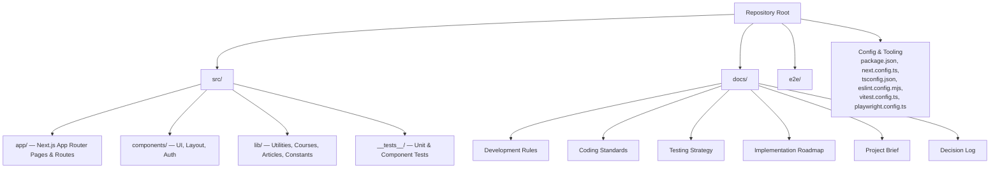
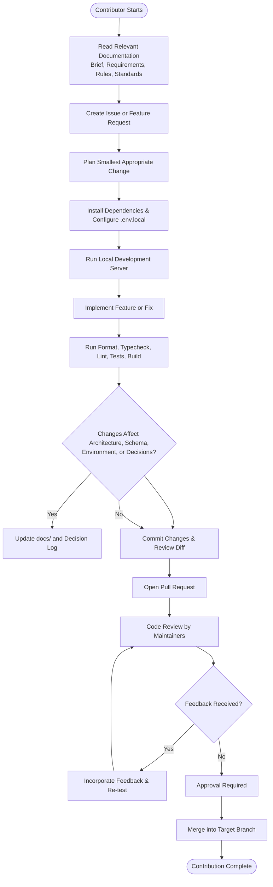
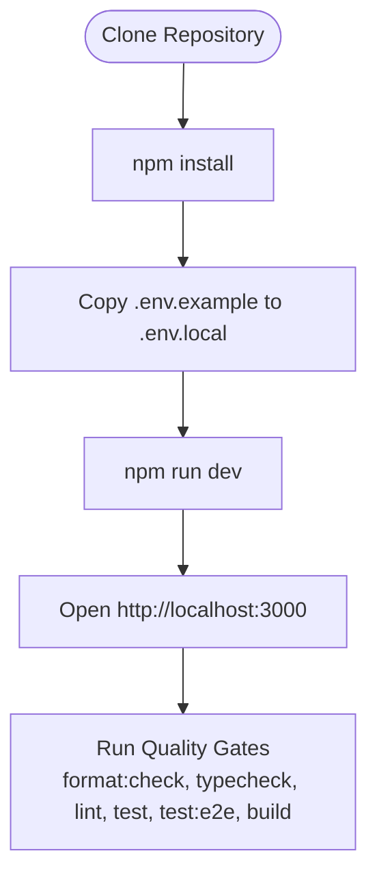
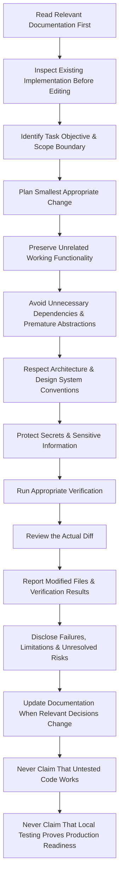
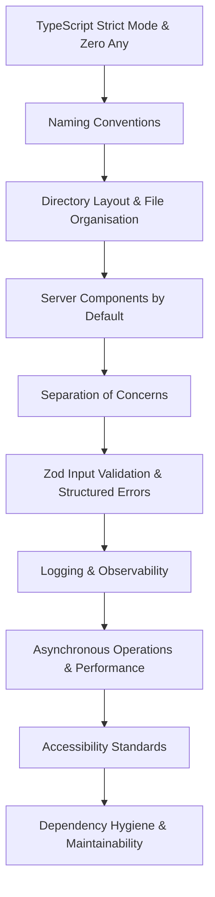
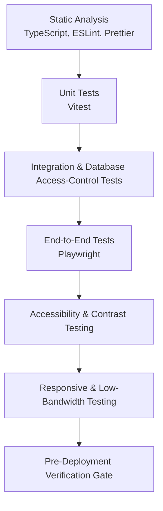
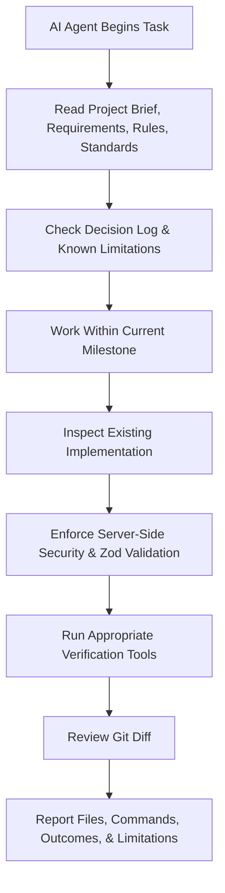
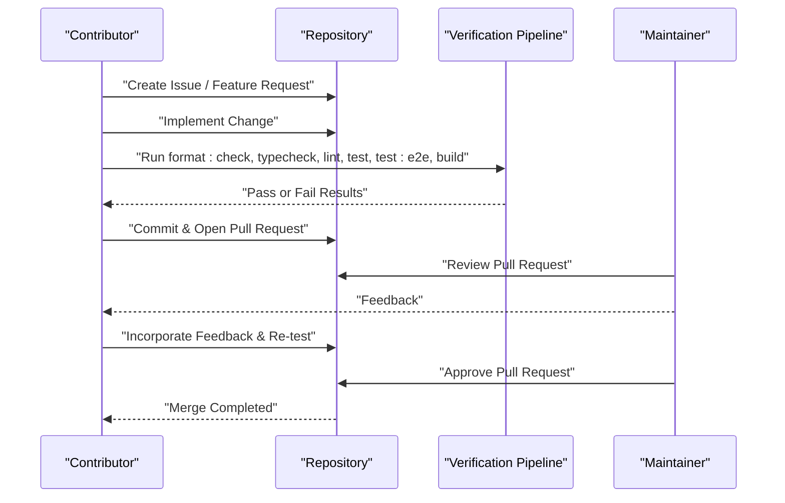
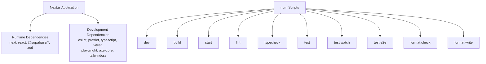

# Contribution Process & Guidelines

<cite>
**Referenced Files in This Document**
- [README.md](file://README.md)
- [package.json](file://package.json)
- [AGENTS.md](file://AGENTS.md)
- [docs/DEVELOPMENT_RULES.md](file://docs/DEVELOPMENT_RULES.md)
- [docs/CODING_STANDARDS.md](file://docs/CODING_STANDARDS.md)
- [docs/TESTING_STRATEGY.md](file://docs/TESTING_STRATEGY.md)
- [docs/PROJECT_BRIEF.md](file://docs/PROJECT_BRIEF.md)
- [docs/IMPLEMENTATION_ROADMAP.md](file://docs/IMPLEMENTATION_ROADMAP.md)
- [docs/DECISION_LOG.md](file://docs/DECISION_LOG.md)
</cite>

## Table of Contents
1. [Introduction](#introduction)
2. [Project Structure](#project-structure)
3. [Core Components](#core-components)
4. [Architecture Overview](#architecture-overview)
5. [Detailed Component Analysis](#detailed-component-analysis)
6. [Dependency Analysis](#dependency-analysis)
7. [Performance Considerations](#performance-considerations)
8. [Troubleshooting Guide](#troubleshooting-guide)
9. [Conclusion](#conclusion)
10. [Appendices](#appendices)

## Introduction
This document explains how to contribute to SwimNigeria as a developer or AI coding agent. It covers getting started, setting up the development environment, following the feature development workflow, adhering to mandatory directives and coding standards, writing tests, updating documentation, ensuring accessibility compliance, and participating in code review and approval.

SwimNigeria is a digital aquatic education platform focused on structured swimming instruction, water safety knowledge, beginner courses, and verifiable certifications for Nigerian learners. The project currently reports Phase 1 completion with strict quality gates, TypeScript strictness, Tailwind CSS v4, ESLint, Prettier, Vitest, Playwright, and axe-core configured.

**Section sources**
- [README.md:1-17](file://README.md#L1-L17)
- [docs/PROJECT_BRIEF.md:1-25](file://docs/PROJECT_BRIEF.md#L1-L25)

## Project Structure
The repository follows a Next.js App Router structure with dedicated directories for application pages, reusable components, shared libraries, tests, end-to-end tests, and engineering documentation.

**Diagram sources**
- [package.json:6-16](file://package.json#L6-L16)
- [README.md:71-89](file://README.md#L71-L89)

Key responsibilities:
- `src/app`: Page routes, Server Actions, and route handlers.
- `src/components`: Reusable UI primitives and layout components.
- `src/lib`: Shared utilities, course data helpers, constants, and validation-related logic.
- `src/__tests__`: Unit and component tests using Vitest and React Testing Library.
- `e2e`: Playwright end-to-end smoke tests for critical user journeys.
- `docs`: Engineering documentation including rules, standards, testing strategy, roadmap, brief, and decision records.

**Section sources**
- [README.md:71-89](file://README.md#L71-L89)
- [docs/CODING_STANDARDS.md:30-54](file://docs/CODING_STANDARDS.md#L30-L54)

## Core Components
For contributors, the most important operational components are:

- **Prerequisites and Environment Setup:** Node.js and npm versions, `.env.local` template usage, and local development server startup.
- **Quality Gates:** Formatting, type checking, linting, unit/component tests, E2E tests, production build, and production server commands.
- **Mandatory Development Directives:** Fifteen non-negotiable rules for agents and engineers covering documentation-first work, scope control, security, verification, diff review, transparency, and documentation updates.
- **Coding Standards:** TypeScript strictness, naming conventions, directory organization, Server vs Client components, separation of concerns, Zod validation, logging, async performance, accessibility, and dependency hygiene.
- **Testing Strategy:** Static analysis, unit tests, integration/database access-control tests, E2E tests, accessibility checks, responsive/low-bandwidth testing, and pre-deployment verification gate.
- **Agent Directives:** Documentation-first approach, phase discipline, pre-change inspection, security-first implementation, verification and diff review, and honest reporting.

These components define how contributors should set up their environment, develop features safely, verify changes, and submit contributions.

**Section sources**
- [README.md:20-67](file://README.md#L20-L67)
- [docs/DEVELOPMENT_RULES.md:1-71](file://docs/DEVELOPMENT_RULES.md#L1-L71)
- [docs/CODING_STANDARDS.md:1-131](file://docs/CODING_STANDARDS.md#L1-L131)
- [docs/TESTING_STRATEGY.md:1-128](file://docs/TESTING_STRATEGY.md#L1-L128)
- [AGENTS.md:1-37](file://AGENTS.md#L1-L37)

## Architecture Overview
The contribution workflow is best understood as a pipeline from issue creation through local development, testing, documentation updates, pull request submission, code review, feedback incorporation, and final approval.

**Diagram sources**
- [docs/IMPLEMENTATION_ROADMAP.md:8-24](file://docs/IMPLEMENTATION_ROADMAP.md#L8-L24)
- [docs/DEVELOPMENT_RULES.md:9-64](file://docs/DEVELOPMENT_RULES.md#L9-L64)
- [docs/TESTING_STRATEGY.md:95-119](file://docs/TESTING_STRATEGY.md#L95-L119)

## Detailed Component Analysis

### Getting Started & Development Environment Setup
Follow these steps before developing any feature:

1. **Verify Prerequisites**
   - Use Node.js version at least the minimum specified in the project setup.
   - Use npm version at least the minimum specified in the project setup.

2. **Install Dependencies**
   - Run the package manager install command defined in the project scripts.

3. **Configure Environment Variables**
   - Copy the environment template into an untracked local file.
   - Do not commit real API keys or secrets.

4. **Start the Development Server**
   - Run the development script to start the Next.js server locally.
   - Open the local development URL in your browser.

5. **Understand Quality Gates**
   - Before submitting changes, run formatting checks, type checks, linting, tests, E2E tests, and production build verification.

**Diagram sources**
- [README.md:20-67](file://README.md#L20-L67)
- [package.json:6-16](file://package.json#L6-L16)

**Section sources**
- [README.md:20-67](file://README.md#L20-L67)
- [package.json:6-16](file://package.json#L6-L16)

### Mandatory Development Directives for Contributors
All contributors, including AI coding agents, must follow the fifteen mandatory directives. These cover reading documentation first, inspecting existing code, defining scope boundaries, planning small changes, preserving unrelated functionality, avoiding unnecessary dependencies, respecting architecture and design system conventions, protecting secrets, running verification, reviewing diffs, reporting modified files and results, disclosing failures, updating documentation when relevant, never claiming untested code works, and distinguishing local testing from production readiness.

**Diagram sources**
- [docs/DEVELOPMENT_RULES.md:9-70](file://docs/DEVELOPMENT_RULES.md#L9-L70)

**Section sources**
- [docs/DEVELOPMENT_RULES.md:1-71](file://docs/DEVELOPMENT_RULES.md#L1-L71)

### Coding Standards & Accessibility Compliance
Contributors must adhere to TypeScript strict mode, zero `any` policy, explicit return types, interface vs type alias guidance, nullability handling, naming conventions, directory layout, Server vs Client component boundaries, separation of concerns, Zod input validation, structured error returns, logging rules, asynchronous performance patterns, accessibility standards, and dependency hygiene.

Accessibility requirements include semantic HTML, meaningful alt text, labeled form inputs, keyboard-accessible interactive elements, visible focus indicators, and logical heading hierarchy.

**Diagram sources**
- [docs/CODING_STANDARDS.md:3-131](file://docs/CODING_STANDARDS.md#L3-L131)

**Section sources**
- [docs/CODING_STANDARDS.md:1-131](file://docs/CODING_STANDARDS.md#L1-L131)

### Testing Strategy & Pre-Deployment Gate
The testing strategy defines a layered verification model: static analysis, unit tests, integration/database access-control tests, end-to-end tests, accessibility checks, responsive and low-bandwidth testing, and a pre-deployment verification gate.

Before merging or deploying:
- Run formatting check.
- Run TypeScript type check.
- Run linting.
- Run unit, component, and accessibility tests.
- Run production build.
- Run Playwright E2E smoke and accessibility tests.

**Diagram sources**
- [docs/TESTING_STRATEGY.md:10-20](file://docs/TESTING_STRATEGY.md#L10-L20)
- [docs/TESTING_STRATEGY.md:95-119](file://docs/TESTING_STRATEGY.md#L95-L119)

**Section sources**
- [docs/TESTING_STRATEGY.md:1-128](file://docs/TESTING_STRATEGY.md#L1-L128)

### AI Coding Agent Directives & Mandatory Rules
AI coding assistants must follow documentation-first planning, strict scope control aligned with the implementation roadmap, pre-change inspection, security-first implementation, verification and diff review, and honest transparent reporting. Agents must consult `docs/PROJECT_BRIEF.md`, `docs/PRODUCT_REQUIREMENTS.md`, `docs/DEVELOPMENT_RULES.md`, `docs/CODING_STANDARDS.md`, `docs/DECISION_LOG.md`, and `docs/KNOWN_LIMITATIONS.md`.

**Diagram sources**
- [AGENTS.md:1-37](file://AGENTS.md#L1-L37)
- [docs/DEVELOPMENT_RULES.md:9-70](file://docs/DEVELOPMENT_RULES.md#L9-L70)

**Section sources**
- [AGENTS.md:1-37](file://AGENTS.md#L1-L37)
- [docs/DEVELOPMENT_RULES.md:1-71](file://docs/DEVELOPMENT_RULES.md#L1-L71)

### Feature Development Workflow: From Issue to Pull Request
Use this workflow for every feature, bug fix, or improvement:

1. **Create an Issue or Feature Request**
   - Describe the problem, goal, affected areas, acceptance criteria, and constraints.
   - Reference relevant product requirements, design system rules, or architectural decisions.

2. **Plan the Change**
   - Identify the smallest appropriate change.
   - Confirm that the task is within the current phase boundary.
   - Determine whether documentation, tests, or environment variables need updates.

3. **Set Up the Environment**
   - Install dependencies.
   - Configure `.env.local`.
   - Start the development server.

4. **Implement the Change**
   - Follow coding standards and accessibility requirements.
   - Keep Server Components default; use Client Components only for interactivity.
   - Validate all inputs with Zod and return structured results.

5. **Verify Locally**
   - Run format check, typecheck, lint, unit/component tests, E2E tests where applicable, and production build.

6. **Update Documentation**
   - If the change affects architecture, database schema, environment variables, or settled decisions, update the corresponding documentation and decision log.

7. **Commit and Review the Diff**
   - Ensure every changed line is intentional.
   - Remove debugging artifacts such as console logs.

8. **Open a Pull Request**
   - Include a clear description, affected files, verification results, and links to related issues.

9. **Incorporate Feedback**
   - Address reviewer comments.
   - Re-run verification after changes.

10. **Obtain Approval**
    - Wait for maintainer review and approval before merging.

**Diagram sources**
- [docs/IMPLEMENTATION_ROADMAP.md:8-24](file://docs/IMPLEMENTATION_ROADMAP.md#L8-L24)
- [docs/DEVELOPMENT_RULES.md:44-64](file://docs/DEVELOPMENT_RULES.md#L44-L64)
- [docs/TESTING_STRATEGY.md:95-119](file://docs/TESTING_STRATEGY.md#L95-L119)

**Section sources**
- [docs/IMPLEMENTATION_ROADMAP.md:1-167](file://docs/IMPLEMENTATION_ROADMAP.md#L1-L167)
- [docs/DEVELOPMENT_RULES.md:1-71](file://docs/DEVELOPMENT_RULES.md#L1-L71)
- [docs/TESTING_STRATEGY.md:1-128](file://docs/TESTING_STRATEGY.md#L1-L128)

### Writing Tests
Tests should follow the testing pyramid:
- Prefer fast, deterministic unit and integration tests.
- Use focused end-to-end smoke tests for critical user journeys.
- Cover validation schemas, pure business logic, certificate-related logic, date/time formatting, and utility functions.
- For server actions and database interactions, assert correct behavior under Row-Level Security policies.
- Include accessibility checks using axe-core.
- Test responsive layouts across mobile, tablet, and desktop viewports.
- Simulate low-bandwidth conditions to ensure stable layouts and functional interactions.

When a test cannot be executed locally due to external services, disclose the limitation explicitly rather than marking it as passing.

**Section sources**
- [docs/TESTING_STRATEGY.md:3-9](file://docs/TESTING_STRATEGY.md#L3-L9)
- [docs/TESTING_STRATEGY.md:37-92](file://docs/TESTING_STRATEGY.md#L37-L92)
- [docs/TESTING_STRATEGY.md:123-128](file://docs/TESTING_STRATEGY.md#L123-L128)

### Updating Documentation
Documentation updates are mandatory when implementation changes affect:
- Architecture decisions.
- Database schema or data model.
- Environment variables or secret management.
- Established decisions recorded in the decision log.
- Product requirements or known limitations.

Always record updated documentation changes alongside code changes and verification results.

**Section sources**
- [docs/DEVELOPMENT_RULES.md:63-64](file://docs/DEVELOPMENT_RULES.md#L63-L64)
- [docs/DECISION_LOG.md:1-18](file://docs/DECISION_LOG.md#L1-L18)

### Ensuring Accessibility Compliance
Accessibility compliance is a core requirement. Contributors must:
- Use semantic HTML elements.
- Provide descriptive alt text for informative images and empty alt attributes for decorative icons.
- Associate form inputs with labels.
- Ensure clickable elements are native buttons or anchor tags with proper keyboard support.
- Maintain WCAG 2.1 Level AA contrast ratios.
- Verify focus visibility during keyboard navigation.
- Enforce logical heading hierarchy.
- Run automated accessibility audits with axe-core and perform manual keyboard navigation audits.

**Section sources**
- [docs/CODING_STANDARDS.md:118-123](file://docs/CODING_STANDARDS.md#L118-L123)
- [docs/TESTING_STRATEGY.md:73-82](file://docs/TESTING_STRATEGY.md#L73-L82)

### Code Review Process, Feedback Incorporation, and Approval Requirements
Code review focuses on:
- Adherence to development rules and coding standards.
- Correct use of Server Components, Client Components, and component boundaries.
- Proper input validation and structured error handling.
- Security practices, especially around secrets, environment variables, and authorization.
- Test coverage and verification results.
- Documentation updates when relevant.
- Accessibility and responsiveness.

Reviewers may request changes. Contributors must incorporate feedback, re-run verification, and resubmit until approval is granted.

**Section sources**
- [docs/DEVELOPMENT_RULES.md:52-64](file://docs/DEVELOPMENT_RULES.md#L52-L64)
- [AGENTS.md:25-33](file://AGENTS.md#L25-L33)

### Templates for Issues, Feature Requests, and Pull Requests
Use these templates to standardize communication and make reviews faster.

#### Issue Report Template
- **Title:** Short summary of the problem.
- **Description:** What is broken or missing.
- **Steps to Reproduce:** Numbered steps.
- **Expected Behavior:** What should happen.
- **Actual Behavior:** What actually happens.
- **Environment:** Node version, browser, device, connection notes.
- **Relevant Documentation:** Links to product requirements, design system, or architecture documents.
- **Severity:** Low, Medium, High, Critical.
- **Attachments:** Screenshots, logs, or terminal output.

#### Feature Request Template
- **Title:** Clear feature name.
- **Goal:** Why this feature matters to learners or the platform.
- **User Story:** As a [role], I want [action] so that [benefit].
- **Acceptance Criteria:** Measurable outcomes.
- **Constraints:** Budget, bandwidth, security, accessibility, phase boundaries.
- **Related Phases:** Which implementation phase this belongs to.
- **Dependencies:** Other features or infrastructure required.
- **Risks & Unknowns:** Assumptions, limitations, open questions.

#### Pull Request Description Template
- **Summary:** One-paragraph explanation of the change.
- **Related Issue:** Link to issue or feature request.
- **Files Changed:** List of created, modified, or deleted files.
- **Implementation Notes:** Important design or technical decisions.
- **Security & Validation:** How inputs, secrets, and authorization were handled.
- **Testing Performed:** Commands run and results.
- **Accessibility & Responsiveness:** Changes affecting a11y or mobile/tablet/desktop views.
- **Documentation Updates:** Whether docs or decision log were updated.
- **Remaining Risks:** Anything still untested or unresolved.

[No sources needed since this section provides general templates without analyzing specific files]

## Dependency Analysis
The project’s development workflow depends on several tooling layers:

- **Runtime Dependencies:** Next.js, React, Supabase client packages, and Zod for validation.
- **Development Dependencies:** ESLint, Prettier, TypeScript, Vitest, React Testing Library, Playwright, axe-core, Tailwind CSS, PostCSS, and jsdom.
- **Scripts:** Development server, build, start, lint, typecheck, test, test watch, E2E tests, and formatting commands.

**Diagram sources**
- [package.json:6-46](file://package.json#L6-L46)

**Section sources**
- [package.json:1-48](file://package.json#L1-L48)

## Performance Considerations
Contributors should keep performance and low-bandwidth usability in mind:
- Prefer Server Components for content-heavy routes.
- Avoid unnecessary client-side JavaScript.
- Use concurrent fetching for independent data sources.
- Avoid heavy third-party dependencies unless justified.
- Optimize assets and avoid layout shift.
- Test under simulated slow network conditions.
- Monitor bundle size and audit dependencies regularly.

[No sources needed since this section provides general guidance]

## Troubleshooting Guide

### Common Setup Issues
- **Node.js or npm version mismatch:** Ensure the installed versions meet the project’s minimum requirements.
- **Missing Playwright Chromium binary:** Install the required browser binary before running E2E tests.
- **Environment variables not loaded:** Confirm `.env.local` exists and contains required values without committing secrets.
- **Permission or path issues:** Run installation and development commands from the repository root.

**Section sources**
- [README.md:20-44](file://README.md#L20-L44)
- [README.md:64-67](file://README.md#L64-L67)

### Development Workflow Problems
- **Formatting fails:** Run the auto-format command before committing.
- **Type errors:** Fix TypeScript errors and avoid `any`; use `unknown` with guards or Zod validation.
- **Lint warnings:** Resolve ESLint warnings; zero warnings are expected in CI.
- **Test failures:** Investigate failing unit, component, or E2E tests; do not ignore them.
- **Build failures:** Run the production build to catch bundling or prerendering issues.
- **External service limitations:** Clearly state when live services cannot be tested locally.

**Section sources**
- [docs/DEVELOPMENT_RULES.md:44-64](file://docs/DEVELOPMENT_RULES.md#L44-L64)
- [docs/TESTING_STRATEGY.md:95-128](file://docs/TESTING_STRATEGY.md#L95-L128)

## Conclusion
Contributing to SwimNigeria requires disciplined setup, strict adherence to development rules and coding standards, comprehensive testing, accessibility compliance, and transparent documentation. The recommended workflow moves from reading documentation and creating issues, through scoped implementation and verification, to pull requests, code review, feedback incorporation, and final approval. Following these guidelines ensures that contributions remain secure, maintainable, accessible, and aligned with the project’s educational mission and phased roadmap.

[No sources needed since this section summarizes without analyzing specific files]

## Appendices

### Quick Contributor Checklist
- [ ] Read relevant documentation before starting work.
- [ ] Confirm the task fits the current phase and scope.
- [ ] Install dependencies and configure `.env.local`.
- [ ] Start the development server.
- [ ] Implement changes following coding standards and accessibility rules.
- [ ] Validate inputs with Zod and return structured results.
- [ ] Run format check, typecheck, lint, tests, E2E tests, and build.
- [ ] Update documentation if architecture, schema, environment, or decisions changed.
- [ ] Review the actual diff before submitting.
- [ ] Open a pull request with a clear description and verification results.
- [ ] Incorporate reviewer feedback and re-test.
- [ ] Obtain approval before merging.

[No sources needed since this section provides general guidance]