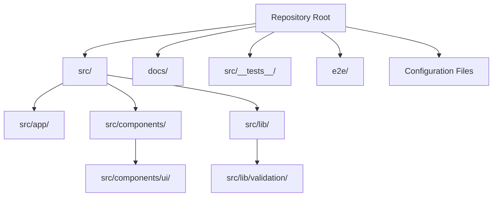
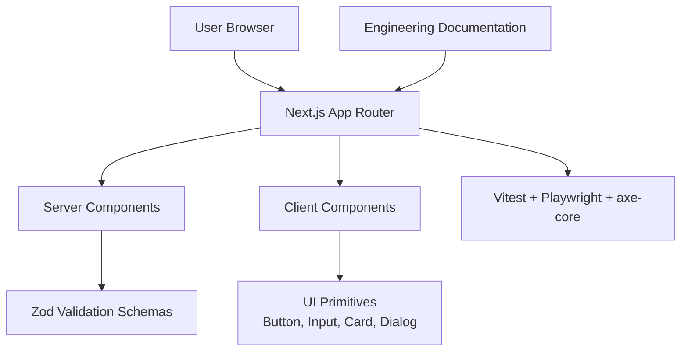
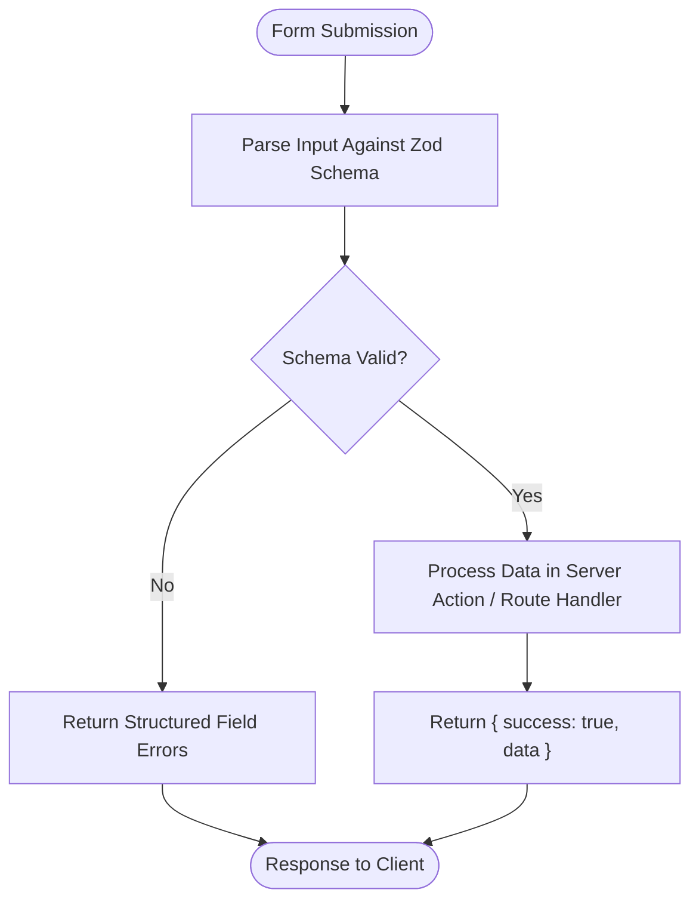
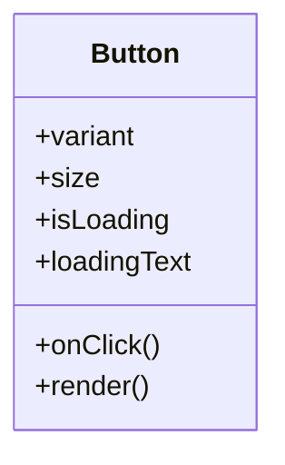
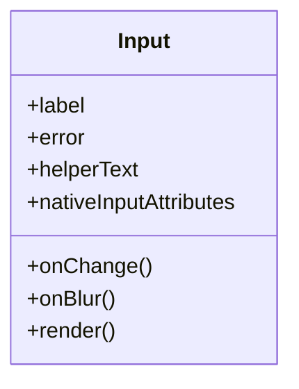
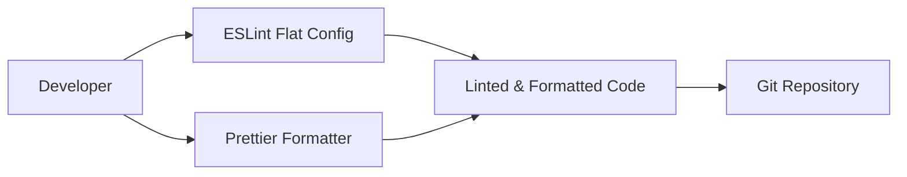
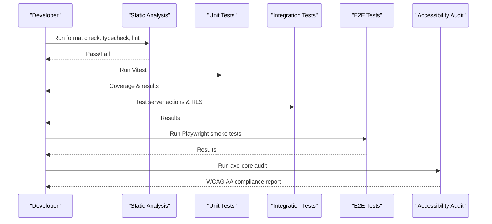
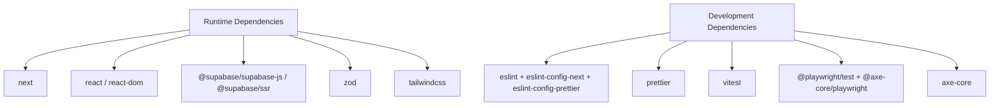

# Development Guidelines

<cite>
**Referenced Files in This Document**
- [README.md](file://README.md)
- [package.json](file://package.json)
- [tsconfig.json](file://tsconfig.json)
- [eslint.config.mjs](file://eslint.config.mjs)
- [.prettierrc](file://.prettierrc)
- [.gitignore](file://.gitignore)
- [docs/CODING_STANDARDS.md](file://docs/CODING_STANDARDS.md)
- [docs/DEVELOPMENT_RULES.md](file://docs/DEVELOPMENT_RULES.md)
- [docs/TESTING_STRATEGY.md](file://docs/TESTING_STRATEGY.md)
- [docs/DESIGN_SYSTEM.md](file://docs/DESIGN_SYSTEM.md)
- [src/lib/validation/auth.ts](file://src/lib/validation/auth.ts)
- [src/components/ui/button.tsx](file://src/components/ui/button.tsx)
- [src/components/ui/input.tsx](file://src/components/ui/input.tsx)
</cite>

## Table of Contents
1. [Introduction](#introduction)
2. [Project Structure](#project-structure)
3. [Core Components](#core-components)
4. [Architecture Overview](#architecture-overview)
5. [Detailed Component Analysis](#detailed-component-analysis)
6. [Dependency Analysis](#dependency-analysis)
7. [Performance Considerations](#performance-considerations)
8. [Troubleshooting Guide](#troubleshooting-guide)
9. [Conclusion](#conclusion)
10. [Appendices](#appendices)

## Introduction
This document defines the development guidelines for SwimNigeria, a Next.js App Router platform built with TypeScript, Tailwind CSS v4, and a strict quality-assurance pipeline. It consolidates coding standards, directory organization, component design principles, validation patterns using Zod, code quality tooling, testing expectations, accessibility requirements, performance guidance, and mandatory directives for both human contributors and AI coding agents.

The repository is currently at Phase 1 completion: scaffolding, type safety, linting, formatting, testing infrastructure, and accessibility tooling are established, but no business features or course data have been introduced yet.

**Section sources**
- [README.md:7-16](file://README.md#L7-L16)
- [README.md:93-101](file://README.md#L93-L101)

## Project Structure
SwimNigeria follows Next.js App Router conventions with feature-oriented directories under `src/`, shared UI primitives under `src/components/ui/`, server-side utilities and validation schemas under `src/lib/`, and foundational engineering documentation under `docs/`.

**Diagram sources**
- [README.md:71-89](file://README.md#L71-L89)
- [docs/CODING_STANDARDS.md:30-54](file://docs/CODING_STANDARDS.md#L30-L54)

Key structural rules:
- Pages and route handlers live under `src/app/`.
- Reusable UI components live under `src/components/ui/`.
- Shared libraries, Supabase integrations, and Zod validation schemas live under `src/lib/`.
- Documentation lives under `docs/` and must be updated when architectural or operational decisions change.

**Section sources**
- [docs/CODING_STANDARDS.md:30-54](file://docs/CODING_STANDARDS.md#L30-L54)
- [README.md:71-89](file://README.md#L71-L89)

## Core Components
The core development surface consists of:
- TypeScript configuration enforcing strict mode.
- ESLint flat configuration integrating Next.js Core Web Vitals, TypeScript rules, and Prettier.
- Prettier formatting rules.
- Zod-based input validation.
- UI primitives such as Button and Input.
- Testing strategy covering unit, integration, E2E, and accessibility checks.

### TypeScript Conventions
TypeScript is configured with strict mode enabled, including `noImplicitAny` and `strictNullChecks`. The project uses ES modules, bundler-style module resolution, JSX React support, path aliases (`@/*` mapped to `./src/*`), and includes all `.ts` and `.tsx` files except `node_modules`.

Requirements:
- Strict mode must remain enabled.
- Zero `any` policy; use `unknown` with explicit type guards or Zod validation.
- Explicit return types on exported functions, Server Actions, Route Handlers, and public API helpers.
- Prefer `interface` for object shapes and component props; prefer `type` for unions, intersections, primitives, and mapped types.
- Avoid non-null assertions; use optional chaining, nullish coalescing, and guard clauses.

**Section sources**
- [tsconfig.json:1-36](file://tsconfig.json#L1-L36)
- [docs/CODING_STANDARDS.md:3-11](file://docs/CODING_STANDARDS.md#L3-L11)

### Naming Conventions
- Components and React components: PascalCase.
- Route files and directories (Next.js App Router): kebab-case.
- Utilities and helpers: kebab-case or camelCase.
- TypeScript types and interfaces: PascalCase.
- Props interfaces: PascalCase suffixed with `Props`.
- Functions and methods: camelCase with descriptive verb prefixes.
- Boolean variables: prefixed with `is`, `has`, `should`, or `can`.
- Global constants and environment keys: UPPER_SNAKE_CASE.

**Section sources**
- [docs/CODING_STANDARDS.md:14-27](file://docs/CODING_STANDARDS.md#L14-L27)

### Directory Organization Patterns
The recommended layout separates pages, reusable UI, shared libraries, and global types/styles. Feature-driven subdirectories under `components/` and `lib/` should reflect domain areas such as courses, assessments, certificates, and Supabase client configurations.

**Section sources**
- [docs/CODING_STANDARDS.md:30-54](file://docs/CODING_STANDARDS.md#L30-L54)

### Component Design Principles
- Use React Server Components by default.
- Use Client Components only when interactivity requires state, side effects, browser APIs, or direct user event listeners.
- Push client boundaries to the leaves; keep parent layouts and data-fetching containers as Server Components.
- Separate presentation from business logic and data access layers.

**Section sources**
- [docs/CODING_STANDARDS.md:58-73](file://docs/CODING_STANDARDS.md#L58-L73)

### Validation Patterns Using Zod
All inputs entering Server Actions, API routes, or form processing must be validated against Zod schemas. Errors returned to clients should be structured rather than unhandled exceptions, and user-facing messages must be plain-language and actionable.

Current implementation reference:
- Validation schema file: `src/lib/validation/auth.ts`.

**Section sources**
- [docs/CODING_STANDARDS.md:76-94](file://docs/CODING_STANDARDS.md#L76-L94)
- [src/lib/validation/auth.ts](file://src/lib/validation/auth.ts)

## Architecture Overview
At a high level, SwimNigeria’s development architecture centers on:
- A Next.js application layer handling routing and rendering.
- A component layer providing accessible UI primitives.
- A library layer encapsulating validation, utilities, and future Supabase integrations.
- A testing layer covering static analysis, unit tests, integration tests, E2E smoke tests, and accessibility audits.

**Diagram sources**
- [docs/CODING_STANDARDS.md:58-73](file://docs/CODING_STANDARDS.md#L58-L73)
- [docs/TESTING_STRATEGY.md:24-82](file://docs/TESTING_STRATEGY.md#L24-L82)

## Detailed Component Analysis

### Zod Validation Layer
Validation schemas define the contract between user input and backend processing. They prevent invalid data from reaching business logic and provide consistent error structures.

**Diagram sources**
- [docs/CODING_STANDARDS.md:76-94](file://docs/CODING_STANDARDS.md#L76-L94)

Implementation references:
- Auth validation schema: `src/lib/validation/auth.ts`.

**Section sources**
- [docs/CODING_STANDARDS.md:76-94](file://docs/CODING_STANDARDS.md#L76-L94)
- [src/lib/validation/auth.ts](file://src/lib/validation/auth.ts)

### UI Primitive: Button
The Button primitive demonstrates the design system’s accessibility and interaction requirements:
- Default button type.
- Minimum touch target size.
- Loading state with `aria-busy`.
- Reduced motion support.
- Focus-visible ring styling aligned with brand colors.

**Diagram sources**
- [docs/DESIGN_SYSTEM.md:168-181](file://docs/DESIGN_SYSTEM.md#L168-L181)

**Section sources**
- [docs/DESIGN_SYSTEM.md:100-114](file://docs/DESIGN_SYSTEM.md#L100-L114)
- [docs/DESIGN_SYSTEM.md:168-181](file://docs/DESIGN_SYSTEM.md#L168-L181)
- [src/components/ui/button.tsx](file://src/components/ui/button.tsx)

### UI Primitive: Input
The Input primitive enforces accessible form behavior:
- Auto-generated ID via `useId()`.
- Bound `<label htmlFor>`.
- Inline error messaging with `role="alert"`.
- `aria-invalid="true"` in error state.
- 48px touch height for accessibility.

**Diagram sources**
- [docs/DESIGN_SYSTEM.md:115-122](file://docs/DESIGN_SYSTEM.md#L115-L122)
- [docs/DESIGN_SYSTEM.md:168-181](file://docs/DESIGN_SYSTEM.md#L168-L181)

**Section sources**
- [docs/DESIGN_SYSTEM.md:115-122](file://docs/DESIGN_SYSTEM.md#L115-L122)
- [docs/DESIGN_SYSTEM.md:168-181](file://docs/DESIGN_SYSTEM.md#L168-L181)
- [src/components/ui/input.tsx](file://src/components/ui/input.tsx)

### Code Quality Tooling
Code quality is enforced through:
- ESLint flat configuration combining Next.js Core Web Vitals, TypeScript rules, and Prettier.
- Prettier formatting with semicolons, double quotes, trailing commas, 2-space indentation, and 100-character print width.
- Git ignore rules preventing secrets, build outputs, test artifacts, and IDE temporary files from being committed.

**Diagram sources**
- [eslint.config.mjs:1-24](file://eslint.config.mjs#L1-L24)
- [.prettierrc:1-8](file://.prettierrc#L1-L8)
- [.gitignore:21-32](file://.gitignore#L21-L32)

**Section sources**
- [eslint.config.mjs:1-24](file://eslint.config.mjs#L1-L24)
- [.prettierrc:1-8](file://.prettierrc#L1-L8)
- [.gitignore:1-74](file://.gitignore#L1-L74)

### Testing Expectations
Testing follows a layered approach:
- Static analysis: TypeScript, ESLint, Prettier.
- Unit tests: Vitest for validation schemas, pure business logic, utilities.
- Integration tests: Server Actions, database access control, RLS policies.
- E2E tests: Playwright smoke tests for critical user journeys.
- Accessibility tests: axe-core and manual keyboard navigation audits.

**Diagram sources**
- [docs/TESTING_STRATEGY.md:10-20](file://docs/TESTING_STRATEGY.md#L10-L20)
- [docs/TESTING_STRATEGY.md:95-119](file://docs/TESTING_STRATEGY.md#L95-L119)

**Section sources**
- [docs/TESTING_STRATEGY.md:24-82](file://docs/TESTING_STRATEGY.md#L24-L82)
- [docs/TESTING_STRATEGY.md:95-119](file://docs/TESTING_STRATEGY.md#L95-L119)

## Dependency Analysis
The project’s runtime and development dependencies include Next.js, React, Supabase client libraries, Zod, Tailwind CSS, ESLint, Prettier, Vitest, Playwright, and axe-core.

**Diagram sources**
- [package.json:18-46](file://package.json#L18-L46)

**Section sources**
- [package.json:1-48](file://package.json#L1-L48)

## Performance Considerations
Performance guidance emphasizes:
- Eliminating waterfall fetches by running independent data requests concurrently.
- Containing async errors with proper try/catch or structured result returns.
- Preferring native platform and runtime APIs over unnecessary third-party packages.
- Auditing dependency sizes and licenses before adding new packages.
- Respecting reduced-motion preferences and avoiding layout shifts.

These practices align with the project’s focus on resilient experiences on fragile connections and low-bandwidth environments.

**Section sources**
- [docs/CODING_STANDARDS.md:105-115](file://docs/CODING_STANDARDS.md#L105-L115)
- [docs/CODING_STANDARDS.md:126-131](file://docs/CODING_STANDARDS.md#L126-L131)
- [docs/TESTING_STRATEGY.md:85-92](file://docs/TESTING_STRATEGY.md#L85-L92)

## Troubleshooting Guide
Common issues and resolutions:
- **Playwright Chromium not installed:** Install the required browser binary before running E2E tests.
- **Secrets accidentally committed:** Ensure `.env.local` and other sensitive files remain ignored; never commit real credentials.
- **Formatting failures:** Run the formatter auto-fix command before committing.
- **Type errors:** Run the TypeScript type checker and fix strict-mode violations.
- **Lint warnings:** Run ESLint and resolve all warnings and errors.
- **Test failures:** Run unit and E2E tests; disclose exact commands, exit codes, and limitations.

Verification commands:
- Format check: `npm run format:check`
- Type check: `npm run typecheck`
- Lint: `npm run lint`
- Unit/component tests: `npm run test`
- E2E smoke tests: `npm run test:e2e`
- Production build: `npm run build`

**Section sources**
- [README.md:48-67](file://README.md#L48-L67)
- [.gitignore:21-32](file://.gitignore#L21-L32)
- [docs/TESTING_STRATEGY.md:95-119](file://docs/TESTING_STRATEGY.md#L95-L119)

## Conclusion
SwimNigeria’s development guidelines enforce strict TypeScript usage, clear naming and directory conventions, Server Component defaults, Zod-based validation, comprehensive testing, and strong accessibility requirements. Contributors and AI agents must follow the 15 mandatory directives, maintain code hygiene through ESLint and Prettier, and verify changes through the full quality gate pipeline before merging.

[No sources needed since this section summarizes without analyzing specific files]

## Appendices

### The 15 Mandatory Directives for AI Agents & Contributors
1. Read relevant documentation first.
2. Inspect existing implementation before editing.
3. Identify task objective and scope boundary.
4. Plan the smallest appropriate change.
5. Preserve unrelated working functionality.
6. Avoid unnecessary dependencies and premature abstractions.
7. Respect architecture and design system conventions.
8. Protect secrets and sensitive information.
9. Run appropriate verification.
10. Review the actual diff.
11. Report modified files and verification results.
12. Disclose failures, limitations, and unresolved risks.
13. Update documentation when relevant decisions change.
14. Never claim that untested code works.
15. Never claim that local testing proves production readiness.

**Section sources**
- [docs/DEVELOPMENT_RULES.md:1-71](file://docs/DEVELOPMENT_RULES.md#L1-L71)

### Git Workflow, Branching Strategy, and Code Review Processes
The repository does not define an explicit branching model or pull request workflow in the analyzed files. However, the mandatory directives require:
- Focused changes.
- Verification before submission.
- Diff review.
- Updated documentation when architectural or operational details change.

Contributors should adopt a standard feature-branch workflow:
- Create a feature branch from `main`.
- Implement small, scoped changes.
- Run all verification commands locally.
- Open a pull request with a clear description of changes, affected files, and verification results.
- Request reviews focused on correctness, accessibility, performance, and adherence to coding standards.

[No sources needed since this section provides general guidance based on documented directives]