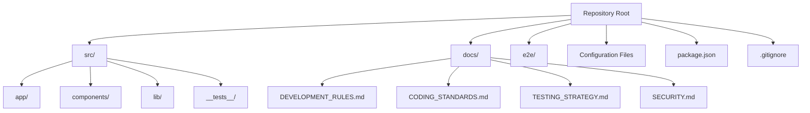
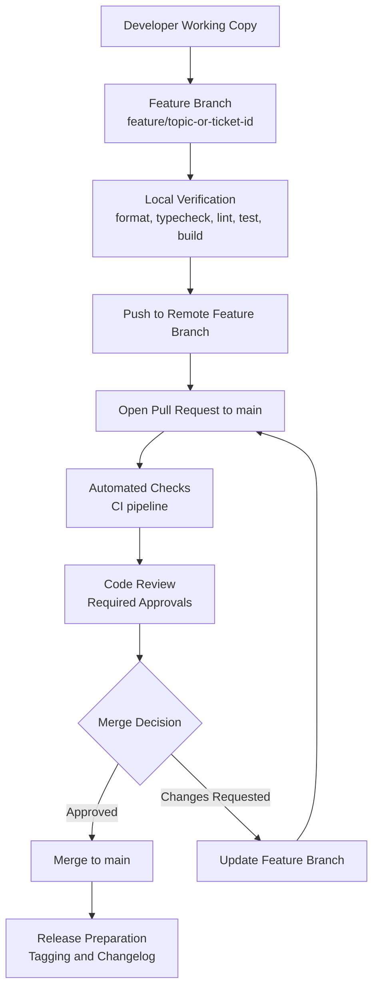
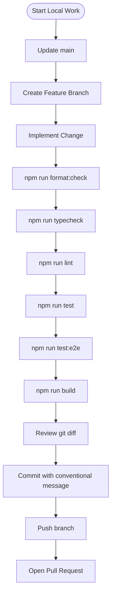
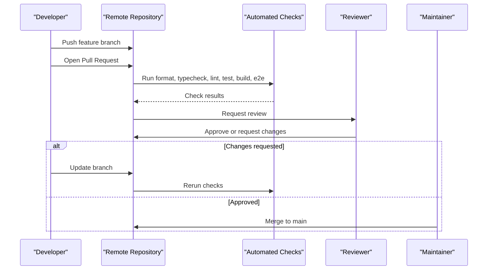
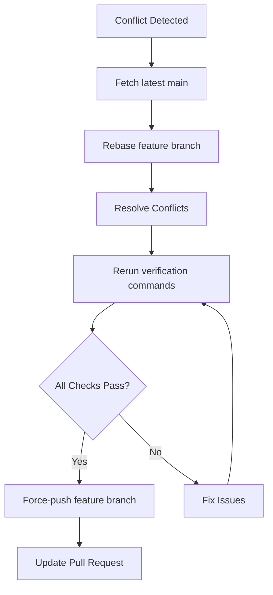
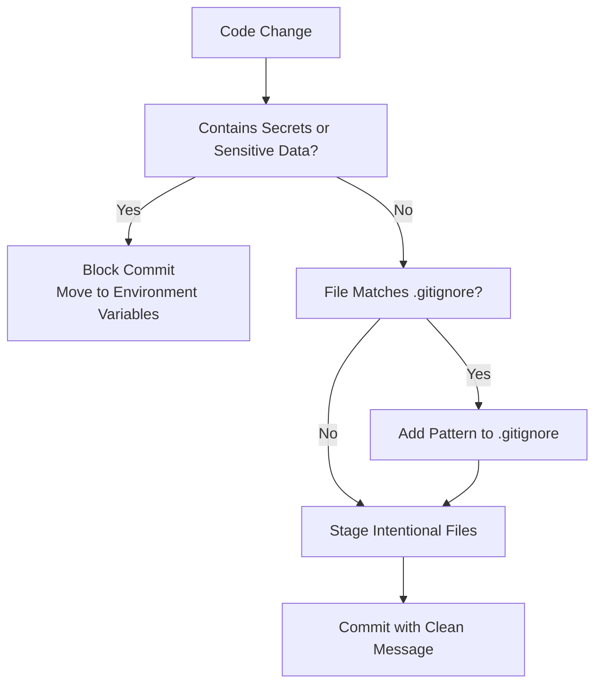
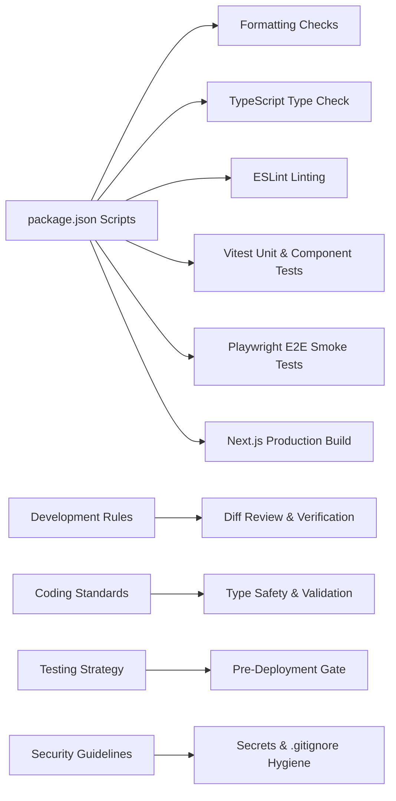

# Git Workflow & Branching Strategy

<cite>
**Referenced Files in This Document**
- [README.md](file://README.md)
- [.gitignore](file://.gitignore)
- [package.json](file://package.json)
- [docs/DEVELOPMENT_RULES.md](file://docs/DEVELOPMENT_RULES.md)
- [docs/CODING_STANDARDS.md](file://docs/CODING_STANDARDS.md)
- [docs/TESTING_STRATEGY.md](file://docs/TESTING_STRATEGY.md)
- [docs/SECURITY.md](file://docs/SECURITY.md)
</cite>

## Table of Contents
1. [Introduction](#introduction)
2. [Project Structure](#project-structure)
3. [Core Components](#core-components)
4. [Architecture Overview](#architecture-overview)
5. [Detailed Component Analysis](#detailed-component-analysis)
6. [Dependency Analysis](#dependency-analysis)
7. [Performance Considerations](#performance-considerations)
8. [Troubleshooting Guide](#troubleshooting-guide)
9. [Conclusion](#conclusion)
10. [Appendices](#appendices)

## Introduction
This document defines the Git workflow, branching strategy, commit conventions, collaboration process, and quality gates for SwimNigeria. It translates the project’s existing engineering standards into a practical developer workflow from local changes to merged releases.

SwimNigeria is a Next.js 16 application with TypeScript strict mode, ESLint, Prettier, Vitest, Playwright E2E tests, and axe-core accessibility checks. The repository currently represents Phase 1 scaffolding and does not yet include business features or database migrations. All contributors should treat `main` as the stable integration branch and use feature branches for isolated work.

The repository already provides:
- A clear set of verification commands.
- Strict security guidance about secrets and environment files.
- Coding standards for TypeScript, components, validation, logging, and performance.
- A testing pyramid and pre-deployment verification gate.

What is not explicitly defined in the repository is a formal branching model, commit message format, changelog generation process, pull request approval policy, and merge strategy. This document proposes concrete defaults that align with the existing tooling and documentation so the team can adopt them consistently.

## Project Structure
At a high level, the repository is organized around a Next.js App Router frontend, shared libraries, component primitives, end-to-end tests, and extensive engineering documentation.



**Diagram sources**
- [README.md:71-90](file://README.md#L71-L90)
- [package.json:6-16](file://package.json#L6-L16)
- [.gitignore:1-74](file://.gitignore#L1-L74)

**Section sources**
- [README.md:1-111](file://README.md#L1-L111)
- [package.json:1-48](file://package.json#L1-L48)

## Core Components
The Git workflow for SwimNigeria is built around five core components:

| Component | Purpose | Repository Alignment |
|---|---|---|
| Branching Model | Defines how work is isolated, integrated, and released. | Aligns with Next.js App Router structure and phased roadmap. |
| Commit Conventions | Ensures readable history, predictable changelogs, and automated release notes. | Complements coding standards and development rules. |
| Local Verification Gate | Runs formatting, type checking, linting, unit/component tests, build, and E2E smoke tests. | Uses scripts defined in `package.json`. |
| Pull Request Quality Gate | Requires code review, automated checks, and acceptance criteria before merging. | Enforced by CI and repository policies. |
| Security & Secrets Hygiene | Prevents credentials, tokens, and sensitive data from entering version control. | Enforced by `.gitignore`, development rules, and security guidelines. |

**Section sources**
- [package.json:6-16](file://package.json#L6-L16)
- [docs/DEVELOPMENT_RULES.md:39-53](file://docs/DEVELOPMENT_RULES.md#L39-L53)
- [docs/TESTING_STRATEGY.md:95-119](file://docs/TESTING_STRATEGY.md#L95-L119)
- [.gitignore:21-32](file://.gitignore#L21-L32)
- [docs/SECURITY.md:150-154](file://docs/SECURITY.md#L150-L154)

## Architecture Overview
The recommended Git workflow treats `main` as the protected integration branch and uses short-lived feature branches for all new work.



**Diagram sources**
- [package.json:6-16](file://package.json#L6-L16)
- [docs/TESTING_STRATEGY.md:95-119](file://docs/TESTING_STRATEGY.md#L95-L119)

## Detailed Component Analysis

### Branching Strategy
SwimNigeria should use a lightweight branching model focused on stability, small changes, and clear traceability.

#### Branch Types
| Branch Type | Naming Convention | Purpose | Lifespan |
|---|---|---|---|
| `main` | Exact name | Stable, deployable integration branch. | Permanent |
| `develop` | Exact name | Optional integration branch for larger phases if needed. | Long-lived |
| `feature/*` | `feature/description-or-ticket-id` | New features, UI components, utilities, or improvements. | Short-lived |
| `fix/*` | `fix/description-or-ticket-id` | Bug fixes and corrections. | Short-lived |
| `chore/*` | `chore/description` | Tooling, configuration, dependency updates, documentation. | Short-lived |
| `release/*` | `release/vX.Y.Z` | Finalized release preparation, version bump, changelog generation. | Short-lived |
| `hotfix/*` | `hotfix/description-or-ticket-id` | Urgent production fixes. | Very short-lived |

#### Branching Rules
- Create branches from `main` unless working on a multi-phase milestone that requires an integration branch.
- Keep branches focused on one logical change.
- Delete branches after merging to avoid stale references.
- Never push directly to `main`.
- Use descriptive branch names that explain what changed and why.

#### Examples
- `feature/add-course-enrollment-form`
- `fix/correct-login-error-message`
- `chore/update-playwright-chromium-binary`
- `release/v0.2.0`
- `hotfix/fix-certificate-verification-404`

**Section sources**
- [README.md:7-17](file://README.md#L7-L17)
- [docs/IMPLEMENTATION_ROADMAP.md](file://docs/IMPLEMENTATION_ROADMAP.md)

### Commit Conventions
Commit messages should be concise, actionable, and machine-readable where possible. The repository does not enforce conventional commits through tooling, so this section establishes a team-wide convention.

#### Commit Message Format
Use a structured format:

```
type(scope): short summary

Optional detailed explanation.

Refs: ticket-id
```

| Field | Guidance |
|---|---|
| `type` | `feat`, `fix`, `docs`, `style`, `refactor`, `test`, `chore`, `perf`, `security` |
| `scope` | Optional module or area, such as `auth`, `courses`, `ui`, `supabase`, `e2e` |
| `short summary` | Imperative verb phrase under 72 characters |
| `detailed explanation` | Explain what changed and why, not how it was implemented |
| `refs` | Link to issue tracker or internal task when available |

#### Good Commit Examples
- `feat(courses): add course enrollment form with Zod validation`
- `fix(auth): correct login error message for invalid credentials`
- `test(ui): add button component accessibility tests`
- `chore(deps): update playwright and chromium binary setup`
- `docs(security): clarify service role key protection rules`

#### Bad Commit Examples
- `update files`
- `fix stuff`
- `WIP`
- `added new thing`

#### Commit Discipline
- Make small, focused commits.
- Avoid mixing unrelated changes in one commit.
- Remove debugging logs, temporary files, and accidental edits before committing.
- Review the actual diff before finalizing a commit.

**Section sources**
- [docs/DEVELOPMENT_RULES.md:52-53](file://docs/DEVELOPMENT_RULES.md#L52-L53)
- [docs/CODING_STANDARDS.md:1-131](file://docs/CODING_STANDARDS.md#L1-L131)

### Local Development Workflow
Follow this sequence when making changes locally:

1. Update your local repository.
2. Create a feature branch using the naming convention.
3. Implement the smallest appropriate change.
4. Run formatting checks.
5. Run type checks.
6. Run linter checks.
7. Run unit and component tests.
8. Run E2E smoke tests when user journeys are affected.
9. Build the production bundle.
10. Review the Git diff.
11. Commit with a clear message.
12. Push the branch and open a pull request.



**Diagram sources**
- [package.json:6-16](file://package.json#L6-L16)
- [docs/TESTING_STRATEGY.md:95-119](file://docs/TESTING_STRATEGY.md#L95-L119)
- [docs/DEVELOPMENT_RULES.md:44-53](file://docs/DEVELOPMENT_RULES.md#L44-L53)

**Section sources**
- [README.md:48-68](file://README.md#L48-L68)
- [package.json:6-16](file://package.json#L6-L16)
- [docs/TESTING_STRATEGY.md:95-119](file://docs/TESTING_STRATEGY.md#L95-L119)
- [docs/DEVELOPMENT_RULES.md:44-53](file://docs/DEVELOPMENT_RULES.md#L44-L53)

### Pull Request Process
A pull request is the primary collaboration artifact. It should clearly describe the change, its motivation, and verification results.

#### Required Pull Request Elements
- Clear title matching the branch purpose.
- Description explaining the problem, solution, and impact.
- List of modified files.
- Verification results showing which commands passed.
- Screenshots or recordings for UI changes.
- Notes on manual testing or external dependencies.
- Links to related issues or requirements.

#### Approval Requirements
- At least one approved review from a maintainer or senior contributor.
- All automated checks must pass.
- No unresolved security concerns.
- Changes must align with coding standards and architecture decisions.

#### Acceptance Criteria
- Formatting passes.
- TypeScript compilation succeeds.
- Linting has zero warnings or errors.
- Unit and component tests pass.
- E2E smoke tests pass for affected flows.
- Production build succeeds.
- Documentation is updated when behavior changes.



**Diagram sources**
- [package.json:6-16](file://package.json#L6-L16)
- [docs/TESTING_STRATEGY.md:95-119](file://docs/TESTING_STRATEGY.md#L95-L119)

**Section sources**
- [docs/TESTING_STRATEGY.md:95-119](file://docs/TESTING_STRATEGY.md#L95-L119)
- [docs/DEVELOPMENT_RULES.md:44-53](file://docs/DEVELOPMENT_RULES.md#L44-L53)

### Merge Strategies
Choose a merge strategy based on the nature of the change.

| Scenario | Recommended Strategy | Reason |
|---|---|---|
| Small feature or fix | Squash merge | Keeps history clean and ties one PR to one change. |
| Complex feature with multiple meaningful commits | Rebase and merge | Preserves commit granularity while keeping linear history. |
| Hotfix | Fast-forward or squash merge | Minimizes risk and accelerates recovery. |
| Release branch | Merge only after all checks pass | Prevents accidental rebasing during release stabilization. |

#### General Merge Rules
- Never force-push to `main`.
- Resolve conflicts locally when possible.
- Prefer rebasing feature branches onto the latest `main` before opening or updating a PR.
- After merging, delete the feature branch.
- Tag releases and generate changelogs from commit history.

**Section sources**
- [README.md:7-17](file://README.md#L7-L17)
- [docs/DECISION_LOG.md](file://docs/DECISION_LOG.md)

### Changelog Generation
Changelogs should be generated from conventional commit history. This allows automated tools to produce release notes based on commit types.

#### Suggested Automation
- Use a changelog generator configured to read conventional commits.
- Generate changelogs per release branch.
- Include sections for Features, Fixes, Performance, Security, Dependencies, and Documentation.
- Keep the generated changelog human-reviewed before publishing.

#### Example Changelog Sections
- **Features:** New user-facing functionality.
- **Fixes:** Bug corrections and edge-case handling.
- **Performance:** Optimization and bundle improvements.
- **Security:** Secret rotation, input validation, access control changes.
- **Dependencies:** Dependency upgrades and audits.
- **Documentation:** README, docs, or architectural updates.

**Section sources**
- [docs/IMPLEMENTATION_ROADMAP.md](file://docs/IMPLEMENTATION_ROADMAP.md)

### Code Review Guidelines
Code reviews should focus on correctness, security, maintainability, and alignment with project standards.

#### Review Checklist
- Does the change solve the stated problem?
- Is the scope limited to the intended feature or fix?
- Are TypeScript types explicit and safe?
- Are inputs validated with Zod schemas?
- Are secrets and sensitive data excluded?
- Are tests added or updated?
- Are accessibility requirements met?
- Does the change break any existing behavior?
- Is documentation updated when necessary?

#### Review Feedback Standards
- Be specific and actionable.
- Distinguish between blocking and optional feedback.
- Reference relevant documentation or standards.
- Encourage small iterations rather than large rewrites.

**Section sources**
- [docs/CODING_STANDARDS.md:1-131](file://docs/CODING_STANDARDS.md#L1-L131)
- [docs/TESTING_STRATEGY.md:73-92](file://docs/TESTING_STRATEGY.md#L73-L92)
- [docs/DEVELOPMENT_RULES.md:18-31](file://docs/DEVELOPMENT_RULES.md#L18-L31)

### Conflicts, Rebasing, and Merging Decisions
Conflicts are expected when multiple contributors modify overlapping areas.

#### Handling Conflicts
1. Fetch the latest `main`.
2. Rebase the feature branch onto `main`.
3. Resolve conflicts carefully.
4. Rerun all verification commands.
5. Force-push only the feature branch, never `main`.
6. Update the pull request with conflict resolution details.

#### When to Rebase vs Merge
- Rebase when the feature branch is behind `main` and you want a clean linear history.
- Merge when preserving exact commit history is more important than linearity.
- Avoid rebasing shared branches or long-lived integration branches unless the team agrees.



**Diagram sources**
- [docs/DEVELOPMENT_RULES.md:44-53](file://docs/DEVELOPMENT_RULES.md#L44-L53)

**Section sources**
- [docs/DEVELOPMENT_RULES.md:44-53](file://docs/DEVELOPMENT_RULES.md#L44-L53)

### Release Branching Strategy
Releases should be prepared on dedicated release branches and tagged after successful verification.

#### Release Flow
1. Create `release/vX.Y.Z` from `main`.
2. Freeze new feature development on the branch.
3. Run full verification pipeline.
4. Generate changelog.
5. Bump version in package metadata.
6. Tag the release commit.
7. Merge into `main` and publish artifacts.

#### Versioning Guidance
- Use semantic versioning: major.minor.patch.
- Increment minor versions for backward-compatible features.
- Increment patch versions for bug fixes.
- Increment major versions for breaking changes.

**Section sources**
- [README.md:105-111](file://README.md#L105-L111)
- [package.json:1-5](file://package.json#L1-L5)

### Security Considerations for Commits and .gitignore
Security is central to SwimNigeria. Contributors must treat version control as a potential attack surface.

#### Secrets Policy
- Never commit API keys, tokens, passwords, or service credentials.
- Use environment variables accessed via server-side processes.
- Ensure sensitive files remain listed in `.gitignore`.
- Rotate any accidentally exposed credentials immediately.

#### .gitignore Coverage
The repository already excludes:
- Environment files and local variants.
- Certificate and key files.
- Node modules and build outputs.
- Test reports and coverage data.
- OS and IDE temporary files.
- Provider-specific state directories.

#### Safe Practices
- Add new secret patterns to `.gitignore` before committing.
- Use `.env.example` as a template without real values.
- Audit diffs before pushing.
- Treat logs, stack traces, and debug output as potentially sensitive.



**Diagram sources**
- [.gitignore:21-32](file://.gitignore#L21-L32)
- [docs/DEVELOPMENT_RULES.md:39-42](file://docs/DEVELOPMENT_RULES.md#L39-L42)
- [docs/SECURITY.md:150-154](file://docs/SECURITY.md#L150-L154)

**Section sources**
- [.gitignore:21-32](file://.gitignore#L21-L32)
- [docs/DEVELOPMENT_RULES.md:39-42](file://docs/DEVELOPMENT_RULES.md#L39-L42)
- [docs/SECURITY.md:150-154](file://docs/SECURITY.md#L150-L154)

### Common Workflow Scenarios

#### Scenario 1: Adding a New Course Page
1. Create `feature/add-course-page`.
2. Implement the page under the Next.js App Router structure.
3. Add unit or component tests.
4. Run formatting, typecheck, lint, test, build, and E2E smoke tests.
5. Commit with a conventional message.
6. Open a pull request and request review.
7. Address feedback and merge after approvals.

#### Scenario 2: Fixing a Login Error
1. Create `fix/login-error-message`.
2. Identify the affected route handler or action.
3. Update error messaging without exposing internal details.
4. Add or update tests.
5. Run the full verification pipeline.
6. Submit a pull request with a concise explanation.

#### Scenario 3: Updating Dependencies
1. Create `chore/update-dependencies`.
2. Upgrade packages carefully.
3. Run all verification commands.
4. Audit for vulnerabilities.
5. Document breaking changes if required.
6. Open a pull request for review.

**Section sources**
- [README.md:48-68](file://README.md#L48-L68)
- [docs/CODING_STANDARDS.md:1-131](file://docs/CODING_STANDARDS.md#L1-L131)
- [docs/TESTING_STRATEGY.md:95-119](file://docs/TESTING_STRATEGY.md#L95-L119)

## Dependency Analysis
The Git workflow depends on the repository’s existing scripts, configuration, and documentation.



**Diagram sources**
- [package.json:6-16](file://package.json#L6-L16)
- [docs/DEVELOPMENT_RULES.md:39-53](file://docs/DEVELOPMENT_RULES.md#L39-L53)
- [docs/CODING_STANDARDS.md:1-131](file://docs/CODING_STANDARDS.md#L1-L131)
- [docs/TESTING_STRATEGY.md:95-119](file://docs/TESTING_STRATEGY.md#L95-L119)
- [docs/SECURITY.md:150-154](file://docs/SECURITY.md#L150-L154)

**Section sources**
- [package.json:6-16](file://package.json#L6-L16)
- [docs/DEVELOPMENT_RULES.md:39-53](file://docs/DEVELOPMENT_RULES.md#L39-L53)
- [docs/CODING_STANDARDS.md:1-131](file://docs/CODING_STANDARDS.md#L1-L131)
- [docs/TESTING_STRATEGY.md:95-119](file://docs/TESTING_STRATEGY.md#L95-L119)
- [docs/SECURITY.md:150-154](file://docs/SECURITY.md#L150-L154)

## Performance Considerations
Git workflow performance improves when changes are small, focused, and well-tested.

- Keep feature branches short-lived to reduce merge complexity.
- Avoid large refactors inside hot paths unless absolutely necessary.
- Run only relevant tests locally when time is constrained, but always run the full pre-deployment gate before merging.
- Use conventional commits to make changelog generation fast and reliable.
- Avoid committing generated artifacts, large binaries, or unnecessary logs.

[No sources needed since this section provides general guidance]

## Troubleshooting Guide

### Common Issues and Resolutions

| Issue | Likely Cause | Resolution |
|---|---|---|
| CI fails due to formatting | Prettier rules violated | Run `npm run format:write` and commit formatted files. |
| Type check fails | TypeScript strict mode violation | Fix types, remove unsafe casts, and add proper guards. |
| Lint fails | ESLint rule violation | Follow coding standards and fix reported issues. |
| Tests fail | Missing or incorrect test logic | Inspect failing tests, add missing assertions, and verify behavior. |
| E2E tests fail | Browser or Playwright setup issue | Install Chromium binary and rerun `npm run test:e2e`. |
| Build fails | Next.js compilation error | Fix route handlers, Server Actions, or imports. |
| Secret detected in commit | Credential accidentally committed | Rotate the secret immediately and move it to environment variables. |

### Verification Commands Reference
| Check | Command | Purpose |
|---|---|---|
| Formatting Verification | `npm run format:check` | Ensures consistent code style. |
| Formatting Auto-Fix | `npm run format:write` | Formats files automatically. |
| TypeScript Type Check | `npm run typecheck` | Validates strict TypeScript types. |
| Linting | `npm run lint` | Enforces ESLint rules. |
| Unit & Component Tests | `npm run test` | Runs Vitest tests. |
| E2E Smoke Tests | `npm run test:e2e` | Runs Playwright browser tests. |
| Production Build | `npm run build` | Verifies production bundling. |

**Section sources**
- [README.md:48-68](file://README.md#L48-L68)
- [package.json:6-16](file://package.json#L6-L16)
- [docs/TESTING_STRATEGY.md:95-119](file://docs/TESTING_STRATEGY.md#L95-L119)

## Conclusion
SwimNigeria’s Git workflow should emphasize small changes, clear communication, automated quality gates, and strong security hygiene. By adopting the proposed branching model, commit conventions, pull request process, and release strategy, the team can maintain a stable `main` branch while moving quickly and safely.

The most important practices are:
- Use feature branches for isolated work.
- Write clear, conventional commit messages.
- Run the full verification pipeline before merging.
- Require code review and approvals.
- Protect secrets and follow `.gitignore` rules.
- Prepare releases on dedicated branches with generated changelogs.

[No sources needed since this section summarizes without analyzing specific files]

## Appendices

### Appendix A: Quick Workflow Checklist
- [ ] Created a properly named branch.
- [ ] Implemented the smallest appropriate change.
- [ ] Added or updated tests.
- [ ] Ran formatting, typecheck, lint, test, build, and E2E checks.
- [ ] Reviewed the Git diff.
- [ ] Wrote a conventional commit message.
- [ ] Opened a pull request with description and verification results.
- [ ] Addressed reviewer feedback.
- [ ] Merged after approvals and automated checks passed.

### Appendix B: Commit Type Reference
| Type | Meaning |
|---|---|
| `feat` | New feature |
| `fix` | Bug fix |
| `docs` | Documentation-only change |
| `style` | Formatting, whitespace, semicolons, no code change |
| `refactor` | Code restructuring without behavior change |
| `test` | Adding or updating tests |
| `chore` | Tooling, config, dependencies |
| `perf` | Performance improvement |
| `security` | Security-related change |

**Section sources**
- [docs/DEVELOPMENT_RULES.md:39-53](file://docs/DEVELOPMENT_RULES.md#L39-L53)
- [docs/CODING_STANDARDS.md:1-131](file://docs/CODING_STANDARDS.md#L1-L131)
- [docs/TESTING_STRATEGY.md:95-119](file://docs/TESTING_STRATEGY.md#L95-L119)
- [docs/SECURITY.md:150-154](file://docs/SECURITY.md#L150-L154)