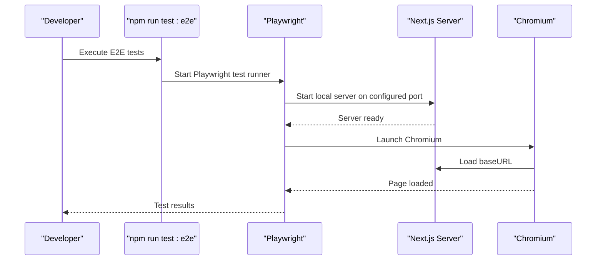
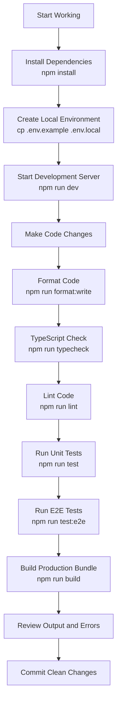

# Getting Started

<cite>
**Referenced Files in This Document**
- [package.json](file://package.json)
- [README.md](file://README.md)
- [playwright.config.ts](file://playwright.config.ts)
- [.gitignore](file://.gitignore)
</cite>

## Table of Contents
1. [Introduction](#introduction)
2. [Prerequisites](#prerequisites)
3. [Installation](#installation)
4. [Environment Setup](#environment-setup)
5. [Local Development Server](#local-development-server)
6. [Quality Gate Commands](#quality-gate-commands)
7. [Playwright Browser Binary Setup](#playwright-browser-binary-setup)
8. [Verification Checklist](#verification-checklist)
9. [Troubleshooting Guide](#troubleshooting-guide)
10. [Development Workflow Overview](#development-workflow-overview)

## Introduction
This guide helps new developers set up the SwimNigeria development environment quickly and safely. It covers prerequisites, installation with locked dependency versions, environment configuration, starting the local server, running quality gates, and troubleshooting common setup issues.

SwimNigeria is a digital aquatic education platform built with Next.js App Router, TypeScript, Tailwind CSS v4, Vitest for unit/component tests, and Playwright for end-to-end smoke testing. The repository includes strict code quality tooling and security guidance to prevent accidental exposure of secrets.

## Prerequisites
Before installing dependencies, ensure your machine meets these requirements:
- Node.js version 20.9.0 or newer
- npm version 10.0.0 or newer

These versions are explicitly required by the project and verified during development.

**Section sources**
- [README.md:22-25](file://README.md#L22-L25)

## Installation
Install all dependencies using the locked versions defined in the package lock file:
```bash
npm install
```

Why use `npm install` instead of other package managers?
- The repository uses `package-lock.json`, which pins exact dependency versions.
- Running `npm install` ensures reproducible builds across machines and CI environments.
- It avoids unexpected upgrades that could break type checking, linting, or tests.

After installation, verify that `node_modules` exists and no installation errors were reported.

**Section sources**
- [README.md:26-30](file://README.md#L26-L30)
- [package.json:1-48](file://package.json#L1-L48)

## Environment Setup
Copy the environment template into a local environment file:
```bash
cp .env.example .env.local
```

Important security rules:
- Never commit `.env.local` or any file containing real API keys.
- The `.gitignore` file explicitly excludes `.env`, `.env*.local`, and secret-like files such as `.pem`, `.key`, and `.cert`.
- Only environment templates like `.env.example` are safe to commit.

Even though Phase 1 scaffolding does not require live external credentials, always treat `.env.local` as private. If you later add Supabase, email, or hosting secrets, keep them only in `.env.local` or your deployment provider’s secret manager.

**Section sources**
- [README.md:32-37](file://README.md#L26-L37)
- [.gitignore:21-32](file://.gitignore#L21-L32)

## Local Development Server
Start the Next.js development server:
```bash
npm run dev
```

Then open your browser at:
```
http://localhost:3000
```

What happens when you run this command:
- The script runs the Next.js development server.
- Hot reloading is enabled so changes refresh automatically.
- The application serves the operational foundation page created during Phase 1.

If the server fails to start, check:
- Your Node.js and npm versions meet the minimum requirements.
- No other process is already using port 3000.
- There are no syntax or type errors blocking compilation.

**Section sources**
- [README.md:39-44](file://README.md#L39-L44)
- [package.json:6-16](file://package.json#L6-L16)

## Quality Gate Commands
Run these commands regularly before committing code. They enforce formatting, type safety, linting, tests, and production build readiness.

| Command | Purpose | When to Run |
|---|---|---|
| `npm run format:check` | Verifies Prettier formatting without changing files | Before every commit |
| `npm run format:write` | Automatically formats supported files | During development when fixing style issues |
| `npm run typecheck` | Runs TypeScript compiler in strict mode without emitting output | Before running tests or building |
| `npm run lint` | Runs ESLint with Next.js, Core Web Vitals, and TypeScript rules | Before every commit |
| `npm run test` | Runs Vitest unit and component tests once | Before pushing changes |
| `npm run test:watch` | Starts Vitest in interactive watch mode | While writing components or logic |
| `npm run test:e2e` | Runs Playwright end-to-end smoke tests | Before merging or deploying |
| `npm run build` | Compiles the optimized Next.js production bundle | Before deployment or final verification |
| `npm run start` | Boots the compiled production server locally | After running `npm run build` |

Recommended pre-commit flow:
1. Format code with `npm run format:write`.
2. Verify formatting with `npm run format:check`.
3. Check types with `npm run typecheck`.
4. Lint code with `npm run lint`.
5. Run unit tests with `npm run test`.
6. Run E2E tests with `npm run test:e2e`.
7. Build the production bundle with `npm run build`.

**Section sources**
- [README.md:48-68](file://README.md#L48-L68)
- [package.json:6-16](file://package.json#L6-L16)

## Playwright Browser Binary Setup
For first-time users, install the Playwright Chromium binary:
```bash
npx playwright install chromium
```

Why is this needed?
- Playwright E2E tests require a real browser binary to automate user interactions.
- On a fresh machine, the binary may not be present until installed.
- Installing it once avoids repeated download prompts during test runs.

How E2E tests work in this project:
- The Playwright configuration runs tests from the `e2e` directory.
- It starts a local Next.js server on port 3001 unless overridden by `PORT`.
- Tests run against `http://localhost:3001`.
- In CI, retries and worker behavior change for stability.



**Diagram sources**
- [playwright.config.ts:1-33](file://playwright.config.ts#L1-L33)

**Section sources**
- [README.md:64-67](file://README.md#L64-L67)
- [playwright.config.ts:1-33](file://playwright.config.ts#L1-L33)

## Verification Checklist
Use this checklist after setup to confirm everything works:
- [ ] Node.js version is 20.9.0 or newer
- [ ] npm version is 10.0.0 or newer
- [ ] Dependencies installed successfully with `npm install`
- [ ] `.env.local` exists and contains no real secrets
- [ ] `npm run dev` starts without errors
- [ ] Browser opens `http://localhost:3000` and shows the foundation page
- [ ] `npm run format:check` passes
- [ ] `npm run typecheck` passes
- [ ] `npm run lint` passes
- [ ] `npm run test` passes
- [ ] `npm run test:e2e` passes (after installing Chromium)
- [ ] `npm run build` produces a production build
- [ ] `npm run start` boots the production server locally

## Troubleshooting Guide

### Node.js or npm version too old
**Symptoms:** Installation warnings, missing features, or scripts failing.  
**Fix:** Upgrade Node.js to 20.9.0 or newer and npm to 10.0.0 or newer.

### Missing `.env.local`
**Symptoms:** Environment variables are undefined or runtime behavior differs from expected.  
**Fix:** Copy the template file to create a local environment file:
```bash
cp .env.example .env.local
```

### Accidentally committed secrets
**Symptoms:** `.env.local` appears in version control history or diff.  
**Fix:** Remove secrets immediately, rotate any exposed credentials, and rely on `.gitignore` to prevent future commits of `.env*.local` files.

### Port 3000 already in use
**Symptoms:** `npm run dev` fails because the default port is occupied.  
**Fix:** Stop the conflicting process or configure another port through your environment or framework settings.

### Playwright tests fail due to missing browser
**Symptoms:** E2E tests cannot launch Chromium.  
**Fix:** Install the browser binary:
```bash
npx playwright install chromium
```

### E2E tests cannot connect to the local server
**Symptoms:** Tests report connection refused or timeout.  
**Fix:** Ensure the Next.js server is running on the expected port. By default, Playwright expects the server at `http://localhost:3001` when running E2E tests.

### Type checking or linting fails
**Symptoms:** `npm run typecheck` or `npm run lint` reports errors.  
**Fix:** Address TypeScript errors and ESLint violations before committing. Use `npm run format:write` to fix formatting issues automatically.

### Production build fails
**Symptoms:** `npm run build` stops with compilation or optimization errors.  
**Fix:** Resolve type errors, lint errors, and invalid imports. A successful build is required before deployment.

**Section sources**
- [README.md:22-68](file://README.md#L22-L68)
- [.gitignore:21-32](file://.gitignore#L21-L32)
- [playwright.config.ts:1-33](file://playwright.config.ts#L1-L33)

## Development Workflow Overview
The recommended development workflow balances speed, safety, and consistency:



Key principles:
- Keep dependencies locked by using `npm install`.
- Never commit secrets; use `.env.local` for local-only values.
- Run formatting, type checking, linting, and tests before committing.
- Use E2E tests to validate user-facing flows.
- Build the production bundle to catch issues early.

**Section sources**
- [package.json:6-16](file://package.json#L6-L16)
- [README.md:26-68](file://README.md#L26-L68)