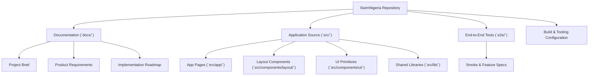
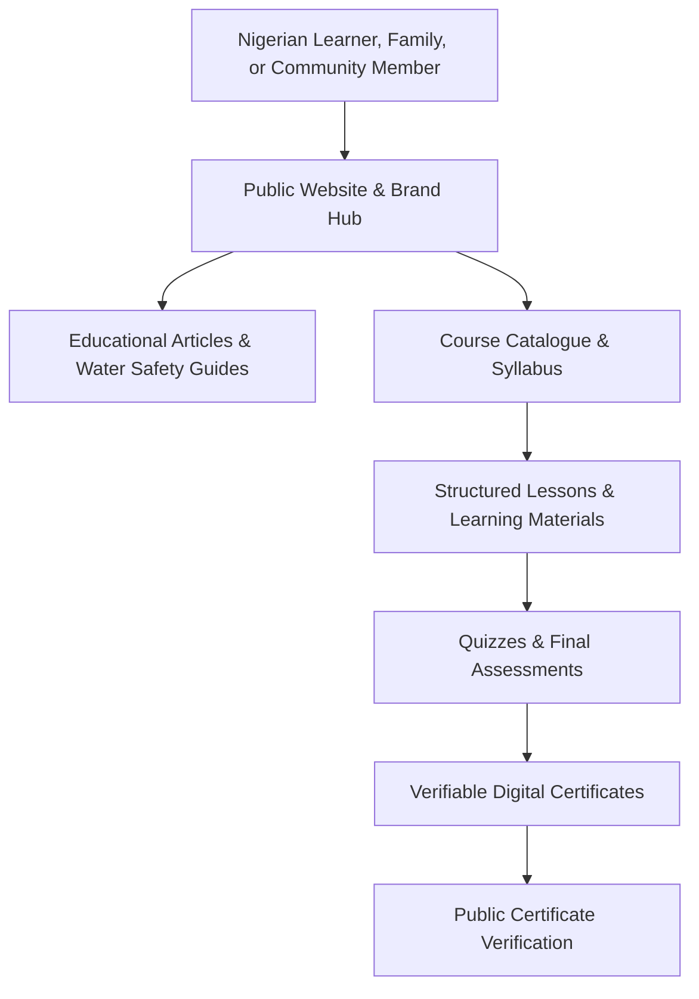
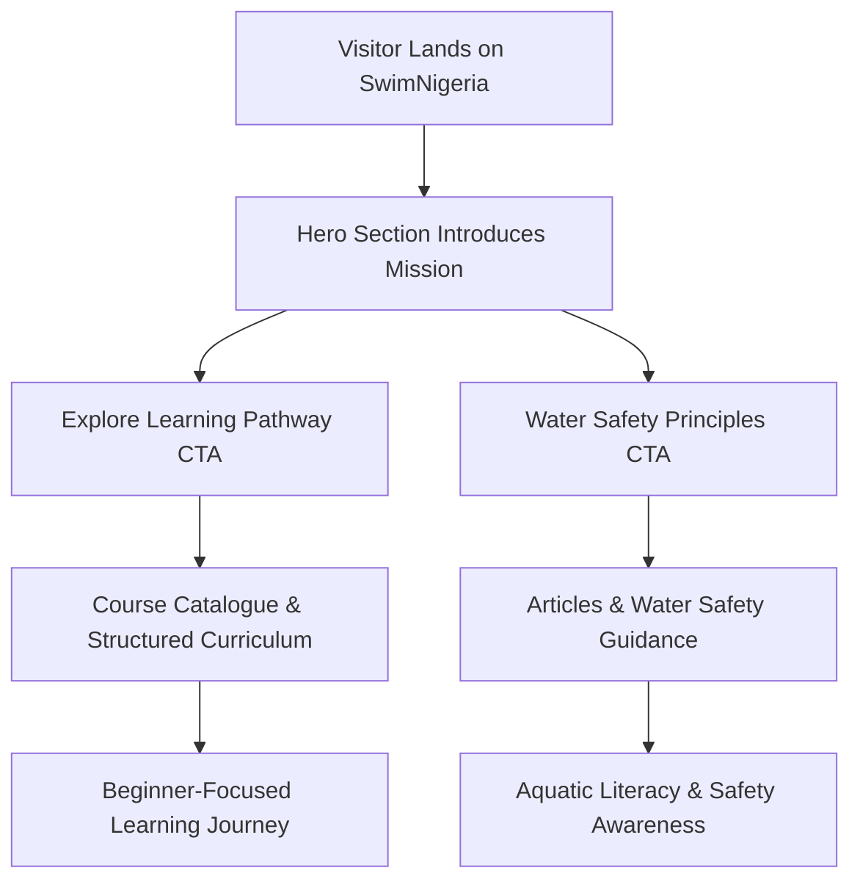
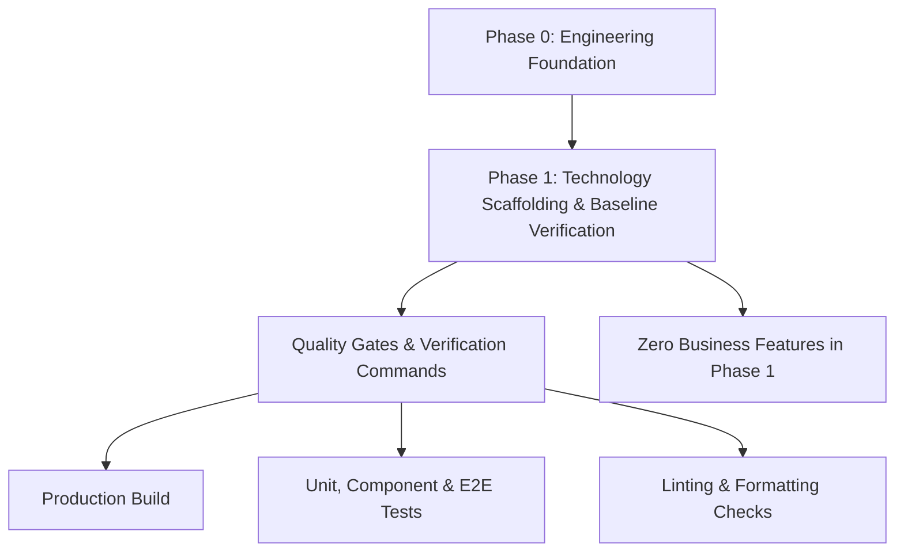
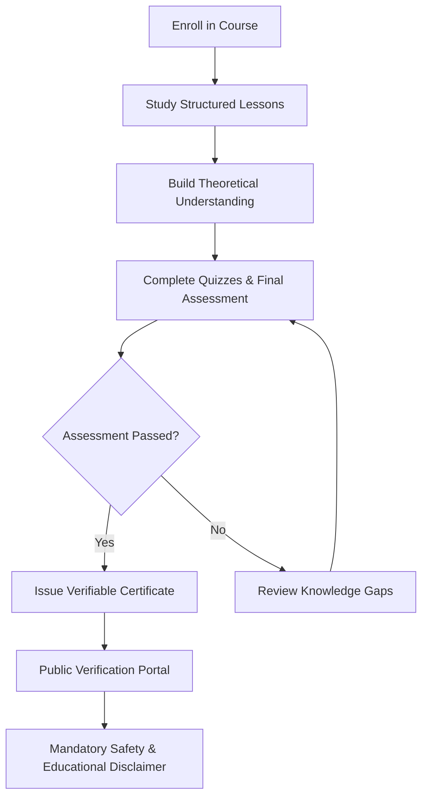
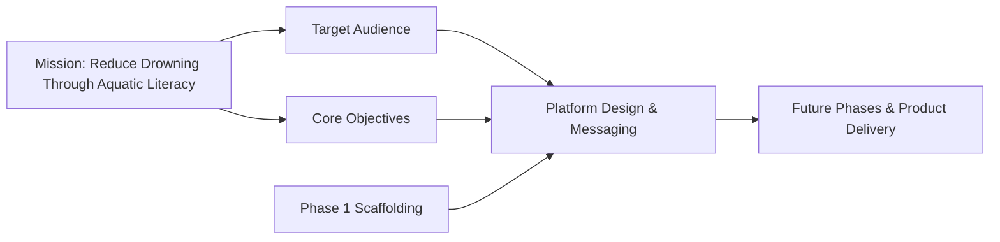

# Project Overview

<cite>
**Referenced Files in This Document**
- [README.md](file://README.md)
- [PROJECT_BRIEF.md](file://docs/PROJECT_BRIEF.md)
- [PRODUCT_REQUIREMENTS.md](file://docs/PRODUCT_REQUIREMENTS.md)
- [IMPLEMENTATION_ROADMAP.md](file://docs/IMPLEMENTATION_ROADMAP.md)
- [site-footer.tsx](file://src/components/layout/site-footer.tsx)
- [page.tsx (About)](file://src/app/about/page.tsx)
- [page.tsx (Home)](file://src/app/page.tsx)
</cite>

## Table of Contents
1. [Introduction](#introduction)
2. [Project Structure](#project-structure)
3. [Core Components](#core-components)
4. [Architecture Overview](#architecture-overview)
5. [Detailed Component Analysis](#detailed-component-analysis)
6. [Dependency Analysis](#dependency-analysis)
7. [Performance Considerations](#performance-considerations)
8. [Troubleshooting Guide](#troubleshooting-guide)
9. [Conclusion](#conclusion)

## Introduction
SwimNigeria is a digital aquatic education platform whose mission is to reduce drowning incidents in Nigeria by making structured swimming instruction and essential water safety knowledge accessible to all Nigerians. The project emphasizes **aquatic literacy**, practical **water safety**, and **structured digital curricula** that prepare learners for safe, informed engagement with water environments.

At its core, SwimNigeria aims to bridge the gap between basic awareness and life-saving competence by offering:
- Structured digital curricula
- Practical water safety guidelines
- Self-paced beginner courses
- Verifiable digital certifications

The educational approach prioritizes theoretical understanding before practical training. Learners first build foundational knowledge through text-based lessons, safety guidance, and assessments; this foundation is intended to support safer real-world practice when combined with supervised, in-person instruction.

This overview is written for two audiences:
- Beginners and community stakeholders who need a clear conceptual understanding of the platform’s purpose and impact.
- Developers and technical contributors who need precise context about Phase 1 completion status, terminology alignment, and how the codebase reflects the project’s mission.

**Section sources**
- [README.md:1-16](file://README.md#L1-L16)
- [PROJECT_BRIEF.md:1-7](file://docs/PROJECT_BRIEF.md#L1-L7)
- [page.tsx (Home):42-52](file://src/app/page.tsx#L42-L52)

## Project Structure
The repository follows a modern Next.js App Router structure with TypeScript, Tailwind CSS, and comprehensive testing tooling. For the Project Overview section, the most relevant areas are:
- `README.md`: High-level project description, Phase 1 status, technology decisions, and quality gates.
- `docs/`: Foundational documentation including project brief, product requirements, implementation roadmap, architecture, database design, security, testing strategy, and deployment operations.
- `src/app/`: Application pages such as Home, About, Articles, Courses, Login, Register, and Contact.
- `src/components/layout/`: Shared layout components including site header, footer, container, and mobile navigation.
- `src/components/ui/`: Reusable UI primitives such as Button, Input, Card, Badge, Dialog, Skeleton, and Textarea.
- `src/lib/`: Shared libraries for articles, constants, courses, utilities, validation, and Supabase client configuration.
- `e2e/`: Playwright end-to-end test specifications covering smoke tests, layout, login, registration, articles, courses, and dialogs.

**Diagram sources**
- [README.md:71-101](file://README.md#L71-L101)
- [IMPLEMENTATION_ROADMAP.md:1-24](file://docs/IMPLEMENTATION_ROADMAP.md#L1-L24)

**Section sources**
- [README.md:71-101](file://README.md#L71-L101)
- [IMPLEMENTATION_ROADMAP.md:1-24](file://docs/IMPLEMENTATION_ROADMAP.md#L1-L24)

## Core Components
For the Project Overview, the most important conceptual components are:

| Concept | Purpose | Codebase Alignment |
|---|---|---|
| Digital Aquatic Education Platform | Provides structured swimming instruction and water safety knowledge to Nigerian learners | Described in README and homepage content |
| Mission Focus | Reduce drowning incidents through accessible, culturally contextualized education | Emphasized in project brief and about page narrative |
| Target Audience | Nigerian learners, families, communities, educators, recreational swimmers | Defined in project brief and reflected in public-facing messaging |
| Structured Digital Curricula | Modular, progressive learning pathways from theory to assessment | Referenced in README, product requirements, and roadmap phases |
| Water Safety Guidelines | Practical, actionable safety principles for everyday water exposure | Highlighted in footer navigation and product requirements |
| Self-Paced Beginner Courses | Free introductory courses designed for beginners and non-swimmers | Part of MVP scope and course catalogue planning |
| Verifiable Digital Certifications | Unique, verifiable credentials issued after course completion and assessment | Specified in product requirements and roadmap phase 8 |
| Educational Approach | Theory-first learning before practical training | Explicitly stated in product requirements and certificate disclaimers |

These components reflect a platform built not only as software but as a public health intervention. The emphasis on **aquatic literacy** and **water safety** ensures that the platform communicates clearly that online learning builds knowledge and awareness, while practical swimming competence requires supervised, in-person training.

**Section sources**
- [README.md:1-16](file://README.md#L1-L16)
- [PROJECT_BRIEF.md:10-25](file://docs/PROJECT_BRIEF.md#L10-L25)
- [PRODUCT_REQUIREMENTS.md:148-168](file://docs/PRODUCT_REQUIREMENTS.md#L148-L168)
- [site-footer.tsx:37-77](file://src/components/layout/site-footer.tsx#L37-L77)

## Architecture Overview
Conceptually, SwimNigeria can be understood as an educational web platform with these layers:

This diagram is conceptual and does not map directly to specific source files. It illustrates the intended learner journey from discovery through education, assessment, and credential verification.

[No sources needed since this diagram shows conceptual workflow, not actual code structure]

## Detailed Component Analysis

### Mission and Public Narrative
SwimNigeria’s public narrative centers on the urgent need for water safety education in Nigeria. The homepage positions the platform as a structured learning pathway for beginners, families, and communities. The About page explains why SwimNigeria exists, highlighting proximity to rivers, coastal lagoons, canals, open waters, seasonal flooding, and the historical treatment of aquatic education as an elite or overlooked service.

Key messaging includes:
- Swimming mechanics and water safety principles
- Structured learning pathways
- Prevention of drowning as a largely preventable tragedy
- Treating water safety as an essential life skill rather than a privilege

**Diagram sources**
- [page.tsx (Home):42-69](file://src/app/page.tsx#L42-L69)
- [page.tsx (About):40-68](file://src/app/about/page.tsx#L40-L68)

**Section sources**
- [page.tsx (Home):42-69](file://src/app/page.tsx#L42-L69)
- [page.tsx (About):40-68](file://src/app/about/page.tsx#L40-L68)

### Target Audience
The project brief defines a broad and inclusive audience:
- Novice and non-swimmers seeking safe introduction to water
- Parents and guardians looking for practical water safety guidance
- School educators and community leaders needing standardized materials
- Recreational swimmers improving technique
- Future commercial learners preparing for specialized credentials

This audience model supports both individual learners and community-scale impact. The platform is intentionally designed to serve people with minimal aquatic background while also supporting families and educators who want reliable, structured information.

**Section sources**
- [PROJECT_BRIEF.md:10-16](file://docs/PROJECT_BRIEF.md#L10-L16)

### Current Phase 1 Completion Status
Phase 1 is documented as completed scaffolding and baseline verification. The key accomplishments include:
- Next.js App Router project initialized with TypeScript strict mode
- Tailwind CSS v4 configured with brand tokens
- Integrated ESLint, Prettier, Vitest, React Testing Library, Playwright, and axe-core
- Automated quality gates for formatting, type checking, linting, unit/component tests, E2E smoke tests, production build, and production server
- Zero business features, course data, mock learner records, or database migrations introduced

This means Phase 1 established the engineering foundation without yet implementing the full product scope defined in later phases.

**Diagram sources**
- [README.md:7-16](file://README.md#L7-L16)
- [README.md:48-67](file://README.md#L48-L67)
- [IMPLEMENTATION_ROADMAP.md:42-50](file://docs/IMPLEMENTATION_ROADMAP.md#L42-L50)

**Section sources**
- [README.md:7-16](file://README.md#L7-L16)
- [README.md:48-67](file://README.md#L48-L67)
- [IMPLEMENTATION_ROADMAP.md:42-50](file://docs/IMPLEMENTATION_ROADMAP.md#L42-L50)

### Core Objectives
SwimNigeria’s core objectives align with its mission and are reflected across multiple documents:
- Deliver structured digital curricula
- Provide practical water safety guidelines
- Offer self-paced beginner courses
- Issue verifiable digital certifications
- Promote aquatic literacy
- Bridge the gap between awareness and life-saving competence

The product requirements further clarify that certificates validate completion of digital coursework and water safety knowledge, not physical swimming competence or lifeguard qualification. This distinction is critical for safety and legal clarity.

**Section sources**
- [README.md:1-16](file://README.md#L1-L16)
- [PROJECT_BRIEF.md:20-25](file://docs/PROJECT_BRIEF.md#L20-L25)
- [PRODUCT_REQUIREMENTS.md:148-168](file://docs/PRODUCT_REQUIREMENTS.md#L148-L168)

### Educational Approach: Theory Before Practice
The platform emphasizes theoretical understanding before practical training. Learners engage with:
- Text-based lessons
- Safety guidelines
- Curated instructional references
- Quizzes and final assessments
- Verifiable certificates that explicitly state their limits

The product requirements require that every certificate and verification view include a mandatory disclaimer clarifying that the credential validates theoretical completion and water safety knowledge, not practical in-water swimming competence. This ensures responsible communication about what online learning can and cannot achieve.

**Diagram sources**
- [PRODUCT_REQUIREMENTS.md:130-168](file://docs/PRODUCT_REQUIREMENTS.md#L130-L168)

**Section sources**
- [PRODUCT_REQUIREMENTS.md:130-168](file://docs/PRODUCT_REQUIREMENTS.md#L130-L168)

### Terminology Alignment
The codebase and documentation consistently use terminology that reinforces the platform’s mission:
- **Aquatic literacy**: Building foundational understanding of water safety and swimming concepts
- **Water safety**: Practical guidance for preventing accidents and responding to hazards
- **Structured digital curricula**: Organized, progressive learning pathways
- **Self-paced beginner courses**: Accessible entry points for new learners
- **Verifiable digital certifications**: Credentials tied to completed coursework and assessments

The site footer reinforces this positioning by describing SwimNigeria as providing “structured swimming instruction and vital water safety education for Nigerian learners and communities.”

**Section sources**
- [README.md:1-16](file://README.md#L1-L16)
- [site-footer.tsx:37-77](file://src/components/layout/site-footer.tsx#L37-L77)

## Dependency Analysis
Conceptually, the Project Overview depends on several foundational elements:
- A clear mission statement focused on drowning prevention and aquatic literacy
- Well-defined target audiences across learners, families, and communities
- Completed Phase 1 scaffolding that enables future feature development
- Product requirements that define course delivery, assessments, and certification
- An educational philosophy that separates theoretical learning from practical qualification

[No sources needed since this diagram shows conceptual relationships, not direct code mappings]

## Performance Considerations
From a Project Overview perspective, performance matters because the platform serves Nigerian users who may access it via mobile devices and metered connections. The broader documentation emphasizes low-bandwidth optimization, mobile-first design, accessibility compliance, and efficient asset delivery. While Phase 1 does not include full business features, the engineering foundation is intended to support future performance-sensitive functionality such as course players, assessments, and certificate generation.

[No sources needed since this section provides general guidance aligned with the overview objective]

## Troubleshooting Guide
For readers reviewing the Project Overview, common points of confusion include:
- Assuming Phase 1 includes full course delivery: Phase 1 is scaffolding and baseline verification, not the complete product.
- Interpreting certificates as proof of practical swimming ability: Certificates validate theoretical completion and water safety knowledge, not in-water competence.
- Expecting immediate payment or monetization features: Initial launch is free, with monetization planned for later phases.
- Confusing public safety guidance with professional lifeguard certification: SwimNigeria focuses on education and awareness, not replacing certified practical training.

These clarifications help stakeholders understand both the current state and the intended long-term impact of the platform.

**Section sources**
- [README.md:7-16](file://README.md#L7-L16)
- [PRODUCT_REQUIREMENTS.md:148-168](file://docs/PRODUCT_REQUIREMENTS.md#L148-L168)

## Conclusion
SwimNigeria is a purpose-driven digital aquatic education platform. Its mission is to reduce drowning incidents in Nigeria by delivering structured digital curricula, practical water safety guidelines, self-paced beginner courses, and verifiable digital certifications. The platform targets Nigerian learners, families, and communities, emphasizing **aquatic literacy** and responsible **water safety** education.

Phase 1 has established the technology scaffolding, testing infrastructure, and quality gates without introducing business features. Future phases will expand into authentication, course delivery, assessments, certificates, administration, and operational readiness. Throughout, the educational approach remains clear: theoretical understanding should precede practical training, and certificates must never imply that online learning alone establishes physical swimming competence.