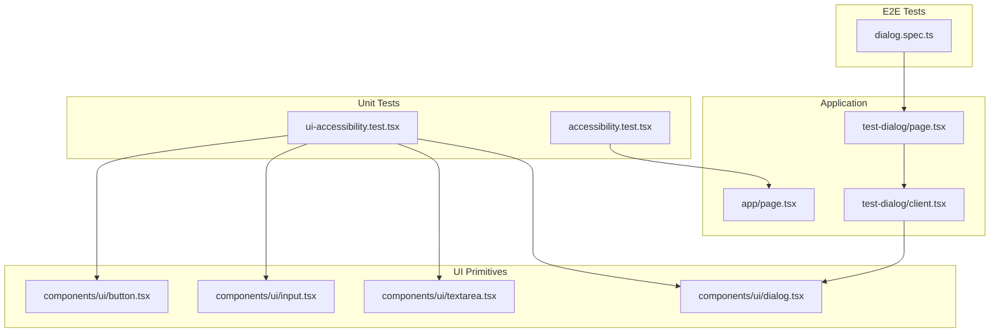
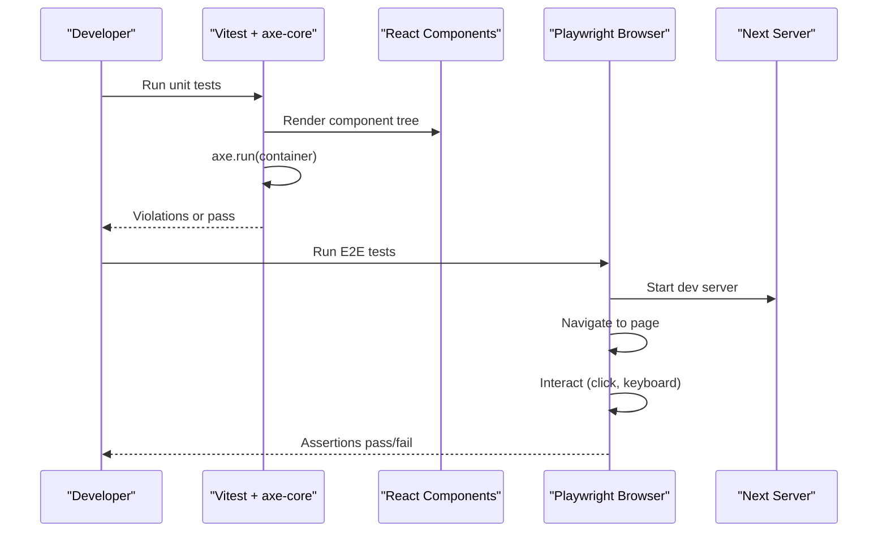
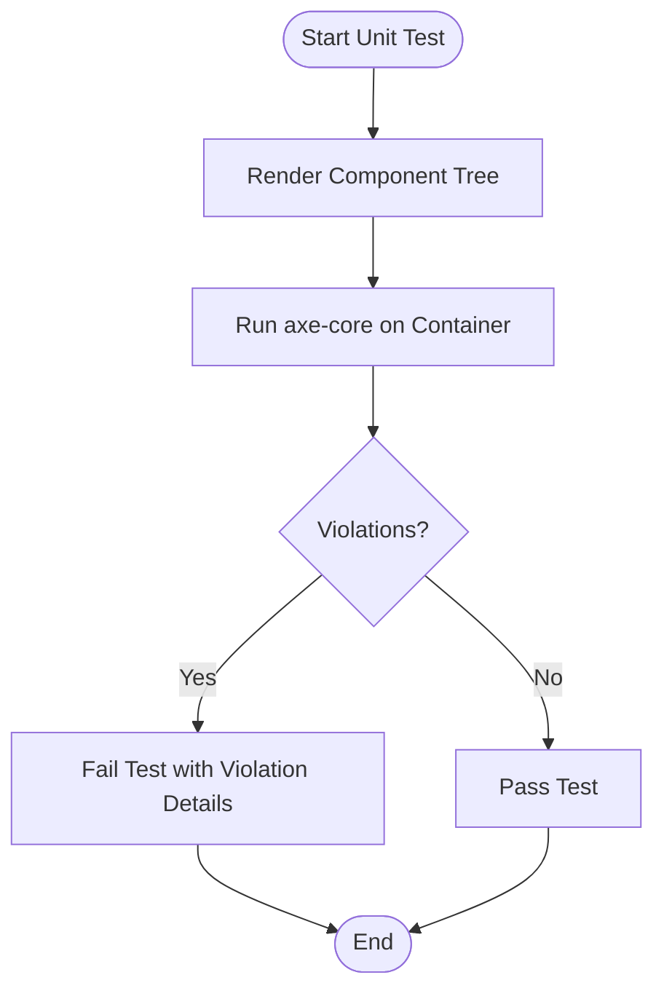
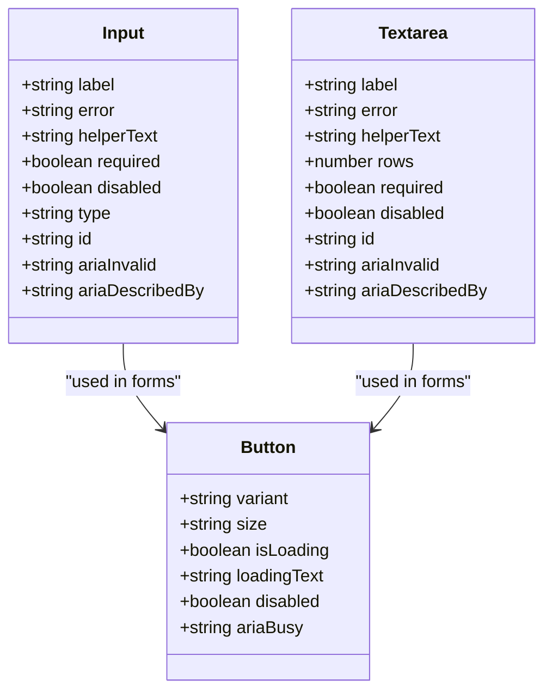
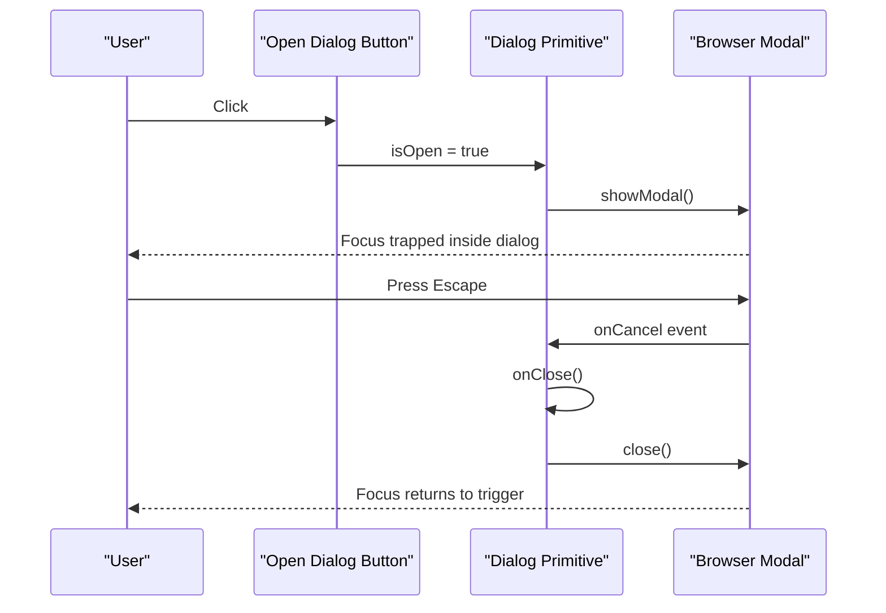
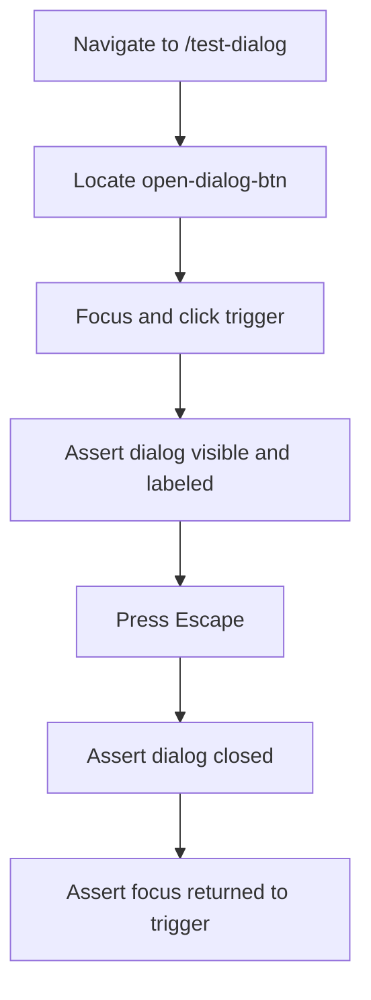
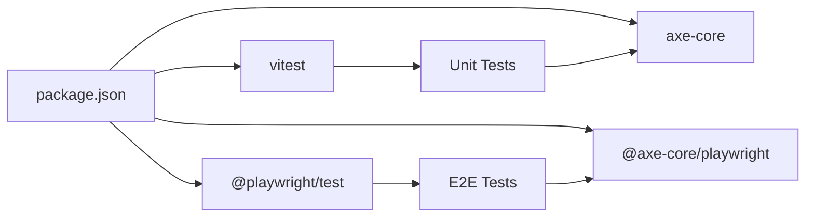

# Accessibility Testing & Auditing

<cite>
**Referenced Files in This Document**
- [package.json](file://package.json)
- [playwright.config.ts](file://playwright.config.ts)
- [src/__tests__/accessibility.test.tsx](file://src/__tests__/accessibility.test.tsx)
- [src/__tests__/ui-accessibility.test.tsx](file://src/__tests__/ui-accessibility.test.tsx)
- [e2e/dialog.spec.ts](file://e2e/dialog.spec.ts)
- [src/components/ui/dialog.tsx](file://src/components/ui/dialog.tsx)
- [src/app/test-dialog/page.tsx](file://src/app/test-dialog/page.tsx)
- [src/app/test-dialog/client.tsx](file://src/app/test-dialog/client.tsx)
- [src/components/ui/button.tsx](file://src/components/ui/button.tsx)
- [src/components/ui/input.tsx](file://src/components/ui/input.tsx)
- [src/components/ui/textarea.tsx](file://src/components/ui/textarea.tsx)
- [docs/TESTING_STRATEGY.md](file://docs/TESTING_STRATEGY.md)
- [docs/DESIGN_SYSTEM.md](file://docs/DESIGN_SYSTEM.md)
</cite>

## Table of Contents
1. [Introduction](#introduction)
2. [Project Structure](#project-structure)
3. [Core Components](#core-components)
4. [Architecture Overview](#architecture-overview)
5. [Detailed Component Analysis](#detailed-component-analysis)
6. [Dependency Analysis](#dependency-analysis)
7. [Performance Considerations](#performance-considerations)
8. [Troubleshooting Guide](#troubleshooting-guide)
9. [Conclusion](#conclusion)

## Introduction
This document defines the accessibility testing and auditing strategy for SwimNigeria with a focus on WCAG 2.1 AA compliance. It explains how axe-core is integrated into unit tests, how Playwright-based E2E tests validate real browser behavior, and how design system guidelines are enforced through automated checks. The guidance covers forms, navigation, dialogs, dynamic content, screen reader compatibility, keyboard navigation, color contrast, utilities, custom rules, violation reporting, and common educational platform issues.

## Project Structure
Accessibility testing spans three layers:
- Unit/component tests using Vitest and axe-core against React components rendered in jsdom.
- E2E tests using Playwright to validate native browser behaviors such as dialog focus management and Escape key handling.
- Design system documentation that codifies accessibility requirements for colors, focus states, motion, and component semantics.

**Diagram sources**
- [src/__tests__/accessibility.test.tsx:1-13](file://src/__tests__/accessibility.test.tsx#L1-L13)
- [src/__tests__/ui-accessibility.test.tsx:1-118](file://src/__tests__/ui-accessibility.test.tsx#L1-L118)
- [e2e/dialog.spec.ts:1-47](file://e2e/dialog.spec.ts#L1-L47)
- [src/app/test-dialog/page.tsx:1-23](file://src/app/test-dialog/page.tsx#L1-L23)
- [src/app/test-dialog/client.tsx:1-45](file://src/app/test-dialog/client.tsx#L1-L45)
- [src/components/ui/button.tsx:1-103](file://src/components/ui/button.tsx#L1-L103)
- [src/components/ui/input.tsx:1-120](file://src/components/ui/input.tsx#L1-L120)
- [src/components/ui/textarea.tsx:1-110](file://src/components/ui/textarea.tsx#L1-L110)
- [src/components/ui/dialog.tsx:1-251](file://src/components/ui/dialog.tsx#L1-L251)

**Section sources**
- [docs/TESTING_STRATEGY.md:73-82](file://docs/TESTING_STRATEGY.md#L73-L82)
- [docs/DESIGN_SYSTEM.md:159-180](file://docs/DESIGN_SYSTEM.md#L159-L180)

## Core Components
- Axe-core integration in unit tests audits rendered React trees for WCAG violations.
- Playwright E2E tests verify real browser modal behavior, focus restoration, and keyboard interactions.
- UI primitives (Button, Input, Textarea, Dialog) implement accessible defaults aligned with the design system.

Key responsibilities:
- Automated rule coverage via axe-core in unit tests.
- Real-world interaction validation via Playwright.
- Accessible component contracts defined by design system tokens and patterns.

**Section sources**
- [src/__tests__/accessibility.test.tsx:1-13](file://src/__tests__/accessibility.test.tsx#L1-L13)
- [src/__tests__/ui-accessibility.test.tsx:1-118](file://src/__tests__/ui-accessibility.test.tsx#L1-L118)
- [e2e/dialog.spec.ts:1-47](file://e2e/dialog.spec.ts#L1-L47)
- [docs/TESTING_STRATEGY.md:73-82](file://docs/TESTING_STRATEGY.md#L73-L82)

## Architecture Overview
The accessibility architecture combines automated audits with manual-like E2E validations:

**Diagram sources**
- [src/__tests__/accessibility.test.tsx:1-13](file://src/__tests__/accessibility.test.tsx#L1-L13)
- [src/__tests__/ui-accessibility.test.tsx:1-118](file://src/__tests__/ui-accessibility.test.tsx#L1-L118)
- [e2e/dialog.spec.ts:1-47](file://e2e/dialog.spec.ts#L1-L47)
- [playwright.config.ts:1-33](file://playwright.config.ts#L1-L33)

## Detailed Component Analysis

### Axe-Core Integration in Unit Tests
- Page-level audit renders the home page and asserts zero violations.
- UI primitives audit validates Button variants, form controls, cards, badges, skeletons, and dialogs render without automated violations.

Implementation pattern:
- Render component under test.
- Run axe-core against the container.
- Assert no violations.

**Diagram sources**
- [src/__tests__/accessibility.test.tsx:1-13](file://src/__tests__/accessibility.test.tsx#L1-L13)
- [src/__tests__/ui-accessibility.test.tsx:1-118](file://src/__tests__/ui-accessibility.test.tsx#L1-L118)

**Section sources**
- [src/__tests__/accessibility.test.tsx:1-13](file://src/__tests__/accessibility.test.tsx#L1-L13)
- [src/__tests__/ui-accessibility.test.tsx:1-118](file://src/__tests__/ui-accessibility.test.tsx#L1-L118)

### Form Controls Accessibility
Accessible form inputs ensure:
- Explicit labels bound via htmlFor.
- Error messages associated via aria-describedby and role="alert".
- Invalid state communicated via aria-invalid.
- Sufficient touch target size and visible focus indicators.

**Diagram sources**
- [src/components/ui/input.tsx:1-120](file://src/components/ui/input.tsx#L1-L120)
- [src/components/ui/textarea.tsx:1-110](file://src/components/ui/textarea.tsx#L1-L110)
- [src/components/ui/button.tsx:1-103](file://src/components/ui/button.tsx#L1-L103)

**Section sources**
- [src/components/ui/input.tsx:1-120](file://src/components/ui/input.tsx#L1-L120)
- [src/components/ui/textarea.tsx:1-110](file://src/components/ui/textarea.tsx#L1-L110)
- [src/components/ui/button.tsx:1-103](file://src/components/ui/button.tsx#L1-L103)
- [docs/DESIGN_SYSTEM.md:115-121](file://docs/DESIGN_SYSTEM.md#L115-L121)

### Dialog Accessibility and Keyboard Behavior
The Dialog primitive uses the native HTML5 dialog element to provide:
- Modal semantics with aria-modal.
- Title and description associations via aria-labelledby and aria-describedby.
- Native Escape key cancellation.
- Focus trapping and return-to-trigger behavior managed by the browser.

**Diagram sources**
- [src/components/ui/dialog.tsx:1-251](file://src/components/ui/dialog.tsx#L1-L251)
- [e2e/dialog.spec.ts:1-47](file://e2e/dialog.spec.ts#L1-L47)

**Section sources**
- [src/components/ui/dialog.tsx:1-251](file://src/components/ui/dialog.tsx#L1-L251)
- [e2e/dialog.spec.ts:1-47](file://e2e/dialog.spec.ts#L1-L47)

### E2E Dialog Validation Flow
Playwright verifies:
- Dialog opens from a known trigger button.
- Dialog has correct roles and attributes.
- Escape closes the dialog.
- Focus returns to the trigger after closing.

**Diagram sources**
- [e2e/dialog.spec.ts:1-47](file://e2e/dialog.spec.ts#L1-L47)
- [src/app/test-dialog/page.tsx:1-23](file://src/app/test-dialog/page.tsx#L1-L23)
- [src/app/test-dialog/client.tsx:1-45](file://src/app/test-dialog/client.tsx#L1-L45)

**Section sources**
- [e2e/dialog.spec.ts:1-47](file://e2e/dialog.spec.ts#L1-L47)
- [src/app/test-dialog/page.tsx:1-23](file://src/app/test-dialog/page.tsx#L1-L23)
- [src/app/test-dialog/client.tsx:1-45](file://src/app/test-dialog/client.tsx#L1-L45)

### Screen Reader Compatibility Patterns
Recommended patterns validated by both axe-core and manual review:
- All interactive elements have discernible text or aria-label.
- Headings follow a logical hierarchy.
- Forms bind labels to inputs and announce errors via role="alert".
- Decorative icons use aria-hidden="true".
- Skeletons and decorative graphics do not expose noise to assistive technologies.

These patterns are reflected in:
- Button’s default type and aria-busy during loading.
- Input/Textarea’s label binding, aria-invalid, and aria-describedby.
- Dialog’s aria-modal, aria-labelledby, and aria-describedby.
- Skeleton’s aria-hidden and reduced-motion support.

**Section sources**
- [src/components/ui/button.tsx:1-103](file://src/components/ui/button.tsx#L1-L103)
- [src/components/ui/input.tsx:1-120](file://src/components/ui/input.tsx#L1-L120)
- [src/components/ui/textarea.tsx:1-110](file://src/components/ui/textarea.tsx#L1-L110)
- [src/components/ui/dialog.tsx:1-251](file://src/components/ui/dialog.tsx#L1-L251)
- [docs/DESIGN_SYSTEM.md:172-180](file://docs/DESIGN_SYSTEM.md#L172-L180)

### Color Contrast Compliance
Design system mandates:
- 4.5:1 minimum for normal text; 3:1 for large text.
- High-contrast focus rings and clear visual states.
- Avoid low-contrast text on colored backgrounds.

Automated enforcement:
- Use axe-core rules to detect contrast failures.
- Visual regression or dedicated contrast checks can be added to CI.

**Section sources**
- [docs/DESIGN_SYSTEM.md:159-165](file://docs/DESIGN_SYSTEM.md#L159-L165)
- [docs/TESTING_STRATEGY.md:73-82](file://docs/TESTING_STRATEGY.md#L73-L82)

### Dynamic Content and Loading States
Patterns:
- Indicate loading with aria-busy on buttons and skeleton placeholders.
- Ensure skeletons are hidden from screen readers.
- Respect prefers-reduced-motion to avoid jarring animations.

**Section sources**
- [src/components/ui/button.tsx:1-103](file://src/components/ui/button.tsx#L1-L103)
- [docs/DESIGN_SYSTEM.md:159-165](file://docs/DESIGN_SYSTEM.md#L159-L165)

### Navigation Accessibility
Guidelines:
- Maintain a logical heading structure across pages.
- Provide skip links and landmark regions where appropriate.
- Ensure mobile navigation remains keyboard accessible and perceivable.

While specific navigation components are not analyzed here, these principles should be applied consistently across layout and header components.

[No sources needed since this section provides general guidance]

## Dependency Analysis
Accessibility tooling and configuration dependencies:

**Diagram sources**
- [package.json:1-48](file://package.json#L1-L48)

**Section sources**
- [package.json:1-48](file://package.json#L1-L48)
- [playwright.config.ts:1-33](file://playwright.config.ts#L1-L33)

## Performance Considerations
- Keep axe-core audits scoped to relevant containers to reduce overhead in unit tests.
- Prefer rendering only necessary parts of the UI in tests.
- Avoid heavy DOM mutations in tight loops during tests.
- Use Playwright’s built-in tracing and retries judiciously in CI.

[No sources needed since this section provides general guidance]

## Troubleshooting Guide
Common issues and resolutions:
- Missing labels: Add explicit labels or aria-label to interactive elements.
- Low contrast: Adjust color tokens to meet WCAG ratios per design system.
- Focus management: Ensure dialogs trap focus and restore it on close; verify with Playwright.
- Error announcements: Bind aria-describedby to error messages and use role="alert".
- Decorative media: Mark decorative SVGs/icons with aria-hidden="true".
- Motion sensitivity: Respect prefers-reduced-motion and disable non-essential animations.

Validation references:
- Unit tests assert zero axe-core violations for core UI primitives and pages.
- E2E tests assert dialog behavior and focus restoration.

**Section sources**
- [src/__tests__/ui-accessibility.test.tsx:1-118](file://src/__tests__/ui-accessibility.test.tsx#L1-L118)
- [e2e/dialog.spec.ts:1-47](file://e2e/dialog.spec.ts#L1-L47)
- [docs/DESIGN_SYSTEM.md:159-180](file://docs/DESIGN_SYSTEM.md#L159-L180)

## Conclusion
SwimNigeria’s accessibility strategy combines automated axe-core audits in unit tests with realistic Playwright E2E validations. The design system enforces high-contrast colors, visible focus states, and semantic markup. By following the patterns documented here—especially around forms, dialogs, dynamic content, and screen reader compatibility—the team can maintain strict WCAG 2.1 AA compliance and deliver an inclusive learning experience.

[No sources needed since this section summarizes without analyzing specific files]