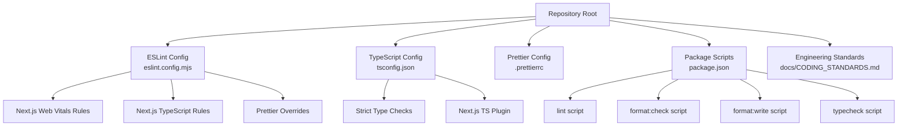
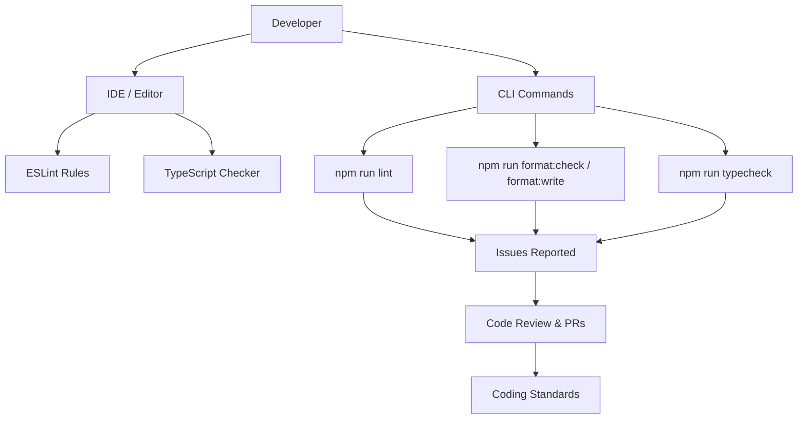
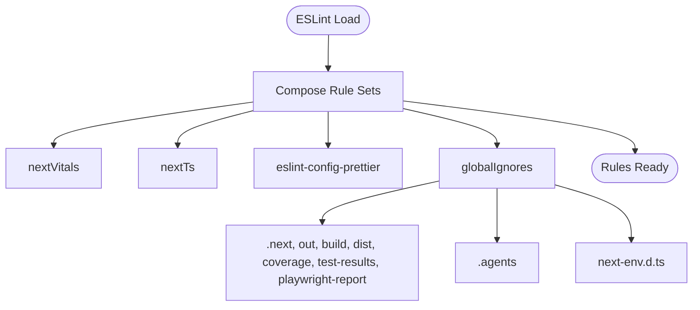
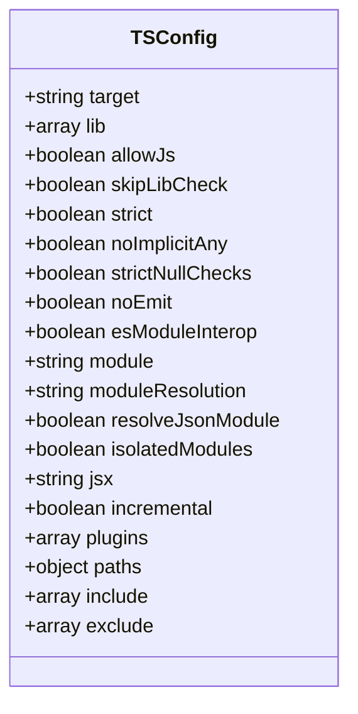
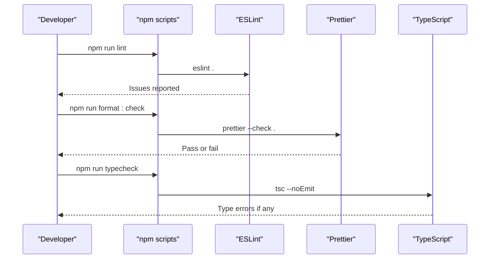
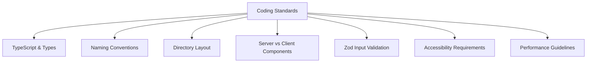
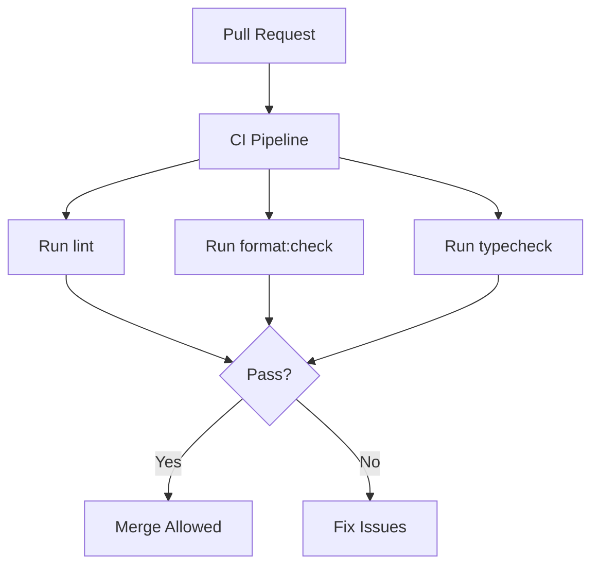
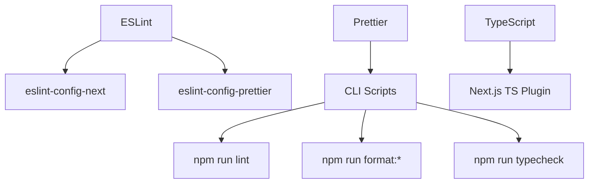

# Code Quality & Static Analysis

<cite>
**Referenced Files in This Document**
- [eslint.config.mjs](file://eslint.config.mjs)
- [tsconfig.json](file://tsconfig.json)
- [.prettierrc](file://.prettierrc)
- [package.json](file://package.json)
- [CODING_STANDARDS.md](file://docs/CODING_STANDARDS.md)
- [AGENT_SKILLS_REGISTER.md](file://docs/AGENT_SKILLS_REGISTER.md)
</cite>

## Table of Contents
1. [Introduction](#introduction)
2. [Project Structure](#project-structure)
3. [Core Components](#core-components)
4. [Architecture Overview](#architecture-overview)
5. [Detailed Component Analysis](#detailed-component-analysis)
6. [Dependency Analysis](#dependency-analysis)
7. [Performance Considerations](#performance-considerations)
8. [Troubleshooting Guide](#troubleshooting-guide)
9. [Conclusion](#conclusion)
10. [Appendices](#appendices)

## Introduction
This document explains the code quality and static analysis setup for SwimNigeria. It focuses on ESLint configuration, TypeScript strict mode settings, Prettier formatting rules, coding standards, and how these tools integrate into development workflows. It also covers Next.js-specific linting strategies, type safety checks, import organization guidance, IDE integration recommendations, performance implications of linting, and strategies for maintaining quality across large teams.

## Project Structure
The code quality tooling is defined at the project root:
- ESLint configuration is centralized in a single modern ESM config file.
- TypeScript compiler options are configured with strict mode enabled and Next.js plugin integration.
- Prettier formatting rules are declared in a dedicated configuration file.
- Scripts in `package.json` expose linting, formatting, and type-checking commands.
- Coding standards are documented in a repository-wide engineering guide.

**Diagram sources**
- [eslint.config.mjs:1-24](file://eslint.config.mjs#L1-L24)
- [tsconfig.json:1-36](file://tsconfig.json#L1-L36)
- [.prettierrc:1-8](file://.prettierrc#L1-L8)
- [package.json:6-16](file://package.json#L6-L16)
- [CODING_STANDARDS.md:1-131](file://docs/CODING_STANDARDS.md#L1-L131)

**Section sources**
- [eslint.config.mjs:1-24](file://eslint.config.mjs#L1-L24)
- [tsconfig.json:1-36](file://tsconfig.json#L1-L36)
- [.prettierrc:1-8](file://.prettierrc#L1-L8)
- [package.json:6-16](file://package.json#L6-L16)
- [CODING_STANDARDS.md:1-131](file://docs/CODING_STANDARDS.md#L1-L131)

## Core Components
This section summarizes the core quality tools and their responsibilities.

- ESLint
  - Uses Next.js Web Vitals and TypeScript rule sets.
  - Disables conflicting rules via Prettier overrides.
  - Ignores generated and build directories to reduce noise.

- TypeScript
  - Enforces strict mode, null checks, and explicit typing policies.
  - Integrates with Next.js through its TS plugin.
  - Uses path aliases for cleaner imports.

- Prettier
  - Standardizes formatting (semicolons, quotes, trailing commas, indentation, line width).

- Scripts
  - Provide consistent commands for linting, formatting, and type checking.

- Coding Standards
  - Define naming conventions, component architecture, validation strategy, accessibility requirements, and performance guidelines.

**Section sources**
- [eslint.config.mjs:1-24](file://eslint.config.mjs#L1-L24)
- [tsconfig.json:1-36](file://tsconfig.json#L1-L36)
- [.prettierrc:1-8](file://.prettierrc#L1-L8)
- [package.json:6-16](file://package.json#L6-L16)
- [CODING_STANDARDS.md:1-131](file://docs/CODING_STANDARDS.md#L1-L131)

## Architecture Overview
The quality pipeline integrates three layers:
- Editor-time feedback via ESLint and TypeScript language services.
- Pre-commit or developer-driven checks using scripts.
- Documentation-backed standards that guide code review and PR expectations.

[No sources needed since this diagram shows conceptual workflow, not actual code structure]

## Detailed Component Analysis

### ESLint Configuration
ESLint is configured as an ESM module that composes Next.js rule sets and disables style conflicts with Prettier. Generated folders and test artifacts are ignored to keep analysis focused on source code.

Key behaviors:
- Extends Next.js Web Vitals rules for performance-oriented linting.
- Extends Next.js TypeScript rules for React and Next.js patterns.
- Applies Prettier overrides to avoid conflicting style rules.
- Ignores build outputs, agent skill directories, and generated types.

**Diagram sources**
- [eslint.config.mjs:1-24](file://eslint.config.mjs#L1-L24)

**Section sources**
- [eslint.config.mjs:1-24](file://eslint.config.mjs#L1-L24)

### TypeScript Compiler Options
TypeScript is configured with strict mode and Next.js plugin integration. The configuration enforces strong typing, avoids implicit any, enables null checks, and uses bundler-style module resolution. Path aliases simplify imports.

Important aspects:
- Strict mode is enabled globally.
- Nullability is enforced with strict null checks.
- JSX is set to React’s automatic runtime.
- Incremental compilation is enabled for faster builds.
- Includes generated Next.js types while excluding node_modules.

**Diagram sources**
- [tsconfig.json:1-36](file://tsconfig.json#L1-L36)

**Section sources**
- [tsconfig.json:1-36](file://tsconfig.json#L1-L36)

### Prettier Formatting Rules
Prettier defines consistent formatting across the codebase:
- Semicolons are required.
- Double quotes are used for strings.
- Trailing commas are applied everywhere possible.
- Indentation uses two spaces.
- Line width is capped at 100 characters.

These rules ensure uniform formatting and reduce diff noise during reviews.

**Section sources**
- [.prettierrc:1-8](file://.prettierrc#L1-L8)

### Scripts and Development Workflow
Scripts provide standardized entry points for quality checks:
- `lint`: Runs ESLint across the project.
- `typecheck`: Runs TypeScript without emitting files.
- `format:check`: Validates formatting.
- `format:write`: Applies formatting automatically.

These scripts can be integrated into pre-commit hooks and CI pipelines to enforce quality gates.

**Diagram sources**
- [package.json:6-16](file://package.json#L6-L16)

**Section sources**
- [package.json:6-16](file://package.json#L6-L16)

### Coding Standards and Review Expectations
The engineering standards document defines team-wide expectations:
- TypeScript strictness and zero `any` policy.
- Explicit return types for public APIs and Server Actions.
- Naming conventions for components, routes, utilities, and constants.
- Directory layout following Next.js App Router conventions.
- Separation between server components and client components.
- Validation using Zod for all inputs.
- Accessibility requirements and semantic HTML usage.
- Performance guidance such as avoiding data-fetch waterfalls.

These standards should be referenced during code reviews and pull request evaluations.

**Diagram sources**
- [CODING_STANDARDS.md:1-131](file://docs/CODING_STANDARDS.md#L1-L131)

**Section sources**
- [CODING_STANDARDS.md:1-131](file://docs/CODING_STANDARDS.md#L1-L131)

### Custom ESLint Rules and Next.js Strategies
The current ESLint configuration relies on official Next.js rule sets rather than custom rules. This approach provides:
- Consistent behavior aligned with Next.js releases.
- Built-in support for React and TypeScript patterns.
- Reduced maintenance burden compared to hand-written rules.

If custom rules are added later, they should:
- Be scoped to specific file patterns.
- Avoid blocking slow operations on every save.
- Include clear error messages and fix suggestions where possible.

**Section sources**
- [eslint.config.mjs:1-24](file://eslint.config.mjs#L1-L24)

### Import Ordering and Type Safety Examples
While there is no explicit import-order rule in the current ESLint configuration, the coding standards define naming and organization principles that help maintain readable imports. For example:
- Use path aliases (`@/*`) to organize imports cleanly.
- Prefer explicit return types for exported functions and route handlers.
- Validate inputs with Zod schemas before processing.

Type safety examples from the standards:
- Zero `any` policy; use `unknown` with guards or Zod when necessary.
- Use interfaces for object shapes and props; use `type` for unions and mapped types.
- Avoid non-null assertions; prefer optional chaining and nullish coalescing.

**Section sources**
- [tsconfig.json:23-25](file://tsconfig.json#L23-L25)
- [CODING_STANDARDS.md:3-10](file://docs/CODING_STANDARDS.md#L3-L10)
- [CODING_STANDARDS.md:76-93](file://docs/CODING_STANDARDS.md#L76-L93)

### Code Review Workflow and Automated Quality Gates
The repository does not include a pre-commit hook framework such as Husky or lint-staged. However, the documented verification checklist references running type checks and linters, which can serve as manual or CI-based quality gates.

Recommended workflow:
- Developers run `npm run lint`, `npm run format:check`, and `npm run typecheck` locally.
- Pull requests trigger CI jobs that run the same commands.
- Reviews reference the coding standards for consistency.

[No sources needed since this diagram shows conceptual workflow, not actual code structure]

**Section sources**
- [AGENT_SKILLS_REGISTER.md:224-239](file://docs/AGENT_SKILLS_REGISTER.md#L224-L239)

### IDE Integration and Real-Time Feedback
To enable real-time feedback:
- Configure your IDE to use the project’s ESLint configuration.
- Enable TypeScript diagnostics powered by the workspace version of TypeScript.
- Set up Prettier as the default formatter and enable format-on-save.
- Ensure ESLint auto-fixes are available for supported rules.

This setup provides immediate feedback for style, type, and Next.js-specific issues.

[No sources needed since this section provides general guidance]

## Dependency Analysis
The quality toolchain depends on a small set of packages:
- ESLint and Next.js ESLint configs.
- Prettier and ESLint Prettier overrides.
- TypeScript and Next.js TS plugin.

**Diagram sources**
- [package.json:37-45](file://package.json#L37-L45)
- [eslint.config.mjs:1-9](file://eslint.config.mjs#L1-L9)
- [tsconfig.json:18-22](file://tsconfig.json#L18-L22)

**Section sources**
- [package.json:37-45](file://package.json#L37-L45)
- [eslint.config.mjs:1-9](file://eslint.config.mjs#L1-L9)
- [tsconfig.json:18-22](file://tsconfig.json#L18-L22)

## Performance Considerations
Linting and type checking can impact developer experience if not tuned properly. Recommendations:
- Keep ESLint ignores broad enough to exclude generated and build directories.
- Prefer fast, targeted rules over expensive ones.
- Use incremental TypeScript compilation.
- Run formatting checks only on changed files in CI or pre-commit hooks.
- Avoid heavy custom rules unless they provide high value.
- Cache dependencies and tool outputs where supported by your environment.

[No sources needed since this section provides general guidance]

## Troubleshooting Guide
Common issues and resolutions:
- ESLint reports style conflicts: Ensure Prettier overrides are active and your editor uses Prettier as the formatter.
- TypeScript errors appear due to strict mode: Follow the zero `any` policy and add explicit types or guards.
- Path alias imports fail: Verify the `@/*` path mapping and that your IDE is using the project’s tsconfig.
- Formatting fails in CI: Run `npm run format:write` locally or configure a formatter step in CI.
- Linting is slow: Confirm that generated directories are ignored and consider narrowing the scope of linting.

**Section sources**
- [eslint.config.mjs:10-20](file://eslint.config.mjs#L10-L20)
- [tsconfig.json:23-25](file://tsconfig.json#L23-L25)
- [package.json:6-16](file://package.json#L6-L16)

## Conclusion
SwimNigeria’s code quality setup centers on Next.js-aligned ESLint rules, strict TypeScript configuration, and consistent Prettier formatting. The engineering standards document codifies team expectations around types, naming, component architecture, validation, accessibility, and performance. While pre-commit hooks are not present in the repository, the provided scripts and documentation establish a clear foundation for automated quality gates in CI and disciplined code reviews.

[No sources needed since this section summarizes without analyzing specific files]

## Appendices

### Quick Reference: Commands
- Lint: `npm run lint`
- Format check: `npm run format:check`
- Format write: `npm run format:write`
- Type check: `npm run typecheck`

**Section sources**
- [package.json:6-16](file://package.json#L6-L16)