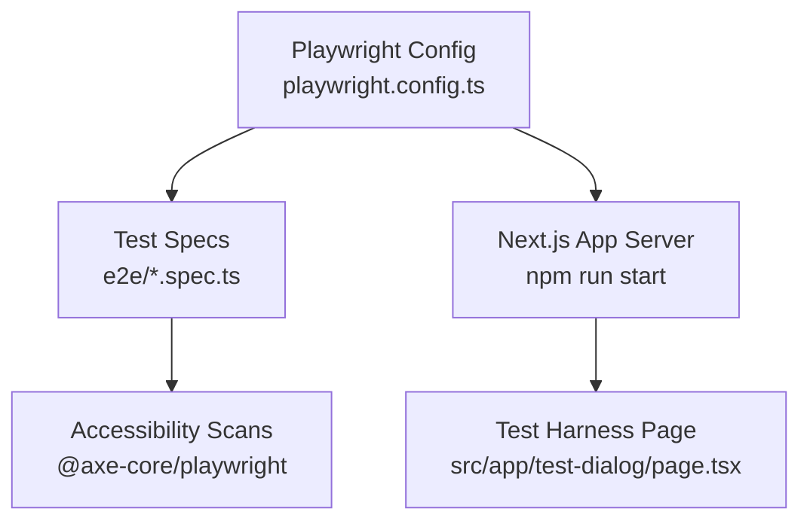
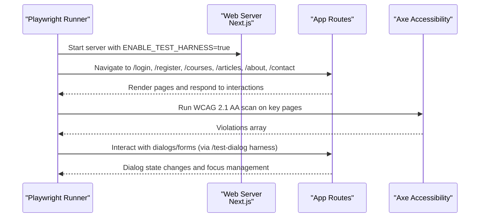
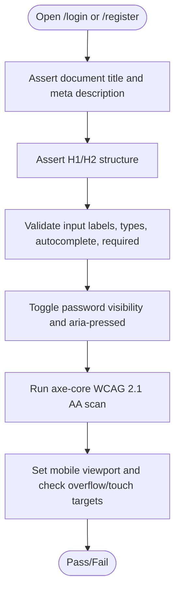
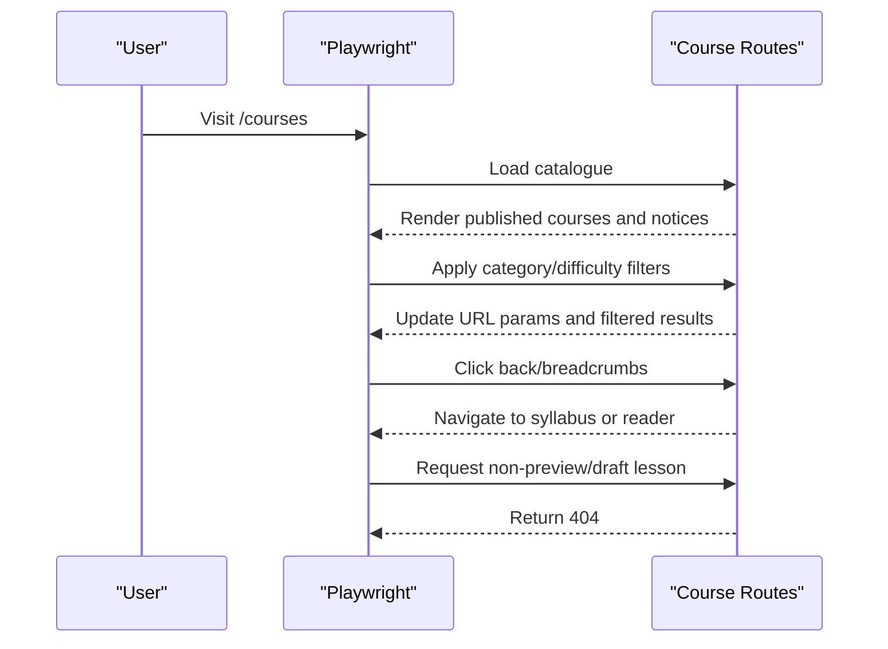
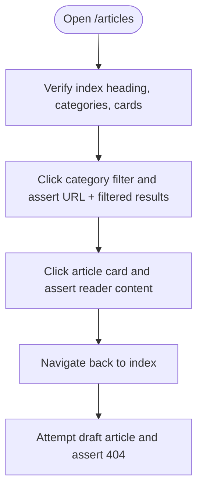
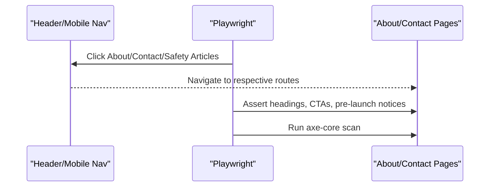
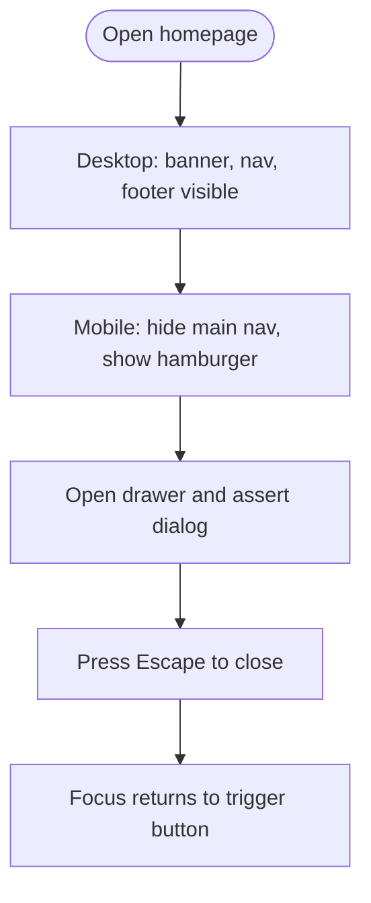
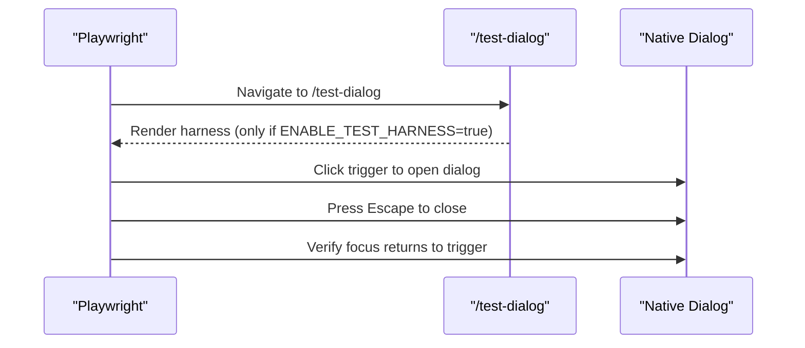
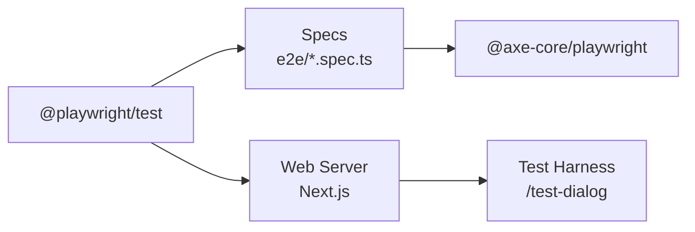

# End-to-End Testing with Playwright

<cite>
**Referenced Files in This Document**
- [playwright.config.ts](file://playwright.config.ts)
- [package.json](file://package.json)
- [e2e/smoke.spec.ts](file://e2e/smoke.spec.ts)
- [e2e/layout.spec.ts](file://e2e/layout.spec.ts)
- [e2e/about-contact.spec.ts](file://e2e/about-contact.spec.ts)
- [e2e/articles.spec.ts](file://e2e/articles.spec.ts)
- [e2e/courses.spec.ts](file://e2e/courses.spec.ts)
- [e2e/login.spec.ts](file://e2e/login.spec.ts)
- [e2e/register.spec.ts](file://e2e/register.spec.ts)
- [e2e/dialog.spec.ts](file://e2e/dialog.spec.ts)
- [src/app/test-dialog/page.tsx](file://src/app/test-dialog/page.tsx)
- [docs/TESTING_STRATEGY.md](file://docs/TESTING_STRATEGY.md)
</cite>

## Table of Contents
1. [Introduction](#introduction)
2. [Project Structure](#project-structure)
3. [Core Components](#core-components)
4. [Architecture Overview](#architecture-overview)
5. [Detailed Component Analysis](#detailed-component-analysis)
6. [Dependency Analysis](#dependency-analysis)
7. [Performance Considerations](#performance-considerations)
8. [Troubleshooting Guide](#troubleshooting-guide)
9. [Conclusion](#conclusion)
10. [Appendices](#appendices)

## Introduction
This document provides comprehensive end-to-end testing guidance for SwimNigeria using the Playwright framework. It explains how the E2E suite is configured, how tests are organized by feature and user flow, and how to write robust tests covering authentication entry points, course navigation, article browsing, and form interactions. It also covers environment setup, test harness usage, accessibility checks, mobile viewport emulation, debugging techniques, CI considerations, and performance monitoring strategies.

## Project Structure
The E2E tests live under the e2e directory and are executed by Playwright against a running Next.js application. The configuration defines the test directory, parallel execution, retries, workers, reporter, base URL, tracing, projects (browser/device matrix), and a web server that starts the app with a test-specific environment variable.

**Diagram sources**
- [playwright.config.ts:1-33](file://playwright.config.ts#L1-L33)
- [src/app/test-dialog/page.tsx:1-22](file://src/app/test-dialog/page.tsx#L1-L22)

Key structural notes:
- Test directory: e2e
- Browser project: Desktop Chrome via devices
- Web server: Starts Next.js on a configurable port with ENABLE_TEST_HARNESS enabled
- Tracing: Enabled on first retry for diagnostics
- Reporter: list

**Section sources**
- [playwright.config.ts:1-33](file://playwright.config.ts#L1-L33)
- [package.json:6-16](file://package.json#L6-L16)

## Core Components
- Playwright configuration: Defines test execution behavior, browser device matrix, web server startup, and tracing.
- Feature-based spec files: Each major area has its own spec file (smoke, layout, about/contact, articles, courses, login, register, dialog).
- Accessibility integration: All specs use @axe-core/playwright to enforce WCAG 2.1 AA compliance.
- Test harness: A dedicated page (/test-dialog) gated by an environment flag for native dialog testing.

What you get out of the box:
- Parallel test execution across features
- Retries in CI with trace capture on first retry
- Mobile viewport checks within specs
- Automated accessibility scans per page or flow

**Section sources**
- [playwright.config.ts:6-31](file://playwright.config.ts#L6-L31)
- [e2e/smoke.spec.ts:1-36](file://e2e/smoke.spec.ts#L1-L36)
- [e2e/layout.spec.ts:1-111](file://e2e/layout.spec.ts#L1-L111)
- [e2e/about-contact.spec.ts:1-138](file://e2e/about-contact.spec.ts#L1-L138)
- [e2e/articles.spec.ts:1-101](file://e2e/articles.spec.ts#L1-L101)
- [e2e/courses.spec.ts:1-532](file://e2e/courses.spec.ts#L1-L532)
- [e2e/login.spec.ts:1-112](file://e2e/login.spec.ts#L1-L112)
- [e2e/register.spec.ts:1-128](file://e2e/register.spec.ts#L1-L128)
- [e2e/dialog.spec.ts:1-47](file://e2e/dialog.spec.ts#L1-L47)
- [src/app/test-dialog/page.tsx:1-22](file://src/app/test-dialog/page.tsx#L1-L22)

## Architecture Overview
The E2E architecture runs Playwright against a locally started Next.js server. Tests navigate to routes, assert UI state, interact with forms, and validate accessibility. A test harness route is only available when ENABLE_TEST_HARNESS is set, which is automatically injected by Playwright’s webServer env.

**Diagram sources**
- [playwright.config.ts:23-31](file://playwright.config.ts#L23-L31)
- [src/app/test-dialog/page.tsx:15-22](file://src/app/test-dialog/page.tsx#L15-L22)
- [e2e/dialog.spec.ts:1-47](file://e2e/dialog.spec.ts#L1-L47)
- [e2e/login.spec.ts:1-112](file://e2e/login.spec.ts#L1-L112)
- [e2e/courses.spec.ts:1-532](file://e2e/courses.spec.ts#L1-L532)

## Detailed Component Analysis

### Authentication Entry Points: Login and Registration
These specs verify SEO metadata, semantic headings, accessible inputs, password visibility toggles, and WCAG compliance. They also include mobile viewport checks and touch target sizing validation.

**Diagram sources**
- [e2e/login.spec.ts:9-110](file://e2e/login.spec.ts#L9-L110)
- [e2e/register.spec.ts:9-126](file://e2e/register.spec.ts#L9-L126)

Practical guidance:
- Use role-based locators and accessible names for robustness.
- Assert both visible content and attributes (type, autocomplete, required).
- Validate interactive states like aria-pressed during toggles.
- Include mobile viewport assertions to catch layout regressions early.

**Section sources**
- [e2e/login.spec.ts:1-112](file://e2e/login.spec.ts#L1-L112)
- [e2e/register.spec.ts:1-128](file://e2e/register.spec.ts#L1-L128)

### Course Catalogue, Syllabus, and Preview Lessons
These tests cover public course discovery, filtering by category and difficulty, combined filters, empty states, breadcrumb navigation, access control (404s for drafts/non-preview lessons), and preview lesson reader flows.

**Diagram sources**
- [e2e/courses.spec.ts:5-531](file://e2e/courses.spec.ts#L5-L531)

Key patterns:
- Filter interactions update URL parameters; assert both URL and visible content.
- Empty states and reset actions should be explicitly tested.
- Access control paths must return 404 for unauthorized or draft content.
- Breadcrumb and “next” navigation flows should be validated.

**Section sources**
- [e2e/courses.spec.ts:1-532](file://e2e/courses.spec.ts#L1-L532)

### Articles Directory and Reader
Tests assert the articles index, category navigation, card rendering, reader view, back navigation, and 404 handling for unpublished drafts.

**Diagram sources**
- [e2e/articles.spec.ts:5-81](file://e2e/articles.spec.ts#L5-L81)

**Section sources**
- [e2e/articles.spec.ts:1-101](file://e2e/articles.spec.ts#L1-L101)

### About, Contact, and Global Navigation
These specs validate the About and Contact pages’ content and accessibility, plus navigation from the header and mobile drawer.

**Diagram sources**
- [e2e/about-contact.spec.ts:5-136](file://e2e/about-contact.spec.ts#L5-L136)

**Section sources**
- [e2e/about-contact.spec.ts:1-138](file://e2e/about-contact.spec.ts#L1-L138)

### Responsive Layout and Navigation Drawer
Tests ensure desktop and mobile layouts render correctly, the hamburger menu opens/closes, Escape dismisses the drawer, and focus returns to the trigger.

**Diagram sources**
- [e2e/layout.spec.ts:5-89](file://e2e/layout.spec.ts#L5-L89)

**Section sources**
- [e2e/layout.spec.ts:1-111](file://e2e/layout.spec.ts#L1-L111)

### Native Browser Dialog Primitive
Uses a test harness page that is only available when ENABLE_TEST_HARNESS is true. Validates dialog open/close, keyboard Escape, and focus restoration.

**Diagram sources**
- [e2e/dialog.spec.ts:1-47](file://e2e/dialog.spec.ts#L1-L47)
- [src/app/test-dialog/page.tsx:15-22](file://src/app/test-dialog/page.tsx#L15-L22)
- [playwright.config.ts:26-28](file://playwright.config.ts#L26-L28)

**Section sources**
- [e2e/dialog.spec.ts:1-47](file://e2e/dialog.spec.ts#L1-L47)
- [src/app/test-dialog/page.tsx:1-22](file://src/app/test-dialog/page.tsx#L1-L22)

### Smoke Test and Home Page
Quick smoke test validates the landing page identity, hero heading, primary CTA, and accessibility.

**Section sources**
- [e2e/smoke.spec.ts:1-36](file://e2e/smoke.spec.ts#L1-L36)

## Dependency Analysis
- Playwright runner executes specs in e2e against a local Next.js server.
- Axe-core runs accessibility scans inside each spec.
- Test harness page is conditionally exposed based on ENABLE_TEST_HARNESS.

**Diagram sources**
- [package.json:26-28](file://package.json#L26-L28)
- [playwright.config.ts:17-22](file://playwright.config.ts#L17-L22)
- [src/app/test-dialog/page.tsx:15-22](file://src/app/test-dialog/page.tsx#L15-L22)

**Section sources**
- [package.json:26-28](file://package.json#L26-L28)
- [playwright.config.ts:17-22](file://playwright.config.ts#L17-L22)

## Performance Considerations
- Parallel execution: fullyParallel is enabled; workers default to all cores locally and single worker in CI for stability.
- Retries: CI enables retries to mitigate flakiness; traces are captured on first retry.
- Viewport checks: Many specs include mobile viewport assertions to prevent CLS and layout shifts.
- Bandwidth throttling: While not configured in Playwright config, consider adding network throttling profiles for realistic low-bandwidth scenarios.

Recommendations:
- Add explicit timeouts for long-running flows (e.g., enrollment, certificate generation).
- Use consistent locators (role, name) to reduce brittle selectors.
- Keep tests focused and independent; avoid shared mutable state between tests.

**Section sources**
- [playwright.config.ts:8-16](file://playwright.config.ts#L8-L16)
- [e2e/layout.spec.ts:41-89](file://e2e/layout.spec.ts#L41-L89)

## Troubleshooting Guide
Common issues and remedies:
- Flaky tests: Enable retries and inspect traces generated on first retry.
- Missing harness page: Ensure ENABLE_TEST_HARNESS is set; Playwright injects it when starting the web server.
- Accessibility failures: Review axe-core violations and fix missing labels, contrast, or focus management.
- Mobile layout issues: Reproduce with the same viewport sizes used in specs (e.g., 375x667).

Debugging techniques:
- Record videos and save traces for failed/retried tests.
- Inspect network requests using Playwright’s built-in network inspection.
- Use headed mode for local debugging and step through interactions.

Environment variables:
- ENABLE_TEST_HARNESS: Enables the /test-dialog route for dialog testing.
- PORT: Overrides the dev server port used by Playwright.

**Section sources**
- [playwright.config.ts:3-4](file://playwright.config.ts#L3-L4)
- [playwright.config.ts:23-31](file://playwright.config.ts#L23-L31)
- [src/app/test-dialog/page.tsx:15-22](file://src/app/test-dialog/page.tsx#L15-L22)

## Conclusion
The SwimNigeria E2E suite uses Playwright to validate critical user journeys across authentication entry points, course catalog and reader experiences, article browsing, global navigation, and native dialog behavior. It integrates automated accessibility checks and includes mobile viewport validations. With parallel execution, CI-aware retries, and trace capture, the suite balances speed and reliability while enforcing high-quality UX standards.

## Appendices

### How to Write Comprehensive User Flow Tests
- Authentication flows:
  - Assert page identity (title, meta description).
  - Validate accessible inputs and interactive controls.
  - Test password visibility toggles and associated ARIA attributes.
  - Include mobile viewport checks and minimum touch target sizes.
- Course navigation:
  - Verify catalogue rendering, educational notices, and published-only content.
  - Test category and difficulty filters, combined filters, active filter summaries, and reset behavior.
  - Validate breadcrumb navigation and next/previous lesson flows.
  - Enforce 404 responses for drafts and non-preview lessons.
- Article browsing:
  - Confirm index, category navigation, and card rendering.
  - Validate reader view content and back navigation.
  - Ensure 404 for unpublished drafts.
- Form interactions:
  - Use role-based locators and accessible names.
  - Assert input attributes (type, autocomplete, required).
  - Validate success/error states and focus management.

### Test Environment Setup
- Install dependencies and browsers:
  - npm ci
  - npx playwright install chromium
- Run E2E tests:
  - npm run test:e2e
- Local development:
  - npm run dev
  - npm run build
  - npm run start

**Section sources**
- [package.json:6-16](file://package.json#L6-L16)

### Database Seeding Strategies
- For E2E, prefer stable seed data at the application layer or via fixtures rather than mutating production databases.
- Use deterministic slugs and IDs for predictable navigation and assertions.
- Isolate test data per test run to avoid cross-test interference.

[No sources needed since this section provides general guidance]

### Mock Service Worker Usage for API Stubbing
- If external APIs are involved, integrate MSW to stub endpoints deterministically.
- Initialize MSW in a Playwright fixture before navigating to routes that call those APIs.
- Assert request/response payloads and error branches.

[No sources needed since this section provides general guidance]

### Visual Regression Testing
- Capture screenshots for critical pages and compare against baselines.
- Use consistent viewports and device settings to avoid false positives.
- Thresholds and ignore regions can help stabilize comparisons.

[No sources needed since this section provides general guidance]

### Cross-Browser Compatibility Testing
- Extend the projects array in Playwright config to include Firefox and Safari where appropriate.
- Run the full suite across browsers in CI to catch engine-specific issues.

[No sources needed since this section provides general guidance]

### Mobile Device Emulation
- Use devices presets (e.g., iPhone, Pixel) in addition to custom viewports.
- Validate touch targets, drawer behavior, and absence of horizontal overflow.

**Section sources**
- [e2e/layout.spec.ts:41-89](file://e2e/layout.spec.ts#L41-L89)

### Test Data Management, Fixtures, and Shared Utilities
- Prefer inline fixtures for small datasets; extract reusable helpers into shared modules.
- Avoid global mutable state; initialize fresh data per test.
- Centralize common assertions (e.g., accessibility scans, viewport checks) to reduce duplication.

[No sources needed since this section provides general guidance]

### Debugging Techniques
- Record videos and enable traces:
  - Configure video and trace options in Playwright.
- Network inspection:
  - Intercept and log requests/responses for failing flows.
- Headed mode:
  - Run tests with --headed for visual debugging.

**Section sources**
- [playwright.config.ts:13-16](file://playwright.config.ts#L13-L16)

### CI/CD Integration Patterns
- forbidOnly: Prevents .only in CI.
- retries: Increase resilience in CI.
- workers: Single worker in CI for deterministic output.
- Pre-deployment gates: Follow the documented verification pipeline including format, typecheck, lint, unit tests, build, and E2E.

**Section sources**
- [playwright.config.ts:9-11](file://playwright.config.ts#L9-L11)
- [docs/TESTING_STRATEGY.md:95-119](file://docs/TESTING_STRATEGY.md#L95-L119)

### Performance Monitoring for E2E Execution
- Track test duration and failure rates in CI dashboards.
- Identify slow tests and split them into smaller, focused suites.
- Monitor resource usage (CPU/memory) to detect bottlenecks.

[No sources needed since this section provides general guidance]