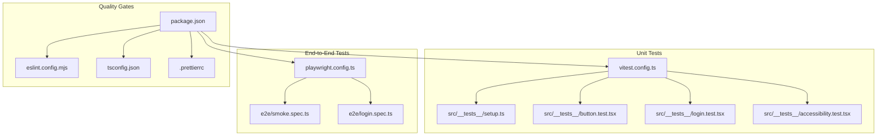
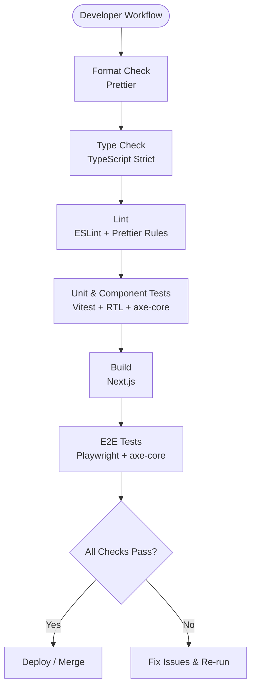
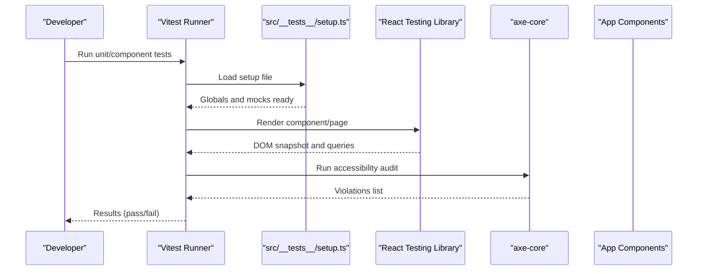
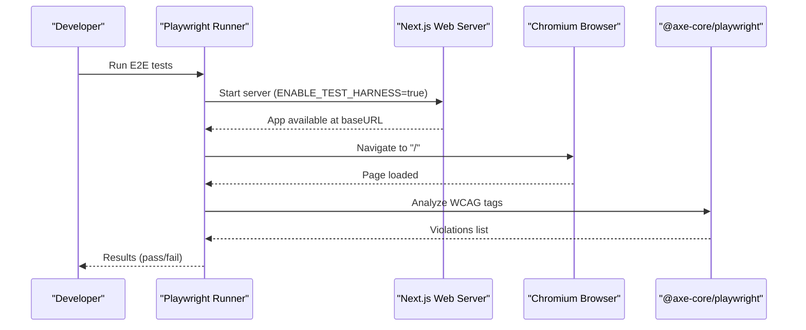
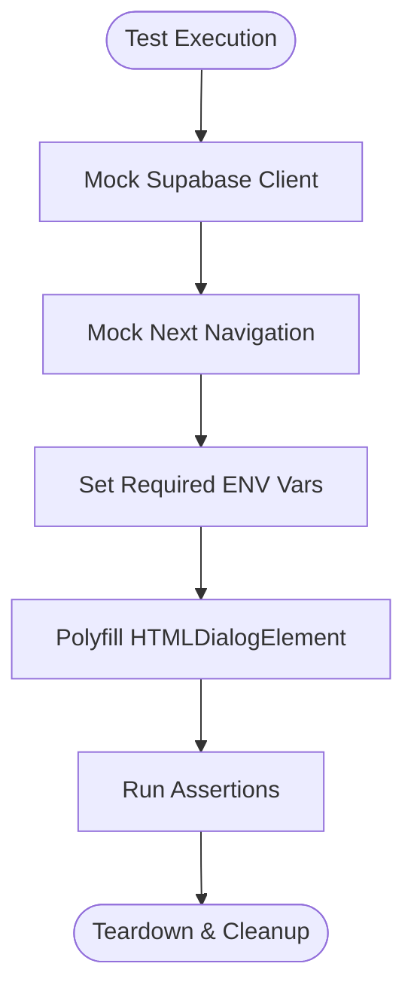
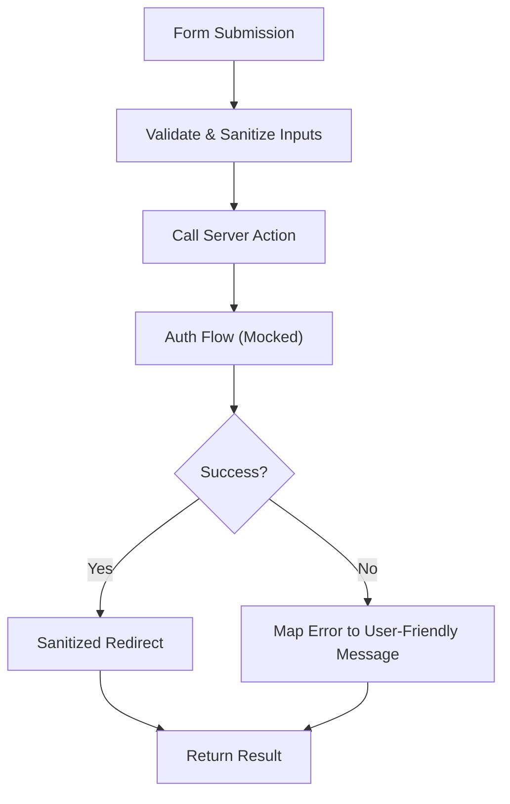
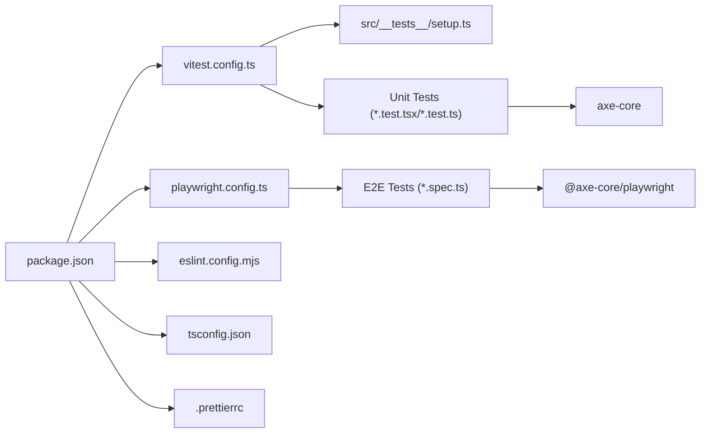

# Testing & Quality Assurance

<cite>
**Referenced Files in This Document**
- [package.json](file://package.json)
- [vitest.config.ts](file://vitest.config.ts)
- [playwright.config.ts](file://playwright.config.ts)
- [eslint.config.mjs](file://eslint.config.mjs)
- [tsconfig.json](file://tsconfig.json)
- [.prettierrc](file://.prettierrc)
- [src/__tests__/setup.ts](file://src/__tests__/setup.ts)
- [docs/TESTING_STRATEGY.md](file://docs/TESTING_STRATEGY.md)
- [src/__tests__/button.test.tsx](file://src/__tests__/button.test.tsx)
- [src/__tests__/login.test.tsx](file://src/__tests__/login.test.tsx)
- [src/__tests__/accessibility.test.tsx](file://src/__tests__/accessibility.test.tsx)
- [e2e/smoke.spec.ts](file://e2e/smoke.spec.ts)
- [e2e/login.spec.ts](file://e2e/login.spec.ts)
</cite>

## Table of Contents
1. [Introduction](#introduction)
2. [Project Structure](#project-structure)
3. [Core Components](#core-components)
4. [Architecture Overview](#architecture-overview)
5. [Detailed Component Analysis](#detailed-component-analysis)
6. [Dependency Analysis](#dependency-analysis)
7. [Performance Considerations](#performance-considerations)
8. [Troubleshooting Guide](#troubleshooting-guide)
9. [Conclusion](#conclusion)

## Introduction
This document describes the multi-layered testing and quality assurance strategy for SwimNigeria. It covers unit and component tests with Vitest and React Testing Library, end-to-end smoke and accessibility tests with Playwright and axe-core, configuration files, test organization patterns, mocking strategies, quality gates (ESLint, Prettier, TypeScript strict mode), and the full workflow from local development to CI/CD. It also includes guidance on performance testing considerations, test data management, and debugging techniques for failing tests.

## Project Structure
SwimNigeria organizes tests across two primary locations:
- Unit and component tests under src/__tests__ using Vitest and jsdom.
- End-to-end tests under e2e using Playwright.

Key configuration files:
- package.json defines scripts for linting, type checking, formatting, unit tests, and E2E tests.
- vitest.config.ts configures jsdom environment, globals, setup file, include/exclude patterns, and path aliases.
- playwright.config.ts configures browser projects, base URL, retries, workers, traces, and a web server wrapper for running the Next.js app during E2E runs.
- eslint.config.mjs composes Next.js ESLint presets with Prettier rules and global ignores.
- tsconfig.json enables strict TypeScript checks and module resolution suitable for Next.js.
- .prettierrc enforces consistent code style.

**Diagram sources**
- [package.json:6-16](file://package.json#L6-L16)
- [vitest.config.ts:1-18](file://vitest.config.ts#L1-L18)
- [playwright.config.ts:1-33](file://playwright.config.ts#L1-L33)
- [eslint.config.mjs:1-24](file://eslint.config.mjs#L1-L24)
- [tsconfig.json:1-36](file://tsconfig.json#L1-L36)
- [.prettierrc:1-8](file://.prettierrc#L1-L8)
- [src/__tests__/setup.ts:1-16](file://src/__tests__/setup.ts#L1-L16)
- [src/__tests__/button.test.tsx:1-88](file://src/__tests__/button.test.tsx#L1-L88)
- [src/__tests__/login.test.tsx:1-287](file://src/__tests__/login.test.tsx#L1-L287)
- [src/__tests__/accessibility.test.tsx:1-13](file://src/__tests__/accessibility.test.tsx#L1-L13)
- [e2e/smoke.spec.ts:1-36](file://e2e/smoke.spec.ts#L1-L36)
- [e2e/login.spec.ts:1-112](file://e2e/login.spec.ts#L1-L112)

**Section sources**
- [package.json:6-16](file://package.json#L6-L16)
- [vitest.config.ts:1-18](file://vitest.config.ts#L1-L18)
- [playwright.config.ts:1-33](file://playwright.config.ts#L1-L33)
- [eslint.config.mjs:1-24](file://eslint.config.mjs#L1-L24)
- [tsconfig.json:1-36](file://tsconfig.json#L1-L36)
- [.prettierrc:1-8](file://.prettierrc#L1-L8)

## Core Components
- Unit and component tests:
  - Run with Vitest in a jsdom environment.
  - Use React Testing Library for rendering and assertions.
  - Include accessibility audits via axe-core within unit/component tests.
- End-to-end tests:
  - Run with Playwright against a live Next.js instance.
  - Include WCAG 2.1 AA automated checks via @axe-core/playwright.
- Quality gates:
  - TypeScript strict mode enabled.
  - ESLint configured with Next.js best practices and Prettier integration.
  - Prettier formatting enforced via scripts.

Examples of test coverage:
- Button primitive component behavior, variants, sizes, disabled state, loading state, and accessibility attributes.
- Login flows including server actions, error handling, redirect sanitization, and UI accessibility.
- Page-level accessibility audits with axe-core.

**Section sources**
- [vitest.config.ts:1-18](file://vitest.config.ts#L1-L18)
- [src/__tests__/button.test.tsx:1-88](file://src/__tests__/button.test.tsx#L1-L88)
- [src/__tests__/login.test.tsx:1-287](file://src/__tests__/login.test.tsx#L1-L287)
- [src/__tests__/accessibility.test.tsx:1-13](file://src/__tests__/accessibility.test.tsx#L1-L13)
- [e2e/smoke.spec.ts:1-36](file://e2e/smoke.spec.ts#L1-L36)
- [e2e/login.spec.ts:1-112](file://e2e/login.spec.ts#L1-L112)

## Architecture Overview
The testing architecture follows a layered approach:
- Static analysis and type checking run first to catch issues early.
- Fast unit and component tests validate logic and UI behavior.
- Integration-style tests cover server actions and interactions with mocked services.
- End-to-end tests verify critical user journeys and accessibility in the browser.

**Diagram sources**
- [package.json:6-16](file://package.json#L6-L16)
- [tsconfig.json:1-36](file://tsconfig.json#L1-L36)
- [eslint.config.mjs:1-24](file://eslint.config.mjs#L1-L24)
- [.prettierrc:1-8](file://.prettierrc#L1-L8)
- [vitest.config.ts:1-18](file://vitest.config.ts#L1-L18)
- [playwright.config.ts:1-33](file://playwright.config.ts#L1-L33)

## Detailed Component Analysis

### Unit and Component Testing with Vitest and React Testing Library
- Environment and setup:
  - jsdom environment is used for DOM APIs.
  - Global matchers from @testing-library/jest-dom are enabled.
  - A setup file mocks HTMLDialogElement methods for jsdom compatibility.
- Test organization:
  - Tests live under src/__tests__ and follow naming conventions like *.test.tsx or *.test.ts.
  - Path alias "@" resolves to src for cleaner imports.
- Example patterns:
  - Button component tests assert default props, variant classes, size constraints, disabled state, loading spinner visibility, aria-busy attribute, and click behavior.
  - Login tests mock Supabase client and Next navigation, then validate server action outcomes, input validation, error mapping, and UI accessibility.
  - Accessibility tests render pages/components and assert zero violations with axe-core.

**Diagram sources**
- [vitest.config.ts:1-18](file://vitest.config.ts#L1-L18)
- [src/__tests__/setup.ts:1-16](file://src/__tests__/setup.ts#L1-L16)
- [src/__tests__/button.test.tsx:1-88](file://src/__tests__/button.test.tsx#L1-L88)
- [src/__tests__/login.test.tsx:1-287](file://src/__tests__/login.test.tsx#L1-L287)
- [src/__tests__/accessibility.test.tsx:1-13](file://src/__tests__/accessibility.test.tsx#L1-L13)

**Section sources**
- [vitest.config.ts:1-18](file://vitest.config.ts#L1-L18)
- [src/__tests__/setup.ts:1-16](file://src/__tests__/setup.ts#L1-L16)
- [src/__tests__/button.test.tsx:1-88](file://src/__tests__/button.test.tsx#L1-L88)
- [src/__tests__/login.test.tsx:1-287](file://src/__tests__/login.test.tsx#L1-L287)
- [src/__tests__/accessibility.test.tsx:1-13](file://src/__tests__/accessibility.test.tsx#L1-L13)

### End-to-End Testing with Playwright and axe-core
- Configuration:
  - Playwright targets Chromium desktop device.
  - Base URL is derived from PORT environment variable.
  - Retries and workers are tuned for CI vs local execution.
  - Traces are captured on first retry for diagnostics.
  - Web server starts the Next.js app with ENABLE_TEST_HARNESS set to true.
- Smoke and accessibility tests:
  - Public entry page smoke test asserts title, meta description, H1 heading, and primary CTA link.
  - Automated WCAG 2.1 AA checks run via @axe-core/playwright.
  - Login page E2E tests assert SEO metadata, semantic headings, accessible labels, autocomplete attributes, password toggle behavior, and mobile viewport constraints.

**Diagram sources**
- [playwright.config.ts:1-33](file://playwright.config.ts#L1-L33)
- [e2e/smoke.spec.ts:1-36](file://e2e/smoke.spec.ts#L1-L36)
- [e2e/login.spec.ts:1-112](file://e2e/login.spec.ts#L1-L112)

**Section sources**
- [playwright.config.ts:1-33](file://playwright.config.ts#L1-L33)
- [e2e/smoke.spec.ts:1-36](file://e2e/smoke.spec.ts#L1-L36)
- [e2e/login.spec.ts:1-112](file://e2e/login.spec.ts#L1-L112)

### Mocking Strategies
- Supabase client:
  - The login tests mock the Supabase server client creation and auth methods to simulate sign-in and sign-out flows without network calls.
- Next.js navigation:
  - useRouter and redirect are mocked to control routing behavior in tests.
- Environment variables:
  - Tests set required environment variables such as NEXT_PUBLIC_APP_URL and Supabase credentials before each test case.
- Dialog element polyfill:
  - The setup file provides showModal and close polyfills for HTMLDialogElement in jsdom.

**Diagram sources**
- [src/__tests__/login.test.tsx:12-28](file://src/__tests__/login.test.tsx#L12-L28)
- [src/__tests__/login.test.tsx:31-66](file://src/__tests__/login.test.tsx#L31-L66)
- [src/__tests__/setup.ts:1-16](file://src/__tests__/setup.ts#L1-L16)

**Section sources**
- [src/__tests__/login.test.tsx:12-66](file://src/__tests__/login.test.tsx#L12-L66)
- [src/__tests__/setup.ts:1-16](file://src/__tests__/setup.ts#L1-L16)

### Integration Testing Patterns
- Server actions:
  - Tests call server-side functions directly (for example, login-related actions) to validate input sanitization, redirect safety, and error mapping.
- Error scenarios:
  - Invalid credentials, unverified email accounts, rate limiting, and misconfigured environments are covered by asserting structured error responses.
- Redirect safety:
  - Return paths are sanitized to prevent open redirect vulnerabilities; malicious URLs fall back to safe defaults.

**Diagram sources**
- [src/__tests__/login.test.tsx:72-196](file://src/__tests__/login.test.tsx#L72-L196)

**Section sources**
- [src/__tests__/login.test.tsx:72-196](file://src/__tests__/login.test.tsx#L72-L196)

### Accessibility Audits
- Unit/component level:
  - axe-core runs against rendered components/pages to ensure zero violations.
- E2E level:
  - @axe-core/playwright performs WCAG 2.1 AA scans on key routes.
- Focus areas:
  - Semantic headings, accessible labels, aria attributes, keyboard navigation, and contrast requirements.

**Section sources**
- [src/__tests__/accessibility.test.tsx:1-13](file://src/__tests__/accessibility.test.tsx#L1-L13)
- [src/__tests__/login.test.tsx:280-284](file://src/__tests__/login.test.tsx#L280-L284)
- [e2e/smoke.spec.ts:27-34](file://e2e/smoke.spec.ts#L27-L34)
- [e2e/login.spec.ts:82-88](file://e2e/login.spec.ts#L82-L88)

## Dependency Analysis
The following diagram shows how test configurations and scripts depend on each other and on tooling.

**Diagram sources**
- [package.json:6-46](file://package.json#L6-L46)
- [vitest.config.ts:1-18](file://vitest.config.ts#L1-L18)
- [playwright.config.ts:1-33](file://playwright.config.ts#L1-L33)
- [eslint.config.mjs:1-24](file://eslint.config.mjs#L1-L24)
- [tsconfig.json:1-36](file://tsconfig.json#L1-L36)
- [.prettierrc:1-8](file://.prettierrc#L1-L8)
- [src/__tests__/setup.ts:1-16](file://src/__tests__/setup.ts#L1-L16)

**Section sources**
- [package.json:6-46](file://package.json#L6-L46)
- [vitest.config.ts:1-18](file://vitest.config.ts#L1-L18)
- [playwright.config.ts:1-33](file://playwright.config.ts#L1-L33)
- [eslint.config.mjs:1-24](file://eslint.config.mjs#L1-L24)
- [tsconfig.json:1-36](file://tsconfig.json#L1-L36)
- [.prettierrc:1-8](file://.prettierrc#L1-L8)

## Performance Considerations
- Test execution speed:
  - Keep unit tests fast and deterministic; avoid heavy I/O or external dependencies.
  - Use mocks for network calls and third-party services.
- Browser-based tests:
  - Limit E2E scope to critical user journeys to reduce flakiness and execution time.
  - Leverage Playwright’s parallelism and trace capture only when needed.
- Rendering performance:
  - Prefer lightweight components in tests; avoid unnecessary layout thrashing.
- Accessibility performance:
  - Run axe-core audits selectively in CI to balance coverage and speed.

[No sources needed since this section provides general guidance]

## Troubleshooting Guide
Common issues and resolutions:
- jsdom missing dialog methods:
  - Ensure the setup file is included in Vitest configuration and that it polyfills HTMLDialogElement showModal/close.
- Supabase client not configured:
  - Verify environment variables are set in tests and that the client creation is mocked appropriately.
- Next.js navigation redirects:
  - Mock useRouter and redirect to control routing behavior in tests.
- Playwright web server startup:
  - Confirm the correct port and ENABLE_TEST_HARNESS environment variable are set; adjust playwright.config.ts if necessary.
- Accessibility violations:
  - Inspect axe-core results to identify missing labels, low contrast, or improper heading hierarchy; fix markup and styles accordingly.

**Section sources**
- [src/__tests__/setup.ts:1-16](file://src/__tests__/setup.ts#L1-L16)
- [src/__tests__/login.test.tsx:12-66](file://src/__tests__/login.test.tsx#L12-L66)
- [playwright.config.ts:1-33](file://playwright.config.ts#L1-L33)

## Conclusion
SwimNigeria’s testing and quality assurance strategy combines fast, reliable unit and component tests with focused end-to-end smoke and accessibility checks. Quality gates enforce type safety, linting, and formatting standards. The configuration files and test examples demonstrate robust mocking, clear test organization, and comprehensive accessibility coverage. Following the documented workflow ensures consistent, high-quality releases while maintaining an accessible and performant learning platform.

[No sources needed since this section summarizes without analyzing specific files]