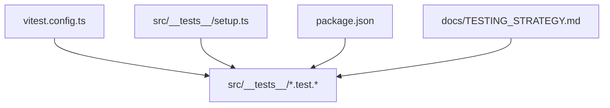
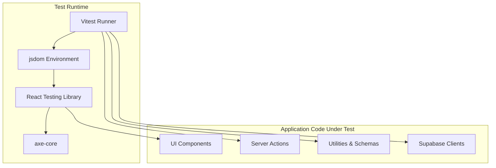
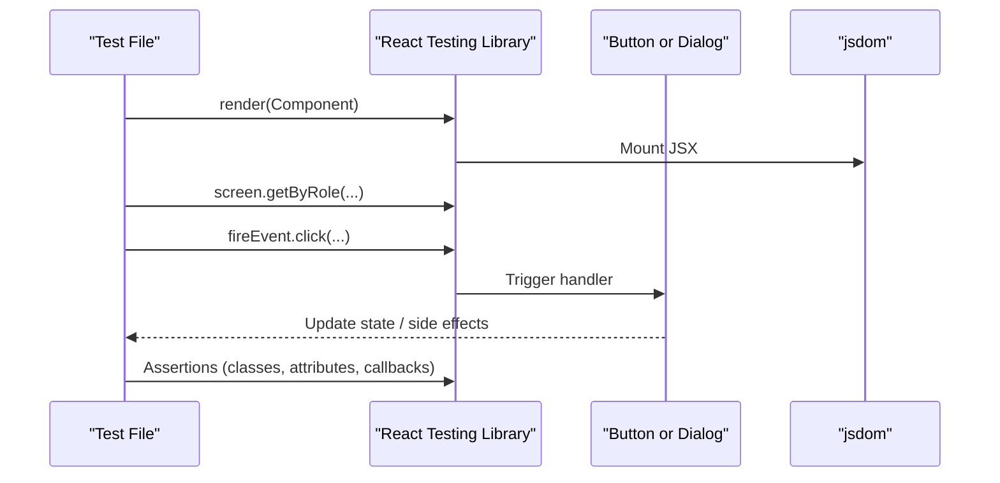
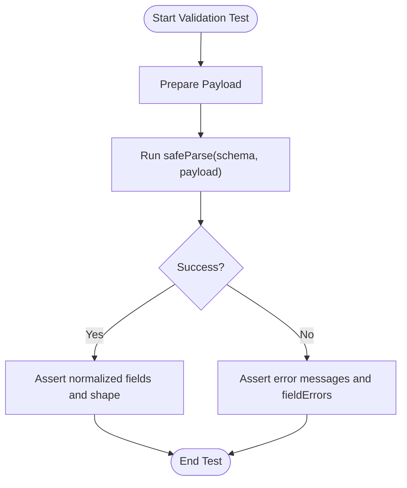
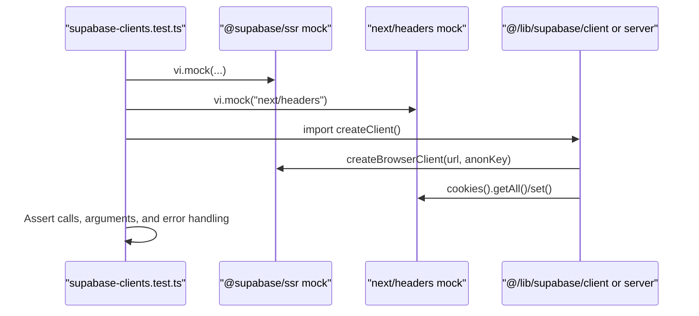
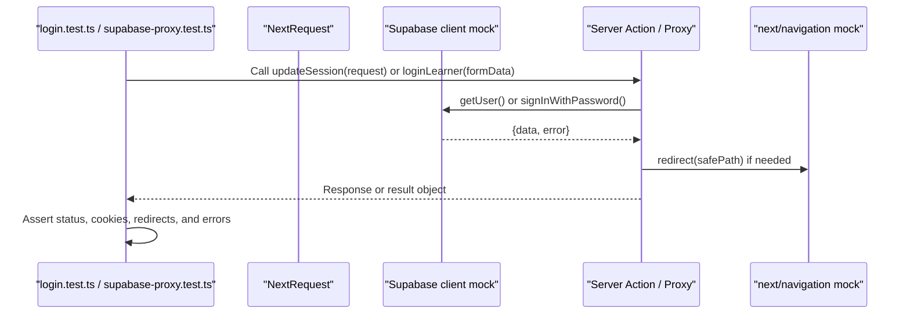
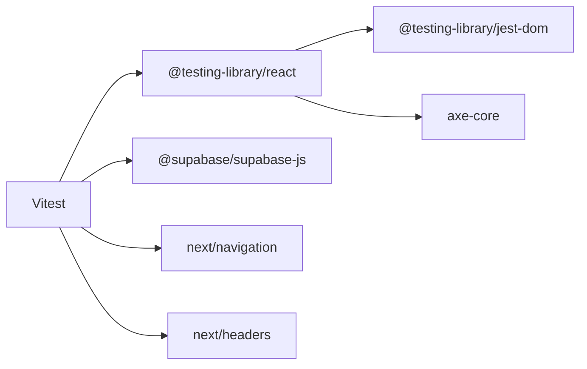

# Unit Testing with Vitest

<cite>
**Referenced Files in This Document**
- [vitest.config.ts](file://vitest.config.ts)
- [package.json](file://package.json)
- [setup.ts](file://src/__tests__/setup.ts)
- [TESTING_STRATEGY.md](file://docs/TESTING_STRATEGY.md)
- [button.test.tsx](file://src/__tests__/button.test.tsx)
- [dialog.test.tsx](file://src/__tests__/dialog.test.tsx)
- [articles.test.ts](file://src/__tests__/articles.test.ts)
- [auth-validation.test.ts](file://src/__tests__/auth-validation.test.ts)
- [supabase-clients.test.ts](file://src/__tests__/supabase-clients.test.ts)
- [supabase-proxy.test.ts](file://src/__tests__/supabase-proxy.test.ts)
- [login.test.tsx](file://src/__tests__/login.test.tsx)
</cite>

## Table of Contents
1. [Introduction](#introduction)
2. [Project Structure](#project-structure)
3. [Core Components](#core-components)
4. [Architecture Overview](#architecture-overview)
5. [Detailed Component Analysis](#detailed-component-analysis)
6. [Dependency Analysis](#dependency-analysis)
7. [Performance Considerations](#performance-considerations)
8. [Troubleshooting Guide](#troubleshooting-guide)
9. [Conclusion](#conclusion)

## Introduction
This document explains how unit testing is implemented in SwimNigeria using Vitest and React Testing Library. It covers the test configuration, environment setup, component testing patterns, mocking strategies for Supabase and Next.js APIs, validation schema testing, asynchronous server action testing, test organization, naming conventions, debugging techniques, and performance optimization tips for large test suites.

The project follows a clear testing pyramid: fast unit tests for pure logic and components, integration-style tests for server actions and Supabase client behavior, and end-to-end tests for critical user journeys. The unit and component tests run under jsdom through Vitest, while E2E tests use Playwright.

## Project Structure
Unit tests live under `src/__tests__`. Each feature or module has one or more test files named after the source file or feature area. Configuration is centralized in `vitest.config.ts`, with global test setup in `src/__tests__/setup.ts`. Scripts are exposed via `package.json` to run unit tests, watch mode, and E2E tests.

**Diagram sources**
- [vitest.config.ts:1-18](file://vitest.config.ts#L1-L18)
- [setup.ts:1-16](file://src/__tests__/setup.ts#L1-L16)
- [package.json:6-16](file://package.json#L6-L16)
- [TESTING_STRATEGY.md:10-20](file://docs/TESTING_STRATEGY.md#L10-L20)

**Section sources**
- [vitest.config.ts:1-18](file://vitest.config.ts#L1-L18)
- [package.json:6-16](file://package.json#L6-L16)
- [setup.ts:1-16](file://src/__tests__/setup.ts#L1-L16)
- [TESTING_STRATEGY.md:10-20](file://docs/TESTING_STRATEGY.md#L10-L20)

## Core Components
- Test runner and environment: Vitest runs tests with jsdom, globals enabled, and a shared setup file.
- Global setup: Adds Testing Library matchers and polyfills missing browser APIs like `HTMLDialogElement.showModal` and `close`.
- Aliases: The `@` alias points to `src`, making imports consistent across tests and application code.
- Scripts: `npm test` runs all tests; `npm run test:watch` enables watch mode.

Key behaviors:
- Environment: jsdom simulates a browser DOM for React components.
- Include pattern: Matches test files under `src/**/*.{test,spec}.{ts,tsx}`.
- Exclude pattern: Ignores e2e, node_modules, and build artifacts.

**Section sources**
- [vitest.config.ts:4-11](file://vitest.config.ts#L4-L11)
- [vitest.config.ts:12-16](file://vitest.config.ts#L12-L16)
- [setup.ts:1-16](file://src/__tests__/setup.ts#L1-L16)
- [package.json:12-14](file://package.json#L12-L14)

## Architecture Overview
The testing architecture integrates Vitest, React Testing Library, axe-core for accessibility, and mocked external dependencies such as Supabase and Next.js routing utilities.

**Diagram sources**
- [vitest.config.ts:4-11](file://vitest.config.ts#L4-L11)
- [setup.ts:1-16](file://src/__tests__/setup.ts#L1-L16)
- [login.test.tsx:1-10](file://src/__tests__/login.test.tsx#L1-L10)
- [auth-validation.test.ts:1-7](file://src/__tests__/auth-validation.test.ts#L1-L7)

## Detailed Component Analysis

### Test Configuration and Global Setup
- Vitest configuration sets jsdom, enables globals, registers the setup file, defines include/exclude patterns, and configures path aliases.
- Global setup imports Testing Library matchers and polyfills dialog methods when missing.

Best practices demonstrated:
- Centralized configuration avoids duplication across test files.
- Polyfilling missing browser APIs ensures stable behavior in jsdom.
- Using `@testing-library/jest-dom/vitest` provides rich assertions like `toBeInTheDocument`.

**Section sources**
- [vitest.config.ts:4-16](file://vitest.config.ts#L4-L16)
- [setup.ts:1-16](file://src/__tests__/setup.ts#L1-L16)

### React Component Testing Patterns
Component tests focus on rendering, props, interactions, accessibility, and state changes. Examples include:
- Button primitive: default variants, explicit types, className merging, icon sizing, click handling, disabled state, and loading spinner behavior.
- Dialog primitive: hidden state, accessible attributes, close triggers (click and cancel event), focus management, drawer variant styling, custom IDs, and unmount focus restoration.

Common patterns:
- Use `render` from React Testing Library to mount components.
- Query elements by role, label, text, or attribute.
- Interact with `fireEvent` for clicks and keyboard events.
- Assert visual classes and accessibility attributes.

**Diagram sources**
- [button.test.tsx:1-88](file://src/__tests__/button.test.tsx#L1-L88)
- [dialog.test.tsx:1-183](file://src/__tests__/dialog.test.tsx#L1-L183)

**Section sources**
- [button.test.tsx:1-88](file://src/__tests__/button.test.tsx#L1-L88)
- [dialog.test.tsx:1-183](file://src/__tests__/dialog.test.tsx#L1-L183)

### Validation Schema Testing with Zod
Validation tests assert that schemas accept valid inputs, normalize data, reject invalid inputs, and strip unexpected fields.

Patterns:
- Define valid payloads and mutate fields to cover edge cases.
- Use `safeParse` to get typed results and inspect errors.
- Validate normalization (trimming, lowercasing).
- Ensure malicious fields are stripped from output.

**Diagram sources**
- [auth-validation.test.ts:9-204](file://src/__tests__/auth-validation.test.ts#L9-L204)
- [auth-validation.test.ts:206-344](file://src/__tests__/auth-validation.test.ts#L206-L344)

**Section sources**
- [auth-validation.test.ts:9-204](file://src/__tests__/auth-validation.test.ts#L9-L204)
- [auth-validation.test.ts:206-344](file://src/__tests__/auth-validation.test.ts#L206-L344)

### Articles Content Model and Query Functions
Tests verify data integrity, filtering, lookup, category normalization, related article selection, and uniqueness of categories.

Patterns:
- Assert minimum dataset size and required fields.
- Verify published-only filters and draft exclusion.
- Confirm slug-based lookups return null for unknown slugs.
- Normalize category queries and ensure empty arrays for unrecognized categories.
- Validate related articles exclude the current article and respect limits.

**Section sources**
- [articles.test.ts:1-92](file://src/__tests__/articles.test.ts#L1-L92)

### Supabase Client Mocking Strategies
The codebase demonstrates robust mocking of Supabase clients and Next.js cookie APIs.

Key strategies:
- Mock `@supabase/ssr` functions (`createBrowserClient`, `createServerClient`) to control initialization and returned objects.
- Mock `next/headers` cookies to simulate cookie store behavior.
- Set environment variables per test to validate client initialization parameters.
- Assert that service role keys are not passed to browser clients.
- Validate cookie adapter delegation for `getAll` and `setAll`.
- Handle `ReadonlyRequestCookiesError` gracefully and rethrow unrelated errors.

**Diagram sources**
- [supabase-clients.test.ts:1-164](file://src/__tests__/supabase-clients.test.ts#L1-L164)

**Section sources**
- [supabase-clients.test.ts:1-164](file://src/__tests__/supabase-clients.test.ts#L1-L164)

### Session Proxy and Asynchronous Server Action Testing
The proxy test verifies session refresh behavior based on request cookies and handles auth errors without redirect loops.

Server action tests demonstrate:
- Mocking Supabase server client and Next.js navigation utilities.
- Validating successful authentication, sanitized redirects, input rejection, and error classification (invalid credentials, unverified email, rate limiting).
- Handling unconfigured Supabase environments gracefully.
- Rendering pages and forms with React Testing Library and asserting accessibility with axe-core.

**Diagram sources**
- [supabase-proxy.test.ts:1-107](file://src/__tests__/supabase-proxy.test.ts#L1-L107)
- [login.test.tsx:1-287](file://src/__tests__/login.test.tsx#L1-L287)

**Section sources**
- [supabase-proxy.test.ts:1-107](file://src/__tests__/supabase-proxy.test.ts#L1-L107)
- [login.test.tsx:1-287](file://src/__tests__/login.test.tsx#L1-L287)

### Accessibility Testing with axe-core
Accessibility assertions are integrated into component tests to ensure WCAG compliance.

Patterns:
- Render components and run `axe.run(container)` to detect violations.
- Assert zero violations for interactive forms and dialogs.
- Combine role-based queries with aria attributes to validate semantics.

**Section sources**
- [login.test.tsx:280-284](file://src/__tests__/login.test.tsx#L280-L284)
- [dialog.test.tsx:26-52](file://src/__tests__/dialog.test.tsx#L26-L52)

### Test Organization, Naming Conventions, and Best Practices
- File naming: Tests mirror feature names and append `.test.ts` or `.test.tsx`.
- Grouping: Use `describe` blocks to group related tests by feature or module.
- Assertions: Prefer semantic queries (role, label, text) over brittle selectors.
- Mocks: Isolate mocks within test files using `vi.mock` and reset with `beforeEach`/`afterEach`.
- Environment: Reset `process.env` between tests to avoid cross-test pollution.
- Coverage target: Aim for high coverage on pure utility and business logic modules.

**Section sources**
- [TESTING_STRATEGY.md:37-45](file://docs/TESTING_STRATEGY.md#L37-L45)
- [button.test.tsx:5-87](file://src/__tests__/button.test.tsx#L5-L87)
- [supabase-clients.test.ts:22-36](file://src/__tests__/supabase-clients.test.ts#L22-L36)

### Test Data Management and Fixture Patterns
- Inline fixtures: Define small payloads directly inside tests for clarity.
- Dataset assertions: Validate structural properties and constraints of datasets (e.g., article records).
- Normalization checks: Ensure transformations like trimming and lowercasing are covered.

Examples:
- Registration and login payloads defined inline.
- Article dataset integrity checks and query function validations.

**Section sources**
- [auth-validation.test.ts:9-25](file://src/__tests__/auth-validation.test.ts#L9-L25)
- [articles.test.ts:11-22](file://src/__tests__/articles.test.ts#L11-L22)

### Asynchronous Testing Scenarios
- Async server actions: Await results and assert success/error shapes.
- Promise-based Supabase calls: Mock resolved/rejected values and assert behavior.
- Error classification: Differentiate between invalid credentials, unverified emails, and rate limits.

**Section sources**
- [login.test.tsx:72-196](file://src/__tests__/login.test.tsx#L72-L196)
- [supabase-proxy.test.ts:35-105](file://src/__tests__/supabase-proxy.test.ts#L35-L105)

## Dependency Analysis
The test suite depends on:
- Vitest for test execution and mocking.
- React Testing Library for component rendering and querying.
- axe-core for accessibility checks.
- Supabase SDK for client interfaces (mocked in tests).
- Next.js utilities for headers and navigation (mocked in tests).

**Diagram sources**
- [package.json:26-46](file://package.json#L26-L46)
- [setup.ts:1-16](file://src/__tests__/setup.ts#L1-L16)
- [login.test.tsx:1-10](file://src/__tests__/login.test.tsx#L1-L10)

**Section sources**
- [package.json:26-46](file://package.json#L26-L46)
- [setup.ts:1-16](file://src/__tests__/setup.ts#L1-L16)
- [login.test.tsx:1-10](file://src/__tests__/login.test.tsx#L1-L10)

## Performance Considerations
- Keep unit tests fast and deterministic: prefer pure functions and isolated mocks.
- Avoid heavy DOM operations where possible; use minimal renders and targeted queries.
- Reuse mocks and helpers to reduce setup overhead.
- Run tests in parallel with Vitest’s default concurrency; tune only if necessary.
- Limit expensive accessibility scans to focused tests rather than every component test.
- Use `vi.clearAllMocks` and controlled environment resets to prevent slow state leakage.

[No sources needed since this section provides general guidance]

## Troubleshooting Guide
Common issues and resolutions:
- Missing browser APIs in jsdom: Polyfill `HTMLDialogElement.showModal` and `close` in setup.
- Unstable tests due to environment variables: Reset `process.env` in `beforeEach`/`afterEach`.
- Flaky Supabase interactions: Mock client methods precisely and assert call counts and arguments.
- Redirect loops in proxy tests: Ensure error paths return stable responses without triggering redirects.
- Accessibility failures: Use axe-core to pinpoint violations and fix roles, labels, and contrast.

Debugging techniques:
- Narrow failing tests with Vitest’s filter flags.
- Add descriptive test names to clarify intent.
- Log mock call details to understand unexpected invocations.
- Inspect rendered DOM using Testing Library debug utilities sparingly.

**Section sources**
- [setup.ts:3-15](file://src/__tests__/setup.ts#L3-L15)
- [supabase-clients.test.ts:22-36](file://src/__tests__/supabase-clients.test.ts#L22-L36)
- [supabase-proxy.test.ts:91-105](file://src/__tests__/supabase-proxy.test.ts#L91-L105)
- [login.test.tsx:280-284](file://src/__tests__/login.test.tsx#L280-L284)

## Conclusion
SwimNigeria’s unit testing strategy centers on Vitest and React Testing Library, with strong emphasis on accessibility, robust mocking, and clear test organization. The configuration and setup provide a stable jsdom environment, while tests demonstrate effective patterns for components, validation schemas, server actions, and Supabase client behavior. Following these patterns ensures maintainable, fast, and reliable test suites that support continuous quality assurance.

[No sources needed since this section summarizes without analyzing specific files]