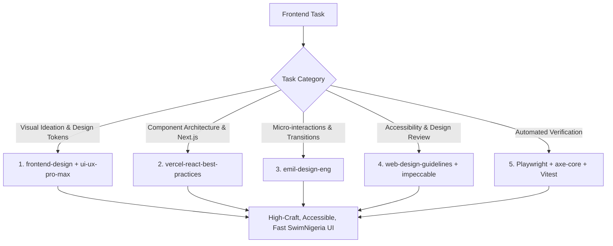

# SwimNigeria — Agent Skills Register & Evaluation

This document provides a comprehensive audit of all AI agent skills and tooling evaluated, installed, or investigated for the SwimNigeria development environment within Google Antigravity.

---

## 1. Summary of Installed & Verified Skills

All installed skills are project-local within [`.agents/skills/`](file:///Users/aj/Downloads/Documents/Career%20&%20Important%20Documents/SwimNigeria/.agents/skills) as real directories (no fragile symlinks). They are tracked in [`skills-lock.json`](file:///Users/aj/Downloads/Documents/Career%20&%20Important%20Documents/SwimNigeria/skills-lock.json).

| Skill Name | Version / Hash | Official Source | Installation Path | Status | Primary Purpose |
| :--- | :--- | :--- | :--- | :--- | :--- |
| **`impeccable`** | 4.8.0 / v0.1.18 | [pbakaus/impeccable](https://github.com/pbakaus/impeccable) | [`.agents/skills/impeccable`](file:///Users/aj/Downloads/Documents/Career%20&%20Important%20Documents/SwimNigeria/.agents/skills/impeccable) | **Installed & Verified** | High-craft frontend UI design, 24 specialized design commands (`craft`, `shape`, `critique`, `audit`, `polish`, `bolder`, `quieter`, `harden`, `animate`), and WCAG AA contrast. |
| **`ui-ux-pro-max`** | `d63bd281a96b` | [nextlevelbuilder/ui-ux-pro-max-skill](https://github.com/nextlevelbuilder/ui-ux-pro-max-skill) | [`.agents/skills/ui-ux-pro-max`](file:///Users/aj/Downloads/Documents/Career%20&%20Important%20Documents/SwimNigeria/.agents/skills/ui-ux-pro-max) | **Installed & Verified** | Comprehensive UI design intelligence: 79 styles, 192 palettes, 74 font pairings, 119 UX guidelines, and offline search tool. |
| **`frontend-design`** | `89496d5dd00f` | [anthropics/skills](https://github.com/anthropics/skills) | [`.agents/skills/frontend-design`](file:///Users/aj/Downloads/Documents/Career%20&%20Important%20Documents/SwimNigeria/.agents/skills/frontend-design) | **Installed & Verified** | Distinctive, opinionated visual direction; eliminates generic AI design tells (cream/terracotta cliches, SaaS card kits, template chrome); enforces editorial discipline. |
| **`emil-design-eng`** | `51f2537e04d1` | [emilkowalski/skills](https://github.com/emilkowalski/skills) | [`.agents/skills/emil-design-eng`](file:///Users/aj/Downloads/Documents/Career%20&%20Important%20Documents/SwimNigeria/.agents/skills/emil-design-eng) | **Installed & Verified** | Micro-interactions, spring physics, UI polish, and strict animation frequency rules (no animations on repeated actions; respect `prefers-reduced-motion`). |
| **`web-design-guidelines`** | 1.0.0 / `f3bc47f890f4` | [vercel-labs/agent-skills](https://github.com/vercel-labs/agent-skills) | [`.agents/skills/web-design-guidelines`](file:///Users/aj/Downloads/Documents/Career%20&%20Important%20Documents/SwimNigeria/.agents/skills/web-design-guidelines) | **Installed & Verified** | Actionable review checklist for web interface guidelines (accessibility, focus rings, forms, touch targets, layout shifts, typography quotes, anti-patterns). Bundles local offline reference. |
| **`vercel-react-best-practices`** | 1.0.0 / `ca7b0c0c6e5f` | [vercel-labs/agent-skills](https://github.com/vercel-labs/agent-skills) | [`.agents/skills/vercel-react-best-practices`](file:///Users/aj/Downloads/Documents/Career%20&%20Important%20Documents/SwimNigeria/.agents/skills/vercel-react-best-practices) | **Installed & Verified** | 70 rules for React 19 and Next.js App Router performance, eliminating waterfalls, bundle minimization, and render optimization. |
| **`supabase`** | 0.1.2 / `211141fd078b` | [supabase/agent-skills](https://github.com/supabase/agent-skills) | [`.agents/skills/supabase`](file:///Users/aj/Downloads/Documents/Career%20&%20Important%20Documents/SwimNigeria/.agents/skills/supabase) | **Installed & Verified** | Supabase database, Auth (SSR cookies), RLS policies, Storage, and security auditing. |
| **`supabase-postgres-best-practices`** | 1.1.1 / `e14e27624180` | [supabase/agent-skills](https://github.com/supabase/agent-skills) | [`.agents/skills/supabase-postgres-best-practices`](file:///Users/aj/Downloads/Documents/Career%20&%20Important%20Documents/SwimNigeria/.agents/skills/supabase-postgres-best-practices) | **Installed & Verified** | PostgreSQL query performance, indexing foreign keys, connection pooling, and schema design. |

---

## 2. Detailed Profiles of Installed Skills

### 2.1 Impeccable
* **Official Source:** `https://github.com/pbakaus/impeccable`
* **Purpose:** Provides design direction and 24 specialized design commands (`craft`, `shape`, `critique`, `audit`, `polish`, `bolder`, `quieter`, `harden`, `animate`) to eliminate generic AI-generated templates and enforce production-grade visual polish.
* **Installation Scope:** Project-scoped at [`.agents/skills/impeccable`](file:///Users/aj/Downloads/Documents/Career%20&%20Important%20Documents/SwimNigeria/.agents/skills/impeccable) (real directory, cross-platform portable without symlinks).
* **When Antigravity Should Use It:**
  * When executing high-level UI critiques (`audit`, `critique`).
  * When refining visual hierarchy, spacing tokens, and contrast ratios.
  * When hardening interfaces against edge cases (long text, empty states, error boundaries).
* **Security & Supply Chain:** Self-contained binary with sandboxed execution. Zero network telemetry.
* **Verification Method:** Checked file presence of `SKILL.md` and launcher permissions.

---

### 2.2 UI/UX Pro Max
* **Official Source:** `https://github.com/nextlevelbuilder/ui-ux-pro-max-skill` (Release / skill: `ui-ux-pro-max`)
* **Purpose:** Provides structured UI/UX knowledge database containing 79 design styles (e.g. Minimal Clean, Educational Flat), 192 curated color palettes, 74 typography pairings, 119 UX rules, and 99 UI component design specs.
* **Installation Scope:** Project-scoped at [`.agents/skills/ui-ux-pro-max`](file:///Users/aj/Downloads/Documents/Career%20&%20Important%20Documents/SwimNigeria/.agents/skills/ui-ux-pro-max).
* **Key Files:**
  * `SKILL.md`: Main instructions and command reference.
  * `data/`: CSV and markdown databases of styles, colors, typography, charts, and UX rules.
  * `scripts/search.py`: Fast, zero-dependency Python 3 search script querying design tokens locally.
* **When Antigravity Should Use It:**
  * When selecting palette tokens, typography scales, and component specifications aligned with SwimNigeria’s educational theme.
  * To query specific design guidelines (e.g., `python3 scripts/search.py "education accessibility"`).
* **Security & Supply Chain:** Audited by Socket (0 alerts) and Snyk (Low Risk). No external network requests; purely local file system lookups using standard Python 3.
* **Verification Method:** Verified `SKILL.md`, verified `data/` assets, and ran test query against `scripts/search.py`.

---

### 2.3 Anthropic Frontend Design
* **Official Source:** `https://github.com/anthropics/skills` (Skill: `frontend-design`)
* **Purpose:** Art-direction skill focused on high-craft, distinctive visual execution. Guides the agent to avoid common AI design tropes (e.g., generic warm cream/terracotta styling, dark mode with acid-green accents, SaaS card kits, unnecessary tracked uppercase eyebrows, formulaic `01/02/03` numbering).
* **Installation Scope:** Project-scoped at [`.agents/skills/frontend-design`](file:///Users/aj/Downloads/Documents/Career%20&%20Important%20Documents/SwimNigeria/.agents/skills/frontend-design).
* **When Antigravity Should Use It:**
  * At the conceptual inception of new page layouts (e.g. course catalogue, reading interface).
  * When setting typographic scales and editorial pacing.
  * To ensure written copy and visual elements do not feel templated.
* **Security & Supply Chain:** Pure markdown guidance with complete license text. Zero dependencies, zero network requests, Snyk Low Risk, Socket 0 alerts.
* **Verification Method:** Inspected `SKILL.md` and frontmatter.

---

### 2.4 Emil Kowalski’s Design Engineering (`emil-design-eng`)
* **Official Source:** `https://github.com/emilkowalski/skills` (Skill: `emil-design-eng`)
* **Purpose:** Encodes Emil Kowalski’s philosophy on micro-interactions, tactile UI feel, spring physics, and the **Animation Frequency Decision Framework**.
* **Installation Scope:** Project-scoped at [`.agents/skills/emil-design-eng`](file:///Users/aj/Downloads/Documents/Career%20&%20Important%20Documents/SwimNigeria/.agents/skills/emil-design-eng).
* **Core Rule: Animation Frequency Framework:**
  * Actions repeated 100+ times/day (e.g. keyboard shortcuts, command palette): **No animation ever**.
  * Actions repeated tens of times/day (e.g. list navigation, frequent hovers): **Remove or drastically reduce**.
  * Occasional actions (e.g. modals, drawers, toasts): **Standard purposeful animation**.
  * First-time/rare events (e.g. certificate issuance): **Delightful, restrained animation**.
  * **Always respect `prefers-reduced-motion`**.
* **When Antigravity Should Use It:**
  * When implementing buttons, interactive cards, modals, dropdowns, and drawers.
  * When reviewing animation PRs using the mandatory Before/After markdown table format.
* **Security & Supply Chain:** Safe, zero executable dependencies, Snyk Low Risk, Socket 0 alerts.
* **Verification Method:** Inspected `SKILL.md` and verified frontmatter.

---

### 2.5 Vercel Web Design Guidelines
* **Official Source:** `https://github.com/vercel-labs/agent-skills` (Skill: `web-design-guidelines`)
* **Purpose:** Fast, high-signal checklist for UI code compliance. Audits accessibility (aria labels, keyboard handlers, semantic tags), focus rings (`:focus-visible`), form best practices (autocomplete, paste protection, inline errors), animation rules (compositor-friendly transforms), and typography (curly quotes, ellipsis entity, tabular nums).
* **Installation Scope:** Project-scoped at [`.agents/skills/web-design-guidelines`](file:///Users/aj/Downloads/Documents/Career%20&%20Important%20Documents/SwimNigeria/.agents/skills/web-design-guidelines).
* **Offline Resilience Enhancement:** Contains a local bundled copy of all rules at [`references/guidelines.md`](file:///Users/aj/Downloads/Documents/Career%20&%20Important%20Documents/SwimNigeria/.agents/skills/web-design-guidelines/references/guidelines.md) to guarantee full operation without relying on live GitHub fetches.
* **When Antigravity Should Use It:**
  * During UI component reviews and pre-commit checks.
  * When auditing focus states, form fields, and touch targets.
* **Security & Supply Chain:** Audited Safe. No sensitive data exfiltration.
* **Verification Method:** Checked `SKILL.md` and offline rule reference.

---

### 2.6 Vercel React Best Practices
* **Official Source:** `https://github.com/vercel-labs/agent-skills` (Skill: `react-best-practices`)
* **Purpose:** 70 specific optimization rules for React 19 and Next.js App Router, addressing async waterfalls, server component boundaries, bundle size, and re-renders.
* **Installation Scope:** Project-scoped at [`.agents/skills/vercel-react-best-practices`](file:///Users/aj/Downloads/Documents/Career%20&%20Important%20Documents/SwimNigeria/.agents/skills/vercel-react-best-practices).
* **When Antigravity Should Use It:**
  * When writing or refactoring React components and Next.js page/layout routes.
  * When auditing data fetching architectures to eliminate sequential request waterfalls.
* **Security & Supply Chain:** Static rule markdown files; zero execution overhead.
* **Verification Method:** Verified rule files in `rules/` directory.

---

### 2.7 Supabase & Supabase Postgres Best Practices
* **Official Source:** `https://github.com/supabase/agent-skills`
* **Purpose:** Server-side RLS enforcement, cookie-based session handling (`@supabase/ssr`), PostgreSQL schema optimization, indexing foreign keys, and connection pooling.
* **Installation Scope:** Project-scoped at [`.agents/skills/supabase`](file:///Users/aj/Downloads/Documents/Career%20&%20Important%20Documents/SwimNigeria/.agents/skills/supabase) and [`.agents/skills/supabase-postgres-best-practices`](file:///Users/aj/Downloads/Documents/Career%20&%20Important%20Documents/SwimNigeria/.agents/skills/supabase-postgres-best-practices).
* **When Antigravity Should Use It:**
  * In Phase 4/5 when configuring authentication, user profiles, or database tables.
  * Whenever writing SQL migrations or defining Row-Level Security policies.
* **Security & Supply Chain:** Verified safe by Snyk and Socket.
* **Verification Method:** Verified directory contents and frontmatter.

---

## 3. Investigated Resources Evaluated But Not Installed (Reference / Deferred)

### 3.1 Resource: "Taste" (`Leonxlnx/taste-skill@design-taste-frontend`)
* **Upstream Repository:** `https://github.com/Leonxlnx/taste-skill`
* **Purpose:** Frontend taste and design curation skill.
* **Supply Chain & Security Analysis:**
  * Evaluated package in sandbox environment.
  * Contains executable script `scripts/assets.mjs` that makes live outbound HTTP requests to external third-party media APIs (Openverse, Wikimedia Commons, Flickr, Pixabay) and downloads remote assets into temporary storage.
  * Flagged by **Socket security scanner** (1 alert for network access) and **Snyk** (Medium Risk).
  * Strong functional overlap with our existing trio of design skills (`impeccable` + `ui-ux-pro-max` + `frontend-design`).
* **Classification:** **DOCUMENT AS REFERENCE / DEFER**.
* **Reason:** Installing third-party automated network scrapers in the workspace introduces unnecessary supply-chain risk and potential bandwidth consumption. The design guidance is already fully covered by `frontend-design` and `impeccable`.

---

### 3.2 Resource: "Agent Browser" (`vercel-labs/agent-browser`)
* **Upstream Repository:** `https://github.com/vercel-labs/agent-browser`
* **Purpose:** Headless browser automation CLI written in Rust for AI agents to navigate web pages via Chrome DevTools Protocol (`agent-browser open <url>`).
* **Technical Evaluation:**
  * It is not a project-local agent skill directory; it is a global command-line binary (`npm i -g agent-browser`) requiring the download of separate Chromium binaries (`agent-browser install`).
  * Antigravity already provides a secure, native, integrated browser subagent (`browser_subagent`) that records WebP video artifacts and navigates DOM nodes directly.
  * SwimNigeria already has an established, verified Playwright test harness (`npm run test:e2e`) with axe-core accessibility automated testing.
* **Classification:** **DOCUMENT AS REFERENCE / DEFER**.
* **Reason:** Installing external global binaries violates project supply-chain rules ("Do not silently change global machine configuration"). Playwright and Antigravity's native browser subagent provide all required browser testing capabilities without destabilizing the environment.

---

### 3.3 Resource: Emil Kowalski’s External Courseware & Animation Libraries
* **Sources:** `animations.dev`, `emilkowal.ski`, and repository `emilkowalski/skills` (`review-animations`, `animation-performance`).
* **Evaluation:**
  * The core philosophy and review checklists are fully captured in the installed `emil-design-eng` skill.
  * Adding external animation libraries (e.g. Framer Motion, Motion One) is premature and prohibited during Phase 1/tooling setup.
* **Classification:** **DOCUMENT AS REFERENCE**.
* **Usage Guidance:** Consult Emil’s animation principles (e.g. spring mass/stiffness ratios, 200ms ease-out defaults) when crafting CSS transitions in Phase 2.

---

## 4. Clear Skill-Usage Policy

To prevent prompt bloat and conflicting guidance, Antigravity agents must follow this coordination strategy:



### 4.1 Visual Design and UI/UX
* **Primary Guide:** Use `frontend-design` for overall art direction, anti-cliché principles, and editorial hierarchy.
* **Token & Pattern Reference:** Use `ui-ux-pro-max` to query specific palettes, typography scales, and UX rules.
* **Refinement & Critique:** Use `impeccable` (`audit`, `critique`, `polish`, `harden`) when reviewing an interface against edge cases.
* *Coordination Rule:* Do not prompt multiple skills to independently redesign the same page simultaneously. Establish the direction with `frontend-design`, look up tokens via `ui-ux-pro-max`, and polish with `impeccable`.

### 4.2 React and Next.js Engineering
* **Primary Guide:** Use `vercel-react-best-practices`.
* Prioritize server components, avoid sequential `await` request waterfalls, and maintain minimal bundle footprints.

### 4.3 Accessibility and Code Review
* **Primary Guide:** Use `web-design-guidelines` (offline reference at `references/guidelines.md`).
* Enforce semantic HTML (`<button>`, `<a>`, `<label>`), visible focus indicators (`:focus-visible`), and touch targets.
* Guidance from skills supplements—but never replaces—automated verification with axe-core and Playwright.

### 4.4 Browser Testing
* **Automated Regression & CI:** Always use the verified Playwright suite (`npm run test:e2e`).
* **Interactive Agent Exploration:** Use Antigravity’s native `browser_subagent`.

### 4.5 Animation and Interaction Polish
* **Primary Guide:** Use `emil-design-eng`.
* Strictly apply the **Animation Frequency Framework**: no animations on high-frequency actions; respect `prefers-reduced-motion`; use physics springs over linear transitions; avoid adding heavy animation dependencies.

---

## 5. SwimNigeria Project-Specific Design Priorities

All skills must be contextualized to SwimNigeria’s actual identity:
1. **Brand Identity:**
   * Primary Brand Red: `#DC2626`
   * Clean White: `#FFFFFF`
   * Deep Slate Text/Contrast: `#0F172A`
   * Aquatic Secondary Accents: Subtle blue/slate hues (`#0284C7` / `#0369A1`) used sparingly.
2. **Context & Tone:**
   * A trustworthy, welcoming Nigerian educational platform (not a generic Silicon Valley SaaS landing page).
   * Clear typography with high legibility on mobile devices.
   * Minimal data usage: lightweight assets optimized for metered mobile internet connections.
3. **Restraint & Substance:**
   * Avoid decorative "AI tells" (floating cards with soft shadows, neon glowing borders, gradient meshes, unprompted animations).
   * Build with SwimNigeria’s real educational subject matter (water safety, stroke technique, coaching certifications).

---

## 6. Verification and Maintenance

### Verification Checklist
Run these commands after updating any skill:
```bash
# 1. Verify skills lockfile integrity
cat skills-lock.json

# 2. Check TypeScript and lint hygiene
npm run typecheck
npm run lint

# 3. Check unit and browser test suites
npm run test
npm run test:e2e
```

### Maintenance
* To update an installed skill: `npx -y skills update <skill-name>`
* To check for upstream skill updates: `npx -y skills check`
