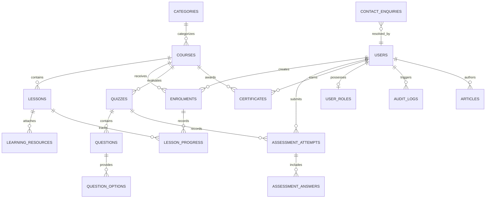

# SwimNigeria — Database Design & Conceptual Data Model

## 1. Overview & Data Modeling Principles
This document defines the conceptual and logical data model for SwimNigeria. The data architecture is structured for high data integrity, strict access control, auditability, and readiness for future commercial expansion.

> **Phase 0 Notice:** In accordance with Phase 0 boundaries, this document presents the conceptual design, entity relationships, integrity constraints, and authorization rules. Actual SQL schema files, DDL scripts, and database migrations will be generated during subsequent implementation phases.

---

## 2. Entity-Relationship Diagram (Conceptual)

---

## 3. Detailed Entity Definitions

### 3.1 Identity & User Profiles
* **`users` (Profile Entity):**
  * Extends the core authentication entity (`auth.users`).
  * *Attributes:* `id` (UUID, PK), `email` (string, unique), `full_name` (string, required for certificates), `avatar_url` (string, optional), `phone_number` (string, optional), `created_at` (timestamp), `updated_at` (timestamp).
  * *Ownership:* Owned by the user themselves.
  * *Integrity:* Linked directly to authentication identity via foreign key cascade on delete.
* **`user_roles`:**
  * Defines user authorization levels.
  * *Attributes:* `user_id` (UUID, PK, FK -> `users`), `role` (enum: `admin`, `learner`, `instructor`), `assigned_at` (timestamp), `assigned_by` (UUID, FK -> `users`).
  * *Security Implication:* Must never be writable by users. Managed strictly by database triggers or privileged administrative actions.

---

### 3.2 Course Curriculum & Structure
* **`categories`:**
  * Logical groupings for courses (e.g., "Water Safety & Phobia", "Stroke Mechanics", "Survival & Rescue").
  * *Attributes:* `id` (UUID, PK), `name` (string, unique), `slug` (string, unique), `description` (text), `display_order` (integer).
* **`courses`:**
  * Central curriculum entity.
  * *Attributes:* `id` (UUID, PK), `category_id` (UUID, FK -> `categories`), `title` (string), `slug` (string, unique), `summary` (string), `description_md` (markdown text), `thumbnail_url` (string), `level` (enum: `beginner`, `intermediate`, `advanced`), `estimated_duration_minutes` (integer), `is_published` (boolean), `is_free` (boolean, defaults to true), `price_kobo` (integer, defaults to 0 for Phase 1), `created_at` (timestamp), `updated_at` (timestamp).
* **`lessons`:**
  * Individual educational modules within a course.
  * *Attributes:* `id` (UUID, PK), `course_id` (UUID, FK -> `courses`), `title` (string), `slug` (string), `order_index` (integer), `content_md` (markdown text), `video_url` (string, optional YouTube/Vimeo ID), `duration_minutes` (integer), `is_preview` (boolean, allows unauthenticated preview if true), `created_at` (timestamp).
  * *Integrity:* Unique composite index on `(course_id, slug)` and `(course_id, order_index)`.
* **`learning_resources`:**
  * Downloadable guides, safety checklists, or external reference links attached to lessons.
  * *Attributes:* `id` (UUID, PK), `lesson_id` (UUID, FK -> `lessons`), `title` (string), `resource_type` (enum: `pdf`, `link`, `checklist`), `url` (string), `file_size_bytes` (bigint).

---

### 3.3 Enrollment & Learning Progress
* **`enrolments`:**
  * Tracks user registration into a specific course.
  * *Attributes:* `id` (UUID, PK), `user_id` (UUID, FK -> `users`), `course_id` (UUID, FK -> `courses`), `status` (enum: `active`, `completed`, `dropped`), `enrolled_at` (timestamp), `completed_at` (timestamp, nullable), `payment_status` (enum: `free`, `pending`, `paid`), `payment_reference` (string, nullable for future gateway integration).
  * *Integrity:* Unique constraint on `(user_id, course_id)` prevents accidental duplicate enrollments.
* **`lesson_progress`:**
  * Granular tracking of individual lesson completion.
  * *Attributes:* `id` (UUID, PK), `enrolment_id` (UUID, FK -> `enrolments`), `lesson_id` (UUID, FK -> `lessons`), `status` (enum: `not_started`, `completed`), `completed_at` (timestamp, nullable).
  * *Integrity:* Unique constraint on `(enrolment_id, lesson_id)`.

---

### 3.4 Assessments, Questions & Grading
* **`quizzes`:**
  * Assessment definitions attached to a course or specific milestone lesson.
  * *Attributes:* `id` (UUID, PK), `course_id` (UUID, FK -> `courses`), `title` (string), `description` (text), `passing_percentage` (integer, e.g., 75), `time_limit_minutes` (integer, nullable for self-paced), `max_attempts` (integer, nullable).
* **`questions`:**
  * Individual evaluation items within a quiz.
  * *Attributes:* `id` (UUID, PK), `quiz_id` (UUID, FK -> `quizzes`), `prompt` (text), `question_type` (enum: `single_choice`, `multiple_choice`, `true_false`), `explanation` (text, shown after grading for educational feedback), `order_index` (integer).
* **`question_options`:**
  * Available answer choices for each question.
  * *Attributes:* `id` (UUID, PK), `question_id` (UUID, FK -> `questions`), `option_text` (text), `is_correct` (boolean), `order_index` (integer).
  * *Access Control:* The `is_correct` field must **never** be exposed via public client APIs. It is read strictly by the server-side grading engine.
* **`assessment_attempts`:**
  * Historical record of every quiz submission.
  * *Attributes:* `id` (UUID, PK), `user_id` (UUID, FK -> `users`), `quiz_id` (UUID, FK -> `quizzes`), `score_percentage` (integer), `passed` (boolean), `started_at` (timestamp), `submitted_at` (timestamp).
* **`assessment_answers`:**
  * Audit record of the exact options selected by the learner during an attempt.
  * *Attributes:* `id` (UUID, PK), `attempt_id` (UUID, FK -> `assessment_attempts`), `question_id` (UUID, FK -> `questions`), `selected_option_id` (UUID, FK -> `question_options`).

---

### 3.5 Certification & Public Verification
* **`certificates` (Underlying Table):**
  * Issued credentials of course completion.
  * *Attributes:* `id` (UUID, PK), `user_id` (UUID, FK -> `users`), `course_id` (UUID, FK -> `courses`), `certificate_number` (string, unique, format `SN-YYYY-[NANOID]`), `verification_code` (string, unique cryptographic token), `recipient_name` (string, snapshot of user's name at time of issuance), `course_title` (string, snapshot of course title), `issue_date` (date), `pdf_url` (string, cloud storage location), `is_revoked` (boolean, defaults to false), `revocation_reason` (text, nullable), `created_at` (timestamp).
  * *Integrity:* Unique constraint on `(user_id, course_id)` prevents multiple valid certificates for the same course. Unique index on `verification_code` for O(1) public lookups.
* **`public_certificate_verifications` (Restricted Verification View / Projection):**
  * Dedicated, secure public interface for unauthenticated certificate verification.
  * *Strictly Approved Public Fields:*
    * `certificate_number`
    * `recipient_name`
    * `course_title`
    * `issue_date`
    * `is_revoked`
  * *Explicitly Prohibited Fields (Never exposed to public):*
    * `user_id` (internal user UUID)
    * `id` (internal certificate primary key)
    * `pdf_url` (private storage bucket paths)
    * User email, auth details, or raw timestamps.
  * *Access Model:* The public verification route must query only this sanitized projection or view. `SELECT *` on the underlying `certificates` table is strictly prohibited for public access.

---

### 3.6 Public Articles & Content
* **`articles`:**
  * Educational water safety articles and swimming guides.
  * *Attributes:* `id` (UUID, PK), `title` (string), `slug` (string, unique), `excerpt` (string), `content_md` (text), `author_id` (UUID, FK -> `users`), `featured_image_url` (string, optional), `reading_time_minutes` (integer), `tags` (array of strings), `is_published` (boolean), `published_at` (timestamp, nullable), `created_at` (timestamp).

---

### 3.7 Contact & Support Management
* **`contact_enquiries`:**
  * Messages submitted via the website contact form.
  * *Attributes:* `id` (UUID, PK), `name` (string), `email` (string), `phone_number` (string, optional), `subject` (string), `message` (text), `channel` (enum: `web_form`, `whatsapp_inquiry`), `status` (enum: `new`, `in_review`, `resolved`, `spam`), `resolved_by` (UUID, FK -> `users`, nullable), `created_at` (timestamp), `updated_at` (timestamp).

---

### 3.8 Administration & Audit
* **`audit_logs`:**
  * Tamper-evident record of sensitive platform actions.
  * *Attributes:* `id` (UUID, PK), `actor_id` (UUID, FK -> `users`), `action` (string, e.g., `ROLE_CHANGE`, `CERTIFICATE_REVOCATION`, `COURSE_ARCHIVED`), `target_entity` (string), `target_id` (UUID), `metadata` (JSONB, capturing previous and new state), `ip_address` (string, anonymized), `created_at` (timestamp).

---

## 4. Data Integrity & Ownership Rules
1. **Cascade vs. Restrict Rules:**
   * Deleting a `course` is **RESTRICTED** if active enrollments or certificates exist.
   * Deleting a `user` triggers **SOFT DELETE** (anonymizing personal information while preserving certificate authenticity and aggregate completion statistics).
   * Deleting a `quiz` cascades to its `questions` and `question_options`.
2. **Immutability of Issued Certificates:**
   * Once issued, a certificate's `recipient_name` and `issue_date` are permanently snapshotted. Even if the learner updates their profile name later, existing earned certificates retain the name verified at the time of achievement.
3. **Server-Side Grading Integrity:**
   * The `question_options.is_correct` field is isolated from public SELECT queries. Only server-side database functions or server actions using the service role key can access correct answer keys.

---

## 5. Row-Level Security (RLS) Architecture Overview
All application tables will have PostgreSQL Row-Level Security enabled by default (`ALTER TABLE table_name ENABLE ROW LEVEL SECURITY;`).

| Entity | Public Role (`anon`) | Learner Role (`authenticated`) | Admin Role (`admin`) |
| :--- | :--- | :--- | :--- |
| `courses` | SELECT (where `is_published = true`) | SELECT (where `is_published = true`) | ALL (Create, Read, Update, Delete) |
| `lessons` | SELECT (where `is_preview = true`) | SELECT (if enrolled in parent course) | ALL |
| `enrolments` | None | SELECT, INSERT (where `user_id = auth.uid()`) | ALL |
| `lesson_progress` | None | SELECT, UPDATE (where enrolment belongs to `auth.uid()`) | ALL |
| `quizzes` | None | SELECT (if enrolled in parent course) | ALL |
| `questions` | None | SELECT (`id`, `prompt`, `type` - without answers) | ALL |
| `question_options` | None | SELECT (`id`, `option_text` - omitting `is_correct`) | ALL |
| `assessment_attempts`| None | SELECT, INSERT (where `user_id = auth.uid()`) | ALL |
| `certificates` (Underlying Table) | None (Direct public SELECT prohibited) | SELECT (where `user_id = auth.uid()`) | ALL |
| `public_certificate_verifications` (View) | SELECT (by `verification_code`; 5 approved public fields only) | SELECT (by `verification_code`) | ALL |
| `articles` | SELECT (where `is_published = true`) | SELECT (where `is_published = true`) | ALL |
| `contact_enquiries` | INSERT (with rate limit check) | INSERT | ALL |
| `audit_logs` | None | None | SELECT only |

> **Security Guard:** The underlying `certificates` table is protected by RLS so that public callers cannot run `SELECT *` or enumerate records. Public verification queries are mediated strictly through the `public_certificate_verifications` view or an explicit server action projection returning only the 5 approved fields.
