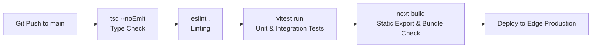

# SwimNigeria — Deployment & Operations Guide

## 1. Environment Strategy & Separation
SwimNigeria operates across two distinct environments:
1. **Local Development (`development`):** Local developer machines running Next.js dev server, connecting to local mock databases or a dedicated Supabase development branch/project.
2. **Production (`production`):** Hosted serverless edge environment on Vercel or Cloudflare Pages, connected to the production Supabase PostgreSQL instance and live email delivery.

---

## 2. Environment Variables & Secret Management

### 2.1 Variable Taxonomy
Environment variables are divided into public configuration and private server secrets:

| Variable Name | Environment | Sensitivity | Purpose |
| :--- | :--- | :--- | :--- |
| `NEXT_PUBLIC_APP_URL` | All | Public | Base URL for absolute links, OpenGraph cards, and auth redirects |
| `NEXT_PUBLIC_SITE_NAME` | All | Public | Site title branding |
| `NEXT_PUBLIC_SUPABASE_URL` | All | Public | Supabase API project endpoint |
| `NEXT_PUBLIC_SUPABASE_ANON_KEY` | All | Public (Scoped) | Scoped anonymous client key for browser Supabase client |
| `SUPABASE_SERVICE_ROLE_KEY` | Server Only | **HIGH SECRET** | Administrative bypass key used strictly in server actions/route handlers |
| `RESEND_API_KEY` | Server Only | **HIGH SECRET** | API key for transactional email delivery |
| `CONTACT_RECIPIENT_EMAIL` | Server Only | Internal | Founder email address receiving contact form inquiries |
| `NEXT_PUBLIC_WHATSAPP_NUMBER`| All | Public | Official WhatsApp telephone number with country code |
| `NEXT_PUBLIC_INSTAGRAM_HANDLE`| All | Public | Official Instagram handle |

### 2.2 Operational Security Directives
* **Never commit secrets:** Real credentials must never appear in version control.
* **Hosting Provider Secret Storage:** In production, secrets are configured via the hosting provider's dashboard (e.g., Vercel Project Settings $\rightarrow$ Environment Variables) with encryption at rest.
* **Rotation Runbook:** If a secret is exposed, immediately rotate it in the respective provider console (Supabase Dashboard or Resend Dashboard) and update the production deployment variables.

---

## 3. Build & Pre-Deployment Verification Pipeline
Every automated deployment pipeline (GitHub Actions / Vercel Build Step) must execute the following checks before shipping:

If any check fails, the build is aborted immediately and existing production traffic remains uninterrupted.

---

## 4. Hosting Constraints & Free-Tier Operational Limitations
SwimNigeria operates under a **₦0 starting budget**. Understanding free-tier quotas and their operational limitations is essential for operational stability:

### 4.1 Supabase Free Tier Constraints
* **Database Size:** 500MB storage limit (generous for tens of thousands of text records and enrollments).
* **Monthly Active Users (MAU):** Up to 50,000 active auth users.
* **Auto-Pause Policy:** Supabase pauses free-tier projects if there is zero database activity for 7 consecutive days.
  * *Operational Mitigation (Non-Guaranteed):* A scheduled health check or query ping (via a free GitHub Actions workflow or Vercel Cron) makes a lightweight read request once every 48 hours to register database query activity.
  * *Critical Operational Caveat:* This approach is an **informal operational workaround**, not a contractually guaranteed SLA or provider-supported exemption. Its ongoing effectiveness depends entirely on Supabase's active inactivity heuristics and plan policies, which are subject to change. The team must verify current provider documentation and plan limitations before relying on this mechanism.
  * *Monitoring Strategy:* Free uptime monitoring (e.g., UptimeRobot or GitHub Actions run notifications) must be configured to alert administrators to database connection failures, failed scheduled pings, or unexpected project pauses so the project can be manually unpaused via the Supabase dashboard immediately.
* **Egress Limit:** 2GB/month bandwidth. (Mitigated by hosting all heavy video on YouTube and offloading static assets to the frontend CDN).

### 4.2 Hosting Platform Constraints (Vercel / Cloudflare)
* **Vercel Hobby Tier:** Free tier intended for personal/hobby projects. Commercial projects require evaluation of Vercel's Fair Use Policy. If commercial status applies, **Cloudflare Pages** offers an unrestricted commercial free tier (unlimited requests and bandwidth).
* **Serverless Function Duration:** Maximum 10–15 seconds execution time. All server actions (grading, verification) are optimized to complete in $< 500$ms.

### 4.3 Email Delivery Constraints (Resend)
* **Free Tier Quota:** 3,000 emails/month, capped at 100 emails/day.
* *Operational Mitigation:* Rate-limiting contact submissions and deferring marketing newsletters to dedicated newsletter tools, reserving Resend strictly for transactional emails (welcome, password reset, certificate issuance).

---

## 5. Database Lifecycle, Migrations & Backup Strategy

### 5.1 Migrations Management
* Database schema changes are managed strictly through declarative, version-controlled migration files (`supabase/migrations/`).
* Schema modifications are applied sequentially and tested against a local database instance before execution on the production database.

### 5.2 Backup & Recovery Runbook
* **Automated Daily Backups:** Supabase free tier provides automated daily backups retained for 7 days.
* **Manual Snapshotting:** Before major production milestones, an administrator triggers a logical database dump (`pg_dump`) and stores the encrypted backup offsite.
* **Recovery Procedure:** In the event of catastrophic data corruption, the latest known good backup is restored via the Supabase Management Console or CLI (`pg_restore`).

---

## 6. Logging, Monitoring & Incident Response

### 6.1 Observability
* **Application Logs:** In production, runtime errors are captured via Next.js error boundaries and logged with structured context.
* **Supabase Logs:** Database query performance, authentication failures, and API status codes are monitored via the Supabase Logs Explorer.

### 6.2 Rollback Runbook
* If a critical defect or regression bypasses pre-deployment checks:
  1. Open the hosting provider console (Vercel / Cloudflare).
  2. Locate the previous successful deployment in the deployment history.
  3. Click **"Instant Rollback"** (traffic shifts immediately to the prior immutable build within seconds).
  4. Investigate the failure locally, prepare a patch, verify, and redeploy.

---

## 7. Domain Configuration & SSL
* **Domain Registration:** Target domain (e.g., `swimnigeria.org`) registered via a registrar.
* **DNS Records:**
  * Root domain (`swimnigeria.org`) configured with `A` or `ALIAS/ANAME` records pointing to edge hosting.
  * Subdomain (`www.swimnigeria.org`) configured via `CNAME` pointing to edge hosting.
* **SSL Certificates:** Automated issuance and renewal of wildcard TLS certificates managed directly by Vercel / Cloudflare with forced HTTPS redirection.
