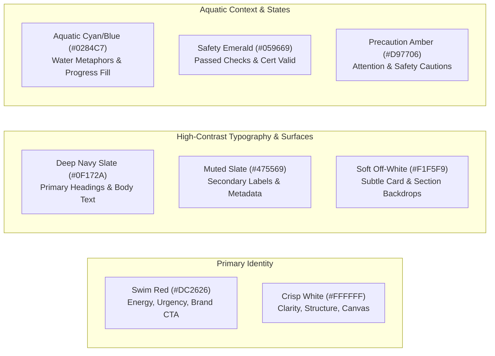

# SwimNigeria — Design System & Visual Identity

## 1. Brand Identity & Personality
SwimNigeria's visual identity balances **urgent public safety awareness** with **encouraging, empowering educational hospitality**. 

* **Tone & Demeanor:** Authoritative yet accessible; encouraging rather than intimidating; deeply educational; dignified and proudly Nigerian.
* **Core Metaphor:** The transition from water apprehension to calm, buoyant confidence.
* **Design Anti-Patterns to Avoid:**
  * Generic "AI template" aesthetics: No arbitrary purple/cyan mesh gradients, no nested card-within-card clutter, no unstyled default form controls.
  * Excessive "resort/vacation" tropes: SwimNigeria is an educational lifesaver and technique platform, not a luxury beach hotel booking site.
  * Low-contrast text on colored backgrounds: Legibility on mobile devices under harsh African sunlight is a non-negotiable usability requirement.

---

## 2. Colour Strategy & Palette Architecture
The foundational brand colors are **Red and Crisp White**. 

To deliver visual depth, prevent eye strain, and provide aquatic context, the palette incorporates deep slate neutrals and tailored aquatic accents.

### 2.1 Color Tokens & Functional Roles
* **Primary Brand Red:**
  * `brand-red-600`: `#DC2626` — Primary interactive buttons, brand accents, key urgency callouts.
  * `brand-red-700`: `#B91C1C` — Hover and active states for primary buttons.
  * `brand-red-50`: `#FEF2F2` — Soft background tint for emergency callouts and safety warnings.
* **Base & Neutral Tones:**
  * `neutral-white`: `#FFFFFF` — Primary page background and card surfaces.
  * `neutral-50`: `#F8FAFC` — Subtle alternating section background to reduce glare.
  * `neutral-200`: `#E2E8F0` — Fine border dividers for cards and form controls.
  * `neutral-700`: `#334155` — High-legibility body text (contrast ratio $> 7:1$ on white).
  * `neutral-900`: `#0F172A` — Deep navy-slate for strong headings and brand headers.
* **Aquatic Secondary Accent (Water Context):**
  * `water-blue-600`: `#0284C7` — Course progress indicators, lesson module markers.
  * `water-blue-50`: `#F0F9FF` — Information callout boxes and tips.
* **Semantic Feedback Tones:**
  * `feedback-success`: `#059669` (Dark emerald for passed assessments and valid certificates).
  * `feedback-error`: `#DC2626` (Brand red doubles as high-visibility form error).
  * `feedback-warning`: `#D97706` (Amber for review recommendations).

---

## 3. Typography & Hierarchy
Typography must be exceptionally legible across budget Android smartphones, high-DPI desktop screens, and under varied ambient lighting.

* **Primary Font Family:** **Plus Jakarta Sans** or **Inter** (modern geometric sans-serif with wide aperture, generous x-height, and optimized mobile legibility).
* **Code / Identifier Font:** **JetBrains Mono** or **Roboto Mono** (used strictly for certificate verification codes: e.g., `SN-2026-A8F9B2`).

### 3.1 Typographic Scale (Major Third - 1.25)
* **Hero / Display (H1):** `2.5rem` (40px) on desktop, `2.0rem` (32px) on mobile; Weight: 800; Line Height: 1.15; Letter Spacing: `-0.02em`.
* **Section Heading (H2):** `1.875rem` (30px) on desktop, `1.5rem` (24px) on mobile; Weight: 700; Line Height: 1.2; Letter Spacing: `-0.01em`.
* **Card / Subsection (H3):** `1.375rem` (22px); Weight: 600; Line Height: 1.3.
* **Body Large (Intro text):** `1.125rem` (18px); Weight: 400; Line Height: 1.6.
* **Body Regular (Standard content):** `1.0rem` (16px); Weight: 400; Line Height: 1.6; Color: `neutral-700`.
* **Caption / Small Metadata:** `0.875rem` (14px); Weight: 500; Line Height: 1.4; Color: `neutral-600`.
* **Micro Label:** `0.75rem` (12px); Weight: 600; Letter Spacing: `0.05em`; Text Transform: Uppercase.

---

## 4. Spacing, Layout Grid & Breakpoints

### 4.1 Spacing Scale (8pt Grid System)
* `space-1`: 4px (Fine alignments)
* `space-2`: 8px (Tight padding, badge insets)
* `space-3`: 12px (Compact form element spacing)
* `space-4`: 16px (Standard component padding)
* `space-6`: 24px (Card padding, column gaps)
* `space-8`: 32px (Section header margins)
* `space-12`: 48px (Major content block separation)
* `space-16`: 64px (Page section vertical rhythm)

### 4.2 Responsive Breakpoints
* **`sm` (Mobile Landscape / Phablet):** `640px`
* **`md` (Tablet Portrait):** `768px` (Navigation collapses to mobile drawer below this point)
* **`lg` (Laptop / Tablet Landscape):** `1024px` (Full desktop navigation and sidebar layouts)
* **`xl` (Desktop):** `1280px` (Max container width: 1200px centered)

---

## 5. Core UI Component Specifications

### 5.1 Buttons & Interactive Elements
* **Primary Button:**
  * Background: `brand-red-600` (`#DC2626`).
  * Text: `#FFFFFF`, Semi-bold (600), 15px.
  * Padding: 12px 24px (minimum touch target $48\text{px}$ height).
  * Border Radius: `8px` (clean, modern, non-pill).
  * Focus State: 2px offset ring in `brand-red-600`.
  * Hover State: `brand-red-700` (`#B91C1C`) with subtle translateY(-1px).
* **Secondary / Outline Button:**
  * Background: Transparent.
  * Border: 1.5px solid `neutral-200` (hover: `neutral-900`).
  * Text: `neutral-900`, Semi-bold (600).
* **WhatsApp Action Button:**
  * Distinct emerald accent (`#25D366`) with WhatsApp speech bubble icon, used exclusively for direct community chat actions.

### 5.2 Form Controls & Inputs
* **Input Fields:**
  * Height: 48px (accessible touch target).
  * Border: 1px solid `neutral-200`; Radius: 8px; Background: `#FFFFFF`.
  * Active/Focus: 2px border in `brand-red-600` with zero layout shift.
  * Error State: 1.5px border in `feedback-error` with descriptive error text beneath input and `aria-invalid="true"`.
  * Explicit labels above every input (`<label for="...">`), never relying solely on placeholder text.

### 5.3 Educational Cards
* **Course Card:**
  * Structure: 16:9 thumbnail ratio, category badge, course title (H3), summary (2-line clamp), duration + level pill, enrollment CTA or progress bar.
  * Border: 1px solid `neutral-200`; Radius: 12px; Elevation: Subtle 1px shadow on hover.
* **Article Card:**
  * Emphasizes headline readability, publication date, reading time estimate, and topic tags.

### 5.4 Course Player & Lesson Layout
* **Layout Structure:**
  * Desktop: 70% primary instructional area (video + rich text) + 30% sticky curriculum progress sidebar.
  * Mobile: 100% full-width lesson stream with collapsible outline drawer at bottom/top.
* **Sticky Navigation Bar:** Previous Lesson, Completion Checkbox / Button, Next Lesson.

### 5.5 Verification & Certificate Layout
* Clean border with official SwimNigeria crest/logo.
* Prominent recipient name in formal serif or distinct display face.
* Clear course title and date of completion.
* Unambiguous verification badge: "Digitally Verified Certificate — SwimNigeria ID: SN-2026-XXXXXX".
* QR Code linking directly to `https://swimnigeria.org/verify/SN-2026-XXXXXX`.
* **Mandatory Safety & Educational Disclaimer:**
  * Must be displayed prominently, legibly, and completely on both the PDF document and the public web verification page.
  * Must not be relegated to microscopic fine print or omitted on responsive mobile layouts.
  * Minimum typography sizing on PDF: 9pt / 12px; on mobile web: `text-sm` (14px) with high-contrast text (`neutral-700` on white or `slate-600` on light container).
  * **Verbatim Required Text:**
  > "Certificate of Theoretical Course Completion: This credential validates completion of digital coursework and water safety knowledge. It does not certify physical swimming competence, water survival capability, or lifeguarding qualification without practical, in-person assessment by a certified aquatic instructor."
  * Graphic ornamentation or framing must never obscure this statement. The certificate must never imply practical in-water qualification.

---

## 6. Feedback, Empty, and Loading States
* **Loading States:** Content skeleton screens matching final layout proportions (avoiding generic spinning spinners that cause cumulative layout shifts).
* **Empty States:** Encouraging illustrations and clear primary CTA (e.g., Learner Dashboard with 0 enrolled courses displays: "Your swimming journey starts today" with a button to "Explore Free Courses").
* **Error States:** Clear, plain-language guidance explaining what occurred and providing an immediate remedy button ("Try Again" or "Return to Dashboard").

---

## 7. Accessibility (WCAG 2.1 AA) & Motion Principles
* **Color Contrast:** Every text-to-background pairing strictly satisfies a 4.5:1 ratio for normal text and 3:1 for large text.
* **Focus Visible:** All interactive elements feature high-contrast keyboard focus indicators (`focus-visible:ring-2 focus-visible:ring-offset-2`).
* **Motion & Animation:**
  * Micro-transitions (150ms to 200ms ease-out) for hover and modal entries.
  * Strict respect for user system settings: `@media (prefers-reduced-motion: reduce)` disables all non-essential animated transitions.

---

## 8. Implemented UI Primitives Inventory (Phase 2A)

The following core UI primitives are implemented in `src/components/ui/` with zero third-party UI framework dependencies:

| Component | Path | Primary Props | Key Accessibility & Polish Features |
| :--- | :--- | :--- | :--- |
| **`Button`** | `src/components/ui/button.tsx` | `variant` (`primary`, `secondary`, `outline`, `ghost`, `aquatic`, `danger`), `size` (`sm`, `md`, `lg`, `icon`), `isLoading`, `loadingText` | Default `type="button"`, min $44\times 44\text{px}$ touch target, `aria-busy` during loading, active press scale (`0.98`), reduced motion support. |
| **`Input`** | `src/components/ui/input.tsx` | `label`, `error`, `helperText`, native `<input>` attributes | Auto-generated accessible ID via `useId()`, bound `<label htmlFor>`, inline error with `role="alert"`, `aria-invalid="true"`, $48\text{px}$ touch height. |
| **`Textarea`** | `src/components/ui/textarea.tsx` | `label`, `error`, `helperText`, `rows`, native `<textarea>` attributes | Auto-generated ID, bound label, inline error with `role="alert"`, `aria-describedby`, vertical resize. |
| **`Card`** | `src/components/ui/card.tsx` | `Card`, `CardHeader`, `CardTitle`, `CardDescription`, `CardContent`, `CardFooter`, `variant` (`default`, `muted`, `interactive`) | Pure Server Component, polymorphic title heading level (`as="h2" \| "h3"`), $12\text{px}$ radius, text truncation safe (`break-words`). |
| **`Badge`** | `src/components/ui/badge.tsx` | `variant` (`default`, `brand`, `aquatic`, `success`, `warning`, `outline`), `size` (`sm`, `md`) | Pure Server Component, rounded-full pill tag, high-contrast labels. |
| **`Skeleton`** | `src/components/ui/skeleton.tsx` | `className` | Pure Server Component, `aria-hidden="true"` to prevent screen reader noise, `animate-pulse` with `motion-reduce:animate-none`. |
| **`Dialog`** | `src/components/ui/dialog.tsx` | `isOpen`, `onClose`, `closeOnBackdropClick`, `DialogHeader`, `DialogTitle`, `DialogDescription`, `DialogFooter` | Native HTML5 `<dialog>` modal with browser-level focus trapping, top-layer elevation, `aria-modal="true"`, native Escape cancellation, and backdrop dismissal. |

