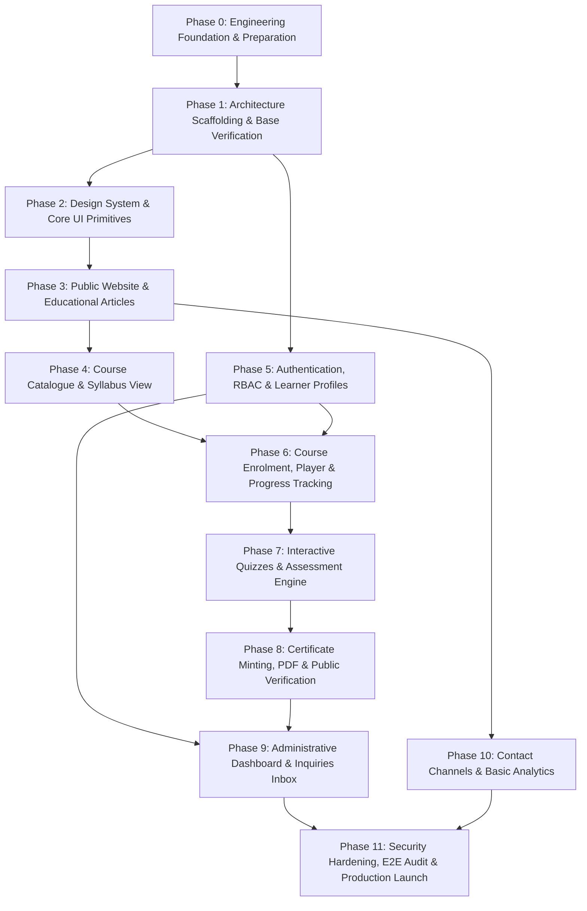

# SwimNigeria — Phased Implementation Roadmap

## 1. Roadmap Strategy & Architectural Ordering
This roadmap establishes a rigorous, dependency-aware implementation sequence for the SwimNigeria platform. Each phase represents a logically self-contained milestone with explicit prerequisites, deliverables, and measurable acceptance criteria.

> **Non-Negotiable Scope Guard:** The presence of future phases in this document does **not** grant permission to begin implementation prematurely. Development must proceed sequentially, and each phase must be verified and approved before starting the next.

---

## 2. Phase-by-Phase Breakdown

### Phase 0: Engineering Foundation & Preparation (COMPLETED)
* **Goal:** Establish engineering documentation, agent rules, coding standards, skill ecosystem, and architectural evaluation.
* **Prerequisites:** None.
* **Deliverables:**
  * Complete documentation suite in `docs/`.
  * Agent instructions in `AGENTS.md`.
  * AI skills installed and verified (`impeccable`, `supabase`, `supabase-postgres-best-practices`, `vercel-react-best-practices`).
  * Initialized Git repository with comprehensive `.gitignore` and `.env.example`.
* **Exit Criteria:** All Phase 0 documentation verified, zero application code scaffolded, and approved by project lead.

---

### Phase 1: Technology Scaffolding & Baseline Verification (COMPLETED — AWAITING REVIEW)
* **Goal:** Initialize the Next.js TypeScript project, configure tooling (ESLint, Prettier, Tailwind CSS, Vitest, Playwright, axe-core), and verify clean builds.
* **Prerequisites:** Phase 0 completion and stack sign-off.
* **Deliverables:**
  * Clean Next.js project initialization with TypeScript and App Router.
  * Tailwind CSS configuration adhering to the design system palette.
  * Baseline testing setup (Vitest, React Testing Library, Playwright, axe-core).
  * Automated quality gates: `format:check`, `typecheck`, `lint`, `test`, `test:e2e`, `build`.
* **Exit Criteria:** `npm run build`, `npm run lint`, `npm run typecheck`, `npm run test`, and `npm run test:e2e` all execute and exit with code 0.

---

### Phase 2: Design System & Core UI Primitives
* **Goal:** Construct reusable, accessible UI component primitives based on `docs/DESIGN_SYSTEM.md`.
* **Prerequisites:** Phase 1 scaffolding.
* **Deliverables:**
  * Core primitives: `Button`, `Input`, `Textarea`, `Card`, `Badge`, `Skeleton`, `Modal/Dialog`.
  * Layout containers: Responsive container, Grid, Navigation Header, Footer.
  * Mobile drawer navigation for small viewports.
* **Exit Criteria:** Primitives satisfy WCAG AA contrast ratios, render without layout shift, and support full keyboard focus navigation.

---

### Phase 3: Public Website & Educational Content Hub
* **Goal:** Build the public marketing pages and Markdown-driven educational article hub.
* **Prerequisites:** Phase 2 UI primitives.
* **Deliverables:**
  * Landing page: Hero, Mission, Water Safety Statistics, Course Preview, Testimonials/Founder Bio.
  * About Page: Story of SwimNigeria and community mission.
  * Educational Articles Directory & Article Reader (`/articles`, `/articles/[slug]`).
* **Exit Criteria:** Lighthouse Performance $> 90$, SEO OpenGraph tags valid, mobile responsive down to 320px.

---

### Phase 4: Course Catalogue & Syllabus Exploration
* **Goal:** Implement the public course showcase and syllabus detail views.
* **Prerequisites:** Phase 3 public layout.
* **Deliverables:**
  * Course catalogue grid (`/courses`) displaying launch courses with difficulty tags and duration.
  * Course syllabus view (`/courses/[courseSlug]`) detailing learning outcomes and lesson breakdown.
  * Preview lesson reader for designated preview modules.
* **Exit Criteria:** Syllabus loads cleanly without authentication; unregistered users see "Enroll" CTA with redirect.

---

### Phase 5: Authentication, RBAC & Learner Profiles
* **Goal:** Integrate Supabase Auth via SSR cookies and configure role-based access control.
* **Prerequisites:** Phase 1 scaffolding, Supabase project setup.
* **Deliverables:**
  * Auth screens: Login, Registration, Forgot Password, Reset Password.
  * Secure HTTP-only cookie session handling and PKCE flow in Next.js middleware.
  * User profile management: Legal full name (for certificates), password change.
  * `user_roles` configuration and server-side RBAC guards.
* **Exit Criteria:** Session persists across browser reloads; `/admin` routes return 404/403 for unauthorized users; zero client-side token storage.

---

### Phase 6: Course Enrolment, Lesson Player & Progress Tracking
* **Goal:** Enable learners to enroll in courses, study lessons sequentially, and track completion progress.
* **Prerequisites:** Phase 4 (Catalogue) and Phase 5 (Authentication).
* **Deliverables:**
  * One-click course enrollment Server Action with idempotency protection.
  * Interactive Lesson Player with responsive video embed facade and rich-text guides.
  * "Mark Complete & Continue" progress recalculation engine.
  * Learner Dashboard (`/dashboard`) showcasing active courses and progress bars.
* **Exit Criteria:** Progress updates persist accurately in database; unauthenticated users cannot access non-preview lessons.

---

### Phase 7: Interactive Quizzes & Assessment Engine
* **Goal:** Implement formative lesson quizzes and course-ending final assessments.
* **Prerequisites:** Phase 6 (Lesson Player & Progress).
* **Deliverables:**
  * Multiple-choice quiz interface with randomized answer shuffling.
  * Server-side grading Server Action (answer keys never sent to browser).
  * Assessment attempt history logging with score calculation and pass/fail determination.
* **Exit Criteria:** 100% server-side grading; cheating via client payload modification prevented; attempt rate-limiting verified.

---

### Phase 8: Certificate Generation & Public Verification Portal
* **Goal:** Implement automated certificate minting, PDF generation, and public verification.
* **Prerequisites:** Phase 7 (Assessments passed and 100% course completion).
* **Deliverables:**
  * Automated certificate record creation upon passing final assessment.
  * Unique verification ID generator (`SN-YYYY-[NANOID]`).
  * Serverless vector-quality PDF generation.
  * Public Verification Portal (`/verify/[certificateCode]`) accessible without login.
* **Exit Criteria:** Verification URL verifies authenticity for valid IDs and displays warning for invalid IDs; PDF renders cleanly on A4 print dimensions.

---

### Phase 9: Administrator Dashboard & Operations
* **Goal:** Empower the founder to oversee platform metrics, inspect learner records, and review contact messages.
* **Prerequisites:** Phase 5 (RBAC), Phase 6 (Enrollments), Phase 8 (Certificates).
* **Deliverables:**
  * Admin metrics overview: Total learners, enrollments, completion rates, certificates issued.
  * Learner inspection table with enrollment and assessment score drill-downs.
  * Inquiries inbox for website contact form submissions.
* **Exit Criteria:** Accessible strictly to users with verified `admin` role in database; audit log entries recorded for administrative actions.

---

### Phase 10: Multi-Channel Contact & Basic Analytics
* **Goal:** Implement validated contact form, direct social channels, and privacy-respecting analytics.
* **Prerequisites:** Phase 3 public layout.
* **Deliverables:**
  * Validated contact form with server-side Zod validation and email notification (Resend API).
  * WhatsApp click-to-chat deep link with pre-formatted inquiry text.
  * Instagram profile direct link.
  * Privacy-respecting event logging (page views, enrollments, certificate downloads).
* **Exit Criteria:** Form submissions recorded in database and notified via email; zero third-party cross-site cookies.

---

### Phase 11: Security Hardening, E2E Audit & Production Launch
* **Goal:** Comprehensive quality assurance, security penetration testing, and production deployment.
* **Prerequisites:** All prior phases completed.
* **Deliverables:**
  * Full E2E Playwright test suite execution across all critical user journeys.
  * Accessibility audit (axe-core WCAG 2.1 AA validation).
  * Low-bandwidth performance optimization and bundle size audit.
  * Production deployment to edge hosting (Vercel / Cloudflare).
  * Custom domain configuration and SSL verification.
* **Exit Criteria:** Zero critical vulnerabilities, Lighthouse Performance and Accessibility $> 90$, 100% green test suite, live verification URL functional.
