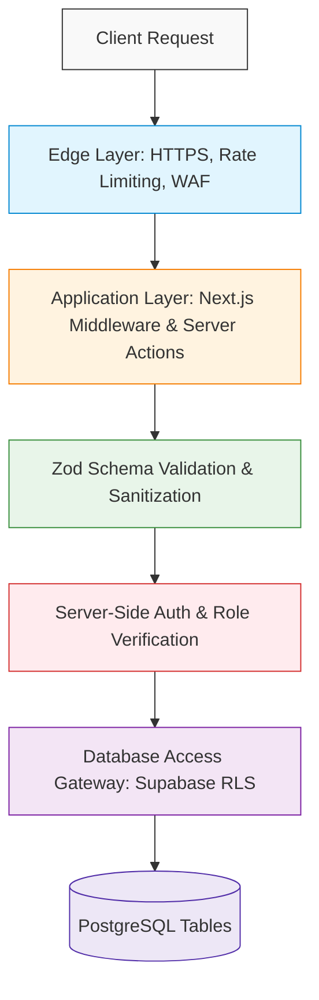

# SwimNigeria — Security Architecture & Guidelines

## 1. Core Security Principles & Threat Model
Security for SwimNigeria is predicated on a **Zero-Trust Client** model:
1. **Never Trust the Browser:** All authorization, assessment evaluation, certificate minting, and data mutations must be validated and executed strictly on the server.
2. **Defense-in-Depth:** Security controls are layered across the edge CDN, Next.js server middleware, server action logic, and database row-level security (RLS).
3. **Frontend UI Hiding is Not Security:** Hiding an "Admin" link, disabling a button, or checking a role only in React components provides zero actual security. Every privileged route and server action must perform an authoritative server-side permission check.



---

## 2. Authentication & Session Security

### 2.1 Credential & Password Security
* **Hashing Standards:** Passwords managed by Supabase Auth are salted and hashed using Argon2 or bcrypt with industry-standard work factors.
* **Complexity Requirements:** Minimum 8 characters; client and server validation requiring a combination of letters and digits.
* **Brute-Force & Credential Stuffing Defense:** Automated rate limiting and exponential backoff on consecutive failed login attempts.

### 2.2 Session Management
* **Transport & Storage:** Authentication tokens (JWTs and refresh tokens) must be stored strictly in **`HttpOnly`**, **`Secure`**, **`SameSite=Lax`** cookies. Storing access tokens in browser `localStorage` or `sessionStorage` is strictly prohibited to prevent token exfiltration via Cross-Site Scripting (XSS).
* **Flow Mechanism:** Utilization of the **PKCE (Proof Key for Code Exchange)** authentication flow for all auth redirects and OAuth callbacks.
* **Revocation & Invalidation:** User sign-out triggers immediate server-side session revocation in Supabase Auth, clearing the session cookies.

---

## 3. Authorisation & Role-Based Access Control (RBAC)

### 3.1 Role Verification Rule
* **Mandatory Rule:** In Supabase, `raw_user_meta_data` is editable by end-users. Therefore:
  * **NEVER** use `user_metadata` for authorization decisions.
  * Roles must be determined by querying the authoritative `user_roles` database table or reading verified `app_metadata` claims injected by administrative triggers.

### 3.2 Administrator Permission Enforcement
* Every administrative route under `/admin/*` must be intercepted by Next.js middleware, and every administrative Server Action must re-verify the caller's role against `user_roles` before executing:
  ```typescript
  // Conceptual Guard Pattern
  const { data: userRole } = await supabase
    .from('user_roles')
    .select('role')
    .eq('user_id', user.id)
    .single();

  if (userRole?.role !== 'admin') {
    throw new UnauthorizedError('Administrative privileges required.');
  }
  ```

---

## 4. Database Access & Row-Level Security (RLS)

### 4.1 Mandatory RLS on Every Table
* Every table in the public PostgreSQL schema must have Row-Level Security enabled:
  ```sql
  ALTER TABLE [table_name] ENABLE ROW LEVEL SECURITY;
  ```
* Direct database queries originating from client connections utilize the scoped `anon` or `authenticated` roles, which automatically filter row visibility based on the requesting `auth.uid()`.

### 4.2 Service Role Key Protection
* The Supabase `SUPABASE_SERVICE_ROLE_KEY` has full administrative power to bypass all RLS policies.
* **Strict Constraint:** This key must **never** be prefixed with `NEXT_PUBLIC_` and must **never** be bundled into client-side code. It may only be utilized within secure server-only route handlers or trusted server actions for system tasks (e.g., automated certificate generation upon grading).

---

## 5. Input Validation, Sanitization & Injection Defense

### 5.1 Strict Runtime Schema Validation
* All data ingested through Server Actions, Route Handlers, or contact forms must be validated against a strict **Zod** schema.
* Inputs must strip unexpected properties and enforce reasonable length constraints:
  * Name: 2–100 characters.
  * Email: valid RFC 5322 format, max 255 characters.
  * Contact message: 10–2000 characters.

### 5.2 SQL & NoSQL Injection Prevention
* All queries must utilize parameterized SQL statements via the Supabase client library or typed ORM. Concatenating raw user strings into SQL queries is completely banned.

### 5.3 Cross-Site Scripting (XSS) Mitigation
* React automatically escapes variables in JSX. When rendering Markdown content (articles or lesson text), a strict, sanitized parser (e.g., `rehype-sanitize`) must be utilized with a strict allowlist of HTML tags (`<p>`, `<h3>`, `<ul>`, `<code>`, `<blockquote>`). Raw `dangerouslySetInnerHTML` is prohibited unless passed through audited sanitization.

---

## 6. Assessment Integrity & Anti-Cheating Architecture

1. **Server-Side Grading:** The correct answer flags (`question_options.is_correct`) and answer explanations are **never** delivered to the client during an assessment.
2. **Submission Payload:** The client submits only an array of `{ questionId, selectedOptionId }`. The server performs the comparison against the database answer key, calculates the score, and logs the attempt.
3. **Attempt Cooldown & Throttling:** Rapid-fire automated submissions are throttled (minimum 10 seconds between start and submit; maximum 1 submission attempt per 15 minutes after a failure).

---

## 7. Certificate Issuance, Tamper-Resistance & Verification Security

1. **Unique Non-Sequential Identifiers:** Certificate numbers use a structured public prefix (`SN-YYYY-`) combined with a cryptographically generated, high-entropy NanoID (e.g., `SN-2026-X9K2P8`).
2. **Public Verification Access & Anti-Leakage Controls:**
   * Public URL `/verify/[code]` verifies certificate authenticity without requiring the visitor to log in.
   * **Strict Public Field Allowlist:** The verification response must expose strictly and exclusively the minimum fields needed to validate authenticity:
     * `certificate_number`
     * `recipient_name`
     * `course_title`
     * `issue_date`
     * `is_revoked`
   * **Explicitly Prohibited Leakage:** The public endpoint and database queries must **NEVER** return:
     * Internal user UUIDs or `user_id`
     * Internal database record primary keys (`id`)
     * Private cloud storage paths or `pdf_url`
     * Email addresses, phone numbers, or profile metadata
     * Authentication session information or internal timestamps
   * **Query Enforcement:** Direct `SELECT *` on the `certificates` table for public queries is strictly prohibited. Public access must be mediated through an explicit column projection in a trusted server action or a dedicated, secure database view (e.g., `public_certificate_verifications`).
   * **RLS & View Isolation:** The underlying `certificates` table must remain protected by Row-Level Security so public `anon` callers cannot enumerate or inspect raw table rows directly.
3. **Data Snapshot Immutability:** The student's legal name, course title, and completion date are permanently snapshotted in the database record at the moment of issuance. Future profile name updates do not alter previously earned certificates.
4. **Revocation Support:** The schema includes `is_revoked` and `revocation_reason`. If a certificate was issued fraudulently or in error, an administrator can mark it revoked, immediately updating the public verification page with a clear revocation notice.
5. **Required Verification Security Tests (Phase 8 Implementation Gate):**
   * *Unauthorized Field Test:* Assert that querying the public verification endpoint never returns `user_id`, `id`, `pdf_url`, or email.
   * *Unknown Code Test:* Assert that querying a non-existent or malformed verification code returns a clean 404 / "Invalid Certificate" without database error leaks.
   * *Revoked Certificate Test:* Assert that a revoked certificate displays `is_revoked: true` and revocation warning.
   * *Valid Certificate Test:* Assert that an authentic certificate returns exactly the 5 allowlisted fields and verifies successfully.

---

## 8. Rate Limiting & Denial-of-Service Defense
* **Contact Inquiries:** Max 3 submissions per IP per 10 minutes.
* **Authentication Endpoints:** Max 5 failed login attempts per IP/email per 15 minutes before exponential delay.
* **Public Certificate Verification:** Max 30 lookups per IP per minute (to prevent brute-force certificate code enumeration).

---

## 9. Personal Information & Nigerian Data Privacy (NDPR) Compliance
* **Data Minimization:** Collect only necessary fields (Name, Email, optional Phone). Never store unnecessary sensitive personal details.
* **Right to Erasure (Soft Delete Anonymization):** When an account is deleted, personal identifying information (email, phone, name) is redacted or anonymized, while non-identifiable completion metrics and certificate hashes remain intact for institutional integrity.
* **Encrypted Transmission:** 100% of traffic forced over HTTPS with modern TLS 1.3/1.2 ciphers.

---

## 10. Secrets Management & Operational Security
* **Zero Hardcoded Secrets:** All API keys, database URLs, and service credentials must reside in environment variables.
* **Git Hygiene:** `.gitignore` explicitly prevents committing `.env`, `.env.local`, or certificate keys.
* **Secret Rotation:** If any credential is accidentally exposed, it must be rotated immediately in the respective third-party console (Supabase, Resend, Vercel).
* **Dependency Auditing:** Automated `npm audit` run as part of CI checks. Only reputable, actively maintained dependencies with zero known vulnerabilities may be added.
