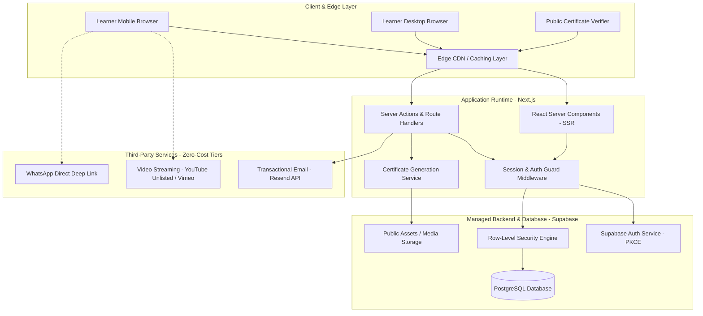
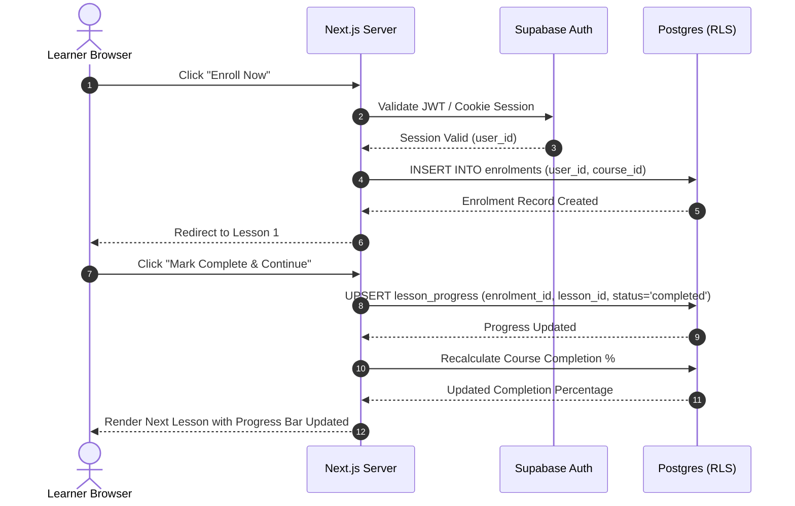
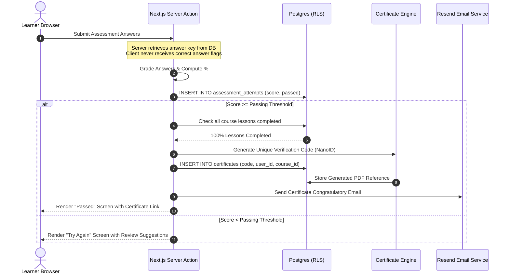

# SwimNigeria — System Architecture

## 1. Architectural Overview & Vision
The SwimNigeria architecture is designed to deliver a high-performance, resilient, and secure educational platform on a **₦0 starting budget** while remaining strictly capable of enterprise-scale expansion.

Key architectural priorities:
1. **Low Latency for Nigerian Networks:** Fast initial page loads and minimal JavaScript payloads for learners on metered 3G/4G connections.
2. **Strict Security Posture:** Server-enforced authentication, database row-level security (RLS), and zero-trust data access patterns.
3. **Decoupled Modularity:** Clean separation between static educational content, dynamic course progression, transactional state, and public verification.
4. **Zero-Cost Sustainability:** Complete avoidance of expensive server overhead by utilizing generous serverless and edge hosting tiers.

---

## 2. Evaluation of Architectural Subsystems

### 2.1 Frontend Architecture
* **Evaluated Options:**
  1. *React Single-Page Application (Vite + React Router):* Fast build times, simple hosting. **Weakness:** Poor SEO for public articles and courses; heavy initial JavaScript bundle on slow mobile connections; slower time-to-content.
  2. *Next.js (App Router, Server Components):* Server-Side Rendering (SSR) for SEO-critical pages, streaming HTML for instant rendering on mobile, zero client-side JavaScript for static content, built-in image optimization and routing.
  3. *Astro:* Extremely fast for content, but more complex when deeply integrating dynamic authenticated dashboards and interactive assessment engines.
* **Architecture Decision:** **Next.js (App Router) with React Server Components (RSC).**
  * Public marketing pages, course syllabi, and educational articles are rendered on the server as lightweight static/cached HTML.
  * Interactive elements (lesson toggles, quiz engines, video player controls) are isolated as granular Client Components (`"use client"`).

---

### 2.2 Server-Side Application Logic
* **Evaluated Options:**
  1. *Standalone Express/Fastify API Server:* Requires dedicated VPS hosting (incurring recurring monthly costs) or complex container setups.
  2. *Next.js Server Actions & Route Handlers:* Colocated within the Next.js runtime, executing in serverless Node.js/Edge environments at zero base cost.
* **Architecture Decision:** **Next.js Server Actions for mutations + Route Handlers for webhooks and certificate streaming.**
  * Server Actions provide type-safe RPC without exposing separate public REST endpoints for internal form and assessment mutations.
  * Zod schemas validate all inputs server-side before database operations.

---

### 2.3 Database Engine
* **Evaluated Options:**
  1. *SQLite / Turso:* Simple, but lacks mature relational ecosystem, extensions, and built-in row-level security for multi-tenant learning progress.
  2. *PostgreSQL (Managed via Supabase):* Battle-tested relational database, ACID compliant, native JSONB support for quiz structures, robust extension ecosystem (`uuid-ossp`, `pgcrypto`), and native Row-Level Security (RLS).
* **Architecture Decision:** **PostgreSQL hosted via Supabase Free Tier.**
  * Schema-enforced data integrity.
  * Native Row-Level Security (RLS) ensures data isolation directly at the database engine level.

---

### 2.4 Authentication & Session Management
* **Evaluated Options:**
  1. *NextAuth.js (Auth.js) with custom database adapter:* High flexibility, but requires maintaining authentication tables, password hashing, and token refresh mechanisms manually.
  2. *Supabase Auth with `@supabase/ssr`:* Turnkey authentication engine supporting email/password, magic links, OAuth (Google), and secure HTTP-only cookie session handling with PKCE flow.
* **Architecture Decision:** **Supabase Auth integrated via `@supabase/ssr`.**
  * Secure server-side session exchange via encrypted, HTTP-only cookies.
  * Token refresh handled transparently by Next.js middleware.
  * Avoids storing sensitive authentication tokens in browser `localStorage`.

---

### 2.5 Authorisation & Access Control
* **Model:** **Multi-Tier Defense-in-Depth.**
  1. *Edge / Middleware Layer:* Next.js Middleware checks session validity and intercepts unauthorized access to `/dashboard/*` or `/admin/*`.
  2. *Application Layer (Server Actions):* Server Actions re-verify the caller's role against the database before executing privileged actions.
  3. *Database Layer (RLS):* PostgreSQL Row-Level Security policies evaluate `auth.uid()` and enforce that learners can only read/mutate their own records, while administrators have elevated policy permissions.

---

### 2.6 Educational Content Management
* **Architecture:** **Hybrid Headless Model.**
  * *Static Articles & Guides:* Structured Markdown files with typed frontmatter for fast editorial review, version-controlled in the repository.
  * *Course Curricula & Syllabus:* Structured relational records in PostgreSQL (`courses`, `lessons`, `resources`), enabling dynamic lesson ordering, status toggling, and progress recalculation.

---

### 2.7 Video Delivery Strategy
* **Evaluated Options:**
  1. *Direct S3 / Storage Hosting:* Cost-prohibitive; video egress fees exceed the ₦0 budget within days.
  2. *Dedicated Video Infrastructure (Mux / Cloudflare Stream):* High quality, but requires upfront credit card billing and usage charges beyond free tiers.
  3. *Unlisted YouTube Embeds / Vimeo Free with Privacy Wrappers:* Completely free bandwidth, globally distributed CDN, adaptive bitrate streaming (crucial for Nigerian mobile networks where bandwidth fluctuates between 2G, 3G, and 4G).
* **Architecture Decision:** **Unlisted YouTube Embeds with Custom Privacy-Enhanced Facades.**
  * Videos are embedded using `lite-youtube-embed` or custom lazy-loaded iframes to eliminate third-party tracking scripts until user clicks play.
  * Preserves 100% of user data and incurs zero video hosting bandwidth costs.

---

### 2.8 Transactional Email Delivery
* **Evaluated Options:**
  1. *Generic SMTP (Gmail):* High rate of spam classification, fragile connection limits.
  2. *Resend:* Modern developer-first email platform with a generous free tier (3,000 emails/month, 100 emails/day), excellent deliverability, and native React Email template support.
* **Architecture Decision:** **Resend API.**
  * Handles welcome emails, password resets, inquiry confirmations, and certificate notifications.

---

### 2.9 Certificate Generation & Verification Engine
* **Generation Strategy & Runtime Compatibility:**
  * When a learner completes all lessons and passes the final assessment, the system generates a tamper-evident digital certificate.
  * **Runtime Compatibility Requirement:** `@react-pdf/renderer` must **not** be assumed to execute in every edge runtime. The selected PDF generation strategy must be strictly compatible with the actual hosting runtime and supported platform APIs:
    * *Node.js Serverless Runtime (e.g., Vercel Serverless Functions):* `@react-pdf/renderer` or serverless headless rendering can be utilized, provided Node.js stream and font engine dependencies are verified prior to implementation.
    * *Edge / Workers Runtime (e.g., Cloudflare Pages / Workers):* Heavy Node-dependent libraries fail in V8 isolate edge workers. If a Workers-based edge runtime is selected, an edge-compatible alternative such as **`pdf-lib`** (pure JavaScript without native Node stream dependencies) or client-side SVG-to-canvas rendering must be evaluated and verified against the required certificate visual features.
    * **Linked Architecture Decision:** Hosting environment selection and PDF generation implementation are treated as a **coupled architecture decision** that must be finalized together before Phase 8 (Certificate Generation) implementation begins. The project is not locked into a single provider prematurely.
  * The certificate is cryptographically signed with a unique verification code (`SN-YYYY-[NANOID]`) and verified against database records.
* **Verification Strategy:**
  * Public verification route `/verify/[code]` queries the database certificate record directly.
  * Renders verification confirmation with student name, course title, issuance timestamp, authenticity badge, and the mandatory theoretical completion disclaimer without requiring login.

---

### 2.10 Hosting & Deployment Infrastructure
* **Hosting Platform:** **Vercel Hobby Tier or Cloudflare Pages.**
  * Global edge network, automatic preview deployments, zero-configuration Next.js SSR support.
  * Commercial use considerations analyzed in `docs/TECHNOLOGY_EVALUATION.md`.

---

## 3. Data Flow Diagrams

### 3.1 Learner Enrolment & Lesson Completion Flow

### 3.2 Assessment Submission & Certificate Issuance Flow

---

## 4. Network & Low-Bandwidth Optimizations for Nigeria
Given local telecommunications infrastructure in Nigeria:
* **Aggressive Asset Caching:** All static assets (fonts, icons, course images) served with immutable cache headers via CDN edge.
* **Lazy Media Loading:** Video players are never embedded on initial page load; lightweight image facades are rendered first, loading the heavy iframe only upon explicit user interaction.
* **Optimized Font Strategy:** Self-hosted variable fonts (WOFF2 format) with latin subsetting to prevent rendering delays.
* **Client Payload Budget:** Strict budget of $< 120\text{KB}$ gzipped JavaScript for public routes.
