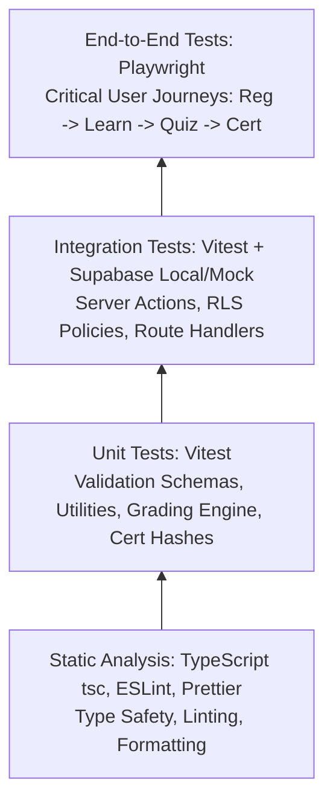

# SwimNigeria — Quality Assurance & Testing Strategy

## 1. Testing Philosophy & Verification Cadence
Quality assurance for SwimNigeria ensures that learners on fragile connections experience a resilient, bug-free, and accessible educational platform.

* **Verification Cadence:** Verification must be executed after **each logically complete unit of work** (e.g., implementing an enrollment action, building a form component, or adding a utility function), rather than blindly executing full E2E suites after every single line of code.
* **Honest Reporting Standard:** Agents and engineers must explicitly state what was tested, what passed, what failed, and what remains untested. Never claim that untested code works.
* **Testing Pyramid:** High density of fast, deterministic unit and integration tests, supported by focused end-to-end (E2E) smoke tests for critical user journeys.



---

## 2. Testing Layers & Tooling

### 2.1 Static Analysis & Type Checking
* **Tooling:** TypeScript (`tsc --noEmit`), ESLint, Prettier.
* **Scope:** 100% of TypeScript codebase.
* **Standards:**
  * Strict mode enabled (`noImplicitAny`, `strictNullChecks`).
  * Zero linting warnings in CI.
  * Explicit return types on server actions and public API helpers.
* **When to Run:** Before committing or after modifying TypeScript types and components.

---

### 2.2 Unit Testing
* **Tooling:** **Vitest**.
* **Scope:**
  * Input validation schemas (Zod parsers for contact forms, auth inputs, profile updates).
  * Pure business logic: Assessment scoring algorithms, percentage calculations.
  * Certificate code generation: Formatting, entropy, and uniqueness validators.
  * Date/time formatters, reading time estimators, and text sanitizers.
* **Target Coverage:** $> 90\%$ code coverage for pure utility and business logic modules.
* **When to Run:** After authoring or refactoring helper functions and validation schemas.

---

### 2.3 Integration & Database Access-Control Testing
* **Tooling:** **Vitest** with test database or transactional rollback mocks.
* **Scope:**
  * Server Actions: Verifying enrollment creation, lesson progress updates, and profile saves.
  * **Row-Level Security (RLS) Verification:**
    * Asserting that a learner cannot read another learner's enrollment or progress.
    * Asserting that unauthenticated users cannot access restricted course lessons.
    * Asserting that non-admin users cannot write to `courses` or read `audit_logs`.
  * Server-side grading: Submitting valid and invalid answer payloads, verifying score calculation and attempt logging.
* **When to Run:** After modifying server actions, database queries, or security rules.

---

### 2.4 End-to-End (E2E) Testing
* **Tooling:** **Playwright**.
* **Core User Journeys Tested:**
  1. **New Learner Journey:** Registration $\rightarrow$ Email confirmation $\rightarrow$ Course browsing $\rightarrow$ Course enrollment $\rightarrow$ Reading Lesson 1.
  2. **Curriculum Completion & Certification Journey:** Completing all lessons $\rightarrow$ Submitting passing assessment answers $\rightarrow$ Unlocking certificate $\rightarrow$ Downloading PDF.
  3. **Public Verification Journey:** Visiting `/verify/[code]` with valid ID (asserting valid display) and with an invalid ID (asserting tamper/not found warning).
  4. **Contact Submission Journey:** Filling out web inquiry form $\rightarrow$ Verifying success confirmation and rate-limiting trigger on repeated submits.
* **When to Run:** Prior to merging milestone pull requests and before production deployments.

---

### 2.5 Accessibility (a11y) & Contrast Testing
* **Tooling:** **axe-core / `@axe-core/playwright`** and manual keyboard tab-navigation audits.
* **Standards:** Strict **WCAG 2.1 Level AA** compliance.
* **Checkpoints:**
  * All interactive elements have discernible text or `aria-label`.
  * Color contrast meets minimum 4.5:1 for body copy and 3:1 for large headers.
  * Form inputs are explicitly associated with `<label>` tags.
  * Focus indicators are visible during keyboard-only navigation (`Tab`, `Shift+Tab`, `Enter`, `Space`).
  * Headings follow a strict logical hierarchy (`H1` $\rightarrow$ `H2` $\rightarrow$ `H3`).

---

### 2.6 Responsive & Low-Bandwidth Testing
* **Viewport Matrix:**
  * Mobile Small: 360px (e.g., Galaxy A series, common in Nigeria).
  * Mobile Medium: 390px (iPhone standard).
  * Tablet: 768px (iPad portrait).
  * Desktop: 1280px / 1440px.
* **Bandwidth Throttling:** Chrome DevTools "Fast 3G" and "Slow 4G" emulation to verify that page layouts do not jump (CLS $< 0.1$) and interactive buttons remain functional while assets stream.

---

## 3. Pre-Deployment Verification Gate

> **Phase 1 Implementation Note:** The following npm lifecycle and verification scripts define the mandatory automated quality gates to be configured in `package.json` during Phase 1 (Technology Scaffolding & Baseline Verification). They are not executable in Phase 0 prior to package initialization.

Before any code is deployed or merged into `main`, the following verification pipeline must pass without errors:

```bash
# 1. Type check
npm run typecheck    # tsc --noEmit

# 2. Lint check
npm run lint         # eslint .

# 3. Unit and integration tests
npm run test         # vitest run

# 4. Production build check
npm run build        # next build (verifies static generation and bundling)
```

---

## 4. Defect Reporting & Untested Path Disclosure
Whenever a verification step encounters an error or when certain paths cannot be tested locally:
1. **Document the Error:** Record the exact command executed, terminal exit code, and error trace.
2. **Disclose Limitations:** If an external service cannot be tested (e.g., live email delivery via Resend without production API keys), explicitly state: *"Email sending was mocked and verified with mock payloads; live network delivery to external inboxes remains unverified."*
3. **Never Guess or Assume:** An unverified test must never be reported as passing.
